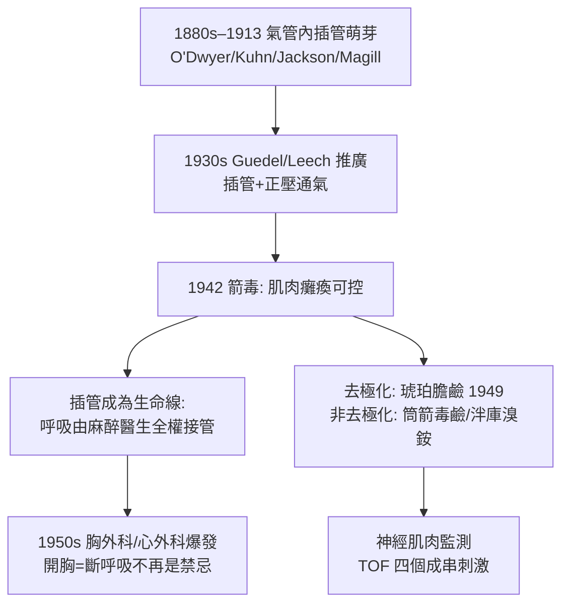

## 1942 - 箭毒與肌肉鬆弛劑（南美獵人的毒藥，如何完成外科的第三次革命）

## 案件摘要

**本案偵破了外科史上的「肌肉之牆」：1942 年 1 月 23 日，加拿大蒙特婁的 Harold Griffith 以箭毒（curare）使外科病人肌肉癱瘓——腹部手術不再需要「麻醉到深得快死」才能鬆開腹肌，平衡麻醉時代自此開啟。**

1942 年 1 月 23 日，蒙特婁家醫院（Montreal Homeopathic Hospital）。麻醉醫生**哈羅德·格里菲斯（Harold Griffith）**與助手 Enid Johnson，以從亞馬遜狩獵毒箭提純的**箭毒（Intocostrin，Squibb 產品）**配合環丙烷麻醉，為一名闌尾切除病人進行肌鬆——手術醫生驚呼腹肌從未如此鬆弛。Griffith 在行醫前曾親自注射箭毒確認其安全性，並系統試用於 25 位病人後發表論文。**肌肉鬆弛劑**正式進入手術室，麻醉學迎來與乙醚（1846）、無菌術（1867）並稱的第三次革命。

## 前因 -- 為什麼會有這個案子

- **深麻醉的死亡代價**。在箭毒之前，腹部手術要求第三期三至四級（見 `1920-格德爾麻醉分期.md`）——深到肋間肌麻痺，常常貼近呼吸循環衰竭的第四期。「麻得夠深才能鬆」等於「鬆就要冒死」。
- **南美的百年毒物學積累**。箭毒是亞馬遜原住民的狩獵毒（使獵物窒息而死），16 世紀起被歐洲記錄；英國生理學家 Claude Bernard（1856）以經典實驗證明其作用點在**神經肌肉接頭**——它麻痺肌肉但不麻痺神經，是生理學「接觸點定位」的教學典範。
- **Richard Gill 的關鍵中介**。1930 年代，美國人 Richard Gill 深入厄瓜多收集箭毒原料，說服 Squibb 投入研究；藥廠將其開發為兩個藥理身份：神經科解痙劑（治療破傷風、痙攣）與麻醉輔助劑——後者由 Griffith 驗證。
- **解剖與生理的預備知識**。1930–40 年代神經肌肉接頭的乙醯膽鹼傳遞機轉已被闡明（Dale、Loewi），「阻斷 N-ACh 受體→肌肉鬆弛」的理論通路已經打通。

## 線索與推理 -- 數學式、程式、理論

**線索一：Bernard 的定位實驗——因果的顯微鏡。** 1856 年 Claude Bernard 將箭毒注射於蛙的腿部動脈並結紮對側——只有同側麻痺，證明藥物作用於**肌肉與神經之間的接點**而非中樞：

$$ \text{箭毒} \Rightarrow \text{競爭性佔據 } N_2\text{-ACh 受體} \Rightarrow \text{終板電位不足以觸發動作電位} \Rightarrow \text{骨骼肌癱瘓（意識與痛覺不變！）} $$

最後一個括號是本案最危險的真相：箭毒**只麻肌肉、不麻意識與痛覺**——它必須與鎮靜鎮痛藥合用，否則病人將在完全清醒中癱瘓（這正是日後「術中知曉」悲劇的藥理根源，見 `1996-BIS麻醉深度監測.md`）。

**線索二：Griffith 的安全驗證鏈。** 本案符合麻醉「自體實驗→動物→病人→發表」的傳統流程：

| 步驟 | 操作 | 意義 |
|---|---|---|
| 1 | Griffith 自注箭毒觀察 | 安全性自體驗證 |
| 2 | 氣管內插管＋人工呼吸備妥 | 呼吸管理是生命線 |
| 3 | 25 例系統使用 | 病例系列可發表 |
| 4 | 1942 年 *Anesthesiology* 論文 | 公開可重複 |

其中第 2 步常被忽略卻是成敗關鍵：**箭毒的臨床化必須先解決呼吸支持**——所幸 1930 年代 Arthur Guedel 與 Leech 已推廣氣管內插管與人工通氣技術（見下「氣管內插管線」），箭毒趕上了呼吸管理的成熟期。

**線索三：氣管內插管的平行偵查。** 肌鬆劑與插管是共生技術：

**線索四：去極化與非去極化的雙子星。** 1949 年後，琥珀膽鹼（suxamethonium，超短效去極化劑）與合成非去極化劑（筒箭毒鹼、泮庫溴銨、羅庫溴銨）構成現代肌鬆武器庫；臨床以**四個成串刺激（TOF）**監測神經肌肉傳導：

$$ \text{TOF 比值} = \frac{T_4}{T_1} \geq 0.9 \Rightarrow \text{殘餘肌鬆可安全拔管} $$

**線索五：知曉悲劇的種子。** 平衡麻醉把劑量從「深到麻醉肌肉」降為「淺麻醉＋肌鬆」——若鎮靜鎮痛不足而肌鬆足量，病人清醒但無法呼救。1940–70 年代累積的術中知曉案件，最終催生了麻醉深度監測科學（見 `1996-BIS麻醉深度監測.md`）與 ASA 知曉實務指引（2006）。

## 結案 -- 後果與影響

- **外科領域的全面解鎖**。胸腔、腹腔、顱底、心臟手術在「淺麻醉＋可控肌鬆＋呼吸管理」的架構下爆發式發展——1953 年 Gibbon 人工心肺機完成首例體外循環手術，沒有肌鬆劑與插管技術不可能實現。
- **麻醉醫生成為「呼吸的主人」**。人工通氣、氣道管理、ICU 呼吸治療——現代重症醫學的技術源頭大半出自麻醉科；COVID 時代的呼吸治療隊伍正是這條血脈。
- **原住民知識的致敬與爭議**。箭毒的開發是「民族植物學→現代藥物」的典範，也啟動了後世對原住民知識產權的長期反思。
- **一句話結案**：獵人為殺死獵物而發明的毒藥，被醫生反轉為「讓病人安全的鬆弛術」——關鍵在於把「麻痺」拆解為**可選擇的元件**：只麻肌肉、不麻意識，且隨時可被新斯的明逆轉。

## 關鍵人物與文獻

- **Harold Griffith（1894–1963）**——加拿大麻醉先驅，1942 年箭毒臨床化，後任加拿大麻醉學會首任主席。
- **Enid Johnson**——助手與共同作者，麻醉史上少見的早期女性破案者。
- **Claude Bernard（1813–1878）**——箭毒作用點定位（1856），實驗醫學方法論的奠基者。
- **Richard Gill（1901–1945）**——厄瓜多箭毒採集者，本案的「情報掮客」。
- 現代註腳——羅庫溴銨＋蘇佳馬剋（sugammadex，2008）實現「數分鐘內完全逆轉肌鬆」，箭毒時代的「等藥物自己代謝」被終結；肌鬆殘餘（PRC）至今仍是手術室安全的稽核重點。
