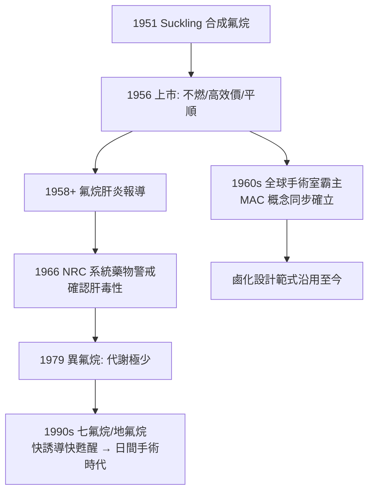

## 1956 - 氟烷吸入麻醉革命（不爆炸的麻醉藥，讓手術室告別火與煙）

## 案件摘要

**本案偵破了吸入麻醉的「安全化改造」工程：1956 年，英國 ICI 公司的氟烷（halothane）上市——第一個非爆炸性、不刺激呼吸道、效價極高的鹵化揮發性麻醉藥，現代揮發性麻醉藥的直系祖先。**

1951 年，帝國化學工業（ICI）化學家 **Charles Suckling** 在尋找「不燃、有效、代謝穩定」的麻醉分子時合成 **2-溴-2-氯-1,1,1-三氟乙烷（halothane，Fluothane）**；1953 年 Michael Johnstone 在曼徹斯特完成大規模臨床評估，1956 年發表贊美論文並上市。氟烷 MAC 僅 0.75%（效價約為乙醚 2.5 倍）、不燃爆、氣味宜人、誘導平順——它幾乎解決了乙醚與氯仿的所有缺點。整個 1960–70 年代氟烷統治全球手術室，直到 1980 年代被異氟烷等新一代藥物接力（見下），但「鹵化改造」的設計思路沿用至今。

## 前因 -- 為什麼會有這個案子

- **爆炸是手術室的日常噩夢**。乙醚與環丙烷高度易燃，1940–50 年代美國每年都有手術室爆炸事故（靜電火花即足以引爆）；「防靜電鞋、導電地板、禁明火」成為手術室規矩——麻醉藥的安全問題成為基礎設施問題。
- **氯仿的心臟毒性教訓**（見 `1847-辛普森氯仿與產科麻醉.md`）——新藥必須兼顧心、肝、腎安全。
- **氟化學的戰後爆發**。二戰中的曼哈頓計畫（鈾六氟化物）與冷戰化學使鹵化技術與氟化物化學大規模成熟——麻醉藥的設計直接受惠於核時代的化學工業。
- **定量麻醉的成熟**。MAC 概念（Merkel 與 Eger，1960 年代）與吸入麻醉藥理學（Edmond Eger 的教科書）為新一代藥物提供了評估標尺。

## 線索與推理 -- 數學式、程式、理論

**線索一：鹵化改造的分子偵查。** Suckling 的推理是：以氟取代氫→**降低可燃性**（C–F 鍵極穩定）；以溴取代氯→**提高麻醉效價**（重鹵素增強脂溶性與受體作用）：

$$ CF_3{-}CHBrCl \;\Rightarrow\; \begin{cases} \text{F 取代} \Rightarrow \text{不可燃} \\ \text{Br 取代} \Rightarrow \text{MAC} \approx 0.75\% \text{（高效價）} \\ \text{血/氣係數 } 2.4 \Rightarrow \text{誘導比乙醚（12）快 5 倍} \end{cases} $$

這一「結構—可燃性—效價—溶解度」的四維設計，成為此後所有揮發性麻醉藥（恩氟烷、異氟烷、七氟烷、地氟烷）的藍圖。

**線索二：分配係數與臨床可控性。** 吸入麻醉的「快慢」由兩個分配係數決定（見 `1540-乙醚的誕生與甜油之謎.md` 的 Meyer–Overton 線）：

```python
agents = {
    "乙醚":  {"blood": 12.0, "oil": 65,  "MAC": 1.9},
    "氟烷":  {"blood": 2.4,  "oil": 224, "MAC": 0.75},
    "異氟烷": {"blood": 1.4,  "oil": 98,  "MAC": 1.15},
    "七氟烷": {"blood": 0.65, "oil": 53,  "MAC": 2.0},
    "地氟烷": {"blood": 0.45, "oil": 19,  "MAC": 6.0},
}
for name, p in agents.items():
    print(f"{name}: 血/氣={p['blood']:>5}, 油/氣={p['oil']:>4}, MAC={p['MAC']}%")
# 趨勢: 血/氣係數越小 → 誘導/甦醒越快、可控性越高
```

**線索三：氟烷的暗面——氟烷肝炎。** 1958 年起累積報導氟烷引起**暴發性肝壞死**（氟烷肝炎，重複暴露與中年肥胖女性風險最高）；1966 年美國國家研究委員會啟動大規模回顧研究，確認罕見但致命的肝毒性（機轉為代謝物致敏的免疫性肝損傷）。這是麻醉藥史上第一個由**系統性藥物警戒**確定的退市級副作用——並直接推動了代謝更少的異氟烷（1979）與幾乎不代謝的七氟烷/地氟烷（1990 年代）的開發。

**線索四：MAC 概念的偵探價值。** 1963 年 Eger 等提出 **MAC（最低肺泡有效濃度）**：50% 病人對切皮不動的肺泡濃度——它使所有揮發性麻醉藥可以放在同一把尺上比較，並可量化疊加（笑氣 0.66 MAC＋異氟烷 0.34 MAC＝麻醉深度 1 MAC）：

$$ \text{總深度} = \frac{C_{N_2O}}{MAC_{N_2O}} + \frac{C_{\text{揮發藥}}}{MAC_{\text{揮發藥}}} \;\geq\; 1 \;\Rightarrow\; \text{50\% 病人不體動} $$



## 結案 -- 後果與影響

- **手術室基礎設施的自由**。不燃＝不再需要防靜電地板與導電手術鞋——電刀、雷射、電子監測設備得以大量進入手術室，現代手術室的電子化由氟烷解鎖。
- **藥物警戒制度的教科書案例**。氟烷肝炎確立了「上市後系統性監測＋回顧性隊伍研究」的方法——所有麻醉藥的肝腎毒性研究自此制度化。
- **日間手術的技術前提**。低血/氣係數藥物（七氟烷、地氟烷）＋丙泊酚（見 `1986-異丙酚與日間麻醉.md`）使「早上手術、下午回家」成為可能——本案是現代日間手術與快速週轉藥理學的源頭。
- **一句話結案**：氟烷的勝利是「設計出來的藥物」對「發現出來的藥物」的勝利——從天然物與偶然，到以分子結構預訂藥性，麻醉藥研發從此進入工程學時代。

## 關鍵人物與文獻

- **Charles Suckling（1920–2013）**——ICI 化學家，氟烷合成者。
- **Michael Johnstone**——曼徹斯特麻醉醫生，1956 年大規模臨床評估論文作者。
- **Edmond Eger II（1930–2021）**——加州大學舊金山分校教授，MAC 概念與吸入麻醉藥理學教科書的締造者。
- 現代註腳——揮發性麻醉藥的**溫室效應**（地氟烷麻醉一小時的碳當量相當於駕車數百公里）使其成為 2020 年代醫院減碳的重點目標；七氟烷＋閉環低流量麻醉是當前的折衷方案——麻醉史第一次面對「藥物的環境審判」。
