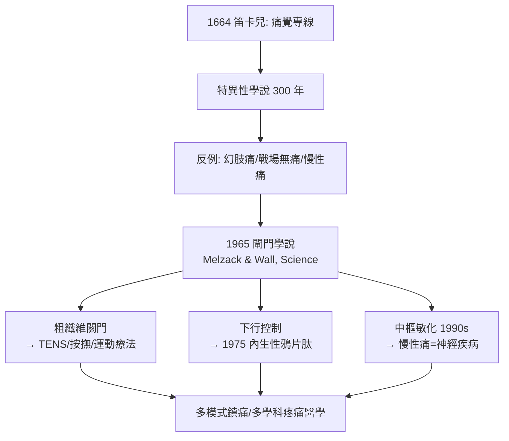

## 1965 - 痛覺閘門學說（「疼痛是大腦的判決」——把痛從感覺器理論中解放出來）

## 案件摘要

**本案偵破了醫學史上最基礎的懸案之一：疼痛究竟是「感覺器的直讀訊號」還是「中樞的加工判決」？1965 年，Ronald Melzack 與 Patrick Wall 發表痛覺閘門學說，把疼痛從「專線電報」改寫為「可調節的閘門系統」——現代疼痛醫學與多模式鎮痛的理論基石。**

1965 年 11 月，加拿大心理學家**梅爾扎克（Ronald Melzack）**與英國神經生理學家**帕特里克·沃爾（Patrick Wall）**在《Science》發表《Pain Mechanisms: A New Theory》。他們挑戰統治三百年的**特異性學說**（Descartes 的「痛覺專線」：痛覺纖維直通大腦）與強度學說，提出：脊髓背角存在一個**閘門（gate）**——由粗纖維（Aβ，觸壓）與細纖維（Aδ/C，傷害性）的輸入平衡、加上**下行中樞控制**共同調節；閘門開→痛覺上傳，閘門關→痛覺被抑制。**痛不是身體的測量值，而是大腦的評估值。**

## 前因 -- 為什麼會有這個案子

- **三百年舊案：笛卡兒的專線模型**。1664 年笛卡兒描述火焰→「痛覺細絲」直拉腦中警鐘的圖像；19 世紀 Müller 的特異性能量學說把「專線」生理學化——痛被視為被動傳遞的客觀訊號。
- **無法解釋的臨床反例堆積**：
  - 截肢後**幻肢痛**——沒有肢體卻有劇痛（專線已斷，誰在報警？）；
  - 士兵重傷後暫不覺痛、平民輕傷即劇痛（Beecher 1946 年二戰研究：重傷士兵僅 25% 需嗎啡）；
  - 慢性痛與組織損傷程度脫鉤。
  任何「直讀電報」理論都解釋不了這些案子。
- **脊髓背角的中間神經元研究**。1950–60 年代 Wall 等對背角第 IV–VI 層細胞的電生理紀錄顯示：同一細胞可同時被觸壓與傷害刺激調節——「混合輸入」的證據在手。

## 線索與推理 -- 數學式、程式、理論

**線索一：閘門的邏輯式。** 學說的核心可用一個調節方程表達：

$$ \text{背角傳遞細胞（T 細胞）輸出} = f\big(\underbrace{S_{\text{細纖維}} - L_{\text{粗纖維}}}_{\text{閘門控制}} \;+\; \underbrace{D_{\text{下行控制}}}_{\text{中樞調節}}\big) $$

- 細纖維（Aδ/C）輸入↑ → 閘門**開** → 痛上傳；
- 粗纖維（Aβ）輸入↑ → 閘門**關** → 痛被抑制（解釋「揉一揉就不那麼痛」與經皮神經電刺激 TENS）；
- 下行控制（腦幹→脊髓）可獨立關門（解釋專注、安慰劑、戰場無痛）。

```python
def pain_output(A_beta, A_delta_C, descending):
    # 閘門學說的簡化模型
    gate = A_delta_C - A_beta + descending
    return "閘門關閉: 痛覺被抑制" if gate < 0 else "閘門開啟: 痛覺上傳"

print(pain_output(A_beta=0.8, A_delta_C=0.4, descending=0.2))  # 揉搓+安心 → 不痛
print(pain_output(A_beta=0.2, A_delta_C=0.9, descending=-0.3)) # 焦慮+損傷 → 劇痛
```

**線索二：幻肢痛的破解。** 學說最有力的破案戰果：截肢後喪失的粗纖維輸入使閘門長期失衡＋中樞重構（後續研究發展為**中樞敏化**與皮質功能重組）——疼痛的「檔案」存在於大腦而非斷肢。本案證明：**治療慢性痛必須治中樞，不能只修組織。**

**線索三：對麻醉與鎮痛的直接推論。** 閘門學說使「多模式鎮痛」從經驗變成理論：

| 靶點 | 介入 | 閘門學說中的位置 |
|---|---|---|
| 粗纖維激活 | TENS、按撫、振動 | 主動關門 |
| 脊髓背角 | 硬膜外/脊椎麻醉（見 `1898-比爾自體實驗脊椎麻醉.md`） | 直接關閉上傳通路 |
| 下行抑制 | 阿片類、5-HT/NE 再攝取抑制 | 強化下行控制 |
| 外周炎症 | NSAIDs、局麻浸潤 | 減少細纖維輸入 |

**線索四：後續科學驗證。** 1970–80 年代分子證據接連到位：Basbaum 與 Fields（1978–）確立腦幹導水管周圍灰質—延髓—脊髓背角的**下行痛覺抑制通路**；內生性鴉片肽的發現（見 `1975-內生性鴉片與腦啡肽.md`）提供了下行控制的分子信使；C 纖維反覆放電導致的**wind-up 與 NMDA 依賴性中樞敏化**（1990s）則證明閘門的「彈簧」會被損傷永久調歪。



## 結案 -- 後果與影響

- **疼痛醫學的立法性理論**。閘門學說直接催生多學科疼痛門診（見 `1973-國際疼痛學會與疼痛醫學.md`）與「疼痛為第五生命徵象」運動；Melzack 之後的**疼痛矩陣（neuromatrix）理論**（1990s）進一步把疼痛主體化。
- **麻醉科的擴張藍圖**。術後鎮痛、慢性痛介入（神經阻滯、射頻、脊髓電刺激——「電子關門器」）、癌痛治療成為麻醉科的正式業務領域。
- **安慰劑與心理因素的科學平反**。學說為「心藥也能止痛」提供了生理學合法席位——Beecher 的戰場數據從異常值變成理論支柱。
- **一句話結案**：閘門學說宣判了「痛覺專線」的死刑——疼痛不是身體的儀表讀數，而是大腦在證據（纖維輸入）、情緒（下行控制）與記憶（中樞敏化）之間作出的**司法判決**；麻醉科因此從「關機器」升級為「管法院」。

## 關鍵人物與文獻

- **Ronald Melzack（1929–2019）**——麥基爾大學心理學家；幻肢痛與疼痛測量（麥基爾疼痛問卷 MPQ，1975）的締造者。
- **Patrick Wall（1925–2001）**——倫敦大學學院/牛津神經生理學家，背角電生理的關鍵人物。
- **Henry Beecher（1904–1976）**——二戰戰地疼痛研究與《新英格蘭醫學期刊》安慰劑效應論文（1955）作者，也是研究倫理的先驅（紐倫堡守則起草者之一）。
- **Melzack, R. & Wall, P. D. (1965). Pain Mechanisms: A New Theory. *Science* 150: 971–979**——被引用逾萬次的醫學理論經典。
