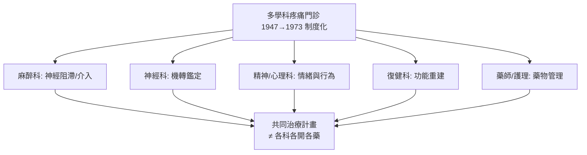

## 1973 - 國際疼痛學會與疼痛醫學（疼痛第一次有了自己的國際法庭）

## 案件摘要

**本案偵破了疼痛的「制度獨立案」：1973 年，華盛頓州西雅圖的 Issaquah 會議催生國際疼痛學會（IASP），疼痛從各科的附屬症狀升格為獨立的研究領域與診療專科——「疼痛管理」（pain management）自此成為一門制度化的醫學。**

1973 年 5 月，**約翰·博尼卡（John Bonica）**——麻醉醫生、前職業摔角手、慢性痛病人——在西雅圖郊外 Issaquah 召開國際疼痛會議，約 300 位跨學科專家（麻醉、神經、精神、心理、藥理）與會；1974 年**國際疼痛學會（IASP）**正式成立，博尼卡任首任主席；1975 年首屆世界疼痛大會於佛羅倫斯召開，《Pain》期刊創刊。1979 年 IASP 通過經典定義：「疼痛是一種與實際或潛在組織損傷相關的**不愉快感覺與情緒體驗**」——情緒被寫進疼痛的法定定義，是閘門學說（見 `1965-痛覺閘門學說.md`）的制度化勝利。

## 前因 -- 為什麼會有這個案子

- **慢性痛是各科都推掉的孤兒**。背痛、神經病變痛、癌痛——疼痛病人遊走於骨科、神經科、精神科之間，無人「認領」；鎮痛的專業知識碎片化。
- **Bonica 的三重身份推動**：職業摔角生涯使他懂得痛與表演；二戰期間他在軍醫院親見傷兵鎮痛荒蕪；他母親與妻子皆死於慢性病之痛——1940 年代末他已建立**多學科疼痛門診**（interdisciplinary pain clinic，1947 年塔科馬）的雛形。
- **閘門學說提供了理論合法性**（1965）——疼痛有可研究的神經機轉，學術界有了集結的理由。
- **鴉片類藥物與癌症痛的實務壓力**。末期病人的鎮痛不足（under-treatment）開始被視為醫療不當，而不僅是宿命。

## 線索與推理 -- 數學式、程式、理論

**線索一：多學科疼痛門診的組織偵查。** Bonica 的模型把疼痛當「多因子案件」成立聯合偵查組：

**線索二：疼痛的「法定定義」偵查。** IASP 1979 定義的偵探價值在於兩個關鍵詞：

1. **「潛在」損傷**——痛不必有可見損傷（承認神經病變痛、纖維肌痛）；
2. **「情緒體驗」**——痛不只是感覺，還是情緒（承認抑鬱、焦慮與痛的雙向因果）。

2020 年 IASP 修訂版更進一步：「疼痛**永遠是個人體驗**，受生物、心理、社會因素影響」——**生物心理社會模型**成為法定語言。這使「痛的主訴本身即是臨床證據」，反對「沒有器質性發現=裝病」的舊判決。

**線索三：鎮痛技術的專科化譜系。** IASP 成立前後，麻醉科主導的疼痛介入技術爆發：

| 技術 | 年代 | 原理 |
|---|---|---|
| 硬膜外/椎管內鎮痛 | 1949（產科普及 1970s–80s） | 關閉脊髓節段通路（見 `1898-比爾自體實驗脊椎麻醉.md`） |
| 患者自控鎮痛 PCA | 1971–1985（Sechzer/White） | 反饋控制給藥，血藥濃度波動最小化 |
| 脊髓電刺激 SCS | 1967（Shealy，閘門學說直接產物） | 電激活粗纖維關閘門 |
| 癌痛三階梯 | 1986（WHO） | 以強度分級的給藥演算法 |

**線索四：PCA 的控制論偵查。** 患者自控鎮痛把給藥權交還病人，本質是**閉環回饋**：

$$ \min \int_0^T \big(\text{疼痛}(t)^2 + \lambda\,\text{副作用}(t)^2\big)\, dt \quad \text{s.t.} \quad \text{鎖定時間防過量} $$

病人自己最清楚痛的程度——以鎖定時間（lockout）防過量的前提下，自我滴定優於護理師的按時給藥。這是疼痛治療從「父權給藥」到「病人主權」的轉折，也呼應了 1853 年女王證詞（見 `1853-維多利亞女王與雪的氯仿.md`）的「治療體驗」倫理。

## 結案 -- 後果與影響

- **疼痛成為第五生命徵象**（1995 年美國疼痛學會推動；2001 年 JCAHO 將疼痛評估列為醫院評鑑項目）——「問分數」成為護理常規。
- **雙面遺產：鴉片類危機**。「疼痛是第五生命徵象」+ 1990 年代 Purdue Pharma 行銷 OxyContin 的組合，導致美國鴉片過量死亡潮（每年逾 8 萬人）——本案的後續偵查顯示：**制度化鎮痛若與藥廠行銷、療效評分（HCAHPS）掛鉤，會被系統性扭曲**。IASP 與 CDC 的 2016/2022 指引轉向「平衡鎮痛與風險」。
- **麻醉科的版圖擴張**。急慢性疼痛醫學、介入性疼痛治療成為麻醉專科醫師的正式次專科；2018 年起美國疼痛醫學次專科認證向多科開放。
- **一句話結案**：1973 年的制度化讓疼痛獲得「司法管轄權」——但司法系統也會被遊說集團俘虜；疼痛醫學的百年偵查顯示，最難偵破的永遠不是疼痛的神經機轉，而是**醫療系統自己的利益結構**。

## 關鍵人物與文獻

- **John J. Bonica（1917–1994）**——摔角手→麻醉醫生→IASP 創會主席；《疼痛管理》（*The Management of Pain*，1953）教科書的作者，「疼痛醫學之父」。
- **Ronald Melzack**——閘門學說共同作者、MPQ 量表與疼痛測量的學術支柱（見 `1965-痛覺閘門學說.md`）。
- **IASP（1974–）**——會員逾 90 國；《Pain》期刊、疼痛分類法（1986/1994/2020）與「全球疼痛日」（10 月 20 日）的營運者。
- 現代註腳——2022 年 IASP/WHO 推動「國際疼痛分類 ICD-11 慢性痛章節」，慢性痛正式成為獨立疾病分類——本案在制度層面仍在持續審理。
