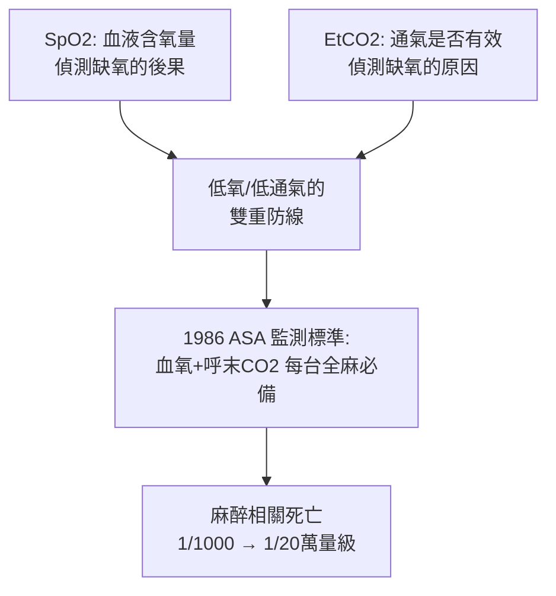

## 1974 - 血氧飽和度監測儀（耳朵上的光電偵探：麻醉安全的分水嶺）

## 案件摘要

**本案偵破了麻醉監測史上最重要的無創革命：1970 年代初，日本工程師青柳卓雄（Takuo Aoyagi）以「血流的脈動」為鑰匙，發明脈搏血氧飽和度儀（pulse oximeter, SpO₂）——讓低氧血症在病人變色之前就被抓住。**

1972 年（1974 年發表），日本光電（Nihon Kohden）工程師**青柳卓雄**在研究心輸出量染料稀釋法時注意到一個干擾訊號：染料曲線隨心跳脈動。他瞬間推理：**這個「脈動成分」正是動脈血的光學指紋**——只要測量耳垂或指尖在收縮期與舒張期的光吸收差值，就能扣除靜脈血與組織的干擾，單獨讀出**動脈血氧飽和度**。1974 年他以論文與專利發表 Ear Oximeter OLV-5100。1980 年代 Biox（1979）與 Nellcor（1981）推出指夾式微處理器版本，迅速席捲美國手術室。

## 前因 -- 為什麼會有這個案子

- **低氧是麻醉的第一死因**。麻醉下病人的呼吸被抑制、氣道被封鎖——低氧血症的傳統偵查手段只有兩種：肉眼觀察發紺（遲且不可靠，飽和度低於約 85% 才顯現）與抽動脈血做血氣（有創、間斷、需數十分鐘）。
- **前人的半成品**。1935 年 Krammer 的「血氧計」、1940 年代 Millikan 的航空用血氧計、1950 年代 Wood 與 Brinkman 的耳血氧計——都能測血氧，卻無法扣除組織與靜脈血的干擾，讀數漂移嚴重，不具臨床可靠性。**卡在「如何扣除背景」這一步整整四十年。**
- **脈動即答案**。動脈血是唯一隨心跳改變容量的成分——「脈動前的光吸收」與「脈動後的差值」之差，數學上恰好隔離出動脈血：

$$ \text{SpO}_2 \propto \frac{A_{\text{脈動}}(660\,\text{nm 紅光})}{A_{\text{脈動}}(940\,\text{nm 紅外光})} \quad (\text{氧合與脫氧血紅素對兩波長吸收不同}) $$

## 線索與推理 -- 數學式、程式、理論

**線索一：兩波長的偵查原理。** 氧合血紅素（HbO₂）與還原血紅素（Hb）的光吸收光譜不同：660 nm 紅光下 Hb 吸收遠強於 HbO₂（這就是動脈血偏紅、靜脈血偏暗的原因）；940 nm 紅外光下相反。測兩波長的脈動吸收比，即可解出飽和度：

$$ R = \frac{(AC_{660}/DC_{660})}{(AC_{940}/DC_{940})} \;\Rightarrow\; \text{SpO}_2 = f(R) \;\approx\; 110 - 25R $$

**線索二：與呼氣末二氧化碳監測的雙偵探組合。** 1980 年代手術室的另一無創偵探是**呼氣末二氧化碳（EtCO₂ 波形圖）**（1980 年代普及，1986 年 ASA 起草、1991 年定案的監測標準之一）：



兩者分工：EtCO₂ 抓「沒呼吸」與插管誤入食道（幾分鐘內），SpO₂ 抓「氧合崩潰」（略遲但更直接）——**偵測原因的偵探與偵測後果的偵探並列**，是麻醉安全監測的黃金組合。

**線索三：ASA 監測標準的立法。** 1984 年 Crane 醫療事故（低氧致腦損傷，賠償案）震動美國；1985 年 Ellison 提案、**1986 年美國麻醉醫學會（ASA）起草「基本監測標準」**：全麻必須連續監測氧合、通氣、循環與體溫。SpO₂ 與 EtCO₂ 使標準具備可執行性——這是醫學史上罕見的「由專業學會立法、由工程師兌現」的安全革命。研究統計顯示，1980 年代後麻醉相關死亡率從約 1/1,000–1/10,000 降至 **1/20 萬量級**（Lagasse 等綜述）——麻醉成為最安全的麻醉醫學領域之一，無創監測是最大功臣。

**線索四：SpO₂ 的偵查盲區。** 完美的偵探也有盲區：

```python
def spo2_blind_spots():
    return {
        "碳氧血紅蛋白中毒": "CO 使 SpO2 高估 (兩波長分不清 HbCO)",
        "高鐵血紅蛋白": "讀數鎖死在 ~85%",
        "末梢灌注差/低溫": "脈動訊號弱 → 讀不出或漂移",
        "膚色偏見": "深色皮膚讀數偏差大, 2021 FDA 警告",
        "延遲性": "肺的變化要等血到指尖, 延遲約 30-60 秒"
    }
for k, v in spo2_blind_spots().items():
    print(f"{k}: {v}")
```

膚色偏差問題（Sjoding 2020 年 NEJM 研究）成為 2020 年代醫療公平性與設備法規的焦點——本案顯示：偵探的「感官偏見」本身就是案情的一部分。

## 結案 -- 後果與影響

- **麻醉安全的大躍進**。無創、連續、即時的血氧監測 + EtCO₂ + 生理標準立法，使麻醉從「高風險職業操作」轉為「可稽核的安全系統」——本案是麻醉科「安全文化」建構的頂點。
- **疫情時代的全球主角**。2020 年 COVID-19 大流行中，「快樂缺氧」（silent hypoxia）以 SpO₂ 監測為主要偵查工具；血氧儀成為家家戶戶的醫療設備——麻醉科技術的社會外溢。
- **從脈搏到 AI 的延長線**。多重波長（飽和度+碳氧血紅蛋白+血容量）、深度學習波形分析、閉環麻醉——本案開創的「無創光電生理監測」仍在迭代。
- **一句話結案**：青柳卓雄的破案祕訣是**把干擾訊號讀成關鍵證據**——染料稀釋實驗裡討厭的脈動雜訊，正是四十年來所有人苦找的答案；科學史上最好的偵探，是能把雜訊聽成線索的人。

## 關鍵人物與文獻

- **青柳卓雄（Takuo Aoyagi, 1936–2020）**——日本光電工程師，脈搏血氧儀之父；2002 年 IEEE Edison Medal、死後追授發明名人堂。
- **Glenn Millikan（1930 年代）**——航空血氧計先驅，「oximeter」一詞的命名者。
- **Susumu Nakajima**——臨床驗證耳血氧計的日本麻醉醫生，推動臨床採用。
- **William New（Biox）與 Paul Noyes（Nellcor）**——1980 年代將脈搏血氧儀微型化、普及化的美國創業團隊。
- **Aoyagi, T. et al. (1974). *Earlobe oximeter for clinical use***——本案原始專利與論文。
