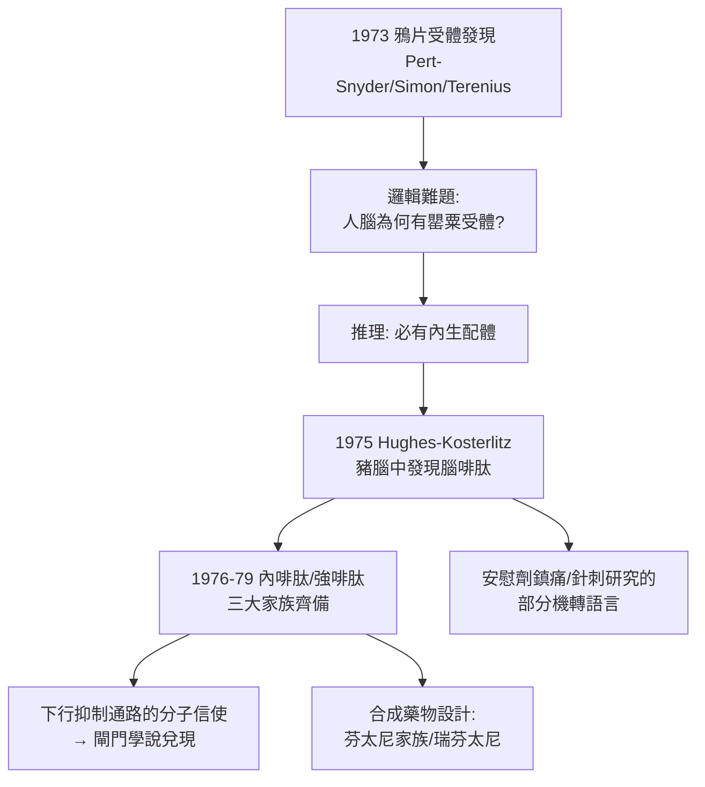

## 1975 - 內生性鴉片與腦啡肽（大腦裡自帶的嗎啡工廠）

## 案件摘要

**本案偵破了藥理學最漂亮的推理之一：嗎啡為何能止痛？1975 年，John Hughes 與 Hans Kosterlitz 在豬腦中發現腦啡肽（enkephalin），證明人腦自帶鴉片系統——嗎啡不是外來的鑰匙，而是模仿了人體自身的信使。**

1973 年，三個實驗室（Pert–Snyder、Simon、Terenius）幾乎同時證實**鴉片受體**存在於腦膜——這立即製造了一個演化論難題：人體為什麼會進化出「專門等著罌粟鹼」的受體？蘇格蘭阿伯丁大學的**約翰·休斯（John Hughes）**與**漢斯·科斯特利茨（Hans Kosterlitz）**推理：受體必有內生配體。他們以豚鼠迴腸生物檢定為「獵犬」，篩檢了數千份豬腦提取物，1975 年發表發現兩個五肽——**甲硫腦啡肽（Met-enkephalin）與亮腦啡肽（Leu-enkephalin）**；同年加州的 Goldstein 團隊發現**強啡肽**系統，1976–79 年垂體的**β-內啡肽**（β-endorphin，31 肽）亦被定序。人體的「內生性鴉片系統」三大家族（腦啡肽、內啡肽、強啡肽）就此齊備。

## 前因 -- 為什麼會有這個案子

- **嗎啡受體的高效之謎**。1973 年受體發現後的邏輯鏈：受體親和力極高且分佈有序（脊髓背角、腦幹、導水管周圍灰質）→ 不可能只為植物鹼存在 → **必有內生信使**——這是典型的「結構暗示功能」推理。
- **針刺麻醉的中西對話**。1970 年代中國針刺麻醉報導引發西方質疑；閘門學說（見 `1965-痛覺閘門學說.md`）提供了下行抑制的框架，而內生性鴉片的發現最終為「針刺可促進內啡肽釋放」提供了部分機轉語言（雖然針刺麻醉療效的臨床證據仍有爭議）。
- **鴉片藥理學的百年積累**。從嗎啡提純（1805）到拮抗劑納洛酮（1961）——納洛酮的「可逆性」恰好證明作用點在受體，是本案推理的化學前提。

## 線索與推理 -- 數學式、程式、理論

**線索一：生物檢定獵犬的設計。** Hughes 的豚鼠迴腸法：電刺激迴腸引起收縮，阿片樣物質抑制收縮、**可被納洛酮逆轉**——這一「可逆性」就是辨識兇手的指紋：

$$ \text{提取物抑制迴腸收縮} \xrightarrow{\text{納洛酮逆轉}} \text{判定為鴉片樣物質} \Rightarrow \text{純化分離五肽} $$

**線索二：鴉片系統的生理地圖。** 三大受體家族的分工（μ、δ、κ）構成現代鎮痛藥理的地圖：

| 受體 | 主要內生配體 | 效應 | 臨床對應 |
|---|---|---|---|
| μ（MOR） | 內啡肽/腦啡肽 | 脊髓上鎮痛、呼吸抑制、欣快 | 嗎啡、芬太尼（見下） |
| δ（DOR） | 腦啡肽 | 脊髓鎮痛、情緒調節 | 新藥靶點 |
| κ（KOR） | 強啡肽 | 脊髓鎮痛、煩躁、內臟痛 | 鎮痛而不欣快的新方向 |

分子機轉（Gi 偶聯）：受體活化→**關閉鈣通道（突觸前，減少遞質釋放）＋開啟鉀通道（突觸後，超極化）**→背角痛覺上傳被雙重靜音：

$$ \text{MOR 活化} \Rightarrow \downarrow Ca^{2+}\text{內流} + \uparrow K^{+}\text{外流} \Rightarrow \text{C 纖維遞質釋放} \downarrow \;\Rightarrow\; \text{痛覺訊號} \downarrow $$

**線索三：對麻醉科的即時回報——芬太尼家族。** 內生系統的地圖直接指導合成藥物設計：**芬太尼**（1960 年合成，1970 年代起大量用於心臟麻醉）效價為嗎啡的 100 倍、脂溶性高、血流動力學穩定——成為心外科與平衡麻醉的主角；瑞芬太尼（1996）以血液酯酶代謝、半衰期約 8 分鐘，實現「滴定到秒級」的靜脈鎮痛。

```python
def opioid_potency(ref="嗎啡", dose=10):
    agents = {"嗎啡": 10, "芬太尼": 0.1, "舒芬太尼": 0.02, "瑞芬太尼": 0.05, "羥考酮": 15}
    for name, mg in agents.items():
        print(f"{name}: 等效劑量 {mg} mg ≈ 嗎啡 10 mg")
    return "受體地圖 → 合成藥物的效價設計"

opioid_potency()
```

**線索四：下行控制的分子信使。** 閘門學說的「下行抑制」找到了解剖與分子基礎：導水管周圍灰質（PAG）—延髓頭端腹內側核（RVM）—脊髓背角的通路以腦啡肽/內啡肽為信使（Basbaum–Fields, 1978）。內生性鴉片系統因此成為閘門學說的**分子兌現**——理論、受體、配體、通路四層證據閉環。



## 結案 -- 後果與影響

- **「痛有閘門，腦有藥廠」的完整敘事**。閘門學說（1965）＋內生鴉片（1975）使疼痛科學第一次擁有從分子到行為的完整證據鏈——神經科學最成功的理論閉環之一。
- **鴉片危機的理論雙刃**。受體系統的存在證明了高效鎮痛的生理合法性，但也確認了耐受、依賴與戒斷的生理必然性——1990 年代「合理用鴉片」的行銷正是濫用了這套科學話語（見 `1973-國際疼痛學會與疼痛醫學.md` 的黑線）。
- **新藥靶點的長期工程**。「鎮痛而不成癮」的探索（δ/κ 選擇性激動劑、偏側激動劑、PZM21 等結構導向設計）至今仍在進行——本案的分子地圖仍是前線。
- **一句話結案**：Hughes 的推理是藥理學的教科書演繹——**受體的存在本身就是內生信存在的證據**；人類花了一百五十年才發現，我們一直隨身攜帶著自己的嗎啡工廠。

## 關鍵人物與文獻

- **John Hughes（1936–2014）與 Hans Kosterlitz（1903–1996）**——阿伯丁大學藥理學家，腦啡肽的共同發現者；Kosterlitz 的兒子 Duncan 獲 2016 諾貝爾物理學獎。
- **Candace Pert 與 Solomon Snyder（1973）**——鴉片受體結合實驗（以放射性標記納洛酮）的先驅。
- **Choh Hao Li（李卓皓，1976）**——β-內啡肽定序的華裔生化學家，亦為生長激素與 ACTH 純化的先驅。
- **Hughes, J. et al. (1975). Identification of two related pentapeptides from the brain with potent opiate agonist activity. *Nature* 258: 577–579。**
