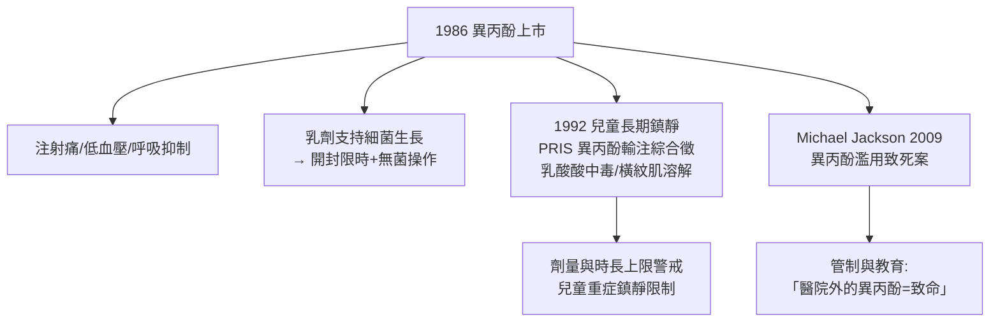

## 1986 - 異丙酚與日間麻醉（白色乳劑：「早上開刀，下午回家」的化學基礎）

## 案件摘要

**本案偵破了麻醉藥史上最成功的「快進快出」工程：1986 年，異丙酚（propofol，商品名 Diprivan）在英美上市——靜脈麻醉從「睡半天才醒」進化到「關機即醒」，日間手術與門診麻醉的時代自此全面開啟。**

異丙酚的故事始於 1970 年代：蘇格蘭 ICI 的化學家 **John Glen** 與 Roger James 篩選酚類衍生物，1977 年證明 **2,6-二異丙基苯酚**靜脈注射後起效與甦醒皆極快、且幾乎無巴比妥類的蓄積後鎮靜。但它水溶性極差，初版溶劑（cremophor EL）引發過敏樣反應，被迫停用；1979 年改以**大豆油卵磷脂乳劑**（外觀如牛奶，暱稱「milk of amnesia」）重新上市試驗，1986 年獲准於英美。臨床特徵驚人：一次臂腦循環起效、停藥後 8–10 分鐘完全清醒、術後噁心嘔吐（PONV）率低——它迅速取代硫噴妥鈉（見 `1934-硫噴妥鈉與靜脈麻醉.md`）成為全球使用量最大的靜脈麻醉藥。

## 前因 -- 為什麼會有這個案子

- **硫噴妥鈉的「二次睡眠」缺陷**（見 `1934-硫噴妥鈉與靜脈麻醉.md`）——脂肪蓄積與甦醒遲滯，與 1970 年代興起的**日間手術**（ambulatory surgery）模式正面衝突。
- **日間手術的制度需求**。1970 年起美國 Surgicenter（Nichol 1969）等獨立手術中心擴張；醫保成本壓力推動「24 小時內入出院」——麻醉藥的核心 KPI 從「夠深」變成「醒得快、走得穩、不吐」。
- **巴比妥類的社會污名**。硫噴妥鈉等屬管制藥品；非巴比妥結構可避開管制與濫用話語。
- **藥代動力學的成熟**。三室模型、開放式計算機模擬（Sheiner 與箱室模型）使「設計一個清除率極高的分子」成為可工程化的目標。

## 線索與推理 -- 數學式、程式、理論

**線索一：清除率為王的藥代偵查。** 異丙酚甦醒快的真正原因不是代謝快（肝清除約 1.5–2 L/min 雖高，但甦醒主要靠**分布**），而是**分布容積巨大＋代謝途徑高效**的組合：

$$ t_{1/2\,\text{甦醒（context-sensitive）}} \ll t_{1/2\beta} \quad (\text{連續輸注後甦醒時間隨輸注時長增長緩慢}) $$

「**情境敏感半衰期**」（context-sensitive half-time）概念正是為比較硫噴妥鈉與異丙酚的連續輸注行為而生：硫噴妥鈉輸注越久甦醒越遲（脂肪蓄積），異丙酚輸注數小時後仍可在十餘分鐘內甦醒。

```python
def context_sensitive_ht(minutes_infused, agent):
    # 示意比較連續輸注後的甦醒時間
    if agent == "硫噴妥鈉":
        return minutes_infused * 0.8   # 蓄積 → 甦醒時間隨時長暴增
    if agent == "異丙酚":
        return min(10 + minutes_infused * 0.05, 25)  # 平台化
    if agent == "瑞芬太尼":
        return 4                        # 幾乎不變
for t in (60, 300):
    for a in ("硫噴妥鈉", "異丙酚"):
        print(f"輸注 {t} min → {a} 甦醒約 {context_sensitive_ht(t, a):.0f} min")
```

**線索二：乳劑的第二次破案。** 異丙酚難溶於水——第一次載體（cremophor）造成類過敏反應，1979 年版被迫撤回；改用**10% 大豆油＋1.2% 卵磷脂＋甘油**的油包水乳劑後安全落地。這是藥劑學決定藥物命運的教科書案例：**分子對了，還要給它找到對的馬車**（同期苯妥英、環孢素的載體問題亦同）。

**線索三：TCI——把藥代數學變成給藥按鈕。** 1990 年代，Kenny 等開發**靶控輸注（TCI, target-controlled infusion）**泵：以異丙酚的群体药代參數（Marsh/Schnider 模型）即時計算效應室濃度，醫生設定「目標濃度」、泵自動調速：

$$ C_{\text{效應室}}(t) \; \xrightarrow{\text{TCI 算法}} \; \text{泵速} \quad (\text{目標濃度 } \mu g/mL \text{ 而非 } mL/h) $$

1996 年 TCI 系統（Diprifusor）在歐洲上市——**全靜脈麻醉（TIVA）**從數學家專屬技能變成臨床常規按鈕；配合瑞芬太尼與腦電監測（見 `1996-BIS麻醉深度監測.md`），閉環麻醉的雛形成形。

**線索四：異丙酚的暗面偵查。**



## 結案 -- 後果與影響

- **日間手術成為主流**。今日全球逾半數手術為日間手術；異丙酚＋短效揮發藥（見 `1956-氟烷吸入麻醉革命.md`）＋區域麻醉是三大支柱——「手術的醫院化」被反轉為「醫療的社區化」。
- **PONV 的對策科學**。異丙酚低致吐特性推動術後噁心嘔吐（PONV）風險評分與預防體系——舒適度成為麻醉品質的正式指標。
- **靜脈麻醉的數學化**。TCI/TIVA 使麻醉醫生以「濃度目標」而非「毫升速度」思考——麻醉徹底成為即時控制系統工程，閉環麻醉（closed-loop anesthesia）自 2010 年代起進入臨床試驗。
- **一句話結案**：異丙酚的三次破案（分子、載體、輸注算法）證明現代藥物是**三層工程的乘積**——化學結構、遞送系統、控制理論缺一即不成案；「milk of amnesia」是麻醉史最漂亮的團隊作品。

## 關鍵人物與文獻

- **John B. Glen（1936–2021）**——ICI/捷利康獸醫背景藥理學家，異丙酚開發靈魂人物；2018 年拉斯克臨床醫學獎得主。
- **Roger James**——異丙酚藥理與乳劑開發的共同作者。
- **James Kenny**——TCI 系統（Diprifusor）的臨床工程推手。
- **Glen, J. B. (1980). Animal studies on propofol (ICI 35,868). *Br J Anaesth***——異丙酚藥理的奠基文獻。
