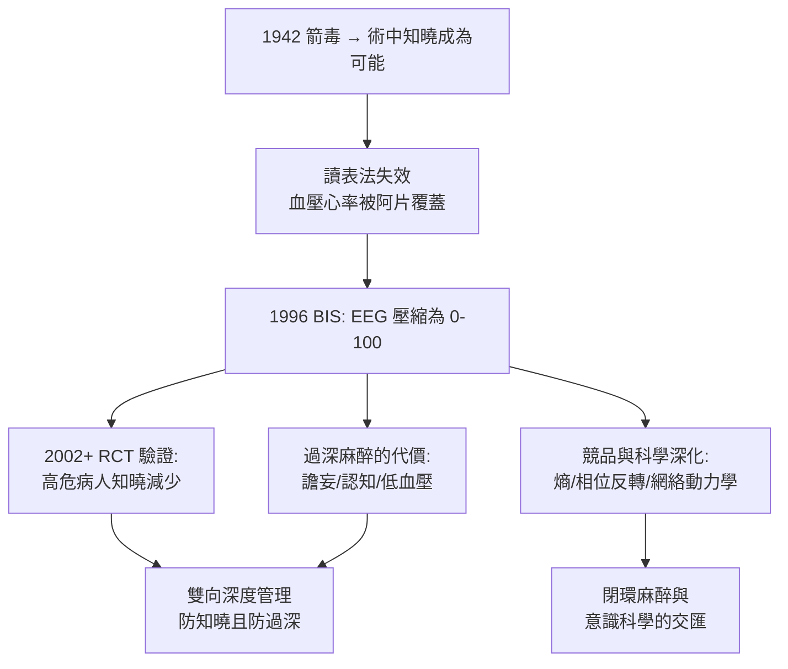

## 1996 - BIS 麻醉深度監測（給意識裝上刻度：腦電 0 到 100 的偵查革命）

## 案件摘要

**本案偵破了麻醉最後的「黑箱」：1996 年，美國 FDA 核准腦電雙頻指數（Bispectral Index, BIS）監測儀——麻醉深度第一次以 0–100 的數字呈現，「術中知曉」這一麻醉最恐怖的隱形事故獲得了可量化的防線。**

1930 年代起，腦電圖（EEG，1929 年 Berger 首錄人腦電）已被觀察到隨麻醉加深而變慢變平，但原始 EEG 波形混亂、無法床邊判讀。1990 年代，Aspect Medical（Nassib Chamoun 與哈佛麻醉醫生 Steven Shafer 等合作）以數千例麻醉腦電建立數據庫，用**雙譜分析（bispectral analysis）**提取相位耦合特徵，壓縮為單一指數：**BIS 100=清醒，60–75=足夠麻醉，<40=深麻醉/爆發抑制**。1996 年 FDA 核准 BIS-1040；2003 年後隨機試驗（Ekman 2002 等）顯示 BIS 指導下明顯減少高危病人的術中知曉，也證實**低 BIS 時長與術後譫妄/認知障礙相關**——麻醉深度從「經驗與血壓推斷」升級為「腦的直接讀數」。

## 前因 -- 為什麼會有這個案子

- **術中知曉的恐怖案卷**。1942 年箭毒問世後（見 `1942-箭毒與肌肉鬆弛劑.md`），「清醒而癱瘓」成為可能：病人術中全醒、聽見手術對話、感覺切割，卻因肌鬆劑無法動彈呼救；估計每千例全麻約 1–2 例發生知曉（肌鬆比例高的手術更高），可致創傷後應激障礙（PTSD）。
- **格德爾讀表法失效**（見 `1920-格德爾麻醉分期.md`）。肌鬆劑廢掉眼球與呼吸指針、阿片類覆蓋心率血壓——臨床指標與意識狀態脫鉤，深度判斷失去刻度尺。
- **過深麻醉的隱性代價**。為防知曉而「寧深勿淺」的策略導致低血壓、蘇醒延遲與老年病人術後譫妄——**過淺與過深都是事故**，需要雙向刻度。
- **腦電信號處理的成熟**。FFT 譜分析、相位耦合（bispectrum）與計算機化使 60 秒內把多導 EEG 壓縮成一個數字成為可能。

## 線索與推理 -- 數學式、程式、理論

**線索一：EEG 隨麻醉的規律變化。** 麻醉加深時腦電的「偵查特徵譜」：

$$ \text{清醒: 高頻低幅（}\beta\text{）} \rightarrow \text{麻醉: 慢波高幅（}\delta\text{）} \rightarrow \text{過深: 爆發抑制/等電位} $$

BIS 融合時間域（抑制比）、頻率域（相對功率）與相位域（雙譜）特徵：

```python
def bis_reading(value):
    if value >= 90: return "清醒"
    if value >= 65: return "輕度鎮靜"
    if value >= 40: return "全身麻醉合適區間"
    if value > 0:   return "深麻醉/爆發抑制風險"
    return "等電位(EEG 平坦)"
for v in (95, 70, 55, 30, 0):
    print(f"BIS {v}: {bis_reading(v)}")
```

**線索二：雙譜分析的偵查價值。** 普通功率譜丟失相位信息；**雙譜（bispectrum）**度量不同頻率間的相位耦合——麻醉狀態下腦網絡的諧波耦合結構有特異變化，這一「相位指紋」是 BIS 區分「自然睡眠」與「藥物麻醉」的關鍵特徵。

**線索三：大規模驗證試驗——偵查的法庭。**

| 試驗 | 年份 | 發現 |
|---|---|---|
| Ekman et al. | 2002 | 高危病人 BIS 組知曉 0/1950 vs 對照 2/1975，且重症縮短 |
| Avidan et al.（B-Aware 復核/Michigan 試驗） | 2008–2011 | BIS 與低呼末麻醉藥濃度監測各有勝場；濃度監測不劣於 BIS |
| Chan et al.（老年非心臟手術） | 2013 | BIS 指導組譫妄與認知下降減少 |

**線索四：競爭偵探團與「意識的生理學」。** BIS 之後，熵（Entropy/Datex）、Narcotrend、GEP、ABI 等競品登場；基礎科學則由 MIT 的 Emery Brown、卡內基的 Max Kelz 等揭示**麻醉是腦網絡動力學的重整**（丘腦皮質信號隔離、α 振盪前額—頂葉相位反轉「神經開關」）——深度監測的終點可能不是單一指數，而是**意識的多模態狀態分類**：

$$ \text{意識狀態} = f(\text{EEG 譜},\ \text{功能連接},\ \text{行為反應},\ \text{藥物濃度}) $$



## 結案 -- 後果與影響

- **知曉防護的制度化**。ASA 2006 年知曉實務指引：高危手術（心臟、創傷、剖宮產、肌鬆比例高）考慮使用腦電監測——「知情同意書上要提到知曉風險」成為新常態。
- **麻醉與意識科學的合流**。麻醉醫生成為「意識操控的生理學家」——麻醉誘導的意識喪失成為研究意識神經相關物（NCC）的模型系統，麻醉科與神經科學深度互嵌。
- **精準麻醉的經濟學**。術中低血壓管理（避免過深）與快速甦醒（見 `1986-異丙酚與日間麻醉.md`）的組合，使 ERAS（加速康復外科）路徑可行。
- **一句話結案**：BIS 的意義不在那個數字絕對可靠（藥物特異性、偽跡、個體差異仍在），而在宣告——**意識是可以被測量的生理變數**；麻醉的黑箱被打開一扇窗，窗外是意識科學的整片新大陸。

## 關鍵人物與文獻

- **Nassib Chamoun**——Aspect Medical 創辦人，BIS 商業化與 FDA 申請的工程靈魂。
- **Steven Shafer（1953–）**——麻醉藥代動力學家與 BIS 科學顧問，後任《Anesthesia & Analgesia》主編。
- **Emery Brown（1956–）**——MIT 計算神經科學家兼麻醉醫生，麻醉腦網絡動力學與信號處理（如 state-space 方法）的當代旗手。
- **Ekman, A. et al. (2002). *Acta Anaesthesiol Scand*; Avidan, M. S. et al. (2011). *NEJM* 365: 591–600**——BIS 對知曉與深度管理的關鍵試驗。
