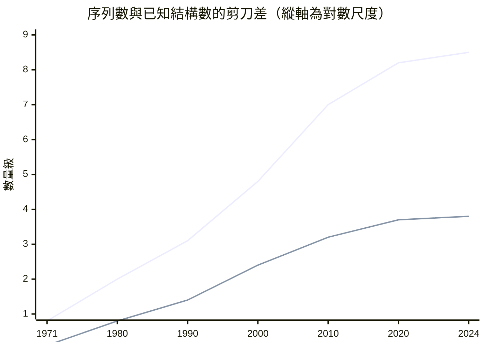
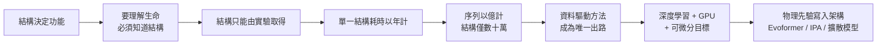
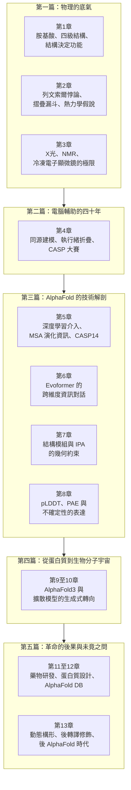

# 0.1 導言：生命科學的聖杯與五十年懸案

## 一個被低估的問題

1957 年，劍橋大學的邁克爾·佩魯茲（Michael Perutz）用 X 光繞射量測了肌紅蛋白的纖維狀衍射樣式，讓蛋白質結構第一次成為可以被系統性求解的對象。一年後，約翰·肯德魯（John Kendrew）與合作者建構出首個高解析度的肌紅蛋白模型：那是一個由數百個原子構成的緊密核心，裡面包著一個血基質（heme）分子，蛋白質的主鏈像一條繃緊的皮帶繞著它盤旋。多年之後，肯德魯描述那個模型時說，它「醜陋得令人難以置信」。

但就是這個醜陋的模型，開啟了現代生物學最核心的一條因果鏈。1960 年前後，佩魯茲與同事證明血紅素能因氧氣的結合而改變形狀，並提出「構造變化（conformational change）」的機制；1965 年，佩魯茲與傑西卡·菲利普斯（Jessica Phillips）發表血紅素的高解析度結構，展示了由四個次單元組成的四聚體，以及那個精細的協同機制：當一個次單元結合氧氣時，其餘三個的構形會依次改變。1962 年，佩魯茲、肯德魯與菲利普斯共享諾貝爾化學獎，一個只用了十年就徹底改寫生物學的領域，於是被正式承認。

回頭看，蛋白質結構之所以重要，並不是因為它「很美」，而是因為它是一種可計算的語言：把一條胺基酸序列讀成一句話，摺疊之後的三維形狀就是這句話的意思，而形狀決定了它在細胞裡能做什麼。結構決定功能，幾乎是分子生物學的第一公理。

然而在 1958 年，這個公理還缺一塊拼圖：人們知道序列可以讀出來，卻不知道序列究竟如何變成形狀。

## 序列先於結構降臨的十年

1953 年，弗雷德里克·桑格（Frederick Sanger）完整定序了牛胰島素的 A 鏈與 B 鏈，讓生物學家第一次握有「一條蛋白質的字母表」。消息傳開時，許多人認為結構問題已經解決了一半——序列既然是可讀的文字，結構或許只是某種字母到幾何的機械轉換，只需一位足夠有耐心的數學家把它算出來即可。

事實上，序列不但沒有加速結構的取得，反而製造了一個更麻煩的問題。第一，一旦知道序列，就會想要知道它的結構；但序列可以在數週內讀出，結構卻需要數月甚至數年的嘗試。第二，序列可以大量生產，結構不行：桑格式的定序雖然緩慢，卻是可靠且可複製的標準流程；而 X 光繞射需要純化出可結晶的樣本，需要找到合適的晶格條件，並且常常在投入數年之後以「這不是我的蛋白質」收場。

於是生物學家發現自己站在一個極不對稱的位置上。他們握著一條越來越長的單行文字，卻缺少詞典。

## 熱力學直覺的黃金年代

1970 年，克里斯蒂安·安芬森（Christian Anfinsen）發表了他對蛋白質摺疊的實驗論證，並在 1972 年獲得諾貝爾化學獎。他提出的熱力學假說大膽而乾淨：蛋白質在適當條件下會自行摺疊成構形自由能最低的原生態（native state），而達成這個目標所需的全部資訊，已經完整地編碼在胺基酸序列之中。這句話後來被濃縮成一句教條：序列決定結構、結構決定功能。

安芬森的假說同時宣告了兩件事。第一，它給了生物化學家一個明確的目標——只要給定序列，最低自由能構形就是答案。第二，它也意味著，只要答案唯一存在於序列之中，那麼計算機理論上就一定能把它找到。這是一個極其誘人的研究計畫，也是接下來半個世紀所有努力的方向。

然而在 1969 年，一位哥倫比亞大學的年輕化學家賽拉斯·列文索爾（Cyrus Levinthal）替這個計畫算了一筆帳，結論令人尷尬。

## 列文索爾悖論：把困難變成一個數字

列文索爾的論證非常簡單。他假設一個由 100 個胺基酸組成的蛋白質，每個殘基在三個空間方向上各有一個位置選擇，因此可能的構形數約為 $`3^{100} \approx 5 \times 10^{47}`$ 。若蛋白質是隨機試出正確摺疊，而每種構形只需嘗試 $`10^{-13}`$ 秒，那麼即使以光速進行遍歷，也要花上比宇宙年齡還長得多的時間。

$$
t_{\text{random}} \approx \frac{3^{100}}{10^{13}} \approx 5 \times 10^{34} \text{ 秒}
$$

但真實的蛋白質在細胞內只需要幾毫秒到幾秒就完成了摺疊。列文索爾因此提出，摺疊過程中必然存在某種「捷徑」，讓分子沿著一條陡峭但可行的能量路徑滑向原生態，而不必窮舉全部空間。這個洞察後來被發展成「摺疊漏斗（folding funnel）」模型：構形空間不是一片平坦的無限平原，而是一個漏斗，能量驅動分子從寬闊的上緣逐漸收斂到唯一的底部。

列文索爾悖論的真正重要性，不在於它給出了答案，而在於它改變了問題的性質。當一個問題困難到無法用演算法直接求解時，研究者往往會去改變問題的表述方式——把它從「搜尋」重新表述為「學習」，從「逐步模擬」重新表述為「一次性回歸」。這一步轉身，要再等四十九年。

## 兩條曲線的剪刀差

與此同時，生物資訊學這條支線正在累積海量資料。1971 年，美國國立衛生研究院資助的蛋白質資料庫（Protein Data Bank, PDB）正式成立，首版僅收錄 7 個結構，此後以每十年數倍的速率成長。與此同時，多重序列對齊（multiple sequence alignment, MSA）的方法在 1973 與 1975 年前後相繼成熟，讓研究者第一次能把一個蛋白質家族的成員排成一列，看出哪些位置在演化中被保守保留——這份「變化的地圖」，後來證明蘊含著結構的關鍵線索。

| 年份 | PDB 已發布結構數 | UniProt 收錄序列數（概略） |
|------|-----------------|---------------------------|
| 1971 | 7 | 數十 |
| 1980 | 約 200 | 約 1,000 |
| 1990 | 約 1,700 | 約 12,000 |
| 2000 | 約 17,000 | 約 40,000 |
| 2010 | 約 65,000 | 約 1,000 萬 |
| 2020 | 約 160,000 | 約 2 億 |
| 2024 | 超過 23 萬 | 超過 2.5 億 |

上圖的兩條曲線是這場僵局的全貌：上面那條是序列數，下面那條是已知結構數。兩者之間不是線性的差距，而是數量級的差距。

這就是「五十年懸案」的量化面貌。1971 年的生物學家面對幾百個序列，結構雖然難求，但至少有可能靠手工把每個都做一遍；到了 2020 年，面對兩億條序列的同時，只有不到二十萬個結構曾被親眼看見，覆蓋率約萬分之一。實驗方法沒有失效，它只是被數量壓垮了。

人們並不是沒有嘗試用電腦補上這個缺口。1970 年代的同源建模與執行緒折疊依賴模板，其前提是序列必須存在可資借鏡的已知結構；1986 年起，費什特（Alan Fersht）等人的實驗定序工作一點一滴地逼近序列到結構的對應關係，卻始終沒有找到能跨越整個序列空間的通則。1994 年第一屆 CASP（Critical Assessment of Structure Prediction）大賽的舉辦，把這件事變成一場定期的公開競技；此後的每一屆——2004 年的 CASP6、2008 年的 CASP7——成績的改善都以厘計。

## 為什麼深度學習是對的工具

2016 年，在 CASP12 上，大衛·羅森布拉特（David Rosenblatt）領銜的論文用深度卷積網路回歸距離幾何，首次證明機器學習可以在結構預測上擊敗傳統方法。這篇論文的重要性不在於分數——當時的平均 GDT_TS 距離只有 0.6——而在一個更根本的轉折：它把結構預測從「寫規則」改成了「從資料學規則」。

要理解為什麼這個轉折遲了這麼久、以及為什麼它一旦發生就不可逆，需要列出深度學習與這個問題之間的四項吻合。

第一項吻合是資料的累積已經到位。傳統方法失敗的原因之一，是它們需要人給出「什麼樣的摺疊是合理的」這類先驗；而深度學習把這些先驗換成了數十萬個已知的序列—結構配對。PDB 在 1971 年是稀缺資源，在 2020 年則是燃料。

第二項吻合是硬體的成熟。GPU 擅長的是大規模、稠密、規則的矩陣乘法，而序列對齊、注意力機制與三維幾何操作在算力上幾乎都是稠密矩陣運算。2012 年之後深度學習在影像與語言上的突破所帶動的算力擴張，恰好在 2018 至 2020 年間成熟到足以支撐數千萬參數的結構預測模型。

第三項吻合是目標函數的可微分性。若以連續的、可微的量來表述結構——例如殘基間距離、原子間距離、虛擬鍵角——那麼「最小化預測誤差」就是一個可以用反向傳播求解的連續最佳化問題。反之，傳統方法在離散空間中做搜索，導數不存在，也無法利用自動微分與小批量資料的效率。深度學習並非只是「更快的搜尋」，它把一個不可微的組合最佳化問題改寫成了可微的回歸問題。

第四項吻合是物理先驗可以被寫進架構，這是最被低估的一項。蛋白質的物理限制是明確的：鍵長與鍵角有統計偏好、接觸距離有上限、局部二級結構要符合螺旋與轉角的立體化學、蛋白質的骨架不會自交、每一段都必須可以從末端連續延伸出去。只要這些限制能在網路的拓撲結構中被強制滿足，網路就不必浪費容量去學習違反化學的形狀。深度學習在這裡的力量不只在於能夠擬合資料，而在於它能接受約束。

這四項吻合不是偶然。它意味著即使不是 2018 年，也是在 2018 年前後，答案必然會以某種形式出現。

## 從阿爾法到普羅米修斯

2018 年，DeepMind 在 CASP13 上提交了第一代 AlphaFold。這個系統的架構大膽而直接：它把序列沿長度切成片段，每個片段各自進行預測，再把片段結果組裝成一張距離圖，最後以梯度下降最佳化出一組三維座標。它在 CASP13 中取得平均 GDT_TS 分數 68.9 ，領先其他團隊相當一段距離，但仍不足以被稱為解決問題。

真正轉折發生在 2020 年 11 月的 CASP14 。AlphaFold2 的中位 GDT_TS 分數達到 92.4 ，這意味著在多數測試標的上，預測結構與實驗結構在幾何意義上幾乎無法區分。同一篇 2020 年 11 月 30 日發表於《自然》的論文，報告了涵蓋蛋白質、DNA、RNA、蛋白質複合體與配體的廣泛應用，並在 2022 年 11 月以 AlphaFold Database 的形式向全世界公開超過兩億個預測結構，涵蓋 UniProt 幾乎全部的已知序列；資料庫的論文隨後於 2022 年發表在《自然·方法》期刊上，並在 2024 年擴充為涵蓋超過兩億條序列的完整版本。

此後的三年是擴張而非顛覆的時期。2022 年，ESM2 以數十億參數的蛋白質語言模型示範了從序列本身學到結構與功能關聯的能力。2023 年，羅斯（Joseph Watson）等人以 RoseTTAfold Diffusion 發表 RFdiffusion，證明擴散模型不僅能預測結構，還能從零開始「畫」出具有指定功能的新蛋白質。2024 年，《自然》刊出 AlphaFold3，把模型從蛋白質擴展到蛋白質、核酸、小分子配體、藥物與修飾基的統一體系，並在同月開放 AlphaFold Server 供全球研究者免費使用；同期，ESM3 更進一步展示了以序列生成全新功能蛋白質的雛形。

從 1969 年列文索爾提出悖論到 2020 年模型達到實驗精度，五十一年的懸案被關上。AlphaFold2 並未推翻列文索爾——列文索爾的洞察是對的，摺疊確實存在捷徑；它證明的是捷徑可以被學出來，而不必被逐步搜尋出來。

## 全書路線圖

本書接下來的章節，沿著上述因果鏈逐段拆解。但它不是一條單線的勝利史詩，而是一連串「舊方法為何在此失敗、新方法為何恰好在此接棒」的局部解答。

第 1 章先建立必要的物理語言：胺基酸的化學性質、四級結構的層次，以及「結構決定功能」這個命題在分子層次究竟意味著什麼。第 2 章回到 1969 年，把列文索爾悖論與摺疊漏斗講清楚，同時處理一個容易被略過的歷史細節：1960 至 1970 年代的分子生物學家究竟相信什麼，以及為什麼「熱力學控制論」在 1970 年代末被蛋白質動力學的實驗數據逼到懸崖邊。

第 3 章是實驗技術的三部曲。X 光繞射在 1912 年由勞埃（Max von Laue）奠基，卻在整個 20 世紀受制於「必須結晶」這道門檻；NMR 自 1946 年起提供了溶液中的動態資訊，但對大分子的靈敏度不足；冷凍電子顯微鏡在 1986 年由杜博謝（Jacques Dubochet）等人開創，並在 2013 年之後經由解析度革命改寫遊戲規則。這一章要說明的不是這些技術失敗了，而是它們的瓶頸是物理性的，無法靠加倍努力解決。

第 4 章處理電腦輔助預測的四十年，包含 CASP 大賽的方法學遺產——它不只是競賽，更是一套把結構預測從「巫術」變成「可量化工程」的機制。第 5 至 8 章是全書的技術核心，逐層拆解 AlphaFold2：MSA 為何能攜帶演化資訊、Evoformer 如何讓序列資訊與三維幾何互相對話、結構模組與 IPA 如何讓網路直接操作剛體座標框架而不必繞道距離圖，以及 pLDDT 與 PAE 如何誠實地表達模型的不確定性。

第 9 章起，敘事離開「預測」而進入「生成」。AlphaFold3 用擴散模型直接生成原子坐標，把配體、核酸、藥物與修飾基納入同一個框架，意味著模型從一個結構預測器變成了一個生物分子生成器。第 11 與 12 章討論這件事的實際後果：罕見疾病突變的結構詮釋、抗藥性機制，以及像分解 PET 塑膠的酵素那樣被設計出來的新催化劑。最後，第 13 章回到懸案本身——AlphaFold 解決的是摺疊，而生命從來不只是摺疊；構形轉換、後轉譯修飾、細胞內的化學環境與動態行為，仍舊是我們尚未破解的部分。

## 聖杯之後

我們有理由對這個結果保持複雜的態度。AlphaFold2 在多數案例中確實達到了實驗精度；AlphaFold Database 在 2022 年底公開時，讓數百萬生物學家第一次擁有近乎完整的結構地圖；這是二十世紀生物學未曾出現過的基礎設施。

但同一件事也帶來新的問題。當預測結構變得近乎免費，「預測」本身的科學價值會不會下降？當模型累積了數十億個已知序列—結構配對，研究者是否還需要自己做實驗？當蛋白質語言模型能從序列直接生成具有指定功能的蛋白質，設計與發現之間的界線又該由誰來劃定？

這些不是附帶的疑問，而是懸案被破解之後必然浮現的新問題。從列文索爾到 AlphaFold2 用了五十年；從 AlphaFold2 到「預測生命」，也許只需要另一個五十年。

現在，讓我們回到 1958 年那個醜陋的肌紅蛋白模型，從那條因果鏈的第一個環節開始。
