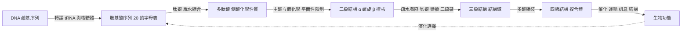

# 1.1 胺基酸的化學性質與多肽鏈的形成

## 一個只有二十種字母的字母表

如果有人告訴你，地球上已知最複雜的機器——從細菌的鞭毛到人類的視網膜——是由一套只有二十種化學單體拼裝而成的，你大概會覺得這是某種誇張的修辭。然而這正是生物學的基本事實：所有蛋白質，不論是長度五個胺基酸的微小胜肽，還是長度兩千多個胺基酸的巨獸，構成它們的基本單位都只有二十種標準胺基酸。

更令人吃驚的是數量上的對比。假設一條蛋白質鏈長度為 $n$ 個胺基酸，那麼理論上可能的序列總數是：

$$
20^{n}
$$

這是一個極端陡峭的指數函數。一條長度 $300$ 的蛋白質，其可能的序列組合數約為 $20^{300} \approx 10^{390.75}$ 。而我們可以觀測到的宇宙中的原子總數，估計不過是 $10^{80}$ 的數量級。也就是說，即使把整個可觀測宇宙的每一顆原子都拿來當作一個標記，也不足以把一個三百胺基酸長的序列走完一遍。

這個對比是理解整本書的起點。**生命不是在巨大的序列空間裡「試出」一個好蛋白質的**；它必須在有限的時間與能量下，從一個近乎無限的可能性海洋裡，精準地挑出那一條能形成正確形狀的序列。要理解生命如何做到這件事，我們必須先回到最底層：這二十種胺基酸究竟彼此有什麼不同？又是什麼力量把它們串成一條穩定、規律、可摺疊的鏈？

## 側鏈：化學差異的載體

所有的標準胺基酸都共享同一副「骨架」：一個中央的 α 碳原子，連接著一個羧基（ $-\mathrm{COOH}$ ）、一個胺基（ $-\mathrm{NH}_2$ ）、一個氫原子，以及第四個可變的基團。第四個基團就是**側鏈（side chain）**，在文獻中也稱為 R 基。整個分子可以用一個通式概括：

$$
\mathrm{H_2N{-}CH(R){-}COOH}
$$

真正決定化學行為的，就是這個 R。蛋白質化學在本質上是一門「側鏈化學」——主鏈提供骨架與剛性，側鏈提供化學多樣性與功能分化。二十種胺基酸之間的一切差異，幾乎全數來自這條可變的支鏈。

側鏈的差異可以沿著幾個正交的軸來分類。最重要的軸是**疏水性**：在生理 pH 附近的水溶液裡，富含碳氫的側鏈（如苯丙胺酸、纈胺酸、白胺酸）會被水分子排擠，因而傾向聚集在蛋白質內部；而帶電或極性的側鏈（如麩胺酸、離胺酸、天門冬胺酸、麩醯胺）則樂意與水形成氫鍵或靜電作用，傾向暴露於表面。

第二個軸是**酸鹼性**：羧基側鏈（天門冬胺酸、麩胺酸）在生理 pH 下幾乎必然帶負電，鹼性側鏈（離胺酸、精胺酸）幾乎必然帶正電，組胺酸則是一個可以穿過中性 pH 的開關。第三個軸是**極性**，指側鏈能否參與氫鍵；羥基（絲胺酸、蘇胺酸）、醯胺基（天門冬醯胺、麩醯胺）與苯環羥基（酪胺酸）都能提供或接受氫鍵。還有一些特殊側鏈：半胱胺酸的硫氫基可以氧化形成二硫鍵；色胺酸的吲哚環具強烈的紫外吸收；脯胺酸與甘胺酸則在立體化學上與眾不同，後文會說明原因。

還有一個容易被忽略但同樣關鍵的軸：**立體化學的手性**。除了甘胺酸之外，所有標準胺基酸的 α 碳都連接四個不同的基團，因此是手性中心。自然界在演化上幾乎完全一致地選擇了 **L 型**（除半胱胺酸外對應 S 構型）——這是一個至今仍無解的「同手性謎題」，但對本章重要的是：這種一致性使得蛋白質可以形成穩定的右手性 α 螺旋。若天然胺基酸在鏈上隨機地左右混雜，螺旋會被毀掉。

最後還有一個軸既非化學亦非物理，卻同樣具有決定性：**立體障礙**。異白胺酸的 β 支鏈、苯丙胺酸與酪胺酸的苯環、色胺酸的龐大吲哚環，都讓它們難以塞進狹窄的螺旋核心；相對地，甘胺酸因為只有一個氫，反而能在任何需要靈活轉折的位置上靈活就位。側鏈的大小與形狀，是蛋白質「能否摺成某個特定形狀」的第二道關卡。1.3 節要討論的鐮刀型貧血，正是這道關卡被跨過的結果：β 鏈第六個位置上，纈胺酸的疏水側鏈剛好提供了原本沒有的那塊表面。

## 二十種胺基酸的分類

下表把二十種標準胺基酸依上述軸整理成一個可反覆查閱的參考座標：

| 胺基酸 | 簡稱 | 側鏈類型 | 疏水性 | 酸鹼性 | 備註 |
|---|---|---|---|---|---|
| 甘胺酸 Gly | G | 無側鏈 | 中性 | 中性 | 唯一非手性；側鏈只有 H，摺疊最靈活，是螺旋破壞者 |
| 丙胺酸 Ala | A | 甲基 | 疏水 | 中性 | 最小且具支鏈，傾向形成 α 螺旋 |
| 纈胺酸 Val | V | 異丙基 | 疏水 | 中性 | 支鏈位阻限制構形 |
| 白胺酸 Leu | L | 異丁基 | 疏水 | 中性 | 支鏈位阻限制構形 |
| 異白胺酸 Ile | I | 仲丁基 | 疏水 | 中性 | β 支鏈傾向 β 摺板 |
| 脯胺酸 Pro | P | 環狀（連回主鏈 N） | 疏水 | 中性 | 亞胺酸；N 上無 H，是強力的螺旋破壞者 |
| 甲硫胺酸 Met | M | 硫醚 | 疏水 | 中性 | 起始胺基酸，含硫 |
| 苯丙胺酸 Phe | F | 苯基 | 疏水 | 中性 | 芳香族，與 Tyr、Trp 同源 |
| 色胺酸 Trp | W | 吲哚 | 疏水 | 中性 | 最大側鏈之一，紫外吸收強 |
| 酪胺酸 Tyr | Y | 對羥苯基 | 疏水偏極性 | 中性 | 酚羥基可磷酸化、參與訊息傳遞 |
| 絲胺酸 Ser | S | 羥甲基 | 極性 | 中性 | 側鏈可磷酸化 |
| 蘇胺酸 Thr | T | 羥乙基 | 極性 | 中性 | 側鏈可磷酸化 |
| 半胱胺酸 Cys | C | 硫氫甲基 | 極性 | 中性 | 唯一具 R 構型；可形成二硫鍵 |
| 天門冬醯胺 Asn | N | 醯胺甲基 | 極性 | 中性 | 醯胺基，氫鍵供體與受體 |
| 麩醯胺 Gln | Q | 醯胺乙基 | 極性 | 中性 | 醯胺基，氫鍵供體與受體 |
| 天門冬胺酸 Asp | D | 羧甲基 | 親水 | 酸性（負） | pKa ≈ 3.9 |
| 麩胺酸 Glu | E | 羧乙基 | 親水 | 酸性（負） | pKa ≈ 4.2 |
| 離胺酸 Lys | K | 己基胺基 | 親水 | 鹼性（正） | pKa ≈ 10.5 |
| 精胺酸 Arg | R | 胍基 | 親水 | 鹼性（正） | pKa ≈ 12.5 |
| 組胺酸 His | H | 咪唑基 | 極性 | 兩性（pKa ≈ 6.0） | 生理 pH 附近可質子化，酵素酸鹼催化常用 |

（表中依台灣常用譯名；Asp 與 Glu 另有天門冬酸、麩胺酸等譯法，Trp 亦作色胺酸或色氨酸。）

這張表不是死記的清單，而是一張「地圖」：當你看到一條序列裡連續出現 Leu、Ile、Val、Met、Phe，就可以合理推測這是一段埋藏在蛋白質核心的疏水螺旋；看到 Asp、Glu、Lys、Arg 密集的區段，則多半朝向水相的表面或金屬結合位。側鏈的化學性質一旦被讀懂，序列就不再是一串無意義的字母，而是一份關於形狀的規格書。

## 肽鍵：把單體焊成鏈

有了二十種字母，接下來的問題是：字母如何被「讀出來」？答案在於一種被稱為**肽鍵（peptide bond）**的化學鍵，以及基因轉譯機制中核糖體的催化。

從化學角度說，肽鍵的形成是一個**脫水縮合**反應。羧基的羰基碳與胺基的氮之間，先形成一個不穩定的中間體，再脫去一分子水：

$$
\mathrm{{-}C(=O){-}OH + H_2N{-}(R) \longrightarrow {-}C(=O){-}NH{-}(R) + H_2O}
$$

這就是蛋白質的肽鍵。它在生物體內並非自發發生——自發的脫水縮合在水中平衡位置極度偏向反應物，蛋白質合成方向的反應需要大量能量。細胞的做法是分兩步：先由胺基醯-tRNA 合成酶把胺基酸接到 tRNA 上，形成高能酯鍵（代價來自 ATP）；再由核糖體的肽基轉移酶中心，以核糖體本身的結構與位置效應暫時降低反應的活化能。脫水縮合的能量學挑戰被拆解成「負載能量」與「催化幾何」兩個可分別解決的問題，這也是生命用演化解法解決化學問題的典型範例。

但對本章的敘事而言，肽鍵最重要的性質不在反應機制，而在**其幾何後果**。肽鍵具有部分的雙鍵性質：羰基碳的 $p$ 軌域與氮的 $p$ 軌域重疊，電子離域化，使 $\mathrm{C{-}N}$ 鍵長（約 $1.32$ Å）比一般的單鍵（約 $1.47$ Å）短，也限制不能自由旋轉。更重要的是，離域化使肽基單元趨向**平面化**：組成肽基的六個原子—— $\mathrm{C}_{\alpha}(i)$ 、 $\mathrm{C}(i)$ 、 $\mathrm{O}(i)$ 、 $\mathrm{N}(i{+}1)$ 、 $\mathrm{H}(i{+}1)$ 、 $\mathrm{C}_{\alpha}(i{+}1)$ ——幾乎共平面。

這個平面性有一個直接且強烈的立體化學後果。既然肽基是剛性的平面板，那麼多肽鏈的形狀就只能由兩個二面角來決定： $\phi$ 角（ $\mathrm{C}_{\alpha}(i{-}1)$ – $\mathrm{C}_{\alpha}(i)$ – $\mathrm{C}(i)$ – $\mathrm{N}(i{+}1)$ ）與 $\psi$ 角（ $\mathrm{C}_{\alpha}(i)$ – $\mathrm{C}(i)$ – $\mathrm{N}(i{+}1)$ – $\mathrm{C}_{\alpha}(i{+}1)$ ）。整條鏈的每個殘基只有兩個自由度可用，而且幾乎所有的取值組合都會造成原子重疊或鏈段穿模。這一點將在 1.2 節以 Ramachandran 圖的形式正式登場，它是本章化學敘事通向結構敘事的橋樑。

順帶一提，肽鍵在構形上偏好 **trans**（反式）而非 cis（順式），因為 trans 排列讓相鄰側鏈遠離、位阻更小。唯一的例外是脯胺酸，由於它的側鏈環回接到主鏈氮上，氮上沒有氫原子可供形成穩定的氫鍵，因此肽鍵前後的順反平衡會明顯偏向 cis——這也是蛋白質轉譯過程中需要**肽基脯胺酸異構酶（prolyl isomerase）**來加速翻轉的原因。

## 序列即程式

肽鍵的另一個後果同樣深遠。回頭看那個數字 $20^{n}$ ，它意味著序列本質上是一段**資訊**：一段可以被複製、比較、比對、傳遞的離散字串。DNA 的鹼基序列是胺基酸序列的模板，而胺基酸序列又是結構的模板。這條資訊鏈有著令人震驚的效率——在數百萬年的演化中，任意一次隨機的單點突變，只要導致更差的形狀，就會被天擇淘汰；只有那些提升功能的突變會被保留。

於是「序列決定結構」這個命題以一個近乎演化演算法的形式浮現：**序列不是結構的描述，而是結構的程式碼**。程式碼的形式是一串符號，執行的結果是一個三維形狀，執行的環境是水與溫度，而篩選的機制是能不能活得夠久。這正是 1.3 節「結構決定功能」原則的對偶，也是本書全體技術方案的立足點。

這裡可以引入一個更早的、比演化更古老的觀念。分子生物學史上曾長期存在一種「拉馬克式」的想法：認為蛋白質的摺疊形狀會隨著行使功能而改變，並且這種改變會被「遺傳」下去。這個觀念最終在統計與實驗上都被否定了——蛋白質的摺疊是熱力學驅動的，對序列具有決定性，不依賴行使功能的需求。但拉馬克式的直覺並非全無價值，它點出了蛋白質研究中的一個核心張力：**功能似乎也能反向地塑造結構**。1.3 節將正式處理這個雙向性。

序列一旦被讀出，它就同時是一件科學工具。比較不同生物的序列，人類得以重建演化樹、辨認保守區與功能位；比較同一個蛋白質在不同個體的序列，則能找出與疾病相關的位點——1949 年鐮刀型貧血的發現，正是「讀序列、找差異、再解釋功能」這條路線的開端，而它將在 1.3 節成為主線。值得注意的是，在 1953 年之前，人們甚至無法想像序列可以被如此系統性地比較；那需要 Sanger 的定序技術（第 1.2 節的主題）作為前提。可以說，序列的出現，同時打開了「由序列推結構」與「由差異推功能」兩條道路。

把上述步驟連成一條資訊流，可以看見本章到全書的接縫在哪裡：

最後那條虛線回饋邊，是本章末尾「拉馬克式」直覺的正式落腳點，也是 1.3 節要處理的雙向性。

在談到序列比對之前，我們需要先理解一個更根本的問題：序列究竟是如何變成形狀的？因為胺基酸的側鏈性質只是「材料」，而形狀是「施工結果」，中間必然存在一套把材料性質推導成幾何構形的規則。

那套規則，就是蛋白質結構的四個層次。

## 序列如何變成形狀：結構層次的預告

蛋白質結構的四個層次層層遞進。初級結構是胺基酸的序列本身，也就是我們剛才建立的那個字母表與串接方式。二級結構是局部規則的幾何排列，最典型的是 α 螺旋與 β 摺板；三級結構是單條多肽鏈的整體三維摺疊，並進一步分為結構域（domain）；四級結構則是數條多肽鏈組裝成複合體。

每一層都建立在下一層之上，卻又各自受制於不同層級的物理約束。二級結構幾乎完全由主鏈的立體化學（ $\phi$ 、 $\psi$ 角與肽鍵平面性）決定，因此相當容易預測；三級結構則是把大量弱作用力——疏水效應、氫鍵、鹽橋、凡得瓦力、二硫鍵——加總起來的極小化問題，複雜度急遽上升；四級結構還要處理鏈與鏈之間的界面。1.2 節將把這條階梯逐級走完，並說明為什麼「從一維到三維」本質上是一個物理化學的搜尋問題——正是第 2 章列文索爾悖論的舞台。

在此之前，讓我們再回到那個 $20^{n}$ 的數字。它此刻不再只是一個統計上的奇觀，而是一個待解的工程問題：要在這樣一個龐大的序列空間裡，找到少數幾千個能摺出真實結構的序列。第 5 章的答案會是深度網路，第 6 章會是 Evoformer。但在那之前，人類先花了一百年，靠手算、靠晶體繞射、靠序列比對，一點一點逼近那個目標。

## 本節重點

1. 蛋白質由 20 種標準胺基酸構成，序列組合數為 $20^{n}$ ；長度 $300$ 的序列約有 $10^{391}$ 種可能，遠超可觀測宇宙的原子數。
2. 化學差異幾乎全由**側鏈**承載，維度包括疏水性、酸鹼性、極性、手性與立體障礙。
3. 自然界一致採用 L 型胺基酸（半胱胺酸為 R 型），這是規則性 α 螺旋得以形成的前提。
4. 肽鍵由**脫水縮合**形成，具有部分雙鍵性質，使肽基單元**平面化**且剛性，鏈的構形自由度被壓縮為 $\phi$ 與 $\psi$ 兩個二面角。
5. 胺基酸序列是**程式碼**而非描述；「序列決定結構」是全書的方法論基石，而「功能反向塑造結構」則構成本書第 1.3 節的核心張力。

## 思考問題

1. 若把蛋白質的主鏈完全換成剛性的直鏈（單一構形），20 種側鏈還可能產生摺疊與功能多樣性嗎？請從資訊量角度估算。
2. 肽鍵平面性使得每個殘基只剩兩個自由度。若某個胺基酸側鏈過於 bulky（如色胺酸），它對 $\phi$ 、 $\psi$ 的允許區域會產生什麼影響？這與 1.2 節的 Chou-Fasman 預測有何關聯？
3. 脫水縮合在水中不利於向右進行。核糖體採用「先接到 tRNA 上再轉移」的兩步策略。請思考：若把整個反應設計成單步，會失去什麼控制力？
4. 「拉馬克式」的想法雖在機制上被否定，但它提出了「功能能否反向影響結構」。請預想：若一個蛋白質的結構完全由熱力學決定，它還能被演化「選出」特定功能嗎？這與 1.3 節的主題有何關係？
