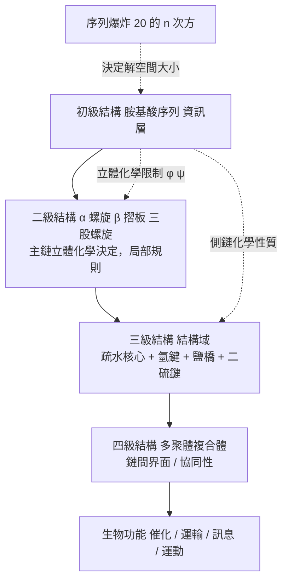

# 1.2 蛋白質的四級結構層次（初級、次級、三級、四級）

## 從字母表到形狀：一個四層樓梯

上一節結束時，我們手上有兩樣東西：一套只有二十種單體的字母表，以及一條把單體串成鏈的化學規則（肽鍵）。這兩樣東西加在一起，只構成蛋白質故事的一半。另一半是形狀——鏈如何彎折、捲曲、收攏成一個特定的三維形體，而這個形體往往帶著狹窄的縫隙，恰好讓某個小分子擠進去。

蛋白質結構的傳統分層——初級、次級、三級、四級——正是一條從「字母」通往「形狀」的階梯。它不是人為的分類遊戲，而是四個物理層次依次湧現的結果：每一層的穩定性都建立在下一層之上，而每一層的可預測性都比下一層差一截。本節要沿著這座階梯往上走，最後停在三級與四級之間那道至今未被跨越的鴻溝前——那正是第 2 章列文索爾悖論的入口。

## 初級結構：序列本身

初級結構就是胺基酸的線性序列，由 N 端到 C 端以化學式標示，例如胰島素的 B 鏈：

$$
\mathrm{H_2N{-}FVNQHLCGSHLVEALYLVCGERGFFYTPKT{-}COOH}
$$

在 1955 年之前，人類完全不知道一條蛋白質的組成順序。Frederick Sanger 花了數年時間，發展出二硫鍵還原、胜肽分段與 Edman 降解等一整套技術，首度完整定出牛胰島素的序列，並因此獲得 1958 年諾貝爾化學獎。這是一個象徵性的里程碑：它證明了「蛋白質的組成是可以被讀出來的」，也把生物學從形而上的形體論拉進了可序列化的化學。

但 Sanger 的貢獻不止於技術。在序列可知的瞬間，一個巨大的機會出現了：如果胺基酸序列可以被讀出，那麼比較不同生物的序列，就有機會揭示物種之間的演化關係——這是分子演化生物學的誕生；而更關鍵的是，如果序列與結構之間存在某種可預測的對應關係，那麼結構預測就從「不可能的任務」變成了「可以嘗試的工程問題」。

初級結構還包含一個容易被略過但物理上重要的資訊：**二硫鍵的連接方式（disulfide connectivity）**。對含多條鏈的蛋白質而言，知道哪個半胱胺酸與哪個半胱胺酸配對，等於知道了鏈與鏈在三維空間中如何被「縫」在一起。這個資訊無法從一維序列推得，卻是結構解析的關鍵輸入。

## 二級結構：主鏈的重複圖樣

若初級結構是字母串，二級結構就是字母串中出現的**局部規則圖樣**。這些圖樣幾乎完全由主鏈決定，而不依賴側鏈的化學性質——這正是它們能被可靠預測的原因。

### α 螺旋

1951 年，Linus Pauling 與 Robert Corey 在 *Nature* 上發表了他們的手工模型：多肽鏈可以藉由主鏈羰基氧與第四個殘基的醯胺氫之間的氫鍵，形成右手性螺旋。其幾何參數極為精確：每轉 $3.6$ 個殘基完成一圈，每圈軸向高度 $5.4$ Å（即每個殘基沿軸上升約 $1.5$ Å），每個殘基相對前一個旋轉約 $100°$ 。氫鍵形成於 $\mathrm{C{=}O}(i)$ 與 $\mathrm{N{-}H}(i{+}4)$ 之間。

α 螺旋是蛋白質中最常見的二級結構，理由是它幾乎是「最不費力」的構形：每個殘基都同時滿足兩件事——主鏈原子彼此不重疊，且每個殘基的醯胺氫都得到充分氫鍵飽和。它的代價是靈活性低：一旦成螺旋，要彎折就需要破壞它，因此螺旋常出現彎折（kink）以吸收曲率。

### β 摺板

同一篇論文的姊妹作是 β 構形：多肽鏈伸展成 β 股（strand），多條 β 股並排，靠股與股之間的氫鍵穩定，形成「摺板」（pleated sheet）——之所以叫摺板，是因為骨架本身呈手風琴狀的鋸齒。β 股可以是平行的（parallel）或反平行的（antiparallel），反平行排列的氫鍵網絡通常更為理想、也更常見。

β 摺板的兩項性質在結構功能上極重要：其一，它能形成**跨越大範圍的延伸片層**，是 β 桶（β-barrel）、澱粉樣纖維與病毒粒子外殼的基礎；其二，它對側鏈的容忍度高得多，兩個 β 股之間可以夾住一段疏水鏈而不產生位阻衝突。

### 膠原蛋白的特例

膠原蛋白提供了第三種、也是最特殊的二級結構：三股螺旋（triple helix）。每個殘基沿軸上升約 $3.3$ Å（比 α 螺旋的 $1.5$ Å 慢一倍多），且序列必須嚴格符合 $\mathrm{Gly{-}X{-}Y}$ 的重複模式——每第三個位置必為甘胺酸，因為三股螺旋的軸心空間極其狹小，只有側鏈只有一個氫的甘胺酸塞得進去。這也解釋了為何膠原蛋白富含脯胺酸與羥脯胺酸（後者需要維生素 C 參與的羥化修飾，缺乏維生素 C 即得壞血病）。

## Ramachandran 圖：立體化學限制的證據

二級結構的預測之所以可能，是因為 1.1 節提到的立體化學限制可以被量化。G. N. Ramachandran、V. Sasisekharan 與 V. Ramakrishnan 在 1973 年發表了著名的方法：以每個殘基的兩個二面角 $\phi$ 與 $\psi$ 為座標，把二肽構形的能量作為背景來繪製「允許區域地圖」，這就是今天教科書中的 **Ramachandran 圖**。

圖上的結構極具資訊量：

| 區域 | $\phi$ 近似值 | $\psi$ 近似值 | 意義 |
|---|---|---|---|
| 右手性 α 螺旋 | $-63°$ （理想值） | $-43°$ （理想值） | 大面積高密度區，說明 α 螺旋是立體化學上「便宜」的構形 |
| β 摺板 | $-135°$ | $+135°$ | 另一個主要允許區，與 α 螺旋幾乎不重疊 |
| 左手性 α 螺旋 | $-120°$ | $+120°$ | 面積很小，蛋白質中罕見但存在 |
| $\pi$ 螺旋 | $-57°$ | $-70°$ | 窄區，環狀肽中常見 |
| 禁區 | $\phi \approx 0°$ , $\psi \approx +90°$ | — | 原子重疊，物理上不可能 |

這張圖解釋了為什麼蛋白質的主鏈結構「看起來很少樣」：可容許的 $(\phi,\psi)$ 組合只佔 $({-}180°, 180°)^2$ 平面的一小部分。脯胺酸是特別有趣的案例，它的環狀側鏈把 $\phi$ 鎖定在約 $-60°$ 附近，卻把 $\psi$ 解放開來——這正是它「破壞螺旋」但「不禁止摺板」的立體化學原因。

### Chou-Fasman 預測（1974-1978）

有了立體化學的允許區域，統計方法就可以上陣。Peter Chou 與 Fasman 建立了所謂的**構形參數（conformational parameters）**：對每一種胺基酸分別統計其在已知結構中出現於 α 螺旋與 β 摺板的相對傾向，並與整體胺基酸頻率比較，得到 $P_{\alpha}$ 與 $P_{\beta}$ 。然後用一組明確的規則掃過序列：找出可能的螺旋起始段、可能的摺板股、可能的 β 轉角，再依序評分。1978 年他們測試了 61 個蛋白質，螺旋的預測準確率約 $65\%$ ，摺板約 $45\%$ 。

這是第一次有人用「序列轉二級結構」的規則在計算機上跑通全蛋白質。它證明了**序列中確實含有足以推導局部構形的資訊**——這是一個極其重要的訊號，因為它意味著同一種「從序列推結構」的思路，在三級結構的尺度上也許只是困難得多，而不是根本上不可行。

## 三級結構：整條鏈的整體摺疊

有了局部的規則圖樣，蛋白質還要解決一個更宏大的問題：一條有兩百個殘基的鏈，怎麼把自己折成一個致密、穩定、唯一的三維形體？

答案是**疏水塌陷（hydrophobic collapse）**。在 1960 年代，Charles Tanford 等人的疏水效應研究顯示，摺疊的早期階段並非經歷「隨機游走再逐步收斂」，而是在水中，鏈會迅速塌陷成一個緊密聚集的疏水核心。疏水基團被埋入核心，極性基團留在表面與水相接觸；核心中殘基與殘基靠凡得瓦力緊密堆積，表面上則形成豐富的**氫鍵網絡**（每一個主鏈醯胺氫與羰基通常都被滿足，這是二級結構之外的第三類氫鍵）。

除此之外，三級結構還靠幾類「長程」作用力穩定。**鹽橋（salt bridge）**是帶正電的離胺酸、精胺酸與帶負電的天門冬胺酸、麩胺酸之間的靜電吸引，其強度隨環境介電常數與距離而變，是「局部」與「遠端」之間的橋樑。**氫鍵**不僅發生在主鏈，也發生在側鏈之間（羥基、醯胺基、咪唑基），並且是酵素活性位點辨識的關鍵。**凡得瓦力**主導核心的緊密堆積，是數以萬計的弱作用加總成強效應的典型例子。

**二硫鍵**則是兩個半胱胺酸側鏈的硫氫基氧化形成的共價鍵，獨一無二地以**共價**方式固定折疊結果，主要出現在分泌到細胞外的蛋白質（胞外環境氧化還原電位較高）中。此外，磷酸化、乙醯化與胜肽鏈剪切等**共價修飾**，會進一步調整三級結構。

### 結構域：三級結構的模組

當蛋白質變得很大（數百到數千殘基），「整條鏈折成一個形體」這種描述就不夠用了。蛋白質實際上是由可獨立摺疊的**結構域（domain）**組裝而成。結構域是三級結構的模組單位：每個結構域通常由 $50$ 到 $350$ 個殘基組成，能獨立摺疊成穩定的球形，並往往對應到一個可辨識的功能。

結構域的概念有兩個深遠影響。第一，它解釋了**模組化演化**：演化可以把結構域模組像是樂高積木一樣重新組合，一個新的蛋白質可以由既有的結構域拼湊而成，而不必從零開始。第二，它為結構預測的實務提供了自然的工作單位——預測一個由三個結構域組成的蛋白質，可以拆成三個較小的預測問題。

順帶一提，超二級結構（supersecondary structure）指的是像「螺旋－環－螺旋」「β 髮夾（β-hairpin）」這類頻繁出現的結構域內局部組合，它們的出現頻率顯著高於隨機預期，暗示著局部序列本身攜帶了「摺成這樣」的偏好。

## 四級結構：多條鏈的組裝

有些蛋白質由單條多肽鏈構成，如肌紅蛋白（myoglobin）。但許多蛋白質必須由數條鏈組成才能工作——它們形成**四級結構**。血紅蛋白（hemoglobin）是最經典的案例：成人血紅蛋白是一個由兩條 α 鏈與兩條 β 鏈組成的四聚體（ $\alpha_2\beta_2$ ），四條鏈各攜帶一個血基質（heme），每個血基質中央的鐵原子可逆地結合一個氧分子。

這個案例之所以經典，是因為它的結構是被「做出來」再「被理解」的。Max Perutz 從 1940 年代起，花了將近二十年的時間，終於在 1958 至 1960 年間解出血紅蛋白的 X 光結構；他在 1962 年與 John Kendrew（解出肌紅蛋白結構者）共同獲得諾貝爾化學獎。Perutz 不只是「解出」結構，他還用結構解釋了功能：氧的結合會使血基質中的鐵從二價平面態移入蛋白質核心，並拉動鄰近的 F 螺旋與 G 螺旋位移，進而改變整個四聚體的構形。

這個機制解釋了兩個用化學結構無法解釋的生理現象。其一是**協同性（cooperativity）**：一個氧分子結合會提高後續氧分子的親和力，而非獨立地一增一減。其二是**波耳效應（Bohr effect）**：當二氧化碳濃度升高或 pH 降低時，血紅蛋白對氧的親和力下降，促進氧的釋放——這正是肺與組織之間氣體運輸得以運作的物理機制。一九六〇年代，Perutz 提出的「立體化學機制（stereochemical mechanism）」正是以側鏈的位移逐級傳遞配位結合的資訊，把結構與生理功能直接扣在一起。

順帶一提，血紅蛋白與肌紅蛋白的關係也說明了演化的方向性：兩者共享同一個**珠蛋白摺疊（globin fold）**，序列相似度約 $25\%$ ，源於共同祖先；但血紅蛋白多出鏈間界面與協同性調控機制，肌紅蛋白則是單體、專職儲氧。換言之，演化並不是重新設計，而是**在既有骨架上改動與擴充**。

## 四個層次如何串成一條線

這張圖也標示了兩條值得記住的因果關係：初級結構決定二級結構，因為主鏈的化學性質是共用的；初級與二級結構共同決定三級結構，因為側鏈的化學性質決定了它願意待在哪裡。而在反方向，初級結構並**不**唯一決定三級結構，因為同一條序列在細胞內的不同環境中可能採取不同構形——別忘了折疊還取決於伴護蛋白、翻譯速度與周遭分子的協作。

## 從一維到三維：一個搜尋問題的浮現

現在回到本章開頭那個問題：為什麼二級結構能預測，三級結構卻不能？

理由有三層，而且一層比一層更令人沮喪。

第一層是**組合爆炸**。若一個蛋白質有 $n$ 個殘基，每個殘基有數百種可能的二面角組合，理論上的構形空間大小是隨 $n$ 指數成長的。當 $n = 300$ 時，這個數字早已超出人類計算能力的極限。

第二層是**搜索的時序障礙**：由於構形空間如此巨大，一條鏈若真的「逐一試出」最低能量的構形，所需時間會超過宇宙的年齡——這正是 1969 年 Cyrus Levinthal 提出的悖論，將在第 2 章正式展開。

第三層是**能量函數本身的困難**：即使給你一台計算機器，也得先有一個足夠精確的能量函數來評分每個候選構形。一個簡化的、可被學習的近似如下：

$$
E(\mathbf{x}) = \sum_{i<j} f(d_{ij}) + \sum_i g(\mathbf{x}_i)
$$

其中 $d_{ij}$ 是原子 $i$ 與原子 $j$ 之間的距離， $f$ 描述成對作用（排斥、吸引、位阻）， $g$ 描述單原子或成鍵項。這個式子的意思很單純：**構形的品質可以寫成一個標量函數，而找到最低能量構形就是一個連續最佳化問題。** AlphaFold 2 的結構模組正是這種「學習到的能量函數加上迭代優化」的具體實現（第 7 章）。

但真正的困難在於：自然界並不是先寫出能量函數再最佳化。它是從頭到尾用一套物理化學的規則，在常壓、常溫、水溶液的條件下，就地把蛋白質「算出來」——而這套規則的核心，是演化預先寫好的胺基酸序列。

這就把我們帶回本章開頭那個樓梯的頂端，並且清楚地指出三級與四級結構預測的癥結所在。結構在物理上是被完全決定的，資訊也完全存在於序列之中；我們缺的只是一個能跨越搜尋障礙的計算方法。而在 AlphaFold 出現之前，人類用了五十年的時間，才把這個問題的輪廓摸索清楚。

## 本節重點

1. **初級結構**是胺基酸序列，Sanger 於 1955 年首次完整定序胰島素，讓序列從此成為可讀、可比對的資訊。
2. **二級結構**由主鏈的立體化學決定：α 螺旋（ $3.6$ 殘基/圈，氫鍵 $i \to i{+}4$ ）與 β 摺板；Ramachandran 圖（1973）將可行的 $(\phi,\psi)$ 區域量化，Chou-Fasman（1974-1978）則首次實現全蛋白質的二級結構預測，螺旋準確率約 $65\%$ 、摺板約 $45\%$ 。
3. **三級結構**由疏水塌陷主導，並靠氫鍵、鹽橋、凡得瓦力與二硫鍵共同穩定；大型蛋白質由可獨立摺疊的**結構域**組成，是演化模組化的基礎。
4. **四級結構**是鏈間組裝；血紅蛋白 $\alpha_2\beta_2$ 由 Perutz 於 1958-1960 年解出，並以其立體化學機制解釋協同性與波耳效應。
5. 從一維序列到三維結構本質上是**物理化學的搜尋問題**，其瓶頸在於構形空間的指數爆炸（Levinthal 悖論，第 2 章）與可用能量函數的精度。

## 思考問題

1. Chou-Fasman 的 $\phi$ 、 $\psi$ 統計參數只需序列即可算出，準確率卻只有六成左右。請思考：側鏈與側鏈的交互作用（例如脯胺酸在 β 股中的角色）為什麼會破壞這項方法的準確度？
2. 若一個蛋白質的序列完全決定其結構，則在細胞內的高溫或變性條件下摺疊會如何？這說明「序列決定結構」在什麼範圍內成立？
3. 血紅蛋白的協同性與阿茲海默症的 tau 蛋白聚集，兩者都涉及構形的變化，但方向相反（一個是可控的構形切換，一個是病態的聚集）。請對照本章的物理作用力清單，思考哪些作用力在兩種現象中扮演了不同角色。
4. 結構域可以獨立摺疊，這對 AlphaFold 的設計提出了什麼實務上的要求？若一個蛋白質由五個結構域組成，預測它應該被當成一個問題還是五個問題？
