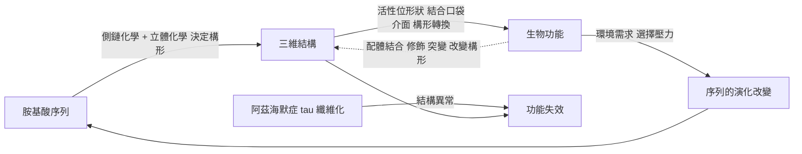

# 1.3 結構決定功能的黃金定律

## 從一個分子的悲劇談起

1949 年，在加州理工學院，兩位化學家 Linus Pauling 與 Max Petris、遺傳學家 Harvey Itano 聯手發表了一篇題為〈鐮刀型貧血症：一種分子疾病〉（*Sickle Cell Anemia, a Molecular Disease*）的論文。這篇論文在科學史上的地位極為特殊：它是第一個把遺傳疾病與單一蛋白質的化學差異直接連結起來的案例。在此之前，鐮刀型貧血被認為是「黑人的疾病」，是種族性的、體質性的疾病；Pauling 等人指出，不對——它是一種化學病，而化學病可以被化學語言描述。

他們的證據來自電泳：正常血紅蛋白與鐮刀型血紅蛋白在電場中的遷移速率不同，說明兩者的電荷或構形存在可測量的差異。七年後，Ingram 於 1956 年完成了序列比對，直接點名了差異的位置與性質：β 鏈第六個胺基酸，麩胺酸（Glu）被纈胺酸（Val）取代。也就是說，一個胺基酸的側鏈，從帶負電、極性的羧基，變成中性的疏水異丙基。

這個改變所造成的後果，可以在原子層級追蹤。纈胺酸的側鏈在 β 鏈表面形成一塊疏水「補丁」，而鄰近的 β 鏈上恰好有苯丙胺酸與白胺酸構成的疏水凹槽。在氧合狀態下，血紅蛋白的構形使凹槽被遮蔽，聚合物無從形成；但在缺氧（去氧合）狀態下，構形鬆動，凹槽暴露出來，與對方的疏水補丁剛好嵌合。一個 β 鏈的 Val6 因此能在去氧血紅蛋白上找到它的「配對對象」，形成長條狀的纖維——這就是鐮刀型貧血患者在低氧環境下紅血球變成鐮刀狀的分子原因。1930 年代學者就已注意到脫氧會促進聚合；1970 年代的 Hoagland 更證實了聚合是協同性的，並確認 2,3-二磷酸甘油酸（2,3-BPG）作為異構物可穩定去氧構形，進一步抑制聚合。

這整條因果鏈，每一環都是「結構」在驅動：原子層次的結構差異，造成了分子層次的構形差異，造成了纖維聚合的物理行為，最終造成了紅血球變形、微血管阻塞、組織缺血與死亡。Pauling 因此在 1954 年獲得諾貝爾化學獎——他是史上唯一一位因研究一種遺傳疾病而獲此獎的科學家。Pauling 與鐮刀型貧血的研究，使「分子疾病」成為二十世紀生物學最有力的概念之一。

## 結構如何決定功能：三個機制的層級

「結構決定功能」並不是一句口號，而是可以拆解為三個層次的命題。

第一個層次是**原子層級**：結構改變了。那個被替換的胺基酸從一個化學身份換成另一個化學身份，於是鹽橋消失了、疏水補丁出現了。

第二個層次是**構形層級**：原子的改變導致構形的改變。微小的胺基酸替換會沿著蛋白質的結構網絡傳播，使原本穩定的構形在特定條件下不再穩定。

第三個層次是**功能層級**：構形的改變導致功能的喪失。血紅素無法正常攜氧，纖維在血管中累積，組織得不到氧。

值得注意的是，這條鏈條的每一環都是**必然**的，它不需要任何「生物學意圖」來運作。分子不會「想要」聚合，它只是落入了能量更低、但生物功能更差的構形。

把本章討論過的案例並排，可以看出同一套原理在不同尺度上的運作：

| 案例 | 結構層次的改變 | 功能後果 | 證據年代 |
|---|---|---|---|
| 鐮刀型貧血 β 鏈 Glu6Val | 側鏈由羧基換成異丙基，形成疏水補丁 | 去氧血紅蛋白聚合纖維，紅血球變形、血管阻塞 | 1949（Pauling 等）、1956（Ingram） |
| 珠蛋白的選擇性擴張 | 鹽橋、鏈間界面、2,3-BPG 口袋等少數關鍵差異 | 肌紅蛋白（單體儲氧）與血紅蛋白（協同性運輸）分化 | 1958-1960（Kendrew、Perutz） |
| 藏族 EPAS1 突變 | 缺氧誘導因子的結合特性改變 | 低氧下血紅素濃度得以維持 | 2010（藏族基因組） |
| β-內醯胺類抗生素 | 藥物形狀模仿 D-Ala-D-Ala 中間體 | 佔據轉肽酶活性位，阻斷細胞壁合成 | 1940 年代至今 |
| tau 蛋白異常磷酸化 | 由穩定微管的構形轉入聚集構形 | 纖維纏結，神經元功能喪失 | 1980-2000 年代 |

## 同源序列，不同功能：肌紅蛋白與血紅蛋白

結構決定功能還有一個更細緻的面向——演化如何用同一套骨架做出不同功能。

肌紅蛋白（myoglobin）與血紅蛋白（hemoglobin）共享同一個**珠蛋白摺疊（globin fold）**：八個 α 螺旋以 A 到 H 標記，圍繞著一個中心口袋。John Kendrew 於 1958 年以 $6$ Å 解析度、1960 年以 $2$ Å 解析度解出抹香鯨肌紅蛋白結構，Perutz 則解出血紅蛋白，兩人共享 1962 年諾貝爾化學獎。結構的相似性如此之高，以至於演化生物學家一看就知道它們同源。

但它們的序列相似度只有約 $25\%$ ，功能卻截然不同：肌紅蛋白是單體，主要儲存氧於肌肉；血紅蛋白是 $\alpha_2\beta_2$ 四聚體，負責肺部與組織間的氧運輸。差異從哪裡來？

從結構上看，三個關鍵的變化撐起了這項功能分化。第一，血紅蛋白的 α 鏈與 β 鏈之間多出了鏈間界面，使四聚體能夠組裝。第二，血紅蛋白的遠端組胺酸（His87）能與 β 鏈的 C 端形成**鹽橋**，而這個鹽橋正是氧結合後被拉開、進而觸發整個四聚體構形轉換的訊號起點。第三，血紅蛋白在鏈上保留了 2,3-BPG 的結合口袋，肌紅蛋白則沒有這個口袋。這些差異並非「重新發明」，而是**在既有骨架上插入幾個關鍵零件**，就把一個靜態的儲氧容器變成了可調控的運輸機器。

演化生物學把這種模式稱為「選擇性擴張」（adaptive expansion）：大多數位置以保守變化維持核心功能，少數位置累積了創新的變化。從 AlphaFold 的角度來看，這是個極佳的訊號——同源序列之間的結構差異，往往集中在少數幾個位置，而序列比對（MSA）在這些位置提供強烈的演化訊號，指向具體的構形差異。第 5、6 章將看到，這正是 AlphaFold 預測能跨越序列家族泛化的關鍵。

## 結構決定功能：藥物設計的實證

如果「結構決定功能」只停留在疾病與演化，它就還只是教科書上的真理。在藥理學裡，它是一套每天被用來製造藥物的工程原則。

抗生素的機制提供了乾淨的例子。β-內醯胺類抗生素（青黴素、頭孢菌素）之所以能殺死細菌，是因為它們的 β-內醯胺環與 D-丙胺酸-D-丙胺酸（D-Ala-D-Ala）中間體在形狀上高度相似，因而能「騙過」細菌的轉肽酶（transpeptidase，即青黴素結合蛋白，penicillin-binding protein）。細菌在合成細胞壁肽聚醣的最後一步會把新肽鏈接到 D-Ala-D-Ala 上；β-內醯胺抗生素佔據了轉肽酶的活性位，卻無法完成反應，於是細胞壁合成被永久阻斷。這是一個純粹的**形狀互補**問題，而它的原子層級細節必須靠結構才能講清楚。

類似的邏輯在針對核糖體的抗生素中重複出現，而且更能看出結構決定的精準度。**氯黴素**（chloramphenicol）結合細菌 50S 核糖體次單元的肽基轉移酶中心，直接阻斷肽鏈延長。**大環內酯類**（macrolides，如紅黴素）結合 23S rRNA 的大環內酯結合位，阻斷核糖體的轉位。**胺基糖苷類**（aminoglycosides）結合 30S 次單元 16S rRNA 的解碼中心，造成 mRNA 被誤讀。**利福平**（rifampicin）則結合細菌 RNA 聚合酶的 β 次單元，抑制轉錄起始。

每一種藥物的效力、選擇性與抗藥性機制，都能在三維結構上找到對應的位點與理由。反過來說，這也解釋了抗藥性為什麼那麼難纏手：一個抗藥性突變之所以有用，是因為它改變了目標蛋白的結合口袋形狀，使藥物「握不住」。理解結構，就理解了解藥性；這正是 AlphaFold 與現代結構藥理學結合時，被寄予厚望的第一個應用場景。

## 雙向性：功能如何反向塑造結構

然而，「結構決定功能」若被讀成單向的因果，就會錯過生物學一半的精采。功能確實會反向塑造結構，而且有兩條不同的路徑。

第一條路徑是**演化層級的反向作用**。功能需求被天擇轉化為序列的改變，序列改變導致結構改變。例如居住在西藏高原的藏族人在 **EPAS1** 基因上帶有一個來自丹尼索瓦人的人群的單一鹼基替換，使其在低氧環境下對缺氧誘導因子 HIF 的敏感性下降，血紅素濃度得以維持。這是一個標準的「功能導向選擇、選擇改變序列、序列改變結構、結構實現功能」的閉環，而閉環的驅動力來自環境中氧分壓這個功能需求。同樣的邏輯解釋了鐮刀型貧血等位基因在瘧疾流行區的高頻分布：雜合子帶因者在瘧疾環境中有生存優勢，因此該等位基因被正選擇保留——這是功能在人類基因體上留下的最戲劇性印記之一。

第二條路徑是**個體內的構形調節（allostery）**，即蛋白質的功能狀態本身改變其構形，而構形的改變又改變功能的表現。血紅蛋白的氧結合與釋放就是最精密的例子；酵素的誘導契合（induced fit）與協同性調控則是同類現象的一般化。換言之，**蛋白質不是被動的形狀，而是一副可被訊號改變形狀的機械**。

因此，嚴謹的表述應該是一個閉環：

$$
\text{序列} \;\longrightarrow\; \text{結構} \;\longrightarrow\; \text{功能} \;\longrightarrow\; \text{選擇壓力} \;\longrightarrow\; \text{序列}
$$

## 當結構無法用序列簡單推導：失序、聚集與構形集合

現在來到本章最關鍵、也最直接引出 AlphaFold 的問題。既然結構決定功能，而結構由序列決定，那麼只要給定序列，功能與病理都應該是可推導的。但現實並非如此。

阿茲海默症是最好的例子。這種疾病涉及至少兩種蛋白質的異常：**類澱粉β 蛋白**（amyloid-β, Aβ）與 **tau 蛋白**。Aβ 是膜上蛋白 APP 的切割產物；當其聚集形成寡聚物與類澱粉纖維時，會造成細胞毒性。tau 蛋白則是穩定微管的蛋白質，在阿茲海默症中經過異常磷酸化，失去與微管結合的能力，並聚集為**成對螺旋絲（paired helical filaments）**與纖維纏結。這兩種病理都涉及蛋白質「離開原本的構形」並進入一種新的、聚集的構形。

問題在於，這個過程的關鍵不只是一條序列，而是**構形的集合（conformational ensemble）**：蛋白質在細胞內並非只有一個立體結構，而是存在於一個由許多構形組成的動態平衡中，能量最低者只是其中之一。當環境條件（氧化壓力、翻譯速率、伴護蛋白濃度、相鄰分子的存在）改變時，平衡移動，蛋白質可能跳入另一個構形盆地。阿茲海默症的 tau 病理還具有**蛋白病毒性（prion-like seeding）**的特性：錯誤摺疊的 tau 構形可以作為模板，把正常的 tau「誘導」成同樣的錯誤構形，並在細胞間傳播。

亨丁頓氏症則呈現了另一種難度。這個疾病由 **HTT** 基因中 CAG 三核苷酸重複序列的擴張所引起，三核苷酸重複在轉譯後產生一段異常長的**多麩醯胺酸（polyglutamine, polyQ）**序列。當重複次數超過約 35 次時，polyQ 片段傾向形成 β 摺板並聚集，而 β 摺板正是類澱粉與 tau 纖維的結構特徵。值得注意的是，這類疾病有**遺傳早發（anticipation）**現象：重複次數在世代間擴增，發病年齡一代比一代提早。

這些案例共同揭示了「結構決定功能」這個原理的適用邊界。其一，**功能對序列的依賴不是單值的**：同一條序列在不同環境、不同時間點可以採取不同構形，而功能取決於當下佔優勢的那個構形集合。其二，**構形集合的分佈無法從靜態序列完整推得**，因為它取決於細胞環境、伴護蛋白、翻譯速率與翻譯後修飾。其三，**病理常發生在構形空間的「別處」**，而不是在最低能量構形上；因此，知道最低能量的結構，並不足以解釋疾病。

還有一層更根本的困難是**資訊的不對稱**。我們從序列得到功能線索（功能註解、演化保守性），再想反推結構；但正如同 1.2 節所述，序列空間的組合爆炸使得「由序列正推結構」本身就是未解的難題，更遑論從功能出發。幾乎所有已知的蛋白質三維結構，都是靠 X 光、NMR 或冷凍電子顯微鏡（見第 3 章）一顆一顆量測出來的；這些方法準確但緩慢，每個結構的取得可能耗時數月到數十年，而且只適用於那些能夠被純化、能夠結晶或製備樣品的蛋白質。對數十萬種蛋白質而言，結構資料的覆蓋率至今仍極低。

這個落差，正是 AlphaFold 的存在理由。

## 為什麼需要 AlphaFold

把本章的因果鏈收束一次，我們會得到 AlphaFold 這個技術方案背後的完整論證。

第一，蛋白質的功能由結構中介，而結構的物理決定因素是序列與環境；第二，序列裡確實含有足夠資訊讓二級結構可被可靠預測（Chou-Fasman 已證明），因此資訊並未在摺疊過程中流失；第三，但三級結構的預測受制於構形空間的指數爆炸，需要一個能繞過逐步搜尋、直接「看出」正確構形的學習方法；第四，而結構的取得成本極高、覆蓋率極低，使得「每個蛋白質都要靠實驗量結構」的假設無法成立。

於是目標變得非常明確：**給定胺基酸序列與同源序列比對，預測出該蛋白質的三維結構，並且要快到足以覆蓋整個蛋白質體。** AlphaFold 2 在 2020 年 CASP14 達成了這件事，並在 2022 年透過 AlphaFold 資料庫釋出逾兩億個結構預測。而當我們把本章末尾提到的那些難題——構形集合、多聚合態、無序區域——重新放到 AlphaFold 的框架下，就會看見第 8 章與第 13 章要處理的問題：**結構預測解決的是「主要構形」的問題，而疾病、動態與功能分化，往往發生在主要構形之外。**

這也解釋了本章開頭那個案例的深意。1949 年，Pauling 用化學語言重新描述了一種疾病，讓「分子疾病」成為可能。而在 2020 年之後，人類第一次有可能對**所有**蛋白質做同樣的事——不是靠逐一實驗，而是靠把序列交給一個足夠好的模型。從 Pauling 的單一案例到 AlphaFold 資料庫的兩億個預測，是同一條方法論路徑的兩端。

## 本節重點

1. 鐮刀型貧血（1949，Pauling、Itano、Petris）是**首例分子疾病**；1956 年 Ingram 定出 β 鏈 Glu6Val，其替換造成去氧血紅蛋白的疏水聚合。
2. 「結構決定功能」可拆為**原子到構形再到功能**三層，每一層的因果都是必然的，不需「生物學意圖」。
3. 肌紅蛋白與血紅蛋白共享珠蛋白摺疊、序列相似度約 $25\%$ ，卻因 His87 鹽橋、鏈間界面與 2,3-BPG 口袋等少數關鍵差異而功能分化。
4. 抗生素機制（β-內醯胺與轉肽酶、氯黴素與 50S 肽基轉移酶、大環內酯與 23S rRNA、胺基糖苷與 16S rRNA、利福平與 RNA 聚合酶 β 次單元）是「形狀互補決定效力」的直接實證。
5. 真正的因果是**閉環**：功能與環境透過天擇反向塑造序列與結構；同時阿茲海默症（tau、Aβ）、亨丁頓症（polyQ）顯示構形集合與聚集態無法由靜態序列簡單推得。

## 思考問題

1. 若一個藥物分子能結合蛋白質的活性位，它必然改變該蛋白的功能嗎？請用「結合可能只是穩定了某個構形」的觀點重新檢視。
2. 鐮刀型貧血在瘧疾流行區以異型合子形式受到正選擇。請思考：這個例子中「功能」指的是個體的適存度還是分子的功能？兩種定義如何統一？
3. tau 蛋白的錯誤構形可以誘導正常 tau 轉變。若一個模型只能預測「最低能量構形」，它在原理上能預測 tau 纖維嗎？理由是什麼？
4. 若你用 AlphaFold 預測一個致病變異體的結構，卻發現它與野生型幾乎沒有差異（pLDDT 也很高），請列出至少三種可能的解釋，並說明哪些需要額外的實驗或後續分析才能區分。
5. 請比較兩種「由功能推結構」的方法：（a）找出與已知功能相關的活性位序列特徵，再推斷可能的結合口袋；（b）用 AlphaFold 預測全蛋白結構後在結構上尋找口袋。哪一種的錯誤模式比較危險？
