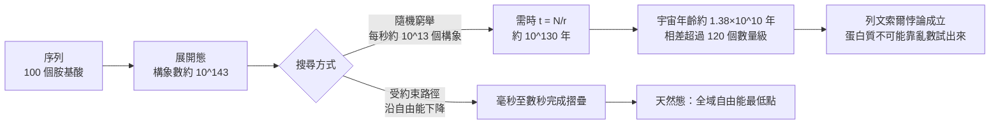

# 2.1 列文索爾悖論（1969）：為什麼蛋白質不是亂數試出來的

## 一、一篇四頁的短文與一道無法逃避的算術

1969 年，麻省理工學院的生物物理學家 Charles Levinthal 在 *The American Journal of Clinical Investigation* 上發表了一篇極短的短文，題為〈How to Fold Graciously〉（如何優雅地摺疊）。全文不超過四頁，沒有大量數據，沒有實驗，語氣近乎隨興——它原本是作者在一次會議上的即席評論。然而正是這篇短文，把蛋白質摺疊從一個化學問題徹底改寫成一個計算問題，也從此為半個世紀後人工智慧介入生命科學留下了最精確的著力點。

Levinthal 關心的問題很單純。一條由一百個胺基酸組成的多肽鏈，每個胺基酸有兩個可旋轉的二面角，每個二面角若取十種以上的分立值，整條鏈理論上就存在數量極為龐大的構象組合。他把這個數量估為約 $`10^{143}`$ 種構象。接著他問了一個幾乎是修辭性的問題：這樣的搜尋，實際上需要多少時間？

Levinthal 的答案是：即使假設一台無限快的機器每秒能檢查 $`10^{13}`$ 個構象，要把整個構象空間窮舉一遍，也需要大約 $`10^{130}`$ 年。而我們所知的宇宙年齡，約為 $`1.38 \times 10^{10}`$ 年。兩個數字之間的差距，超過了一百二十個數量級。蛋白質在細胞內卻只需要毫秒到數秒就完成摺疊——這就是後來被稱為「列文索爾悖論」（Levinthal's Paradox）的全部內容。

所謂「悖論」，其實是一個論證。它並沒有在生物學與物理學之間製造矛盾，而是逼迫物理學承認：分子層面必然存在某種尚未被看見的機制，使得摺疊根本不是我們想像的那種搜尋。列文索爾自己沒有給出這個機制，他只是把問題的形狀釘在牆上。

## 二、算術的細節與它的穩健性

$`10^{143}`$ 這個數字並非定論。不同的物理假設會導致不同的估計；文獻中常見的近似值還包括 $`10^{57}`$ 與 $`10^{14}`$ 這兩個量級，它們分別對應不同的自由度計數方式、不同的構象細分標準，以及是否允許緊密堆積的緊湊態。這些數字都屬於用來說明量級的常用近似，不是精確計算的結果；它們之所以被反覆引用，是因為在數量級的意義上，它們指向同一件事：構象空間大到不可窮舉。

真正關鍵的不是 $`10^{143}`$ 本身，而是這個估計對參數的敏感性極低。即使把構象數低估十二個數量級，得到 $`10^{131}`$ ，再把搜尋速率提高到每秒 $`10^{15}`$ 次，所需時間仍是 $`10^{116}`$ 年。這個數字依然遠遠超出宇宙年齡。要讓隨機搜尋在宇宙年齡之內完成，必須把構象數再砍掉一百二十個數量級——那等於說，一條蛋白質只有一個構象。

我們可以把整段論證寫成一個極簡的式子。若構象空間的大小為 $`N`$ ，搜尋速率為每秒 $`r`$ 個構象，則窮舉所需時間為

$$
t = \frac{N}{r}
$$

代入 $`N \approx 10^{143}`$ 、 $`r \approx 10^{13}`$ ，得 $`t \approx 10^{130}`$ 年。這個比值的本質，是「可能態的數目」與「每秒可檢查的態數」之間的落差，而它與化學細節無關，只與組態論的計數方式有關。因此，列文索爾悖論是一個統計力學層面的必然推論，而不是生物學的例外。

這一點值得反覆強調，因為常見的誤解是：列文索爾悖論顯示生物學違反了物理學。但正確的讀法恰好相反——列文索爾悖論顯示生物學完全服從物理學，服從到骨子裡。所謂「違反」，只是在我們把「摺疊」誤認為「隨機搜尋」的前提下才會出現。生物體沒有違反任何物理定律；它只是做了比隨機搜尋聰明得多的事。

# $`10^{143}`$ 不是「答案」

必須強調， $`10^{143}`$

但這不影響論證的效力。列文索爾需要的是一個盡量偏向對方的估計：如果隨機搜尋連最樂觀的量級都做不到，那麼真實情況只會更難。反過來說， $`10^{57}`$ 這個更小的數字即使被完全接受，結論也不變——因為 $`10^{57} / 10^{13} = 10^{44}`$ 年，仍然比宇宙年齡多出三十四個數量級。整個論證對參數的微小變動完全不敏感，這正是它能夠存活半個世紀的原因。

## 三、真正的問題不在數量，而在搜尋的組織方式

如果構象空間大到不可窮舉，那麼「分子是什麼」的問題就被一個更前置的問題取代了：分子是如何在這個空間中找到正確位置的？

這個提問方式的轉換是關鍵。列文索爾之前，主流的思考方式是把摺疊想像成「分子自己去撞出一個答案」，像一個粒子在房間裡隨機遊走直到找到出口。列文索爾之後，問題變成：這條鏈上一定存在什麼，使得它不是亂撞的？

這裡需要一個更細緻的區分。列文索爾真正排除的並不是「嘗試」，而是「無差別的嘗試」。一個可以在數秒內摺疊的分子，必然在過程中不斷地排除某些構象、保留某些構象。它可能先在局部尋找一段螺旋、讓疏水殘基坍塌（hydrophobic collapse），或者先在數個候選「漏斗口」之間做選擇——這些都屬於受約束的嘗試。真正的亂數嘗試，意味著每一步都不遺留任何資訊，整條路徑等於把所有歷史記憶都丟掉。列文索爾的算術排除的正是這種情形。

這個區分在方法論上極為重要，因為它同時排除了兩種常見的極端說法：既排除了「分子靠運氣撞出答案」這種機械論式的運氣，也排除了「序列完全決定一切，過程只是自動播放」這種過度簡化的說法。真實情況介於兩者之間：序列確實攜帶了足夠的資訊，但資訊必須透過一個搜尋機制被兌現，而這個機制不可能是窮舉。

答案必須是結構性的。自然界給了分子幾種可能的捷徑：局部結構先形成，減少後續的搜尋空間；能量偏好把系統推向某些區域；或者兩者同時發生，構成一個自洽的組織方式。無論是哪一種，都意味著摺疊路徑是受約束的，而不是隨機的。

這個「受約束」的本質可以從物理學中得到更精確的表述。摺疊是一個自由能下降的過程。若一個構象的自由能比另一個構象高，系統就有統計性的傾向離開前者。於是，整個構象空間不是一片無差異的荒原，而是一張被能量起伏雕刻過的地形：在這張地形上，許多地方是高地，少數地方是深谷，而天然態就坐在唯一的、全域最低的那個深谷底部。分子不需要窮舉全部 $`10^{143}`$ 個點，它只需要沿著地形的坡度往下走。

這張地形，就是下一節要處理的「摺疊漏斗」；而促使薛丁格、Anfinsen 與 Wolynes 一代學者把它想出來的歷史動因，很大程度上正是列文索爾留下的那道數學牆。

## 四、歷史上的位置：從「三級結構問題」到「搜尋問題」

列文索爾的文章之所以重要，還因為它出現在一個特定的思想轉折點。1960 年代初期，蛋白質結構生物學剛剛贏得第一場重大勝利：Kendrew 用 X 光繞射解出鯨魚肌紅蛋白的結構，Perutz 隨後解出血紅蛋白。一時間的樂觀氣氛裡，人們相信只要結構生物學的技術持續進步，蛋白質結構的問題就會像 DNA 一樣被逐一解決。

但序列與結構之間的關係一旦被寫下來，就出現了一個極其不對稱的問題。1960 年 Sanger 解出牛胰核糖核酸酶（RNase A）的序列；1961 年之後，愈來愈多蛋白質的序列被讀出，人們卻發現：序列是一維的線性文字，結構是三維的立體形狀，而從前者到後者的映射規則，沒有任何人知道。更糟的是，序列數量的成長速度遠超結構測定的速度：每新增一個序列，就多出一個「不知道結構長什麼樣」的問題。

列文索爾悖論把這個「對不上」精確地量化了。它說明在沒有額外機制的情況下，序列到結構的映射在計算上是不可達的；因此要讓結構預測成為一個可行的學科，必須先解釋「額外機制」是什麼。

值得注意的是，列文索爾並沒有把矛頭指向實驗技術。他也沒有說「序列不足以決定結構」。他的論證完全建立在物理學內部，只用了組態計數、搜尋速率與時間尺度這三個純粹的量。任何一個認為生命有某種特殊的、非物理的機制的人，都無法反駁這個算術；而任何一個接受分子生物學的人，都必須承認某種物理機制確實存在。

## 五、這個悖論如何一路連到 AlphaFold

從 1969 年到 2020 年，將近半個世紀裡，蛋白質摺疊領域的歷史基本上是「繞開列文索爾悖論」的歷史。研究者用各種各樣的方法迴避那 $`10^{143}`$ 個構象。

最直接的路線是加速實驗：既然隨機搜尋來不及，就用實驗手段把過程壓縮到可觀測的時間尺度。1960 至 70 年代的 NMR 與同位素標記實驗，讓研究者得以在毫秒尺度上追蹤摺疊中間態；1990 年代的分子動力學模擬，則試著在電腦上重現摺疊過程。但即使是今日最強大的超級電腦，也只能在數十微秒的時間尺度上模擬小蛋白質的摺疊，而真實蛋白質常常需要數毫秒到數秒。

第二條路線是縮小問題：既然窮舉所有構象不可能，就只窮舉有希望的那些。1980 至 90 年代的執行緒摺疊（threading）與同源建模（homology modeling）走的正是這條路——先從資料庫找出已知結構，再把目標序列套上去。它有效，但只對序列相似度足夠高的目標有效。

第三條路線是釜底抽薪：既然搜尋的代價來自於「不知道終點在哪」，那就讓終點的資訊直接參與搜尋。這正是 AlphaFold2 的核心直覺。深度網路不需要重新發現摺疊路徑，因為它已經從數萬個已知結構中學到了「哪裡是深谷」，於是它可以直接從雜湊式的初始構象出發，透過反覆精煉收斂到低能量區域。網路本身扮演了受約束路徑的角色。

值得注意的是，這三條路線並非互斥，而是同一件事的三種深度。加速實驗是在物理層面壓縮時間軸；縮小問題是在資訊層面剪枝；機器學習則是在表示層面替人補上一個「先驗地形的模型」。它們共同的哲學是：任何可行的摺疊方法，都必須在某個地方假設終點的位置或形狀。沒有任何方法能真正做到「什麼都不知道，然後窮舉」。這也說明了為什麼 AlphaFold2 的輸入裡除了序列之外，還需要比對（MSA）：比對提供的是「同源序列如何摺疊」的統計先驗，等於把終點的線索直接編碼進輸入端。

## 六、為什麼「悖論」這個詞其實用得不對

回頭看，列文索爾悖論最深刻的地方可能不在算術，而在它對生物學特殊論的釜底抽薪。它把人們最直覺的想像——「分子像骰子一樣亂轉」——徹底排除在科學的可行解釋之外。摺疊不是擲骰子，摺疊是一個物理過程，因此它必然可以用能量、自由能與動力學來描述。

這個轉向一旦完成，後續的歷史就順理成章了。Anfinsen 在 1972 年提出「序列決定構形」的熱力學假說，並以 RNase A 的復性實驗證明它；Bryngelson 與 Wolynes 在 1987 年把蛋白質摺疊類比為自旋玻璃（spin glass），並給出摺疊漏斗的地形圖；Doye 與 Onuchic 在 1999 年把它表述為連續的能量地形。列文索爾留下的是一道必須跨越的牆，而這四十年，就是不同學科的人從不同角度翻越牆的過程。

而在 2020 年，人工智慧用一種沒有人預料到的方式翻過了牆：它不試圖讓電腦「走」遍構象空間，而是讓網路「記住」整張勢能面的形狀，然後在這張記住的面上做下降。下一節會說明，為什麼這個做法在直覺上如此自然——因為 AlphaFold2 的訓練目標、其結構模組的反覆精煉機制，以及它所學到的不變量，在某種深層意義上，正是摺疊漏斗本身。

### 關鍵文獻與節點

| 年份 | 事件 | 對列文索爾悖論的回應 |
|------|------|---------------------|
| 1960 | Sanger 決定 RNase A 序列；Kendrew 發表肌紅蛋白結構 | 問題從「結構長什麼樣」轉為「序列如何決定結構」 |
| 1969 | Levinthal，〈How to Fold Graciously〉，AJCI | 證明隨機搜尋在物理上不可能 |
| 1972 | Anfinsen 諾貝爾演講提出熱力學假說 | 以自由能最低點取代隨機搜尋 |
| 1987 | Bryngelson 與 Wolynes，PRL 58, 1259 | 自旋玻璃類比；摺疊漏斗地形 |
| 1999 | Doye 與 Onuchic，PRL 82, 5217 | 連續能量地形與最小 frustration |
| 2020 | AlphaFold2（Evoformer 加上 IPA 與結構模組） | 以「學到的勢能面」取代「窮舉構象空間」 |
