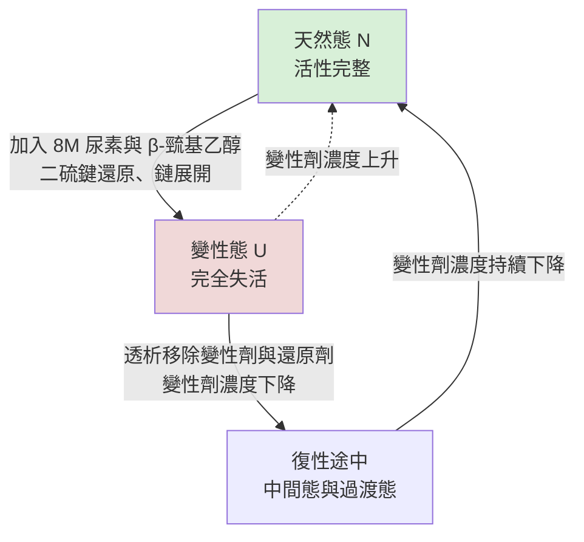

# 2.2 薛丁格的《生命是什麼？》（1944）與摺疊漏斗模型（1995）

## 一、一個離開維也納的人，寫了一本改寫生物學的書

1944 年，愛爾蘭都柏林，一本名為《生命是什麼？》（What Is Life?）的小書問世。它是一位物理學家的作品，而這位物理學家三十年前剛被迫離開維也納——1933 年，納粹上台，猶太裔學者遭到驅逐，厄恩斯特·薛丁格（Erwin Schrödinger）被迫輾轉流亡，最終在都柏林 Trinity College 找到教職。這段流亡史不是背景裝飾，而是全書的隱喻：薛丁格一生都在處理「秩序如何抵抗混沌」這個提問，而 1930 年代的歐洲，恰恰是人類社會秩序崩解的現場。

《生命是什麼？》的英文版由劍橋大學出版社於 1944 年出版，開頭附有 Francis Crick 撰寫的一章，標題是〈遺傳結構對功能之依賴的物理化學基礎〉。Crick 在書中公開致謝薛丁格，因為正是薛丁格在 1930 年代末就向他提出了「基因必然攜帶遺傳訊息」的構想，後來才成為分子生物學的定樑之柱。而這本書更耐人尋味的地方，在於它的寫作方式：全書幾乎是以咖啡廳座談的口吻寫成的——薛丁格以提問、推敲、自我質疑與假設交錯的方式陳述，常常在兩三頁之內推翻自己前一頁的說法。那是一種在維也納咖啡廳裡以口頭辯論替代論文的傳統，幾乎被完整地移植進了這本在愛爾蘭寫成的書。

這裡必須把兩件事分清楚，否則史實就會互相衝突。1944 年出版的《生命是什麼？》確實帶有鮮明的維也納咖啡廳座談風格——但它的思想來源，是薛丁格 1943 年在都柏林 Trinity College 的一系列演講，以及更早年代在維也納與格拉茨的思考。換句話說，座談是它的**文體**，都柏林的演講是它的**內容源頭**。把這兩者分開，才能既保留這本書的質地，又不讓它的來源被寫錯。

這本書最著名的兩個貢獻，一個關乎生命，一個關乎遺傳；而與本節主題直接相關的，是第一個。

## 二、負熵：生命是一台「進口秩序」的機器

薛丁格在書中反覆處理一個物理問題：一個生物體如何能夠維持自身的秩序，甚至還能增加秩序？在十九世紀的熱力學框架下，答案是矛盾的：封閉系統的熵只能增加，第二定律要求一切趨向無序，而生命顯然不是這樣的。薛丁格的做法非常直接——他承認生命是開放系統，並且提出了「負熵」（negative entropy）這個說法：生物體必須不斷地從環境中取得有序的原料，並且排出更無序的廢物，因此它可以在自身之內維持、甚至提升局部秩序。

這個概念今日聽來簡直，卻在當時是一道橋。它把生命從「違反物理學」重新定義為「以另一種方式運用物理學」，並且把生物學問題轉譯成物理學可以處理的問題：不是「生命是什麼」，而是「秩序如何在開放系統中被製造與維持」。從這個提問出發，Prigogine 在 1960 年代提出耗散結構（dissipative structures），把「局部秩序靠持續耗散維持」的觀念推到更一般的水準；分子生物學則在同一條線上，把注意力集中到蛋白質——那種在單一分子層級把秩序從無序原料中摺出來的功能性巨分子。

然而《生命是什麼？》也有它的時代侷限。薛丁格沒有給出負熵的機制，他對遺傳物質的猜測——他認為遺傳物質可能是某種 aperiodic crystal，即「非週期性晶體」——在當時既無法證實也無法否證，二十年後才由 DNA 結構的解析取代。更重要的是，從摺疊研究的觀點看，這本書幾乎沒有談到蛋白質如何取得它的三維形狀。薛丁格提供的是提問的風格與跨學科的橋樑，而不是答案。

## 三、1940 年代的直覺錯誤：摺疊需要「斷鍵重組」嗎？

真正直接影響摺疊研究的，是另一條線。

1940 年代，蛋白質結構生物學剛起步，最廣為接受的直覺是：多肽鏈要形成穩定的三級結構，必須斷裂並重新形成共價鍵。這個想法並非憑空而來——當時人們已經知道許多化學反應裡的鍵可以「轉位」，而蛋白質的多肽鏈被想像成一種類似於化學中間體的可變形物，摺疊的機制則被類比為分子內部的鍵重排。原子能時代的樂觀氣氛讓這種「可塑性」想像格外流行。

這個直覺在 1951 年被 Pauling 與 Corey 的 α-螺旋工作徹底終結。Pauling 證明，多肽鏈只需藉由氫鍵的正確排列就能形成穩定的螺旋，而完全不需要斷裂任何共價鍵。Pauling 提出的模型極其精確：每個羰基氧與第四個殘基的 amide 氫形成氫鍵，如此形成緊密堆積的內部結構。這不只是一個結構模型的勝利，它確立了一個原則：摺疊是非共價作用力——氫鍵、疏水效應、凡得瓦力、靜電作用——在既有共價骨架上的重新組織。

1960 年 Kendrew 與 Perutz 分別解出肌紅蛋白與血紅蛋白的高解析度結構，把這個原則具體化了。蛋白質的三級結構，終於被確認是「既有的線性共價鏈，在二級結構單元的基礎上，由側鏈之間的互動所決定」。這也等於宣告了 1940 年代的斷鍵重組想像的死亡，而把一個更精細的問題留在桌面：既然摺疊靠的是大量微弱的、非共價的力同時作用，那麼它是如何在合理的時間裡，找到正確組合的？

這正是列文索爾悖論的化學版本，也是下一個階段的入口。

## 四、驅動力：疏水效應與自由能

1950 年代末，另一批拼圖被拼上。1957 年 Tanford 指出，轉移一個非極性側鏈從水相到有機相在能量上是有利的；1959 年 Kauzmann 在論文中把蛋白質摺疊明確描述為「一個結晶問題」，並引入疏水核心的概念。這個觀察後來被整理成今天教科書中的標準說法：摺疊的主要驅動力是疏水效應——非極性側鏈傾向把水排出，埋進蛋白質內部，而這只有在多肽鏈取得特定三維構形時才可能同時滿足於所有殘基。

但把疏水效應與列文索爾悖論放在一起，就出現了一個尖銳的矛盾。疏水效應要求「正確的形狀才能獲得能量獎勵」；列文索爾的算術要求「不能靠窮舉找到正確的形狀」。如果獎勵只有在終點才完全兌現，那麼在過程中的每一步，分子的能量都不會告訴它該往哪走。

解開這個僵局的，是把「能量」換成「自由能」。自由能的基本關係式寫成 $G = H - TS$ ，其中 $H$ 是焓，也就是鍵結與交互作用的能量總和； $T$ 是絕對溫度； $S$ 是熵。自由能是「在固定溫度與壓力下，系統自發朝向的方向」的判準；只要系統能接觸環境並散熱，減少自由能的方向就是自發的方向。重要的是 $T \times S$ 這一項：熵不只在終點重要，它在過程中每一個中間構象都有意義。

這就是答案。摺疊不是一個「終點才有獎勵」的過程，而是一個一路都有局部偏好的過程：局部二級結構的形成降低焓並限制後續的構象數；疏水殘基的聚集在局部就開始釋放有序的水分子，這是一個真實的、局部的、可以即時兌現的熵收益。摺疊於是一個每一小步都略微偏好正確方向的過程，把 $10^{143}$ 的難題變成了一條可以走的路。

## 五、Anfinsen：熱力學假說與 RNase 的復性

把上述物理直覺整理成可檢驗命題的，是 Christian Anfinsen。他在 1972 年的諾貝爾化學獎演講中提出「熱力學假說」（the thermodynamic hypothesis）：天然蛋白質的三維結構，完全由其胺基酸序列決定；在適當的物理條件下，天然構形是整個系統自由能最低的狀態。這個命題的措辭非常強——不只是「序列包含足夠資訊」，而是「序列決定唯一的全局最小值，且系統會自動抵達那裡」。他並以 Moore 與 Stein 共同分享該年的諾貝爾化學獎。

最著名的實驗證據來自 Anfinsen 團隊對牛胰核糖核酸酶（RNase A）的研究。需要把時序說清楚：這組復性實驗本身完成於 1960 年代初期，是 Anfinsen 與同僚 Reddi 等人的工作；1972 年的諾貝爾演講把它提升為明確的理論命題，並在隨後 1972 至 1975 年的系列論文中完整論證與推廣。把實驗與理論假說都記在 1972 年，是常見的簡化，但並不準確。

RNase A 是一條 124 個殘基的單鏈蛋白質，含有四對二硫鍵。實驗的設計精巧而殘酷：先用 8 M 尿素與 β-巰基乙醇處理，把二硫鍵還原、把鏈完全展開，此時酵素完全失活；接著把變性劑與還原劑透析移除，讓鏈在無變性劑的環境中重新尋找自己的形狀。結果是酵素活性幾乎百分之百地恢復。

這個實驗的深遠意義，在於它證明了三件事。第一，摺疊是自發的，不需要外力逐步引導。第二，終點是唯一的，無論中途經過多少變性，四對二硫鍵重新形成的樣式與天然態完全一致，這正是 Anfinsen 循環（Anfinsen cycle）的核心。第三，資訊存在於序列之中，因為被破壞的只有鍵結，序列卻完整保留，而系統有能力把它重建回來。時隔半個世紀回頭看，Anfinsen 的實驗基本上就是「序列決定結構」這個範式的實驗室證明，也是 AlphaFold 全部方法論的前提。

上圖即 Anfinsen 循環。它描述的不是一條單向路徑，而是一個由變性劑濃度控制的可逆平衡：天然態與變性態之間的比例隨環境條件連續變化，因此同一條鏈可以在摺疊與展開之間反覆往返，而無論往返多少次，終點都是同一個。這張圖之所以重要，是因為它把摺疊問題從「動態過程」重新定義成「平衡分布」——而只有當它被視為平衡分布時，漏斗地形才會自然浮現。

## 六、漏斗：從自旋玻璃到能量地形

1980 年代中葉，Peter Wolynes 與 Joseph Bryngelson 開始把蛋白質摺疊與統計物理中的自旋玻璃（spin glass）類比。這個類比極為精準：自旋玻璃是一種有競爭性隨機耦合的磁系統，其中 frustration（受挫）——一個自旋想要同時滿足多個互相矛盾的耦合——創造出極大量的局部極小點。摺疊的 frustration 則來自立體化學：同一個殘基有時想形成氫鍵、有時想避免擁擠，二級結構的偏好也彼此競爭。

1987 年，Bryngelson 與 Wolynes 在 *Physical Review Letters* 發表〈Spin glasses and the statistical mechanics of protein folding〉，把摺疊描述成漏斗形狀的自由能地形（folding funnel）：上寬下窄，頂端是構象極多、能量各異的高原，底部是唯一的深谷，也就是天然態。這個模型一舉解釋了列文索爾悖論——地形上的深谷不需要被窮舉找到，粒子只要順著下坡走，就會沿著漏斗壁滾落到谷底。

但 Bryngelson 與 Wolynes 同時指出一個令人不安的推論：如果 frustration 過強，地形就會變得崎嶇、遍布著大量的局部深井，系統在低溫下會被困在其中，稱為玻璃態（glass state）。在這樣的地形裡，摺疊會極慢，而且常常根本到不了真正的全局最小值——這就是動力學陷阱（kinetic trap）。它解釋了許多真實現象：錯誤摺疊的蛋白質、抗體、澱粉樣纖維，以及摺疊中間態的形成。

1990 年代，最小 frustration 原則（principle of minimal frustration）從這些工作裡浮現出來，並成為演化生物學可以解釋的核心主張：天然的胺基酸序列是演化出來的，它傾向讓自己的天然態成為一片巨大、崎嶇勢能原野中唯一突出的深谷。也就是說，序列不只攜帶幾何資訊，還攜帶「在這片地形上我的家在哪」的資訊。相對地，隨機序列會產生極度受挫的地形，摺疊緩慢而且容易出錯——這在 1990 年代末的實驗中被系統性地驗證。

1995 年前後，漏斗圖像在蛋白質摺疊社群成為共識性的思考框架，伴隨著幾個關鍵進展而鞏固。實驗面，NMR 與交聯質譜在 1990 年代中期大量記錄到摺疊中間態的證據，支持「並非所有蛋白質都走簡單的兩態路徑」；計算面，1996 年 Baker 團隊發表的 Rosetta 讓「設計一個適當的能量函數並在漏斗上做最佳化」成為可操作的工程路線。理論面，1997 年 Wolynes 與 Onuchic 在 PNAS 提出完整的摺疊理論，1999 年 Doye 與 Onuchic 在 PRL 把格點模型推廣到連續能量地形（continuous energy landscape），並明確給出漏斗的形狀與最小 frustration 的形式表述。

從此，能量地形（energy landscape）成為標準語彙，而玻璃態、動力學陷阱與漏斗這三個概念構成了描述蛋白質摺疊失誤的通用詞彙。讓我們把三種典型的地形並排比較：

| 地形類型 | 形狀 | 局部極小點 | 對應的生物學 | 摺疊結果 |
|----------|------|------------|------------|----------|
| 平地（無偏地形） | 各向同性，無方向性 | 極多且等深 | 隨機序列、假想蛋白質 | 需時約 10^130 年量級；實際不可行 |
| 玻璃態（多井崎嶇地形） | 崎嶇遍布深井 | 大量深井 | 受挫序列、突變蛋白質 | 動力學陷阱；錯誤摺疊與聚集 |
| 摺疊漏斗（最小 frustration） | 上寬下窄，底部單一深谷 | 少數淺井、一個深谷 | 天然序列 | 數毫秒至數秒抵達天然態 |

漏斗是三者之中唯一能與觀測到的摺疊速率相容的。而這張簡單的圖，正是 AlphaFold2 的直覺來源。

## 七、漏斗如何變成網路架構

從 1995 年到 2020 年之間，漏斗模型在生物物理學界完成了一次意義深遠的遷移：它從「用來解釋蛋白質如何摺疊的描述性模型」，變成了「用來設計計算方法的工程藍圖」。

這個遷移的技術橋樑是梯度下降。在漏斗的描述中，一條多肽鏈被視為一個在自由能地形上移動的粒子；只要給它一個能計算當地自由能的方法，它就會自行下坡。於是問題變成：如何構造一個足夠準確、但又便宜到可以對數十萬條序列重複執行的自由能函數？物理力場（分子力學）嘗試了，但所需時間與實測速率相差數個數量級。

AlphaFold2 的做法，是用深度網路取代物理力場。網路在訓練期間學到的不只是「某個座標下的能量」，而是整片地形——包括哪些區域是高地、哪些是谷底、谷底有多深，以及不同序列的地形長什麼樣。在推論時，AlphaFold2 的結構模組（structure module）從一個雜湊式的初始構象出發，反覆更新殘基座標與側鏈朝向；每一次更新都在某種意義上把系統往下坡，直到收斂到低能量區域。回收機制（recycling）則讓整個過程反覆進行數十次。

換句話說，AlphaFold2 的結構模組扮演的是「在漏斗上做梯度下降」的角色，而它能這樣做，是因為網路從數十萬個已知結構裡，學到了漏斗的形狀本身。這也解釋了為什麼 AlphaFold3 的擴散模型能夠進一步生成原子坐標：擴散模型的逆向過程，同樣是一種沿著隱含自由能面下降的機制，只是把「更新座標」換成了「去雜訊」。

於是，1995 年那張簡單的漏斗圖，在 2020 年變成了一個數十億參數的網路。

### 關鍵文獻與節點

| 年份 | 事件 | 貢獻 |
|------|------|------|
| 1944 | 薛丁格《生命是什麼？》 | 負熵；生命作為秩序的製造者 |
| 1951 | Pauling 與 Corey 的 α-螺旋 | 證明摺疊不需斷裂共價鍵 |
| 1959 | Kauzmann 將摺疊視為結晶問題 | 疏水效應作為驅動力 |
| 1972 | Anfinsen 諾貝爾演講 | 熱力學假說；RNase A 復性實驗的理論化 |
| 1987 | Bryngelson 與 Wolynes，PRL 58, 1259 | 自旋玻璃類比；摺疊漏斗 |
| 1996 | Baker 團隊的 Rosetta | 在漏斗上做能量最佳化的工程化 |
| 1999 | Doye 與 Onuchic，PRL 82, 5217 | 連續能量地形；最小 frustration |
| 2020 | AlphaFold2 | 把漏斗學習成一個深度網路 |
