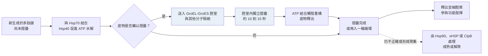

# 2.3 伴護蛋白（Chaperones）在細胞內的輔助角色（1980s-2000s）

## 一、摺疊的真正戰場：不是溶液，而是細胞

上一節的算術說明了分子必須走一條受約束的路，漏斗模型說明了那條路的形狀。但這兩者都建立在一個方便卻不真實的假設之上：蛋白質是在一個稀薄的、乾淨的、沒有其他分子的溶液裡獨自摺疊的。

真實的細胞完全不是這樣。細胞質是擁擠的——蛋白質濃度高達每公升數百克，可用體積被其他大分子占據；新合成的多肽鏈從核糖體中湧出，每一條都在被推擠、摺疊，並且可能彼此黏在一起。疏水性的新生成鏈段暴露在含水的環境中，會毫不費力地互相黏附、聚集（aggregation），形成沉澱或纖維。於是，在細胞內，蛋白質面對的主要競爭對手不是「錯誤的構象」，而是「鄰居」。

伴護蛋白（chaperones）就是在這個背景下出現的。它們做的事情，可以概括成一句話：在摺疊完成之前，防止蛋白質走錯路，並且在它走錯時把它拉回來。它們不製造資訊，也不指定終點；它們改變的是摺疊的動力學環境。

## 二、發現史：從果蠅的熱休克反應到 GroEL 的原子模型

這條歷史有個漂亮的起點。1962 年，義大利科學家 Alessandro Ritossa 觀察到果蠅（Drosophila melanogaster）若短暫暴露於高溫，某些染色體上會出現膨大的膨泡——「熱休克膨泡」（heat-shock puffs），那裡正忙著轉錄大量 RNA。1974 年，Tissières 與同事把這些 RNA 分離出來，發現其中兩種占優勢的蛋白質分別約為 12 kDa 與 70 kDa，「熱休克蛋白」這個家族自此進入視野。

另一條線則來自細菌的 λ 噬菌體研究。1976 年，Edgar 與 Lively 描述了一類 λ 突變體——它們無法在生長溫度下正常繁殖，卻能在低溫下存活——並把相關基因命名為 gro（growth）。後來查明，大腸桿菌中的 groEL 與 groES 基因，分別編碼 60 kDa 與 10 kDa 兩個次單元，是 E. coli 存活所必需的；它們不是病毒基因，而是細菌自己的基因，病毒只是藉由突變把它們揪出來。E. coli 細胞若缺乏 GroEL，在 42°C 會大量死亡。

「伴護蛋白」這個名稱則直到 1987 年才出現，由 John Ellis 提出。他在研究豌豆種子儲存蛋白時注意到，某些蛋白質在體內會經歷構形的部分拆解與重新組裝，而這種「拆解」需要 ATP——這個機制與先前被描述為幫助蛋白質摺疊的 GroEL 高度相似。Ellis 因此提議了一個統稱：molecular chaperones。這個命名本身就宣告了一個立場——chaperone 是「陪伴者」，不是「教導者」；它陪同蛋白質走過摺疊，但不教它該去哪裡。

結構時代的真正突破發生在 1993 年。那一年裡，Boissonnet 等人在 *Nature* 發表 GroEL 在 2.8 Å 解析度下的晶體結構；Nonomura 等人則解析出 GroEL 與 ADP 及 GroES 組成的三元複合體。人們第一次能清楚看見 GroEL 是一個由兩個七員環背靠背組成的水桶狀分子：每個環的內壁覆蓋著帶負電與疏水性的殘基，構成一個直徑約 50 Å 的腔室。而 GroES 是一個像「蓋子」的七員環，能扣在腔室頂端。

## 三、三種不同的輔助策略

伴護蛋白並非一個統一的家族，而是以幾種略有不同的策略解決同一個問題。

GroEL 與 GroES 組成的是「摺疊箱」。未摺疊的底物先結合到 GroEL 某一個環的疏水內壁；接著 ATP 結合到同一個環上的次單元，引起構形改變，頂端的膠囊頂端域下沉，腔室體積驟增，把底物封進腔室裡。底物在腔室中獲得約十到十五秒的獨立時間完成摺疊，此時它被物理地隔絕，無法與其他分子相遇，也就無法聚集。ATP 水解之後，另一個環的 ATP 結合，觸發底物以重構的形式釋出，準備進入下一輪循環。整個機制的精妙之處在於：腔室提供的是一個可以安全犯錯的空間，而不是任何關於正確答案的線索。

Hsp70 是「手」。它由兩個功能域構成：核苷酸結合區（NBD，負責 ATP 水解）與底物結合區（SBD，負責抓取）。當 ATP 結合時，SBD 張開，露出一個偏好疏水片段的結合口袋；當 ATP 水解時，SBD 閉合，把底物片段困住。Hsp70 因此是一台可以抓住並鬆開的機器，特別擅長處理新生成的多肽鏈、大型蛋白質與多結構域蛋白質。它的搭檔 Hsp40 扮演著加速 ATP 水解的角色，而核苷酸交換因子負責把 ADP 換成 ATP，完成循環。Hsp70 與 GroEL 的一個重要差異是：Hsp70 幾乎不提供摺疊空間，它主要的功能是防止聚集並把底物交給下游。1995 年，Flocco 等人解析出大腸桿菌 DnaK（Hsp70 家族的代表）的底物結合區結構，把這個「抓取—閉合」的機制具象化了。

Hsp90 則是「守門人」。它高度特化於摺疊後期的結構成熟，尤其是訊息傳遞用的激酶類客戶。Hsp90 抑制劑（例如 geldanamycin 與其衍生物）在腫瘤學上的應用，正是建立在「阻斷客戶蛋白質成熟即可讓它降解」這個邏輯之上。此外還有專職抓住的小型熱休克蛋白（sHSP）、能解聚聚集體的 ClpB 與 Hsp104，以及處理二硫鍵錯誤配對的蛋白質雙硫鍵異構酶（PDI）與加速脯胺醯肽順反異構的肽基脯胺醯肽異構酶（PPIase）。

## 四、「Anfinsen 箱」：催化而非資訊

伴護蛋白研究中最有影響力的一個概念，出現在 1990 年代中期，並且是以一個非常精確的方式表述的：Anfinsen 箱（Anfinsen cage）。這個說法的意思是，伴護蛋白提供的是一個箱子——一個物理上把底物與外界隔絕的空間——箱子裡面裝的，是 Anfinsen 在 1972 年論證過的那整套規則：序列決定結構，結構由熱力學決定。

Fersht 與同事在 1994 年發表的論證把這件事釘死了。他們測量了核糖核酸酶在有 GroEL 與沒有 GroEL 兩種情況下的復性過程，結果是明確的：伴護蛋白讓摺疊快得多，尤其是對那些容易陷入中間態的底物而言；但最終產物的立體化學結構完全相同。伴護蛋白改變的是通往終點的速率，不是終點本身。

因此，伴護蛋白是摺疊的催化劑。它降低的是反應的活化能，不是反應的平衡位置。把它拿掉，摺疊仍然會完成，只是會更慢，而且更容易在途中被聚集反應劫持。

這個區分在科學上具有關鍵意義，因為它意味著伴護蛋白無法回答「序列如何決定結構」這個問題。它是一個關於動力學與細胞環境的機制，不是一個關於資訊來源的機制。真正回答資訊問題的，是 1972 年的熱力學假說；而伴護蛋白是 1990 年代才被認清的第二個機制，處理的是完全不同的一個問題。

估計有大約百分之十到三十的細菌蛋白質在生理條件下高度依賴伴護蛋白才能正確成熟；這個比例之所以不是百分之百，是因為許多小型蛋白質可以自行快速摺疊，而另一些蛋白質——特別是那些會在細胞質中變性、或在壓力下需要重新摺疊的——則對伴護蛋白的依賴遠高於此。人類細胞中還有另一層複雜度：新生成的多肽鏈有相當一部分是在轉譯過程中就完成摺疊的，由核糖體出口隧道與新生的 Hsp70 系統共同把關。

## 五、資料的堆積：PDB 與結構時代

伴護蛋白的結構研究之所以能在二十年間推進得如此快速，有一個無可否認的技術前提：資料。蛋白質資料庫（Protein Data Bank, PDB）在 1971 年成立時只收錄了七個結構，全是手繪的立體圖紙；1973 年之後才開始以數位格式發布。此後的增長是穩定的：1980 年代累積到數百個，1990 年代中期突破一萬個，2008 年釋出第十萬個結構，到 2020 年代中期，已發布的結構總數超過二十三萬個。

伴護蛋白是這份資料庫中最典型的一類：GroEL 與 GroES 的晶體結構、單一環的構形變化、ATP 與 ADP 的兩種狀態，以及 2010 年代中期冷凍電子顯微鏡解析出的完整 GroEL 與 GroES 複合體，都是靠 PDB 中的原子座標一次又一次拼湊起來的。沒有 PDB，就不會有 1993 年 GroEL 的那張奠定性的桶狀結構圖，也就不會有「摺疊箱」這個概念。

PDB 同時是 2020 年之後人工智慧革命的燃料。AlphaFold2 的訓練資料主要來自 PDB 的結構，而 PDB 中數十萬個經過實驗驗證的結構，正是網路得以學出「漏斗形狀」的原始素材。同一份資料庫，先教會我們認識伴護蛋白，後來又被用來訓練能預測結構的機器。

## 六、為什麼伴護蛋白的存在，無法解釋序列如何決定結構

現在可以把前兩節的內容擺在一起，看清楚它們各自的邊界。

熱力學假說說的是終點：序列決定唯一的全局自由能最小值，這是一個關於平衡分布的命題。伴護蛋白說的是過程：它改變抵達終點的速率，防止路徑被聚集劫持，這是一個關於動力學的命題。兩者互不取代。

證據是雙向的。一方面，在體外許多蛋白質完全不需要任何伴護蛋白就能自發摺疊並達到活性，這說明終點的決定權不在伴護蛋白手裡；另一方面，在細胞內加入伴護蛋白後，產物的結構沒有任何改變，這說明伴護蛋白不是終點的書寫者。Fersht 的實驗之所以重要，正是因為它同時否定了解讀上的兩種極端：既不是「沒有伴護蛋白就折不出來」，也不是「有伴護蛋白就能折出不同的東西」。

有一個更深的理由。伴護蛋白是演化產物，而演化無法為一個無法被檢驗的資訊來源做選擇。伴護蛋白的突變若改變了終點結構，就會改變蛋白質的功能，那是極度有害的；但若只是改變了摺疊速度或聚集傾向，選擇壓力就會比較寬鬆。因此演化對伴護蛋白的篩選，會傾向保留「任何能提高成功率、但不指定答案」的性質。這在邏輯上就意味著：答案在序列裡，伴護蛋白只是把答案兌現的效率提高。

這也讓我們理解為什麼漏斗模型可以在完全不提伴護蛋白的情況下解釋摺疊速率。漏斗描述的是自由能地形加上動力學；漏斗的形狀本身，來自序列所決定的那個全局最小值的深度。伴護蛋白做的事情，是把某些路徑上的玻璃態陷阱清掉，讓漏斗的下降更順暢，而不是把漏斗改造成另一個形狀。

## 七、AlphaFold 為什麼不模擬伴護蛋白

現在可以回答本章最後一個問題。既然伴護蛋白在細胞內如此重要，為什麼 AlphaFold 完全沒有 chaperone 模組、沒有 ATP 依賴的狀態機、也沒有任何時間維度的輸出？

第一個原因是目標不同。AlphaFold 預測的是平衡終點——Anfinsen 循環右下角的那個天然態，而不是通往它的路徑。它回答的是「這條序列最可能的穩態三維結構是什麼」，而不是「這條序列在細胞裡會花多少時間摺疊、會不會中途聚集」。這是一個更窄但更可驗證的問題，恰好也是資料最充足、判準最明確的問題。

第二個原因是資訊型態不同。伴護蛋白的行為取決於細胞內的 ATP 濃度、伴護蛋白本身的表現量、擁擠程度，以及新生成鏈段的翻譯時序——這些量不在序列裡。把伴護蛋白放進 AlphaFold 的架構，等於要求網路去預測一個它看不到的環境參數。

第三個原因，也是最漂亮的一個原因：AlphaFold 的輸入是多重序列對齊（MSA），而 MSA 攜帶的是演化資訊。演化資訊裡包含的不只是「哪些殘基互相接觸」，還包含「這條序列族在過去幾十億年裡，都是成功摺疊的」。所謂「演化出的漏斗」，正是說：MSA 裡的變異與保守模式，隱含了「這一族的序列在同一片能量地形上有一個共同的深谷」。因此網路從 MSA 中學到的，本來就不是單一序列的地形，而是一片由演化收斂的地形——這片地形已經把「伴護蛋白必須解決的那些聚合傾向」提前化解掉了。

換句話說，AlphaFold 不是忽略了伴護蛋白，而是把它的工作前置到了演化資料裡。它預測的是終點，所以不需要重演過程；它看見的是成功摺疊的序列族，所以不必處理失敗摺疊的機制。

這個邊界同時也界定了它的侷限。AlphaFold 不預測摺疊速率、不預測聚集傾向、不預測細胞內的表現量，對天然無序區域也只能給出低信心度的靜態模型——而所有這些，恰恰是伴護蛋白與疾病機制交會的地方。阿茲海默症、帕金森氏症這類錯誤摺疊與聚集疾病，本質上是伴護蛋白系統的負載問題，而不是序列的幾何問題。AlphaFold 改變了結構知識的生產方式，卻沒有、也不可能獨力解決摺疊失敗的問題。

### 伴護蛋白家族一覽

| 家族 | 代表成員 | 主要作用 | 對結構的影響 |
|------|----------|----------|------------|
| 腔體型伴護蛋白 | GroEL 與 GroES | 提供隔絕的摺疊腔室，允許錯誤並防止聚集 | 催化摺疊，不改變終點結構 |
| 抓取型伴護蛋白 | Hsp70（DnaK）與 Hsp40 | 抓住未摺疊片段，防止聚集並交棒給下游 | 動力學輔助；終點由序列決定 |
| 成熟守門人 | Hsp90 | 協助激酶等客戶完成摺疊後期成熟 | 特定客戶的成熟步驟 |
| 小型熱休克蛋白 | sHSP | 暫時結合並穩定未摺疊中間態 | 保護性，無定型腔室 |
| 解聚機器 | ClpB 與 Hsp104 | 分解並復原聚集體 | 復原後仍依序列摺疊 |
| 二硫鍵異構酶 | PDI | 修正錯誤配對的二硫鍵 | 協助形成正確的共價連接 |

### 本節關鍵文獻

| 年份 | 事件 | 意義 |
|------|------|------|
| 1962 | Ritossa 描述果蠅的熱休克膨泡 | 熱休克反應被發現 |
| 1974 | Tissières 等人分離熱休克蛋白 | 12 kDa 與 70 kDa 兩類蛋白被辨識 |
| 1976 | Edgar 與 Lively 描述 gro 突變 | GroEL 與 GroES 的遺傳學地位確立 |
| 1987 | Ellis 提出 molecular chaperones | 統一命名與功能定位 |
| 1993 | Boissonnet 等人發表 GroEL 結構 | 摺疊箱的原子模型問世 |
| 1993 | Nonomura 等人解析 GroEL 與 ADP 及 GroES 複合體 | 蓋子與腔室的組裝機制被看見 |
| 1994 | Fersht 論述 Anfinsen 箱 | 伴護蛋白為催化而非資訊來源 |
| 1995 | Flocco 等人解析 DnaK 的底物結合區 | Hsp70 的抓取機制被結構化 |
| 2020 | AlphaFold2 | 終點預測取代過程模擬，成為主流範式 |
