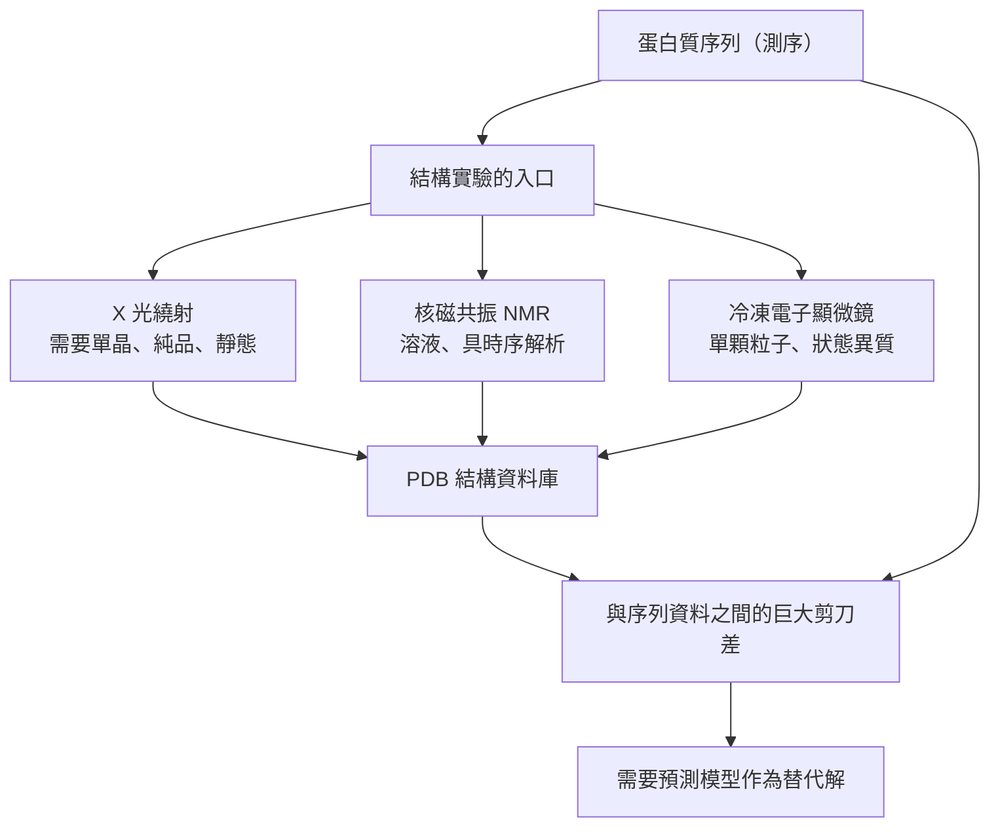

# 3.1 X 光晶體繞射的原理與限制（1912-1972）

## 一、看不見的光波與看不見的原子

1912 年，德國物理學家勞厄（Max von Laue）提出一個大膽的猜想。 X 光的波長只有約 0.1 奈米，與原子間的距離相當；那麼，當 X 光穿過晶體時，它是否會像光柵一樣被原子「繞射」，散成一個規則的點陣？ 弗里德里希與克尼平（Friedrich and Knipping）在同年夏天用硫化鋅與硫酸銅的單晶拍下第一批繞射點照片，猜想成了事實。 這一年，二十五歲的 Bragg 父子（William Henry Bragg 與 William Lawrence Bragg）在英國萊斯特完成了一件更決定性的事：他們發現，若把繞射點視為鏡面反射，就能用一把尺量出晶面之間的距離。

1913 年，小 Bragg 在《皇家學會會報》發表《晶體的 X 光光譜》，逐一測量岩鹽、方解石等晶體的布拉格角，並據此「反演」出晶體的結構。 他整理出的關係式，就是後來整個結構生物學的奠基石：

$$
n\lambda = 2d\sin\theta
$$

其中 $ \lambda $ 是 X 光的波長、 $ d $ 是晶面間距、 $ \theta $ 是布拉格角、 $ n $ 是反射級數。 這個公式的優雅在於它把「看不見的波長」與「可量測的角度」直接綁在一起：只要旋轉樣品、收集足夠的繞射強度，就能反推晶體內部的電子分布。 1915 年，Bragg 父子獲得諾貝爾物理學獎，父子同獲殊榮在該獎的歷史上屈指可數。

X 光之所以是對的工具，不只是因為波長合適，還因為它足夠穿透：它能穿過整顆晶體而不被表面散射吃掉，也能在數小時的曝光中累積足夠的訊號。 這兩個性質決定了它是一種「量測」技術而非「成像」技術——它給出的是統計量，而不是圖像。

Bragg 的實驗同時確立了一個後來主宰整個領域的方法論。 人們不試圖「看見」結構，而是設計一個可以量測的幾何關係，再用數學把它反推回來。 這個思路與幾十年後用深度網路預測蛋白質結構的邏輯是同構的：兩者都是把無法直接觀測的量，透過可量測的代數關係推回來。

## 二、從礦物到生命：Bernal 與 Hodgkin 的胰島素

X 光繞射在二十世紀初主要用於無機鹽、礦物與金屬的結構分析；生命分子要等到 1930 年代才登堂入室。 1934 年，貝納爾（John Bernal）與霍奇金（Dorothy Hodgkin）在牛津大學研究胰島素的晶體，他們發現這顆來自牛的胰島素晶體含有大量水分，而且每一個分子周圍都包圍著一層水分子。 這個看似細節的觀察，後來成為「溶劑可及性」概念的源頭，也是 Perutz 血紅素研究能夠突破的關鍵。

1937 年，貝納爾與霍奇金在《自然》雜誌發表胰島素晶體的首張繞射照片。 那張照片只顯示出一片模糊的斑點，遠不足以建構原子模型；真正的結構又花了三十二年，直到 1969 年霍奇金終於發表胰島素的三維結構。 胰島素的分子量只有 5.8 kDa，在今天的標準下是「小蛋白質」，但在 1930 年代，它已經是能夠成功結晶並送進 X 光機的最大生命分子。

這個反差點出了本章的核心矛盾：技術剛剛跨過門檻，就立刻撞上了生理尺度上的牆。 更深一層的問題在於，胰島素是激素，卻不是酵素；它沒有可被催化加速的反應，因此它的結構無法用功能來解釋。 X 光繞射在這個階段只能做「這是什麼形狀」的清單式累積，而不是像後來的 DNA 那樣，一次實驗就回答一個根本性的生物學問題。

## 三、DNA 雙螺旋與「照片五十一號」

1953 年 4 月，華生（James Watson）與克里克（Francis Crick）在《自然》雜誌發表 DNA 雙螺旋模型。 他們能做出這個模型，直接的結構依據來自倫敦國王學院的富蘭克林（Rosalind Franklin）與戈斯林（Raymond Gosling）拍攝的第五十一號 X 光衍射照片（Photo 51），以及威爾金斯（Maurice Wilkins）與斯托爾（Erwin Stokes）取得的其他衍射圖。 那張照片呈現出清楚的 X 形圖樣，斜向的各向異性寬點——這正是 B 型 DNA 的特徵。

這兩所大學之間的關係本身就說明方法的地位。 劍橋的華生與克里克是理論家，他們有模型與數學卻沒有資料；倫敦國王學院的富蘭克林與戈斯林有最好的資料卻沒有理論框架；而威爾金斯在物理上提供了第三種能力——他能操作 X 光機，能把樣品做得更好。 富蘭克林在 1958 年過世，此後二十多年裡，她的貢獻在結構生物學界被重新梳理與澄清；直到今天，「Photo 51 是 DNA 雙螺旋模型的決定性證據」已成為教科書的標準敘述。

這裡有一段必須講清楚的史實。 華生與克里克在《自然》論文發表的同時，也發表了配套的衍射數據，並將富蘭克林與威爾金斯的數據列入共同作者名單（富蘭克林因故未同意自己的名字被列入）。 1962 年諾貝爾生理學或醫學獎由華生、克里克與威爾金斯共享，富蘭克林並未獲獎，並於 1958 年過世。 從科學認識史的角度看，這件事說明了一件事：X 光衍射資料本身並不包含答案，答案存在於「如何從強度分布推回電子密度」的推論鏈中，而這條鏈需要數學與直覺同時到位。

Photo 51 之所以關鍵，不只因為它好看，而是因為它能被量化。 富蘭克林測量的是各個衍射點的強度與位置，她把「X 形圖樣」翻譯成「螺旋、每圈約十個鹼基、鹼基間距約 3.4 Å」這些可以被寫成方程式的數量。 這一步把生物學問題轉譯成了幾何問題，也讓「雙螺旋」從一個漂亮的比喻變成一個可以被原子模型實現的結構假說。

## 四、肌紅蛋白、血紅素與 1972 年的諾貝爾

蛋白質三維結構的第一個突破來自劍橋的兩個團隊。 肯德魯（John Kendrew）與他的合作者花了八年，於 1958 年在《自然》發表鯨魚肌紅蛋白的原子模型，這是第一個完整的蛋白質三維結構——一條折疊起來的球狀肽鏈，其內部被緊密地塞滿了原子，鏈的每一段都指向明確的二級結構。 1960 年，模型推進到 2 Å 等級，原子與原子之間的間距終於足以讓人「看見」氫鍵與疏水核心。

與此同時，佩魯茲（Max Perutz）研究血紅素。 他的研究之所以能夠推進，是因為他注意到了貝納爾與霍奇金發現的水層現象，並據此設計出重金屬同型衍生物來求解相位。 1960 年，血紅素結構問世：四個次單元繞著一個鐵原子組成的四面體排列，一個 α2β2 四聚體以精巧的對稱性換取協同結合氧的能力。

1972 年諾貝爾化學獎頒給佩魯茲與肯德魯，表彰他們「對球狀蛋白質結構的研究」。 值得注意的是，那個年代 X 光結構生物學的產出極為稀少：從 1958 到 1972 年，能被解出的高解析度蛋白質結構屈指可數，大部分工作花費數年甚至數十年，一張照片的曝光時間以天計，而結構的計算在沒有電子計算機的年代要靠手摇計算機與紙張完成。 這就是「速度與覆蓋率」瓶頸的第一個徵兆，而它將在三十年後以更鮮明的形式出現。

| 事件 | 年份 | 結構生物學上的意義 |
|---|---|---|
| Laue 與 Bragg 的繞射發現 | 1912 | 開啟以 X 光量測原子排列的方法 |
| Bragg 定律 | 1912–1913 | 把波長與晶面間距連結成可量測的幾何 |
| 胰島素晶體 | 1937 | 第一個生命大分子的晶體研究 |
| Photo 51 與 DNA 雙螺旋 | 1953 | 結構方法第一次回答根本的生物學問題 |
| 肌紅蛋白 | 1958 | 第一個完整的蛋白質三維結構 |
| 血紅素 | 1960 | 揭示協同性與對稱性 |
| 諾貝爾化學獎 | 1972 | 球狀蛋白質結構研究獲最高肯定 |

## 五、原理解說：電子密度、Fourier 轉換與結構因子

X 光繞射量測的是強度 $ I(hkl) $ ，但結構理論真正想知道的量是電子密度函數 $ \rho(x, y, z) $ ，它描述單位體積內電子的分布。 兩者之間由 Fourier 轉換聯結：

$$
\rho(x, y, z) = \frac{1}{V}\sum_{h}\sum_{k}\sum_{l} F(hkl)\exp\left[ -2\pi i (hx + ky + lz) \right]
$$

其中 $ V $ 是晶胞體積， $ F(hkl) $ 是結構因子，它由電子密度對晶格傅立葉級數的係數組合而成，可分解為原子形式因子 $ f_j $ 與相位的乘積：

$$
F(hkl) = \sum_{j=1}^{N} f_j \exp\left[ 2\pi i (hx_j + ky_j + lz_j) \right] e^{i\phi_j}
$$

$ F(hkl) $ 可寫成振幅與相位的形式 $ F(hkl) = |F(hkl)| e^{i\alpha(hkl)} $ ，而實驗量到的強度只保留了絕對值平方 $ I(hkl) = |F(hkl)|^2 $ 。 相位資訊在量測中遺失，這就是著名的「相位問題」（phase problem），也是整個結構生物學最核心的技術障礙。 同型取代法（heavy-atom isomorphous replacement）、多波長反常散射（MAD/SAD）與分子置換（molecular replacement）都是繞過它的不同策略，前兩者靠人為構造差異，第三者則靠生物學家的記憶。

解相位問題的四條主要路線各自反映了不同的物理假設。 同型取代法先以重金屬衍生物製造相位差，再以差異 Fourier 求解；多波長反常散射利用元素吸收邊附近的多重散射，讓同一個晶體在不同波長下提供相位資訊；分子置換則完全放棄實驗求相，改為用已知結構的同源蛋白作為初始模型，用旋轉搜尋找出它在晶胞中的位置。 分子置換在 1990 年代之後成為主流，也正是它把「有同源模板」的蛋白質結構解析從數月壓縮到數天。

這些方法都沒有解決一個更根本的問題：X 光資料無法區分結構與其鏡像。 手性是生物分子的基本性質，但繞射強度對結構與其鏡像完全相同。 判斷哪一隻手才是對的，靠的是先驗知識——比如已知肽鏈的構型，或者生物功能上的合理性。 這也說明了一件事：X 光晶體學從來不是一台自足的機器，它始終需要生物學的先驗來完成最後一步。

另一個關鍵限制來自 Wilson 統計。 在高解析度區域，各原子散射因子的相位趨於隨機，結構因子振幅的統計分布可用 Wilson 分布描述；由此可推得，隨解析度提高，訊雜訊比會系統性下降，使得「高解析度」的極限大約落在 2 Å。 這也解釋了為何大型複合體即使拿到了繞射資料，也難以延伸到接近原子解析度：每一個反射點的訊號被數萬個原子的貢獻稀釋。

資料收集的硬體也在這個時期經歷了躍升：從 1930 年代的照相底片與肉眼判讀指紋點，到 1990 年代的 CCD 探測器與自動化的旋轉影像收集，再到 2000 年之後第三代同步輻射光源與最末端的非晶相板實驗。 每一次硬體進步都把解析度往前推一格，也把「哪些蛋白質值得被解」這個選擇題的門檻往下挪。 但無論光束多亮、探測器多靈敏，單晶的取得始終是瓶頸所在。

## 六、限制：X 光繞射的五道牆

第一道牆是樣本。 蛋白質純化需要數百毫克的純品，而且必須是單一構形、單一寡聚狀態，任何一點點變性都會讓晶體無法形成。 第二道牆是單晶。 蛋白質相對於 X 光的波長尺度是一顆巨大分子，必須被整個整個地排列在規則的晶格中，分子之間不能有任何空隙干擾。 第三道牆是膜蛋白：疏水性的跨膜區段天生難以在水中結晶，需要去垢劑穩定，而去垢劑又會擾動構形，長期以來只有極少數膜蛋白結構能夠問世。

晶體生長本身也是一道牆。 蛋白質結晶不是把分子「排隊」，而是讓分子在過飽和溶液中自發地找到彼此、以一致的介面能相互黏附；每一次成核都帶有隨機性，因此同一批樣品在不同條件下長出的晶體，其胞大小、含水量與分子構形都可能略有差異。 這種「每次都不同」的特性，正是同型衍生物難以取得的根源，也是相位問題長期困擾領域的原因。

第四道牆是輻射損傷。 X 光的光子會把電子從原子上撞飛，破壞晶格並累積自由基輻射損傷；現代的冷凍冷卻與自動化收集緩解了這個問題，但單一資料集仍受限於累積劑量。 第五道牆是同型疊加（isomorphism）：只有當同型衍生物與母體晶體的晶胞與分子構形幾乎完全相同時，相位才可解出，而這是一個相當苛刻的實驗條件。

但最根本的，其實是第六點：**X 光繞射只告訴你靜態的、經過平均的形狀**。 溶液中的蛋白質在每一刻都有一整個分布構形集合，而晶體中的分子被強迫定格在一個構形上；想看到動態，只能靠 NMR 或其他方法。 也正因為如此，1972 年的諾貝爾獎並沒有讓此後三十年的結構產出加速——瓶頸不在於諾貝爾級的洞見，而在於每一個結構都是一場耗時數月的手工戰役。

## 七、從少數到大量：結構基因組學的失敗

1995 年，美國結構基因組學聯盟（Protein Structure Consortium）成立，目標是以工業化的流程解出數千個蛋白質結構。 計畫背後的判斷是：既然解一個結構的成本主要來自結晶與數據處理，那麼把流程標準化、把成本壓低，吞吐量就會上升。 這個判斷部分正確——自動化取樣、機器人上樣、非晶相測量與分子置換的普及，確實讓 PDB 在 2000 年代前半維持每年數千個結構的增量——但總量始終沒有進入「十萬」的量級。

原因在結晶這一關。 統計上，真正能長出適合衍射的單晶的蛋白質只占少數：受蛋白質穩定性、表面性質、分子間接觸面積與結晶條件的影響，許多蛋白質在任何條件下都不結晶，另一些則需要數百種條件的試驗。 這些試驗沒有捷徑，因為結晶不是化學反應，無法用理論預測；它更像是一種需要經驗與耐心的搜尋，而搜尋的空間又隨著蛋白質的數量呈乘法成長。 於是「逐一量測」的方法在遇到「以億計的序列」時，不只是慢，而是結構性的不可能。

## 八、三種技術的分工與共同的瓶頸

三種技術的分工互補，但牆壁高度一致：它們都需要時間、需要純化的樣本，而且每一個結構都是一次性的手工事件。 結果是，2018 年時，蛋白質資料庫（PDB）收錄的結構約 15 萬筆，而 UniProt 收錄的蛋白質序列已超過 1.6 億條。 兩條曲線以近乎相反的斜率分開，剪刀差達三個數量級。

這個缺口不是科學家不努力，而是「逐一量測」的物理方法在面對「以億計的序列」時必然崩潰。 更值得注意的是，即使在 1995 年成立結構基因組學聯盟（Protein Structure Consortium）之後，PDB 的年增結構數也只在數千的量級。 這個瓶頸，正是十年後人工智慧介入的起點。

要理解為何人工智慧能繞過它，得先理解另外兩種技術各自能做什麼、又在哪些地方撞牆。 核磁共振不需要晶體，能在溶液中原生地觀測分子的動態，但它的訊號隨分子量增大而擁擠；冷凍電子顯微鏡不需要結晶，能直接對單顆粒子成像，但它的重建精度取決於樣本的均一性。 三種方法各有天賦，也各有天花板，而它們的天花板疊在一起，仍然遠低於序列的數量。
