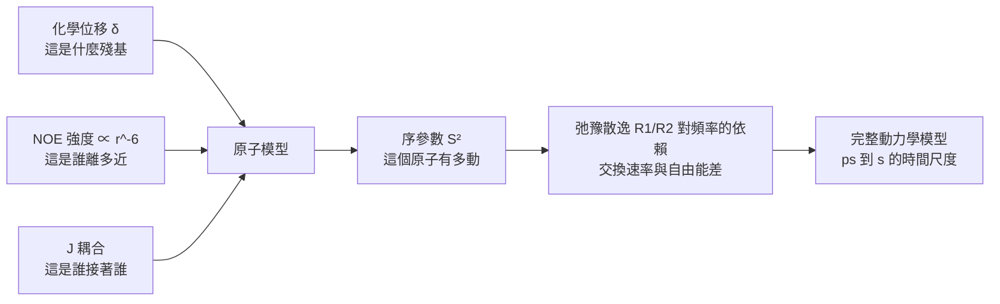

# 3.2 核磁共振光譜（NMR）與動態結構捕捉（1946-2010s）

## 一、兩顆同樣的磁鐵，兩種不同的共振

1945 年，第二次世界大戰剛結束，在麻省理工學院工作的布洛克（Felix Bloch）與在哈佛大學工作的珀塞爾（Edward Purcell）各自獨立地發現了一個現象：把樣品置於均勻磁場中並施加射頻脈衝，原子核會以特定的頻率吸收能量，而這個頻率取決於核種所處的化學環境。 兩人各自在 1946 年發表論文，1952 年共享諾貝爾物理學獎。 這個原理與 X 光繞射截然不同：X 光看的是電子的靜態分布，NMR 看的則是原子核的磁性及其周圍的電子屏蔽——前者回答「形狀是什麼」，後者回答「這個形狀怎麼動」。

最初的實驗只是一件儀器：布洛克在史丹福大學建造的裝置，讓射頻線圈包住一個小瓶，瓶子裡裝的是溶解在石蠟油中的硝酸銨鈉晶體；當射頻頻率掃過時，線圈偵測到原子核吸收能量後放出的訊號。 珀塞爾在哈佛的版本則是讓液態水與苯的混合物在磁場中產生不同的訊號頻率。 兩人各自看見了同一件事：共振頻率不只是一個物理常數，它帶著化學資訊。

NMR 之所以能用來談結構，關鍵在於「化學位移」這個概念。 對化學位移的解讀奠基於 1950 年代，人們發現同種核種在不同化學環境中的共振頻率會有細微但可重現的差異。 若外部磁場為 $`B_0`$ ，某核的拉莫爾頻率為

$$
\nu_0 = \frac{\gamma}{2\pi} B_0
$$

其中 $`\gamma`$ 是核的磁旋比。 當核被電子雲包圍，電子雲的感應磁場會部分抵銷 $`B_0`$ ，使得實際感受到的磁場變為 $`B_{\mathrm{eff}} = B_0 (1 - \sigma)`$ ，因此共振頻率會位移。 相對參考物（常用四甲基矽烷，TMS）的位移以百萬分之一為單位定義：

$$
\delta = \frac{\nu_{\mathrm{sample}} - \nu_{\mathrm{ref}}}{\nu_0} \times 10^{6} \ (\mathrm{ppm})
$$

化學位移的價值在於它是一個「指紋」：同一個胺基酸殘基在不同蛋白質裡的位移幾乎一致，不同殘基之間的位移則可區分。 也就是說，一張一維 NMR 光譜裡，每一根峰都對應一個化學環境，這是 X 光方法完全不具備的資訊層級。 對一個只有十幾個殘基的小蛋白質，人可以直接用肉眼讀出這張「指紋表」；對大分子，則需要把它拆解成一張二维甚至三维的表格。

## 二、耦合、NOE 與二維光譜的誕生

單靠化學位移只能「認出這是什麼殘基」，還需要知道「它離誰多遠」。 這就是耦合的作用。 化學鍵上的成對電子會產生標量耦合（ $`^{1}J`$ 與 $`^{2}J`$ ），其大小可用耦合常數 $`J`$ 表示，典型值為 3–15 Hz，這個量在分子內與分子間都存在，而其符號與大小可用 Karplus 關係式換算成二面角。 另一種更關鍵的是核偶極耦合：空間上靠近的核，其磁矩會互相影響，這種耦合隨距離以 $`r^{-3}`$ 的形式快速衰減。

核磁共振的諾伏斯效應（NOE）正是利用了後者。 當兩個核的空間距離足夠近（通常 5 Å 以內），經由交叉飽和或混合的途徑，兩個核的磁化向量會互相傳遞並造成強度變化，這個比例稱為 NOE 強度，與 $`r^{-6}`$ 成正比。 1980 年，恩斯特（Richard Ernst）與讓納（Jean Jeener）在一次演講中提出了二維 NOESY 實驗的想法；1982 年，這項技術問世，改變了整個領域的走向。

二維光譜的出現，讓「譜峰重疊」這個問題從一場災難變成了一個可管理的問題：橫軸是化學位移，縱軸是另一個維度，而交叉峰的位置直接對應到兩個質子之間的耦合。 COSY 讓同一殘基內的耦合現形，NOESY 讓空間上靠近的質子現形，兩者搭配，序列賦值與二級結構判定可以在同一張圖上完成。

NOESY 的偉大之處在於它把「誰和誰近」變成了一張圖譜。 有了這張圖譜，維特里希（Kurt Wüthrich）及其同事在 1980 年代建立了蛋白質的序列賦值流程：利用 NOE 交叉峰沿著肽鏈做步進，配合化學位移的特異性，逐步把每個 NOE 峰指派到特定殘基與特定質子對上。 1984 年起，一份份小型蛋白質的解法陸續公布，NMR 正式躋身於結構生物學的三大方法之一。

## 三、二維、三維與異核技巧

純 $`^{1}`$ H 光譜的瓶頸是譜峰重疊嚴重：一個 100 殘基的蛋白質有 800 個以上的質子，它們的化學位移分布在一個相對狹窄的範圍內。 解法是往三個方向擴展。

第一個方向是維度：三維與四維 NOESY 加上時間維或碳維，能把重疊的交叉峰拆開。 第二個方向是異核標記：用 $`^{13}`$ C 與 $`^{15}`$ N 標記蛋白質， $`^{1}`$ H– $`^{15}`$ N 的 HSQC 光譜會讓譜峰在第二個維度散開，同時提供每個殘基獨立的指紋訊號；三共振實驗再加入 $`^{13}`$ C、 $`^{15}`$ N、 $`^{1}`$ H 之間的接力傳遞，讓序列賦值變得自動且可靠。

第三個方向是弛豫抑制，這是 NMR 尺寸上限被推高的關鍵。 1995 年 Riek、Wider、Dötsch 與 Wüthrich 提出的 TROSY（Transverse Relaxation-Optimized SpectroscopY），利用化學位移各向異性與偶極耦合的交叉項，在譜峰解耦的同時大幅延長橫向弛豫時間 $`T_2`$ ，使大分子的訊號得以存活。 這是一個典型的「用物理學買時間」的設計：同一台儀器、同一份樣品，只因為採用了不同的脈衝序列，可解的分子量就從約 30 kDa 提高到 100 kDa 以上。

三維與四維 NMR 的加入，讓「一個峰對應多個質子」的問題被徹底拆開。 四維實驗把兩個正交維度都拿來編碼耦合，讓交叉峰只剩下兩個質子對；代價是資料量膨脹到數十 gigabyte，計算與存儲都成為瓶頸。 但即便如此，NMR 仍然是三種方法中最耗資源的一種。

另一個常被低估的技術是化學位移擾動（chemical shift perturbation）。 當蛋白質與配體結合時，結合界面附近的殘基會因環境改變而移動，這些位移可以被一鍵式地標記出來。 對那些沒有晶體、又需要知道「分子與誰互動」的系統而言，這是一種幾乎零成本的介面地圖。

## 四、大分子的終極武器：methyl-TROSY（2006）

對大型複合體而言，甲基基團的 $`^{13}`$ C 標記提供了關鍵突破口。 2006 年，甲基-TROSY 技術問世：研究者以高度選擇性的激發方式，只觀測側鏈甲基的共振，再配合 TROSY 的弛豫抑制，讓譜峰即使在 100 kDa 以上的複合體中仍能分離。 甲基碳的化學位移取值範圍很窄（介於 10–30 ppm 之間），本來是缺點，但正因為窄，甲基峰反而成了每個殘基的指紋標籤，可以在高密度光譜中用直覺比對找出。

這項技術把溶液 NMR 的適用上限推到了約 100–200 kDa，並讓核糖體、核糖體蛋白、病毒衣殼這類大型複合體第一次能被 NMR 直接研究。 更重要的是，甲基的側鏈振盪在奈秒（ns）到數十奈秒尺度上提供了極佳的靈敏度探針——它們既能報時，又能報出誰在動。

## 五、為什麼 NMR 的靈敏度天生不足

在談解技術之前，有一個物理事實必須先講清楚，它決定了 NMR 所有後續設計的走向。 對固定數量的核而言，磁化向量能提供的總能量正比於 $`B_0`$ ，而量測時真正能被接收線圈感應到的訊號又比這更小一個數量級；更重要的是，儀器的背景雜訊（線圈熱噪聲、化學品的溶劑訊號）並不會隨 $`B_0`$ 一起下降。 這意味著單靠增加磁場，訊雜訊比改善的速度遠慢於直覺。

因此 NMR 的所有進步都圍繞著「如何讓更多的核同時貢獻、而不讓它們互相干擾」這個問題。 異核標記讓碳與氮的稀薄標記成為稀疏而乾淨的訊號來源；選擇性激發只挑有興趣的甲基；解耦脈衝把不需要的耦合壓回背景；TROSY 則是在數學上找出「哪一個效應會讓橫向弛豫變快」，然後設計脈衝把它抵消。 理解了這條主線，就理解為何 NMR 的每一次進步都伴隨著新的數學工具，而不僅是更貴的儀器。

## 六、超強磁場與固態 NMR

第一個增加靈敏度的方向是磁場本身。 1952 年，第一台商用核磁共振儀的磁場僅 1.5 T（40 MHz）；到 1980 年代，超導磁體把 600 MHz（14.1 T）變成標配；進入 2010 年後，商用儀器跨過 20 T 的門檻，900 MHz（21.1 T）成為高端實驗室標配，2020 年前後更出現 28.2 T（1200 MHz）的機型。 靈敏度大致隨 $`B_0`$ 線性提升，因為共振頻率直接由 $`\nu_0 = \gamma B_0 / 2\pi`$ 決定；而共振頻率愈高，化學位移的 ppm 視窗對應的 Hz 範圍就愈大，也就是說譜峰擁擠程度直接下降。 這是 NMR 能追上蛋白質尺寸的物理原因之一。

第二個方向是脫離溶液。 固態 NMR 讓樣品以結晶或纖維形式存在，可以研究無法溶於水、體積龐大、或具有天然無序區域的系統。 其技術核心是魔角旋轉（Magic Angle Spinning, MAS）：把樣品以 $`54.74°`$ 的魔角快速旋轉，使化學位移各向異性等異向性相互作用在時間平均中被抵消，讓固體的寬頻譜收斂成類似液體的窄峰。 2010 年代，轉速從傳統的數 kHz 躍升到超過 100 kHz 的 fast MAS，並搭配超極化與質子偵測技術，讓固態 NMR 能解析出蛋白質中質子層級的異質性，甚至推動了天然無序區域在固態下的結構研究。 固態 NMR 有一個溶液 NMR 無法取代的位置：阿茲海默症類的類澱粉纖維與膜蛋白的脂質雙層環境，本來就不存在於均勻溶液之中；把樣品做成纖維或脂質體，再以魔角旋轉「把固體攤平」成可解讀的頻譜，是唯一能在其原生環境中取得原子級資訊的路徑。 動態核極化（dynamic nuclear polarization, DNP）則利用電子自旋的極化轉移來放大核磁化，嘗試把靈敏度再提高一到兩個數量級。

## 七、NMR 的獨特價值：把時間當成第四個維度

X 光與冷凍電子顯微鏡給出的是一張快照，而 NMR 給出的是一段剪輯。 透過測量縱向弛豫速率 $`R_1 = 1/T_1`$ 、橫向弛豫速率 $`R_2 = 1/T_2`$ 、異核 NOE 與偶極耦合所導致的化學位移散逸（chemical shift dispersion），研究者可以計算每個 $`^{1}`$ H– $`^{1}`$ N 鍵的振幅與序參數 $`S^2`$ ，進而推知該原子相對於蛋白質整體的運動幅度。 Kay、Torchia 與 Bax 在 1989 年提出的無模型分析法（model-free analysis），正是把這些量換算成皮秒到奈秒尺度內部運動的標準框架。

更關鍵的是弛豫散逸（relaxation dispersion）測量。 當蛋白質的構形在兩個狀態之間以微秒到毫秒的速率交換時，會在 $`R_1`$ 或 $`R_2`$ 上留下與頻率依賴的特徵。 2001 年 Palmer、Kroenke 與 Loria 系統化了這套方法，使研究者能定量測出有多少比例的分子處在過渡態、交換速率是多少、兩個狀態的能量差是多少。 配合超極化、氫氫交換（HDX）與等溫滴定量熱等技術，NMR 的時間解析度可從皮秒一路延伸到秒級。

這張流程圖的關鍵在於它的單向性：化學位移、NOE 與耦合提供幾何，弛豫與散逸提供時間。 前面三者是多數結構方法都有的部分，最後兩個則是 NMR 獨有的延伸。 當 AlphaFold 之後的時代不再缺乏幾何，缺的反而是時間，這個分工就會重新排列。

NMR 在動力學上的專長，還直接改變了生物物理學的問題意識。 過去人們習慣把構形變化描述成靜態的兩張圖，而 NMR 讓「構形是一個連續的集合」成為常見的表述。 2011 年諾貝爾化學獎頒給 Boyer 與 Walker，表彰他們對 ATP 合成酶的結構與機制研究；在那條研究路線上，構形切換的速率與能量學正是靠 NMR 的弛豫散逸與同位素交換實驗定出來的。 這些量是任何一張靜態結構圖都無法提供的。

這些能力是其他結構方法難以複製的。 一個典型的例子是：X 光顯示某蛋白質有一道狹窄的通道，而 NMR 顯示這道通道在毫秒尺度上會被一側的胺基酸反覆開合——前者給出靜態的拓撲，後者給出生物學家真正關心的機制。 另一個例子是天然無序區域（IDR）：它沒有固定的立體結構，因此在所有要求有序構形的技術眼中都是隱形的，但 NMR 卻能證明它在溶液中高度擴張、只在與伴護蛋白結合時才局部收斂。

## 八、限制：NMR 的四道牆

在談四道牆之前，有一點必須承認：NMR 是三種方法中唯一不需要「把分子變成別的東西」的技術。 X 光要求分子結晶成晶格，冷凍電子顯微鏡要求分子被急速冷凍在玻璃冰中，只有 NMR 讓蛋白質待在水溶液裡、保持摺疊、保持結合態、保持溫度可調。 這個「原生」性質使它在研究生理相關現象時具有不可替代性。

第一道牆是譜峰重疊，也就是大小限制。 傳統的一維 $`^{1}`$ H 與二維 $`^{1}`$ H– $`^{1}`$ H 方法在約 30–40 kDa 以下運作順利，超過之後譜峰交疊使得賦值幾乎不可能；TROSY 與 methyl-TROSY 把極限推到 100 kDa 以上，但代價是更複雜的實驗設計與更長的資料收集時間。

第二道牆是時間成本。 一次完整的溶液 NMR 實驗往往需要數天的儀器時間與數十毫克的純化樣品，而單一結構的解算（資料收集、賦值、結構計算與修飾）往往耗時數月。 這與 X 光的「一天出圖」形成鮮明對比，也讓 NMR 結構在 PDB 中的占比長期偏低。

第三道牆是樣本濃度需求。 NMR 需要毫莫耳濃度級別的均勻溶液樣本，這對稀有蛋白質、膜蛋白（在脂質體或 nanodisc 中才穩定）以及容易聚集的複合體都是嚴苛條件。 第四道牆是無法處理超大或高度對稱的體系：病毒的衣殼這類數百 MDa 的結構，NMR 只能看見表面殘基，無法重建整體。 此外 NMR 給出的是一組構象集合而非單一結構，這在視覺上不夠乾淨，卻在科學上更誠實。 2002 年諾貝爾化學獎頒給 Fenn、Tanaka 與 Wüthrich，其中 Wüthrich 的獲獎理由正是「開發多維度核磁共振光譜以決定溶液中生物大分子的三維結構」；能把一個方法用到足以問鼎最高榮譽，本身就說明這條路線在「速度」上的弱點有多致命。

第三道牆與第四道牆之間還有一層張力：越是把 NMR 推向大分子，越需要標記、越需要時間，也就越偏離「原生態」這個初衷。 一台 900 MHz 的儀器造價以千萬美元計，機時以天計，而真正需要 NMR 的往往正是那些最難以純化、最稀有、最珍貴的樣本。

| 面向 | X 光繞射 | NMR |
|---|---|---|
| 物理量 | 電子密度 | 核自旋共振頻率與弛豫 |
| 環境 | 晶體（固態、有序） | 溶液（原生態） |
| 產出 | 單一電子密度圖 | 構象集合與動力學參數 |
| 時間解析度 | 無（靜態平均） | ps 至 s |
| 分子量門檻 | 數百 kDa（需單晶） | 約 30–40 kDa（TROSY 後可更大） |
| 樣本需求 | 數百 mg 純品與單晶 | 數十 mg、mM 濃度 |
| 主要瓶頸 | 結晶與相位問題 | 譜峰重疊與機時 |

兩種技術的差異不是好壞，而是量測的是不同的東西。 這個差異在 AlphaFold 出現之後變得愈發重要：當預測模型能在幾秒內給出靜態結構，人類研究者對結構的需求就會從「我要形狀」轉向「我要這個形狀怎麼動」——而那正是 NMR 的領地。
