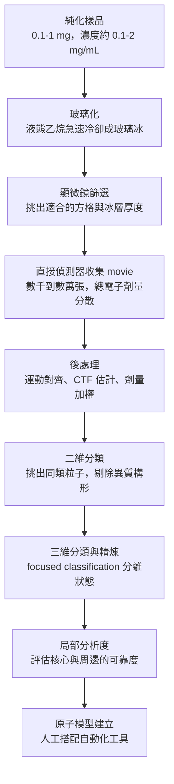

# 3.3 冷凍電子顯微鏡（Cryo-EM）的解析度革命（1986-2013）

## 一、玻璃中的樣本：Dubochet 的直覺

X 光繞射與核磁共振都是「間接」測量，它們把樣品放進某種物理裝置裡，再從統計量反推結構。 電子顯微鏡不同：它真的用電子束照到樣品上，用透鏡成像。 問題是，生物樣品在電子束下會被劇烈加熱、脫水而崩解，電子束還會把重原子打出輻射損傷。 1980 年代的解法是「玻璃化」：把含樣品的薄膜急速冷卻到液態乙烷的溫度（約 -196 °C），使水瞬間形成非晶態的玻璃冰，而不是讓它形成會破壞結構的冰晶。

這個方法由日内瓦的 Dubochet、Frank 與 Villiger 在 1980 年代中期系統化，並在 1986 年的論文中確立。 關鍵在於「玻璃」這個狀態：其中的水分子排列混亂、無晶格，因此不會像冰晶那樣以任何特定方向切割生物分子。 從此，蛋白質得以在近乎生理的環境下被成像。 Frank 將這套技術命名為冷凍電子顯微鏡（cryo-electron microscopy, cryo-EM），並把它定位成「不需要結晶的結構生物學」。

玻璃冰的優點不只在於低溫。 水在冷卻時若形成六方冰，晶格會把樣品分子擠壓、切片，甚至造成局部脫水造成的構形改變；非晶的玻璃冰則完全沒有這類切割效應，蛋白質只是被原地凍結。 這意味著樣品在玻璃化前後的構形幾乎不變，電子束看到的分子構形，就是它在溶液中本來的樣子。 這個「所見即所得」的性質，是 cryo-EM 相對 X 光最被低估的優勢。

這個定位在當時聽起來像是句玩笑話。 沒有晶格，就沒有週期性，也就没有 Bragg 定律可用；X 光繞射之所以能給出高解析度，正是因為整個晶體在數千個格點上重複同一個分子，讓訊號被平均。 電子顯微鏡沒有這種平均，它拍到的是一張張隨機取向的分子照片。 要把這些照片變成結構，就必須先用演算法把每一張照片「轉正」，再把它們疊起來求平均。 整個領域的成敗，都押在這個疊加能否壓平噪聲、又保留細節。

## 二、1990 年代的低解析度歲月

1990 年，Frank 與 Henderson 成功重建出核糖體的低解析度三維結構，證明了「玻璃化樣品加上單顆粒子影像再加上計算機平均」這條路走得通。 1998 年，Frank、Zhou 與 Chen 在《自然》發表 B 型肝炎病毒衣殼的重建結果，解析度約 7 Å 等級——這是一個相當壯觀的成就，因為病毒衣殼是數百萬道道單位（MDa）尺度的組裝體，裡面有數百個蛋白質次單元。

先從一個簡單的估計開始。 單顆粒子的影像充滿了隨機相位與隨機噪聲，但把 $`N`$ 張粒子對齊後疊加，訊雜噪比只會以平方根的方式成長：

$$
\mathrm{SNR} \propto \sqrt{N}
$$

這個平方根是整個領域的關鍵算式。 它意味著要把解析度從 4 Å 推到 3 Å（相當於把可分辨的距離縮短三分之一），所需的粒子數要增加數倍而非數十倍——代價是資料量、儲存空間與計算時間全部一起成長。 在直接偵測器出現之前，人們根本拿不出足夠的粒子數來兌現這個平方根。

但整個 2000 年代，冷凍電子顯微鏡幾乎被結構生物學界拋棄了。 原因有三個。其一是解析度不足：大型蛋白質的重建多半停在 5–10 Å，看得見整體形狀，看不見側鏈，更別說分辨水分子。其二是輻射損傷：每一張影像的電子劑量必須很低，否則樣品就被打壞，但低劑量又代表訊雜噪比極差，需要數千到數萬張影像來平均，而當時的對位演算法效率低下。其三是缺乏確定性的模型：即使有了粗糙的密度圖，也幾乎沒有人知道該如何從中可靠地建立原子模型。

低解析度的物理原因值得說明。 當單一粒子影像的每一張都含有隨機相位與隨機噪聲，而重建的本質是「猜對相位、再把訊號相加」，只要相位猜錯了百分之十，兩個物體互相抵消的機率就顯著上升。 對大分子而言，粒子形狀本身提供了一些可用來對位的資訊；對小分子而言，這些資訊被噪聲完全淹沒。 於是 2000 年代的主流策略變成了「取悅演算法」：加上去垢劑讓蛋白質變大、用支架或抗體 Fab 讓粒子形狀更獨特、用對稱性讓平均更有效。 這些策略有效，但每一個都增加了實驗的複雜度，也讓方法更遠離「任何人都能做」的理想。

這段低潮期常被稱為 cryo-EM 的「沉睡期」。 它不是一個錯誤的方法，而是缺少關鍵零件：更好的探測器。

## 三、2012-2013：電子直接偵測器與解析度革命

2012 年起，商用的高速直接電子偵測器（如 Gatan K2）出現在市場上。 這些相機能做「movie mode」記錄，也就是把每個電子事件的時間戳與位置逐一記錄下來，而不是把整個曝光期間的電子累積成單一影像。 這個差異看似細微，卻徹底改變了物理：研究者可以在後處理階段逐幀對齊、逐幀估計像差變化（CTF），把電子劑量依時間加權，從而在不犧牲總劑量的前提下大幅提高有效解析度。 更重要的是，記錄每個電子的位置，讓每張影像的讀出噪音降到極低，單張影像中每個電子的座標都能被量測到非常精確的程度。

2013 年，Scheres 團隊發表了關鍵的理論與實驗論文，證明在直接偵測器的支援下，單一蛋白質分子即使完全不做任何對稱性平均，也可以重建到 3.4 Å。 這是一個門檻式的結果：在那之前，cryo-EM 的 3 Å 關口被認為只有藉助巨大對稱性（二十面體衣殼的平均）才可能跨越。 2014 年，利用同樣的技術，80S 核糖體以 3.9 Å 的解析度問世，標誌著核糖體級別的複合體可以被完整原子建模。此後數年，cryo-EM 的產出曲線急遽上揚，被學界稱為「解析度革命」（resolution revolution）。

在硬體之外，演算法同樣關鍵。 2012 年之後興起的一整套流程——運動對齊、CTF 精確估計、Bayesian polishing、二維分類配合三維精煉——把「資料量」與「演算法」變成了解析度的乘數。 2015 年之後，cryoSPARC 與 RELION 等工具把這些步驟串成一條可自動化的流水線，讓非專家也能取得接近專家的結果。 探測器的量子效率（detector quantum efficiency）從當時的有限值一路提升，也讓每個電子都能被記錄下來而不是被雜訊淹沒。

其物理原因值得說明：X 光量測的是振幅的平方，相位資訊在過程中遺失，因此必須用重金屬衍生物或分子置換去補救；而 cryo-EM 是實空間的投影，重建過程不依賴振幅與相位的分離。 這是 cryo-EM 在樣本取得極為困難的情況下仍能留下來的重要原因，也是它在三十年後終於「鹹魚翻身」的關鍵。

## 四、流程拆解：從一滴樣品到一個結構

這條流程裡，沒有任何一步要求「單晶」，這是它相對 X 光最大的解放。 樣本需求量從數百公克降到數百毫克到一毫克等級；而且由於三維分類可以從混合的方格中挑出合格的粒子，純化壓力也大幅下降——研究者不必再追求絕對純化，只要方格裡有足夠比例的目標粒子就行。 一個典型的現代實驗會收集五千到五萬張影像，經過數天的計算，最終產出一個模型。 重建出來的密度圖通常也會一併存入電子顯微鏡資料庫（EMDB，2015 年成立），使得任何人都可以重新解算、比較不同樣本本轉換前後的密度變化，而不必重跑整條流程。

## 五、異質性：cryo-EM 的真正難題

cryo-EM 重建的數學本質是「把許多相似粒子疊加平均」，而蛋白質恰恰不是靜態的物體。 如果同一個蛋白質在冰中以兩種構形各占一半，那麼兩者的訊號會互相稀釋，結果是一個兩者的平均——一個現實中並不存在的構形。 這是 cryo-EM 長期解析度落後的根本原因，也是 2014 年之後技術開發的重點。

2014 年之後，Scheres 團隊發展出所謂的 focused classification：不先做整體對位，而是把計算資源集中在指定的區域或指定的朝向子集合上做分類，因而能把同一個蛋白質的不同構形從混合資料中分離出來。 2015 年之後，這套流程被 RELION、cryoSPARC 等軟體商品化，異質性處理成為常規操作。 2016 至 2021 年，更進一步的方法出現：cryoDRGN 等工具不把構形當成離散的幾個類別，而是把它當成連續的流形，直接重建出構形異質性的連續變化軌跡；這使得研究者可以看見一個蛋白質從結合態到鬆弛態的連續過渡。

這在概念上把 cryo-EM 從拍照推向了拍影片。 2015 年起，G 蛋白偶聯受體、轉運體、離子通道、呼吸鏈複合體等一大票膜蛋白陸續以 3 Å 甚至 2 Å 等級的解析度問世；對結構藥物設計而言，這是自 2015 年以來最大的變化——過去二十年間作用於 GPCR 的藥物設計只能依賴少數幾個先導結構進行分子設計，而今主要標靶的結構覆蓋率迅速提高。

## 六、驗證：如何知道自己沒有做錯

任何結構方法都需要一套「自我懷疑」的機制，cryo-EM 在這方面反而是三種方法中最透明的一種。 首先是半對角圖（FSC）：把重建結果切成兩半，各自獨立重算，再比較兩者所保留的 Fourier 係數；兩條曲線交叉處即為宣稱的解析度。 其次是金標準（gold standard）設計：全程不讓兩半資料互相看，避免自我欺騙。 再者是局部分析度地圖：把結構切成小塊逐一估算，用顏色標示每一塊的可信度，這讓研究者能看見「核心很清楚、外掛很模糊」的真實狀態，而不是被一個漂亮的全域數字騙過。 最後是地圖與模型的 $`R_{\mathrm{work}}`$ 與 $`R_{\mathrm{free}}`$ ，以及近年強調的幾何殘基分佈檢定，用以排除常見的建模偏差。

這些機制的意義在於，它們把解析度從一個宣稱，變成一個可被獨立重現的量。 當一個領域的產出速度從每年數千個提升到每年上萬個，這類驗證機制就是防止品質失控的最後一道防線。

## 七、限制：cryo-EM 也有一牆之隔

cryo-EM 偏好大分子。 當樣本分子量低於約 100 kDa 時，粒子形狀的隨機性使得對位與分類的可靠性快速下降；這與 X 光喜歡小而穩定、NMR 喜歡中小，恰好構成互補的另一組偏好。 另一個偏好是剛性構形：如果蛋白質在冰中是鬆散、構形多變的，粒子在取樣時就會呈現各種朝向與構形，平均化會把訊號抹平。 這也是為何加入配體、突變或穩定化工程（如用抗體 Fab、以奈米支架包裹蛋白質、乃至把膜蛋白包進支架中）會顯著提高解析度。

樣本製備的瓶頸還有一層：網格（grid）本身的物理極限。 傳統的玻璃化必須在液態乙烷中「plunge」成薄膜，薄膜的厚度、冰層的分佈與樣品濃度都需要人工微調；2018 年之後興起的空氣—水界面（air-water interface）方法讓樣品在水面上一層薄薄的碳膜中展開，雖然提高了均一性，卻把許多樣本推向了另一種可能的變性。 探討哪一種製備方式最適合某個蛋白質，至今仍是一門需要經驗的手藝。

其餘限制包括：玻璃化本身仍是手工藝性質的瓶頸，樣品質量、濃度、緩衝液與濃度梯度都會決定成敗；單次資料收集以天計，計算量以千核心小時計；構形異質性的判讀仍高度依賴研究者對生物學的先驗判斷。 換句話說，cryo-EM 把「不能結晶」這個問題解決了，卻把「樣品必須高度均一」這個問題原封不動地留了下來。

## 八、為什麼 2013 年是分水嶺

把 1986 到 2013 這二十七年攤開來看，cryo-EM 的歷史其實是一個「原理早已到位、關鍵零件姍姍來遲」的故事。 玻璃化在 1980 年代中期就已經成熟，單顆粒子的三維重建在 1990 年就已被證明可行，甚至「相位問題不存在」這個結構性優勢也從第一天起就成立。 這二十七年的停滯，卡在一個硬體瓶頸上：底片與早期 CCD 探測器的讀出噪音太高，而把電子束的劑量壓到很低又讓訊號太弱。 探測器一旦同時解決「記錄每個電子」與「低讀出噪音」兩件事，二十年累積的演算法成果才被瞬間釋放出來。

這段歷史對今天有直接的教訓：科學的瓶頸常常不在於「想不出方法」，而在於「量測不夠準」。 當人類終於取得足夠好的硬體時，十年前寫好的演算法會立刻開始發揮作用。 這也是為什麼在 AlphaFold 的故事裡，機器學習的準備期長達十年，而一旦資料與算力同時到位，進步會以月為單位發生。

## 九、三種技術的橫向比較與剪刀差

| 面向 | X 光繞射 | 溶液 NMR | 冷凍電子顯微鏡 |
|---|---|---|---|
| 典型解析度 | 1.5–3 Å | 1–3 Å | 2–4 Å（2013 年後） |
| 樣本量需求 | 數百 mg 與單晶 | 數十 mg，mM 濃度 | 0.1–1 mg |
| 是否需結晶 | 需要 | 不需要 | 不需要 |
| 適用分子量 | 數十 kDa 以上 | 低於 30–40 kDa（TROSY 後更大） | 高於 100 kDa |
| 動態能力 | 幾乎無 | 最佳（ps 至 s，構形交換） | 中等（可分離靜態狀態） |
| 膜蛋白 | 困難 | 中等（nanodisc） | 成功，主流方法 |
| 資料量需求 | 中 | 低但耗機時 | 極高（數千至數萬張影像） |
| 相位問題 | 有 | 不適用 | 無（實空間投影） |
| 可及性 | 高（常規實驗室） | 中（需高階儀器） | 中（需專門技術團隊） |

三種方法的天花板不同，但它們共享同一個致命瓶頸：速度與覆蓋率。 2018 年，PDB 收錄的結構約 15 萬筆，UniProt 的蛋白質序列已超過 1.6 億條；到 2021 年底，PDB 也才勉強突破 19 萬筆。 序列數以每年數千萬的速度增長，結構數以每年數千的速度增長，剪刀差不但沒有收斂，還在不斷張大。 值得注意的是 PDB 的結構數在 2020 年之前主要由 X 光與 NMR 貢獻，cryo-EM 的占比不足兩成；在解析度革命之後，cryo-EM 迅速成為蛋白質複合體與膜蛋白的主要來源，讓 PDB 的結構類型分布發生了結構性的改變。

2016 至 2021 年間，cryo-EM 的結構產出確實明顯加速，人工智慧的預測模型也開始登場；但兩者都無法單獨填平這個缺口。 於是出現了一個自然的分工：讓機器負責猜出大部分結構，讓實驗負責驗證少數關鍵結構並且量測機器猜不出的動態與細節。 AlphaFold 2 在 2020 年 CASP14 之後的隔年，AlphaFold 資料庫就一口氣釋出逾兩億個預測模型，把 PDB 數十年的產出量在幾個月內追平——這正是下一章的主題：為什麼猜比量更能面對億萬級的序列。

這項分工的細節比想像中有趣。 預測模型一旦存在，它就反過來成為 cryo-EM 的助力：用預測結構作為初始模型，可以讓建構模型的工作從零畫出原子變成把預測模型對齊到密度圖上再修正；對那些預測不準的柔性區段與側鏈，密度圖則提供了真實的答案。 兩種技術於是形成一個閉環——機器預測提高實驗效率，實驗結果則回流為訓練資料與評估基準。 這種預測與驗證的反覆迭代，是第 5 章之後 AlphaFold 系列持續進步的真正機制。
