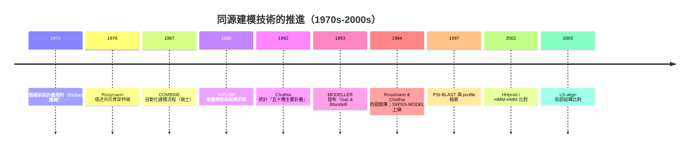

# 4.1 同源建模（Homology Modeling）與執行緒折疊（Threading）（1970s-1990s）

## 一、模板的發現：從一個結構到一整個家族

1970 年代末期的結構生物學面臨的不是「預測」，而是一個更簡單也更尷尬的問題：已知的結構太少，多到連「同一個蛋白質家族的成員長什麼樣」都說不清楚。X 光繞射解出的第一個完整血紅素結構讓人歡喜，卻也立刻暴露了結構的獨特性：鏈結肌紅蛋白（myoglobin）與血紅素的胺基酸序列只有約三分之一的片段相同，但二者的三維形狀卻像同一個模子刻出來的。這意味著序列可以變，形狀卻高度保守；也意味著，一旦手上有一個結構，人們就有理由相信同一家族的成員也大致是那個形狀。

於是「模板」（template）這個概念浮上水面。所謂同源建模，說穿了就是一次結構的插值：若目標序列與模板序列的對應關係夠可靠，就把模板的三維骨架搬過來，再把目標序列的側鏈換上去。只要演化過程中骨架的三維擺動幅度不大，這個搬家的結果就相當準確。1970 年代早期，這件事是靠手工完成的：科學家拿著一張紙或一台早期的向量圖顯示器，把已知結構的摺疊走向描成線條，再一段一段對到新序列上。

這種手工的做法慢慢被歸納成「家族折疊規則」。Greer、Schubert 以及 Jane Richardson 與 David Richardson 團隊在 1970 年代末至 1980 年代初系統性地描繪了蛋白質中最常見的幾何 Motif：β-α-β、α-螺旋束、希臘鍵（Greek key）、捲曲螺旋（coiled-coil）、以及由平行股與反向股交錯的 Rossmann 型折疊。他們的成功不在於發明新數學，而在於示範了一件關鍵的事：蛋白質的三維結構並非無限多樣，而是由有限套的可重用模組拼裝而成。這套觀點把結構預測從「藝術」轉成「目錄查詢」。

## 二、迴旋庫：Rossmann 與 Chothia 的結構普查

手繪規則的侷限在於，主觀且難以量化。若要讓「家族折疊」成為可計算的對象，就必須先把整個已知結構世界做一次普查。David Rossmann 在 1976 年前後已開始以結構比對描述電子轉移相關蛋白質的共同骨架；1990 年代初，Chothia 與其同事對 PDB 中的結構進行了大規模的分類比較，把所有結構歸入有限數目的「迴旋」（fold）。Chothia 在 1992 年的統計給出一個令人震驚的數字：在二十幾個代表性蛋白質中，雖然胺基酸序列種類繁多，卻只出現約五十種不同的主要折疊類型。1994 年發表於《Nature》的 Rossmann 與 Chothia 研究，則以此為基礎，系統辨識了數百個結構域對應的迴旋類型，並把它們編目成「迴旋庫」（fold catalog）。

這是一個決定性的轉捩點。從此「預測三維結構」不再意味著憑空生成座標，而意味著兩個離散問題：一是判斷目標序列屬於哪一個已知迴旋，二是把目標序列對應到該迴旋的骨架上。前者是一個分類問題，後者是一個對齊加建模問題，兩者都可以用當時正逐漸成熟的演算法來處理。

## 三、力場與優化：CHARMM、X-PLOR 與蛋白質工程輔助

有了骨架，剩下的工作是把側鏈放回去，讓整個分子在物理上說得通。放側鏈與最佳化構形，需要一個可計算的能量函數。1980 年代中期，Michael Karplus 團隊的 CHARMM 程式與力場，Pierer Karplus 與 William F. van Gunsteren 等人發展的 CHARMM22 力場（1991 年左右完成），把蛋白質的鍵結、角度、二面角、凡得瓦力、靜電與 hydrogen bond 都寫成可微分的數學式；同一時期，Brunger 等人在 1989 年為 X 光結構解析開發的 X-PLOR（1992 年推出 3.2 版），把能量最佳化與結構精修直接接進了晶體學的流程。

這兩套工具共同奠定了一個原則：預測出來的結構必須用真實的原子間作用力去「檢驗」。若最佳化過程讓原子互相穿透或產生不合理的鍵長，那麼再漂亮的對齊也沒有意義。也正因如此，1980 年代末到 1990 年代初出現了一個頗有啟發性的旁支：所謂「蛋白質工程輔助」的預測策略（PAC 模式），是先用序列二級結構預測取得初始猜測，再以化學合理性與立體化學限制不斷排除不可能的摺疊方式，最後才交給能量函式收斂。這條支線證明了「用物理規則剪枝搜索空間」的價值，但也預示了它的高度依賴初值。

同年（1989 年）推出的 SPRING 折疊預測程式，也屬於同一波嘗試：它先以二級結構預測與片段資訊給出一個初始猜測，再以距離限制與能量函式進行廣域搜尋與收斂，試圖在沒有模板的情況下自行組裝出三維構形。SPRING 這類程式留下了一個耐人尋味的教訓：搜尋策略可以再精巧，但若初始構形的品質太差，再好的能量函式也會被帶進局部極小。這正是十餘年後 fragment-based 方法在 CASP 上重新抬頭的原因。

## 四、自動化：MODELLER、COMBINE 與 SWISS-MODEL（1992-1994）

手繪規則既已轉成 motif 目錄，剩下的工程問題就是把它交給程式。1992 年到 1994 年間，幾套關鍵工具相繼問世。Alessandro Sali 與 Tom Blundell 在 1993 年推出的 MODELLER，是一套以滿足空間限制為主要邏輯的建模程式，它把目標與模板的對齊、模型建構與最佳化整合為單一流水線。瑞士的 Hfelt 與 Jenny 團隊早在此前的 COMBINE（1987）就嘗試過類似的自動化流程，而 1994 年由 Tobias Schwede、Joachim Spiess 與 Bruno Peitsch 發布的 SWISS-MODEL，則把互動式的同源建模直接送上網頁，讓沒有超級電腦的實驗室也能在幾分鐘內取得一個模型。

SWISS-MODEL 的重要性不在演算法原創，而在於它把整件事從少數專家的研究室推廣成廣泛使用的公共服務。此後十幾年間，幾乎每一篇蛋白質功能研究的論文裡，都會出現一個「模型結構」圖，而那張圖多半出自 SWISS-MODEL。到 2000 年代中期，它每日處理的請求量已達數十萬次量級。

## 五、比對的演進：LS-align 與序列的縱深

同源建模的精度，幾乎完全由「模板與目標序列對齊得好不好」決定。早期的方法用 Needleman-Wunsch 之類的動態規劃做全域對齊，這在序列相似度高時沒有問題，一旦相似度低到 20% 附近，錯配與空位就會迅速累積。2003 年，Adam Zemla 在《Proteins》提出的 LS-align，把「局部結構比對」引入模板選擇流程：先找出模板與目標之間的若干高度相似片段，用這些片段的立體排布反過來約束整體對齊，並在多個模板之間做叢集式的結構比對再挑出中心結構作為代表。這個設計後來被幾乎所有主流同源建模伺服器採用。

比對之所以能改善，另一個原因是比對的對象不再只是兩條序列。1992 年 Henikoff 與 Henikoff 提出的位置特異性記分矩陣（PSSM），把多條同源序列的胺基酸頻率壓縮成每個位置上的 20 維向量，讓比對不再只看殘基本身，而看它在该位置的可接受替代範圍。1997 年 Altschul 等人發表的 BLAST 演算法（以 1990 年的 BLAST 為基礎），以及同年推出的 PSI-BLAST，則讓「以檢索結果為基礎的迭代比對」成為可能：先找出相似序列，用它們的 profile 再檢索，反覆數輪。這一點對理解後續的深度學習極其關鍵——PSI-BLAST 等於在把演化資訊從資料庫裡一次一次挖出來，形成對齊序列矩陣（MSA），而這個 MSA 正是 AlphaFold 最重要的輸入。

## 六、HMM 時代：HHpred 與更長的記憶

profile 再上一層是隱馬可夫模型（HMM）。因為蛋白質家族裡同時存在保守位點與保守插入（insertion），用 HMM 來描述一個家族的長程分布，比用局部窗口的 profile 更貼近演化的真實樣貌。1998 年 Eddy 發布的 HMMER 讓 HMM 的建構與檢索變得實用；2002 年左右，Andrei Söding 與其合作者推出的 HHpred 及其配套工具 HHblits，則把 HMM-HMM 比對帶進了同源建模的前端，特別擅長處理「序列相似度低但顯然同族」的目標。

同源建模在這些年的總體走向，可以畫成一條不斷「往前挖」與「往後推」的時間軸：一端是資料庫的縱深越挖越深，另一端是從序列特徵到三維骨架的推論越做越細。

## 七、執行緒折疊：把片段縫進骨架

同源建模的前提是模板整體上適用。當目標序列與任何已知結構的相似度都低到不足以支撐一個可信的骨架，方法就必須換一個思路：放棄「整體模板」，改為借用「局部片段」。這個想法最初在結構分類領域醞釀，最後凝結為執行緒折疊（threading）。

執行緒折疊的直覺來自一個事實：蛋白質的三維結構由有限的二級結構單元構成，一段長度十幾個殘基的 α-螺旋或 β-股，其局部立體化學構形變化範圍相對有限。如果目標序列的某一段，可以被辨認為「像某個已知結構中的某段螺旋」，那麼就可以把這段序列「縫」進那段骨架，再讓各段之間的連接迴圈去尋找最合理的走向。於是問題從「這條序列像哪個蛋白質？」變成「這條序列的每一段各自像什麼？」。

1996 年，David Jones 與 Janet Thornton 在《Nature》發表的工作，是把這一思路系統化為可操作的評分體系，並確立了「折疊指紋」（fold fingerprint）的概念：把一個結構拆成所有可能的連續片段並記錄其構形分佈，形成結構的簽名。目標序列再被拆成同樣長度的片段，逐一與目標結構庫比對，取得每個片段的最佳分數。之後，1990 年代末到 2000 年代初，Jones 與 Thornton 發表的「位置特異性折疊矩陣」（FRM, Fold Recognition Matrix），把這種比對結果組織成一個矩陣：橫軸是目標序列的片段位置，縱軸是資料庫中各種折疊的片段，第一格的分數就是「位置 i 的片段與折疊 j 的片段有多像」。FRM 的本質是一個二維的比對分數場，最高的那一條橫向或縱向路徑，就是候選的摺疊對應。

## 八、評分：從幾何合理性到能量導引

執行緒折疊的瓶頸立刻轉移到評分。早期方法多以接觸圖比對與序列 profile 相似度為主，本質上仍是統計比對的延伸。真正決定成敗的，是能否把物理納入判斷。GROMOVA 與 Kihara 在 1990 年代中期提出的統計勢能（statistical potential），以及 Furuichi 與 Yonetani 的原子接觸統計，為「哪些三維接觸是蛋白質中常見的」提供了量化依據。於是「能量導引的執行緒折疊」成為主流：先用統計力做粗篩，把大量候選剪枝，再用 CHARMM 之類的力場做細部優化，把線性的摺疊序列真正「摺」成三維構形。

這套流程在方法論上相當成熟：候選生成、粗篩、細部優化、評估。它之所以在實務上受限，原因並不在技術細節，而在於候選生成的前提仍未改變。

## 九、共通的極限：模板依賴與暮光帶

回頭看，同源建模與執行緒折疊共享同一個根本前提：資料庫裡必須存在一個可用的參照。無論參照是整個模板（建模）、片段集合（執行緒折疊），還是摺疊的片段簽名（FRM），都是「從已知結構推已知結構」。於是覆蓋率成為硬天花板：能建模的目標，比例上永遠等於「有足夠相似已知結構的目標比例」。

更麻煩的是，這個天花板並非均勻下降，而是存在一片「暮光帶」（twilight zone）。Rost 與 Sander 在 1994 年《Nature》的分析指出，序列相似度在 20% 到 30% 之間的區域，同源性訊號最難被可靠辨認：共享的特徵太弱，不足以指認特定祖先，而共享的差異又足以讓錯誤對齊通過。隨著公共序列資料庫迅速膨脹，1990 年代末已能推斷的目標比例從約 25% 一路上升到 50% 以上；但對資料庫中毫無親緣的目標，方法直接失效。

同一時期，學界也整理出經驗判準：當兩個序列的相同胺基酸比例超過約 25%，其三維結構往往具有相同的整體摺疊；低於此，則統計上處於隨機。這個門檻既定義了同源建模的適用範圍，也定義了它失效的起點。

## 十、缺口：從「匹配模板」到「從序列中學規律」

回顧 1970 年代至 1990 年代末的整條技術路線，可以看見一條清晰的因果鏈：由於蛋白質折疊受物理與演化雙重約束，專家於是推論結構具有模組化的家族性；由於結構具有家族性，人們得以建立迴旋庫與模板庫；由於資料庫只含已知結構，所有推論方法就都以「找到近緣結構」為前提。整個體系內部是自洽的、精密的，也確實解決了大量問題。

但整個體系的天花板與它的起點是同一件事。當目標序列在資料庫中找不到對應，血緣性的線索就斷了，此時沒有任何方法可以從零開始。這不是參數不足、資料不足或演算法不夠好，而是「模板匹配」這個範式本身的邊界。

深度學習提供了另一種範式：不要求先找到一個近緣結構，而是從大量「序列—結構」配對中直接學出映射規則，把序列中的演化模式（MSA、profile、注意力模式）轉成結構的幾何約束。這一步在 AlphaFold 2 於 2020 年付諸實現之前，業界普遍認為不切實際；而在下一節的 CASP 三十年賽程中，我們將看到這條路徑如何在眾目睽睽之下被一點一點鋪設出來。
