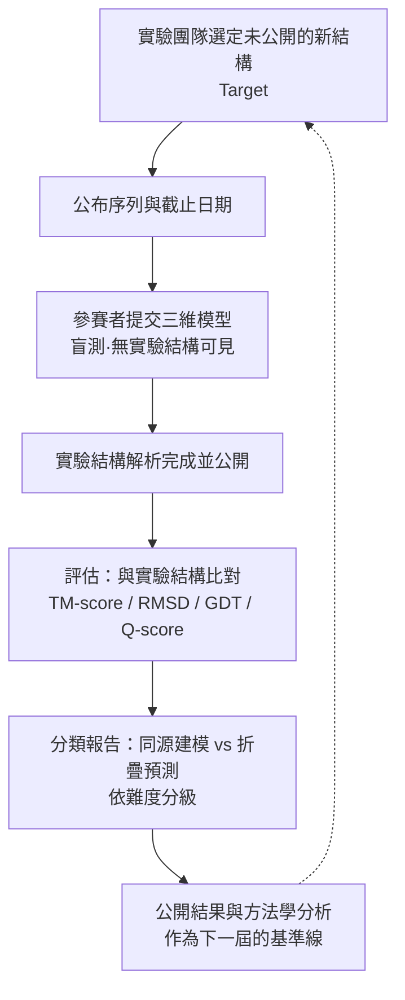
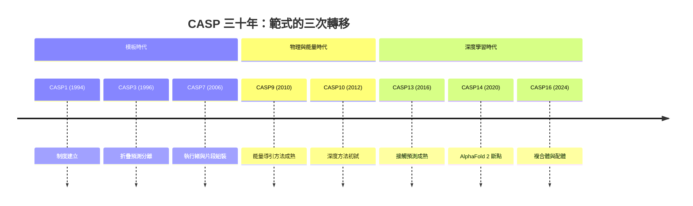

# 4.2 CASP 大賽的歷史沿革（1994-2024）

## 一、盲測的構想：把結構預測放進競技場

1990 年代初，蛋白質結構預測的狀態是一團和稀泥。方法很多，說法各異，卻沒有共同的裁判。研究者可以說自己的模型「看起來合理」，也可以拿自己做過的案例做展示，但沒有任何機制能擺脫一件事的干擾：做預測的人與做實驗的人，往往共享同一批結構資料。一個模型若不小心「看見」了答案，事後幾乎無法被察覺。

CASP 的制度設計正是針對這一點。它的全名是「結構預測評鑑競賽」（Critical Assessment of Techniques for Protein Structure Prediction），1994 年由 Richard Hubbard 與為首的一批結構生物學家發起，並由美國的 Protein Structure Prediction Center 長期承辦。核心規則極為簡潔：競賽單位是「目標」（target），每一批目標由實驗團隊從正在解出的新結構中挑選，選定之際該結構不得公開；參賽者依公布的三維序列提交模型，而實驗結構必須在截止日之後才完成解析與公布。參賽者不僅看不到實驗結構，事後也不該知道用的是哪個結構。這種「盲測」把整個領域從敘事的海洋拉回到可比較的分數上。

CASP 的流程因此具備一種近似實驗室重複性的嚴謹。

## 二、制度的核心：兩個類別與四個難度

CASP 之所以能成為領域的「年度體檢」，在於它把評估拆成幾個維度。第一個維度是預測的種類。早期只有三維結構預測一項，之後陸續加入二級結構預測、摺疊辨識、以及接觸圖預測等項目；最重要的是，最終固定下兩個主要類別：同源建模（homology modeling）與折疊預測（fold prediction）。前者指的是「這條序列在資料庫中有近緣結構，請把模板搬過來」；後者指的是「這條序列的整體形狀從未被見過，請從零預測」。這兩類問題的難度天差地別，若混在一起排名，任何數字都失去意義。

第二個維度是難度分級。CASP 依目標序列與已知結構的相似程度，將目標劃分為 easy、medium、hard 與 very hard 等級，其中以約 25% 的序列辨識率為主要分水嶺：能對上 25% 以上相同胺基酸的目標屬於有模板可用的範圍，而落到「very hard」甚至被標為「new fold」的目標，意味著資料庫中根本沒有可用的近緣結構。這個分級把「進步」拆解成可追溯的來源：是模板覆蓋率提高了，還是無模板的預測能力提高了？

## 三、目標如何被選：可預測性的隱形偏誤

CASP 的可信度建立在盲測之上，但盲測本身並不保證無偏。要讓比賽公平，目標的選取標準必須對所有參賽者一致，同時又要避開那些「已知答案已存在於公開資料庫中」的目標。實務上，承辦單位會先將候選序列與當時已公開的結構做一次全面比對，剔除那些已有高度相似結構的目標，只留下「真的還沒被解出來」的序列。

這個做法本身無可厚非，卻產生了一個值得深思的結構性效果：整個領域的能力，被制約在「那些有人願意投入實驗資源去解的蛋白質」上。實驗室通常挑有生物學意義、體型適中、容易結晶或容易純化的蛋白質，這些蛋白質在序列上往往偏保守、偏常見，於是方法在這些目標上的表現，會系統性地高於其在真正困難、罕見、古老的蛋白質上的表現。更深一層，參賽團隊因為熟悉資料庫與賽制，久而久之會把資源投向「已知有效」的技術路線，而非冒險投入尚無回報的新典範。這不是惡意，而是制度與人類行為共同作用的自然產物。

## 四、尺度的誕生：TM-score 與它的意義

有了分類，還需要一把好尺子。早期 CASP 主要使用 RMSD（均方根偏差），但 RMSD 有個致命的缺陷：它對長度極度敏感，長蛋白質的 RMSD 天生較大，不同長度的目標之間無法直接比較；而且 RMSD 對少數大偏移區域過度敏感，一段完全錯位的螺旋就可能把整體分數拖垮。

1999 年，Yang Zhang 與 Jim Skolnick 在《Proteins》提出的 TM-score（Template Modeling score）改變了這一切。它的核心是把「重疊的品質」與「被重疊的長度」解耦：TM-score 定義在對應的原子（或殘基）集合上，逐一計算距離的倒數型貢獻，取所有對應位置中最有利的一段作為分子，再除以目標長度作為分母。概念上可以寫成：

$$
TM = \frac{1}{L}\max_{L_{ali}}\sum_{i \in L_{ali}} \frac{1}{1 + \left( \frac{d_i}{d_0} \right)^2}
$$

其中 $L$ 是目標序列長度， $d_i$ 是第 $i$ 對應殘基的距離， $d_0$ 是尺度因子（一般取 $d_0 = 1.24 (L - 15)^{1/3} - 1.8$ 之類的長度相關形式），而 $L_{ali}$ 是被納入計算的對齊殘基數。距離越近貢獻越接近 1，距離越遠則趨近 0，於是 $TM$ 的值域落在 $0 < TM \leq 1$ 之間。

TM-score 的三個優點決定了它的地位：它對長度不敏感（兩者長度相近時， $TM$ 可直接橫向比較）；它對局部偏差有容忍度（只要大部分區域對齊即可獲得高分）；它有明確的解讀門檻—— $TM > 0.5$ 通常被視為預測與實驗結構屬於同一種摺疊，而 $TM < 0.17$ 則相當於隨機。GDT（Global Distance Test，源自 Arlotto 與 Dill 1994）以多個距離門檻下的疊加比例給出分數， $GDT\_TS$ 是最具代表性的指標；CASP 後來也採用了綜合相似度與品質的 Q-score 作為輔助指標。TM-score 的普及，使得「中位 TM-score 提升了多少」成為 CASP 歷屆報告中最常被引用的進步曲線。

## 五、三十年賽程與代表方法

CASP 的歷屆賽事構成一條清晰的技術演進軌跡：每一屆的冠軍代表當時最有效的方法，而冠軍的更替往往伴隨一次範式的轉移。

第一屆 CASP 於 1994 年舉行，規模仍屬摸索，參賽隊伍多來自少數實驗室，但它確立了此後三十年不變的基本架構：目標、序列、截止日、模型、評分。第三屆（1996 年）則是制度上的關鍵轉折，它首次把「折疊預測」從同源建模中分離出來，專門設置沒有模板可用的目標。這個分離動作意義重大：它第一次把「人類尚未解出這個蛋白質的結構」從「方法尚未跟上」這兩件事分開來，從此領域有了明確的進步座標。到第六、七屆（2002、2006），片段組裝與執行緒折疊兩條路線在同一批目標上正面交鋒，物理力場第一次不再是唯一的裁判，統計與資訊的成分開始主導勝負。

| 屆次 | 年份 | 賽事特點 | 代表性方法與成就 |
| --- | --- | --- | --- |
| CASP1 | 1994 | 首屆，規則雛形，三維結構預測 | 首次大規模盲測，證明競賽制度的可行性 |
| CASP2 | 1996 | 擴充目標數量 | 同源建模佔絕對多數，模板方法主導 |
| CASP3 | 1996 | 首次分離「折疊難題」（fold prediction） | 確認無模板目標的難度；折疊辨識方法出現 |
| CASP4 | 1998 | 引入模型品質評估與能量評估 | 「能量函數評估」成為獨立賽項 |
| CASP5 | 2000 | 折疊預測類別成熟 | 片段組裝（fragment assembly）與二級結構驅動方法成為主流 |
| CASP6 | 2002 | 賽制與指標細化 | 能量導引的片段組裝取得關鍵進展 |
| CASP7 | 2006 | 難度分級明確化 | 執行緒折疊與片段組裝較勁，同源建模類別精度接近實驗值 |
| CASP8 | 2008 | 引入伺服器賽項 | 自動方法與全自動流水線成為主流 |
| CASP9 | 2010 | 深度學習首次進入接觸圖預測 | 深度神經網路在局部指標上小勝，但三維結構未見提升 |
| CASP10 | 2012 | 指標與分類再調整 | 物理方法仍佔主流，深度方法整體未改變版圖 |
| CASP11 | 2012–2014 | 技術榜與能量榜分離 | 深度接觸預測精度明顯提升 |
| CASP12 | 2014 | 深度方法仍未能產出可用的三維模型 | 業界形成「深度學習不適合蛋白質」的共識 |
| CASP13 | 2016 | 接觸預測接近成熟 | 深度方法在接觸圖大幅領先，三維重建仍是瓶頸 |
| CASP14 | 2020 | 斷點式的跨越 | AlphaFold 2 中位 TM-score 約 0.92、 $GDT\_TS$ 中位約 92.1，遠超第二名 |
| CASP15 | 2022 | AlphaFold 開源後的常態化 | 參賽隊伍普遍使用公開模型，競賽轉為「誰能用得更好」 |
| CASP16 | 2024 | 泛化到複合體、核酸與配體 | 從單鏈蛋白質走向生物分子複合體 |

## 六、2010 年前後的僵局

CASP9 至 CASP13 這段期間，是蛋白質結構預測史上最耐人尋味的停滯期。物理方法的確還在進步：片段組裝的搜尋更有效率，能量函數更精準，同源建模的模板選擇更自動化。但整體的三維結構精度提升緩慢，尤其在「very hard」類別上，許多目標的 TM-score 長期停在 0.3 到 0.5 之間。

與此同時，深度學習悄然出現了。第一波應用不是直接預測座標，而是預測「接觸圖」（contact map）——也就是哪些殘基對在空間上靠近。這是一個更適合神經網路的問題：把二維的距離矩陣當成圖像來預測。到 CASP11 與 CASP12，深度方法在接觸預測上開始取得可觀的優勢；但從接觸圖回到三維座標，仍需要耗時且不穩健的步驟，於是這種優勢並未轉化為結構分數。

於是形成了一個相當普遍的結論：CASP 期間，深度學習在特定指標上小勝，但並未改變三維結構預測的局面；加上蛋白質折疊涉及複雜的物理與拓撲約束，業界形成了「深度學習不適合蛋白質」的共識。2018 年，Rosemary Bryant 在 TED 的演講〈Time to rethink the protein structure prediction problem〉中把這個信念表述得最為完整：她主張結構預測的難點在於拓撲與生物物理的精確性，而這種精確性難以從資料中被「學」出來，深度學習只會把結構預測變成更快的近似。

這個共識有其充分的經驗基礎，卻忽略了一個更根本的問題：過去的深度方法受限，並不是因為蛋白質這個對象不適合深度學習，而是因為它們使用的輸入表示太過貧乏。

## 七、CASP14：斷點

20 $GDT\_TS$ 約 92.1（折疊預測類別的中位 TM-score 甚至達到 0.93 以上），而第二名的中位 TM-score 大約落在 0.8 上下，差距超過 0.1。差距之大，讓「深度學習不適合蛋白質」的判斷在一場比賽中被一次性推翻。

這場勝利之所以可能，正是因為 AlphaFold 2 改變了輸入表示。它不再把序列當作一串孤立的符號，而是引入多序列對齊（MSA）作為演化資訊的載體，並用「配對表示」把兩個殘基間的演化耦合關係顯式編碼出來；再以 Evoformer 讓 MSA 表示與配對表示互相對話，最後用結構模組直接操作三維剛體幾何。這條從「更好的資料表示」出發的路徑，正是本章第 4.1 節所說的那個範式轉移的實踐：不再問「有沒有模板」，而是問「序列裡隱含了什麼規律」。

CASP14 之後，DeepMind 與 EMBL-EBI 合作建立 AlphaFold 資料庫，公開了逾兩億個模型序列的預測結構，2022 年上線時涵蓋幾乎所有已知蛋白質序列。CASP15 與 CASP16 的賽事性質因此改變：參賽隊伍普遍以公開模型為基礎，重點轉向細節加工、複合體組裝與配體對接。

## 八、從競賽到常設評測

CASP 每兩年才舉辦一次，且賽後要等待目標結構的實驗解析，評估報告往往落後一兩年才發布。為了讓評測更接近即時，2014 年之後出現了 CAMEO 這類「半盲」的常設評測機制：系統持續追蹤新發布的結構，自動挑選那些即將公開的目標，給予方法固定的時間窗口提交預測，再自動評分。這類機制的價值在於把 CASP 的節奏從「賽事」變成「體溫計」，讓方法的進步不必等待兩年一次的盛會才能被看見。

AlphaFold 2 在 2020 年之後的傳奇速度，實際上正是這種常設評測與公開資料庫共同作用的結果：模型在 2021 年發表後，任何人幾乎立即就能拿到近乎實驗品質的結構，不必再等三年一度的比較。第三章描述的 AlphaFold 資料庫，就是把這種「即時可得」推到極致——預測不再是一個競賽項目，而是一份可以被任何研究直接取用的基礎設施。

## 九、盲測制度為何不可取代

回顧三十年，CASP 最大的貢獻或許不是找出最好的方法，而是提供了一條可信的進步曲線。盲測制度排除了資料洩漏的可能：參賽者不可能偷看答案，評估者也不會挑有利樣本。這使得「中位 TM-score 從 0.3 走到 0.9」這樣的敘述具有可信度，也讓「深度學習在 2010 年代初被低估、2020 年被證實」這個故事得以成立。

若沒有 CASP，AlphaFold 2 的成果可能仍會出現，但不會有這樣的公共舞台與量化證據。反過來說，沒有 CASP 累積三十年的誠實失敗記錄，人們也不會知道傳統方法究竟卡在哪裡：是卡在物理不夠準，還是卡在表示不夠好。答案最終是後者，而這個答案，是靠一代一代的比賽問出來的。
