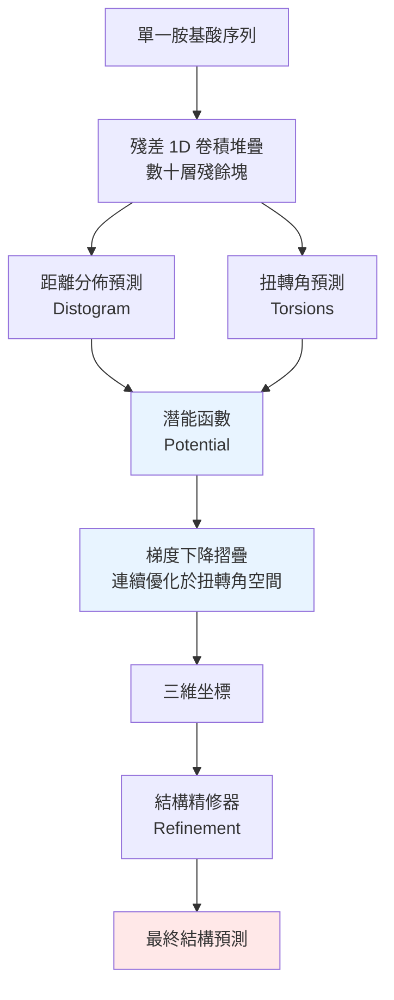

# 5.1 深度學習如何介入結構預測（2018）

## 一、一個被放棄的問題

1970 年代末，物理化學家仍在嘗試用連續變數最佳化直接搜尋蛋白質的三維構形。到 1990 年代，這條路線已被結構生物學界判定為不可行，理由非常直覺：可搜尋的連續空間太大，目標函數不可微，能量面佈滿局部極小值，而每一次摺疊嘗試以毫秒計的電腦時間只能換來一個候選。於是問題被重新表述成一個統計問題：既然窮舉不來，就去資料庫裡找相似物。

這個重新表述在 2018 年之前主導了整個領域三十年。同源建模、執行緒折疊、片段組裝，所有主流方法都建立在一個共同前提上：結構必須從已知結構的模板推導而來。這是一個極其保守的前提，它意味著模型的能力上限被模板資料庫的覆蓋率鎖死。2018 年 12 月，一篇發表在《自然》期刊的論文用一個殘酷的數字結束了這個時代：AlphaFold 1 在 CASP13 盲測中的中位均方根偏差為 $2.8 \text{\AA}$ ，相較當時最好的其他方法約 $6.6 \text{\AA}$ 。

RMSD 是結構預測領域最基本的度量。它的定義是：把預測結構與真實結構先疊合到最佳位置，再計算對應原子位置差的均方根。

$$
\mathrm{RMSD} = \sqrt{\frac{1}{N} \sum_{i=1}^{N} \left\| \mathbf{x}_i - \mathbf{y}_i \right\|^2}
$$

其中 $N$ 是被比較的原子數， $\mathbf{x}_i$ 與 $\mathbf{y}_i$ 是第 $i$ 個原子在預測與真實結構中的三維坐標。RMSD 低於 $2 \text{\AA}$ 大致對應主鏈原子落點誤差在一個原子鍵長以內，業內通常視為實驗級精度的門檻。 $2.8 \text{\AA}$ 距離這個門檻只有一步之遙，而 $6.6 \text{\AA}$ 則意味著模型根本沒有抓住正確的整體拓撲。兩倍以上的差距，不是調參的結果，而是方法論的斷裂。

## 二、為什麼深度學習「理應」適合這個問題

深度學習介入蛋白質結構預測，在當時並非一時興起，而是有四個具體的技術理由共同推動。

第一是可微性。結構生物學的經典問題——摺疊、能量最小化、構形採樣——其困難的核心正是不可微的離散搜尋：無法對離散的構形空間求梯度。但深度網路的全部計算圖本質上都是可微的連續映射。AlphaFold 1 最富啟發性的一步，是把「預測結構」改寫成「預測一個能量函數，再對這個函數做梯度下降」。一旦能量函數由網路給出，摺疊過程就變成了一段可以自動微分、可以反傳播的連續優化。

第二是 GPU 與資料規模。摺疊漏斗模型的核心直覺是：天然蛋白質只佔據構形空間中極小的一塊區域，而且這個區域是漏斗狀的，越接近天然態，能量越低。深度網路的歸納偏置在某種意義上與這個漏斗同構：它用大量參數表達一個柔性極高的能量面，用網路的容量去記憶天然蛋白質在漏斗底部的高密度區。GPU 的算力讓這種容量從不可能變成可行。

第三是資料驅動的典範轉移。在 AlphaFold 出現之前，結構預測的主流典範是物理模型加上專門化啟發式，每一個環節都要由領域專家手工設計、調參。深度學習的典範則是通用架構加上從資料中學習。一旦物理知識可以被寫成損失函數裡的一項，領域專家的工作就從設計演算法轉為設計損失項，這是一種典範層級的降維。

第四，也是最容易被忽略的一點：物理先驗可以被編碼進網路架構本身，而不僅僅是作為懲罰項。捲積的平移不變性對應序列的局部性，殘差連接對應多尺度特徵的融合，注意力機制對應序列中任意兩位置間的長程關聯。這些架構選擇一旦被固定，網路在數千萬個結構樣本上訓練時，就會把領域知識蒸餾進權重裡。

## 三、第一道難題：輸入表示——序列裡沒有幾何

然而，深度學習理應適合，與深度學習實際上適合之間，隔著三道非常具體的工程障礙。AlphaFold 1 之所以不是那個年代的產物，正是因為當時沒有人同時解決了這三道題。

第一道是輸入表示。卷積神經網路擅長處理的，是規則網格上的資料：影像有像素、聲音有時間步。但蛋白質的輸入是一串胺基酸符號，這是一條長度可變的、離散的、沒有任何空間座標的一維序列。網路在第一層就必須回答一個它無法回答的問題：什麼是距離？一個位於序列第 $i$ 位的胺基酸與第 $j$ 位，在三維空間中是近是遠？序列索引上的相鄰，與空間上的相鄰，是兩回事。

更根本的問題是，僅憑序列本身，網路沒有任何機制來建立幾何的概念。要理解一個蛋白質的摺疊，網路必須在某個內部表示裡隱式地維持一套三維座標系，而這件事在卷積網路裡完全沒有被提供。AlphaFold 1 的解法是繞開它：直接餵單一條胺基酸序列，用堆疊的殘差一維卷積處理，讓網路自己去學那些隱式座標。

這是一個樸素但有效的方案，也是一個明顯受限的方案。單一序列所承載的資訊量，是蛋白質序列資料庫中最貧乏的一層。在演化資料庫裡，一個蛋白質家族通常有數百到數萬條同源序列，單獨一條序列只是這張巨大網絡中的一個節點。用單一序列等於自願放棄了九成以上的資訊。第 5.2 節會說明，這個放棄正是 AlphaFold 2 成功的關鍵所在。

## 四、第二道難題：輸出表示——從距離矩陣回到座標

第二道難題在輸出端。深度網路擅長做的是稠密預測：給定輸入，輸出每個位置上的向量或標量。但結構預測要交付的東西是三維坐標，一組連續的三維向量 $\mathbf{x}_i \in \mathbb{R}^3$ ，而且這組坐標必須滿足大量硬性約束：鍵長鍵角必須合理、手性必須正確、鏈不能穿過自己、整體必須緊密堆積。這些不是軟性偏好，而是化學與幾何的硬約束。

一個自然的做法是預測距離矩陣：對每一對殘基 $(i, j)$ ，預測它們在摺疊後的歐氏距離。這樣的輸出全部是標量，完美符合網路擅長的預測形式。但這一步會損失關鍵資訊：兩個點的距離無法決定整體構形。同一組距離資料可以對應到鏡像的構形，也可以對應到在距離不變的前提下重新排列的等距內插構形。距離矩陣是三維結構的一個投影，投影必然不可逆。

另一個更激進的想法是直接預測座標：把每個殘基的位置當作網路輸出向量，然後用一個可微的結構損失把預測坐標拉向真實坐標。這樣做的難點在於，網路輸出的三維空間沒有任何理由是一致朝向的。同樣的結構可以被任意旋轉與平移，而這在平方誤差上會造成巨大的、彼此衝突的梯度。同一個結構的不同表達方式會互相拉扯，訓練極不穩定。

這個張力直到 AlphaFold 2 都沒有被完全消除，只是被工程性地化解了，第 7 章將說明其中的剛體群組與不變點注意力。AlphaFold 1 採取的是折衷方案：它先預測距離分佈，把每對殘基的距離表示成一個機率分佈而非單一數值，然後用這些分佈構成一個連續的、可微的能量函數，最後從一個隨機初始的鏈構形出發，以梯度下降收斂到能量最低點。

這一步的意義遠超技術細節。它把一個離散的構形搜尋問題，轉成了一個連續優化問題，而後者恰好是深度學習工具鏈最擅長處理的形態。構形本身不再由網路直接輸出，而是由網路給出的能量面引導生成。網路學到的是什麼樣的距離關係是物理上可能的，而不是答案長什麼樣。

## 五、第三道難題：資料——訓練集是一條昂貴的生產線

第三道難題在供應端，也是最被低估的一道。深度學習的食量龐大，結構預測需要的不只是數量，更需要嚴格一致的標註資料。

所謂訓練樣本，是一個三元組：胺基酸序列、一個對應的三維結構、以及兩者之間的殘基編號對齊。第三項是關鍵。PDB 中的每個結構是由實驗方法解出來的，這些結構帶有作者手動賦予的殘基編號，而同一條序列在資料庫中往往以許多不同的別名存在：不同物種的命名慣例、缺失的 loop 區段、實驗構建體中的突變與標籤、序列版本更新造成的位移。要把序列與結構正確對齊，需要執行多套精細的比對流程，並嚴格篩除那些本身就有缺失或錯亂的案例。

這意味著訓練資料的建構不是一次性工作，而是一條需要持續維護的生產線：資料庫每季度更新，新結構湧入，舊結構被撤回或修訂，序列命名規則持續演化。更棘手的是，有結構的蛋白質在資料庫中呈現嚴重偏斜，熱門的核心結構域被研究得透透的樣本佔了很大比例，而大量冷門但極有價值的蛋白質只有零星幾筆紀錄。深度網路對這種偏斜非常敏感：它會過擬合那些研究最充分的結構家族，而這恰恰不是我們最需要預測的部分。

於是形成了一個尷尬的循環。深度學習需要大量高品質結構，但結構的取得速度受限於實驗技術（第 3 章的主題）；而結構預測的實用價值，又恰恰在於填補實驗無法覆蓋的那些蛋白質。

## 六、AlphaFold 1（2018）：把物理寫成損失的摺疊網路

2018 年 11 月，DeepMind 團隊在 CASP13 盲測結束後公布了他們的工作，論文於 12 月 4 日發表在《自然》期刊（Senior 等人，*Nature* 539:557-561，題為「Protein structure prediction using recurrent neural networks」）。AlphaFold 1 的架構可以拆成三段。

第一段是特徵處理與結構預測網路。輸入是單一條胺基酸序列，經過數十個殘差塊組成的摺疊堆疊，每一層都對序列做一維卷積並殘差相加。在特徵提取的同時，網路輸出兩樣東西：一是所有殘基對之間的距離分佈，即每對殘基在 $3.5 \text{\AA}$ 到 $20 \text{\AA}$ 之間的機率分佈；二是側鏈的扭轉角預測，用來在摺疊前提供初始的主鏈構形。

第二段是摺疊網路，這是全篇最精采的設計。它不預測結構，而是預測一個潛能函數。這個潛能被定義為：所有殘基對預測距離分佈的負對數似然，加上扭轉角與初始構形之間的偏差項。整個摺疊過程被寫成一個可微的連續優化：從一個隨機初始化的高分子鏈構形出發，對潛能做梯度下降，在鏈的扭轉角空間中更新，最後輸出三維坐標。

第三段是結構精修器，用一組獨立的殘差網路在最終構形上做最後的座標修正，改善局部幾何品質。

這個設計最漂亮的地方在於物理先驗的位置。潛能函數的每一項都是可解釋的物理量：距離分佈來自網路，扭轉角偏好來自立體化學的已知規則，鏈的長度與鍵角來自共價鍵的剛性。深度網路在這裡扮演的不是取代物理的角色，而是用資料填補物理無法給出的部分。這與第 6.3 節將要討論的主題一脈相承。

## 七、CASP13 的成績：黑馬與它的天花板

AlphaFold 1 在 CASP13 中拿下了所有評分項目的第一。它的中位 RMSD 為 $2.8 \text{\AA}$ ，而同一場比賽中次好的方法約為 $6.6 \text{\AA}$ ；在最困難的靶標群組中，AlphaFold 的預測結構有相當一部分仍能保留正確的整體拓撲，這在過去是難以想像的。從任何角度看，這都是一場壓倒性的勝利。

然而，AlphaFold 1 的架構天花板同樣清晰，而且這一天花板的形狀精確地預告了兩年後的突破方向。

其一是資訊來源的不足。整個模型只吃一條序列，等於放棄了演化資料庫中數萬條同源序列所攜帶的耦合資訊。當我們在第 5.2 節看到深層序列對齊如何把遠端共變異轉化為配對資訊時，就會明白這是 AlphaFold 2 最大的增量來源。

其二是距離預測架構的限制。分層的距離預測只學到了局部幾何：網路擅長判斷這兩個殘基大概靠近，卻難以整合跨越整個蛋白質的長程約束。AlphaFold 2 導入的 Evoformer（第 6 章）讓序列對齊表示與配對表示跨維度對話，正是為了補上這個整合的缺口。

其三是最根本的：AlphaFold 1 沒有端到端的結構模組。它的結構不是網路直接生成的，而是「網路給出能量、外部最佳化求解、精修」的三段式管線產生的。這個管線裡有一個隱含的斷裂：網路並不真正負責最終結構，它只負責提供一個引導場。這意味著網路無法從最終結構的品質獲得端對端的梯度回饋，也無法直接優化結構本身是否正確這個目標。

這三個缺口，分別對應演化資訊的深層挖掘、跨維度資訊融合、以及直接操作三維幾何的結構模組。它們不是隨機的技術債，而是同一個設計哲學的三個面向，而 AlphaFold 2 的每一項改進，都精準地落在其中一個缺口上。

## 八、從黑馬到主力：范式轉移的起點

回頭看，AlphaFold 1 的歷史意義不在於它解決了結構預測——它遠未解決——而在於它完成了一次典範的轉移驗證。它證明了三件事：結構預測可以成為一個可學習的問題；物理知識可以被編碼進損失函數而非硬寫在演算法裡；而 PDB 這個被認為已經挖掘完畢的資料庫，原來仍蘊含著足夠的監督訊號來支撐一次小型革命。

同時它也示範了暴力學習的邊界。在沒有演化資訊、沒有端到端結構模組的情況下，即使在 PDB 這個已知偏斜的資料集上，工程極限也只能把中位 RMSD 推到 $2.8 \text{\AA}$ 。要把數字推到 $0.92$ 的 TM-score，必須換掉資訊的來源，而不只是換掉模型。

於是 2019 年的 DeepMind 辦公室裡，問題被重新表述成一句更簡潔的話：既然結構是演化歷史的產物，那麼要預測結構，就必須讀懂演化歷史。這句話把我們帶進第 5.2 節。
