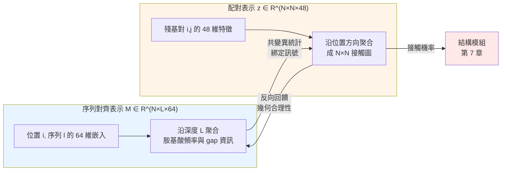

# 5.2 多重序列對齊（MSA）與演化資訊的深層挖掘（2020）

## 一、演化資料庫：被低估的第二個序列

如果說 AlphaFold 1 的侷限可以濃縮成一句話，那就是它只讀了一條序列。而要理解為什麼讀更多序列會徹底改變局面，就必須先理解一個在生物資訊學中長期被視為平淡無奇、卻在 2020 年成為決定性關鍵的技術：多重序列對齊。

MSA 的形式很簡單。取一個蛋白質家族的 $`N`$

但在 1980 年代，人們開始注意到保守性只是表面現象。在某些蛋白質家族裡，兩個在序列上相距甚遠、在三維空間上卻恰好彼此靠近的位置，其胺基酸種類是綁定著一起變動的：這裡是丙胺酸時，那裡也傾向於是丙胺酸；這裡換成白胺酸時，那裡也跟著換。這種現象稱為共變異，或更精確地說，演化耦合。

## 二、共變異：結構的影子

共變異為什麼會出現？因為蛋白質不能只是各自最要緊的位置都保守，它還必須維持三維結構的完整性。若兩個殘基在空間中形成氫鍵或鹽橋，那麼突變其中一個常常會破壞這個作用力。此時，自然選擇會傾向於同時補償性地突變另一個，以維持局部結構。於是演化過程本身，就等於在一個巨大的序列資料庫裡默默地執行了一次又一次的結構實驗，並把結果寫進序列裡。

這就是為什麼演化耦合常被稱為結構的影子。二維的序列對齊裡，藏著三維的接觸關係。

要把這個影子量化，最自然的想法是互資訊。設位置 $`i`$ 與位置 $`j`$ 的胺基酸聯合分佈為 $`p_{ij}(a,b)`$ ，邊際分佈為 $`p_i(a)`$ 與 $`p_j(b)`$ ，則互資訊為：

$$
I(i; j) = \sum_{a} \sum_{b} p_{ij}(a,b) \log \frac{p_{ij}(a,b)}{p_i(a) \, p_j(b)}
$$

互資訊衡量的是：知道位置 $`i`$ 是什麼胺基酸，能多大程度地減少我們對位置 $`j`$ 的不確定性。若兩者獨立，互資訊為零；若兩者完全綁定，則達到最大值，以對數為底時的上界是 $`\log 20 \approx 2.996`$ ，因為有 20 種標準胺基酸。

但直接用互資訊估計有嚴重的統計問題。它對少數序列過度敏感：一條序列裡某個位置剛好出現一次罕見胺基酸，就會製造出一個巨大的、純粹由雜訊造成的互資訊。這就是為什麼深度在 MSA 中如此關鍵——互資訊是一個需要大量樣本才能穩定估計的統計量。

為了解決這個問題，統計物理領域在 2000 年代發展出一整套直接耦合分析方法：Potts 模型、pseudo-likelihood、消息傳遞等。核心思想是把耦合與因單一位置偏好所造成的間接效應區分開來。如果位置 $`i`$ 偏好某種胺基酸而位置 $`j`$ 也偏好同一種，那麼單純的保守性就會製造出虛假的互資訊；真正的耦合必須扣掉這種間接貢獻。這個區分後來在 AlphaFold 的文獻中被普遍稱為直接耦合與間接耦合之分。

## 三、從序列對齊到演化資料庫：搜尋技術的四十年

把共變異的統計做得再精確，前提是你得先有足夠深、足夠準的 MSA。而如何取得 MSA，本身就是一段長達四十年的工程史。

1970 年，Needleman 與 Wunsch 建立了第一個全域序列對齊演算法，把對齊問題定義為動態規劃的最短路徑問題，並以匹配加分、不匹配扣分的簡單打分函式求解。兩年後，Smith 與 Taterman 以及 Fitch 的工作把多條序列引入對齊，開啟了 MSA 的時代。1978 年，Daly 與 Cohen 進一步提出以序列之間的統計距離來推估結構相似性，讓對齊的價值第一次被明確地連結到三維結構上。

接下來的三十年，重點從怎麼對齊轉向到哪裡去找對齊的原料。答案是一座座逐漸擴張的序列資料庫：1988 年的 PIR、1990 年由 NCBI 建立的 GenBank、UniProt 序列資料庫，以及最重要的 SWISS-PROT，它收錄經人工審閱、經過功能註解的蛋白質序列。1990 年登場的 BLAST 演算法讓序列相似性搜尋從數小時縮短到數秒，PSI-BLAST 更進一步利用迭代搜尋，把找不到同源序列變成罕見事件。1995 年的 HMMER 與 2002 年的 HHblits 由 Söding 開發，把序列對齊從逐字比對提升為基於隱含馬可夫模型的 profile 比對，可以在 profile 的層級上比較兩族蛋白質，速度與靈敏度都遠超早年的方法。

2010 年之後，蛋白質結構與序列的關聯資料大量湧入，資料搜尋的性質悄悄改變了。人們不再只是找序列，而是找帶有結構註解的序列，這催生了 Jackhmiter 這類工具。2021 年，Steinegger 發布了 Jackhmiter，用一個積分化的隱含馬可夫模型搜尋策略，能在數十分鐘內對一個蛋白質家族找出數萬條高敏感度的同源序列，同時過濾掉低品質的錯誤命中。同一年，Mirdita 等人發布了 ColabFold，把 Jackhmiter、MMseqs2 的快速搜尋與 HHsearch 的 profile 比對整合成一條可在消費級 GPU 上執行、數十分鐘完成的完整 MSA 生成管線。ColabFold 的重要性在於，它把產生演化資訊從一項需要叢集算力的研究服務，變成了一個任何實驗室都能負擔的日常操作。

這條技術演進的曲線，最終在 AlphaFold 2 中收束成一條明確的資料流程：從 UniRef90、BFD、MGnify、UniProt 等來源搜尋同源序列，組裝成多個不同深度的 MSA，再以 HHblits 迭代擴充。而其中用來預測配對接觸的關鍵 MSA，是透過 Jackhmiter 取得的那個深度搜尋版本。

值得留意的是，這條流程裡存在一個微妙的取捨。為了讓 MSA 覆蓋到演化關係較遠的成員，搜尋必須降低相似性門檻，深度因此上升；但門檻降得太低，錯誤命中的序列就會混入，把假的共變異訊號灌進訓練資料。Jackhmiter 之所以有效，正是因為它在積分化的 HMM 框架下，能把「這條序列是否真的屬於同一家族」這件事量化成一個可以設定門檻的量。同樣地，ColabFold 預設會產生多個深度不同的 MSA（例如以不同迭代輪數搜尋所得），讓下游模型自己判斷該信任哪一個。這種「提供多種資訊深度、由模型決定權重」的設計，是深度學習時代資料管線的典型風格：與其由人挑選最佳資料集，不如把所有候選交給網路自行權衡。

代價則是工程上的真金白銀。整條管線需要在推論前處理動輒數十萬條序列，而這一步完全無法用 GPU 加速，因為它本質上是序列比對問題。於是 AlphaFold 2 的實際使用體驗，是「模型跑得很快，但資料準備得很慢」，這也是為什麼 ColabFold 這類把搜尋最佳化的工具，其影響力不亞於模型本身。

## 四、兩種表示：序列對齊表示與配對表示

演化資訊要餵進深度網路，就必須被編碼成張量。AlphaFold 2 採用了兩種不同維度的表示，這個設計是全章的技術核心。

第一種是序列對齊表示，記為 $`M \in \mathbb{R}^{N \times L \times 64}`$ 。三個維度分別是： $`N`$ 為蛋白質殘基數，也就是序列長度； $`L`$ 為 MSA 的深度，也就是序列條數； $`64`$ 為每個位置與序列單元的嵌入維度。具體而言， $`M[i, l, \cdot]`$ 是一個 64 維向量，用來表示第 $`l`$ 條序列在第 $`i`$ 個位置上的胺基酸。這 64 個通道裡，大致可以區分出兩類資訊：一類是 20 種胺基酸的身分資訊，佔去大部分通道；另一類則是 profile 資訊，也就是該位置在 MSA 中的胺基酸頻率分佈，以及被稱為 gap 狀態的通道，用來編碼該位置是否為插入或缺失。

這裡必須先立一個記號約定，因為文獻中的用法並不一致：AlphaFold 2 原始論文以 $`N`$ $`L`$

第二種是配對表示，記為 $`z \in \mathbb{R}^{N \times N \times 48}`$ 。它的三個維度是：兩個殘基索引 $`i, j`$ 構成 $`N \times N`$ 的矩陣，第三個維度是 48 維特徵通道。 $`z[i, j, \cdot]`$ 編碼的是第 $`i`$ 與第 $`j`$ 個殘基之間的關係，而不是任何單一位置本身的性質。

這兩種表示的分工，是理解 AlphaFold 2 設計哲學的關鍵。序列對齊表示是縱向的：它沿著深度 $`L`$

配對表示則是橫向的：它沿著殘基索引這個方向聚合資訊，把第 $`i`$ 與第 $`j`$ 位可能互相接觸這類資訊，匯聚到 $`N \times N`$ 的一張圖上。而這張圖，正是網路能夠直接用來預測結構的東西，一對殘基是否靠近、靠近時朝哪個方向。

演化耦合是兩者的交會處。共變異的本質是，在序列對齊的深度方向上，某對位置的胺基酸是綁定的；而它的物理意義是，這對位置在三維空間中靠近。把深度方向上的統計量，搬到位置方向上的圖上，這個搬運正是 Evoformer 的工作：它讓序列對齊表示與配對表示雙向流動、相互更新，讓網路能從哪裡的胺基酸一起變，推導出哪裡的殘基互相接觸。

| 面向 | 序列對齊表示 $`M \in \mathbb{R}^{N \times L \times 64}`$ | 配對表示 $`z \in \mathbb{R}^{N \times N \times 48}`$ |
| --- | --- | --- |
| 索引對象 | 位置與序列（ $`N \times L`$ ） | 位置與位置（ $`N \times N`$ ） |
| 聚合方向 | 沿深度 $`L`$ 方向 | 沿序列位置方向 |
| 承載的資訊 | 胺基酸身分、profile 頻率、gap 狀態 | 殘基對之間的耦合與接觸傾向 |
| 物理意義 | 演化歷史的統計切片 | 幾何接觸關係的草圖 |
| 單獨使用的侷限 | 深度為零時無從提供耦合 | 無演化資訊時只能靠物理先驗猜測 |

## 五、深度 L 為什麼如此關鍵

在整個 AlphaFold 2 的設計中， $`L`$ 這個參數的影響力被低估了。原因是純粹統計的：要可靠地估計互資訊或直接耦合，你需要足夠多的獨立樣本。當深度只有幾十條序列時，互資訊估計充滿噪聲，網路能學到的演化耦合多半是假訊號；當深度達到數千甚至數萬條時，耦合訊號才從雜訊中浮現。

更微妙的是，深度還影響能分辨出什麼種類的耦合。假設一個蛋白質家族只有很少數的成員真正表現出某個遠端接觸，深度不足時，這個弱而珍貴的訊號會被淹沒；深度足夠時，網路才能把它和家族中普遍存在的耦合區分開。這有點像天文觀測：看得越久、訊號累積得越多，弱光源才能從背景雜訊中分離。

但深度有代價，而且代價不小。搜尋成本隨深度大致線性增長，而搜尋本身要用到蛋白質資料庫中近乎全部的序列。深度 $`L`$ 從幾千提升到幾萬，意味著每個預測任務的運算時間從數十分鐘上升到數小時。ColabFold 之所以重要，正是因為它用 MMseqs2 這類極致最佳化的搜尋引擎，把這個代價壓到了可接受的範圍。

實證結果支持深度的重要性。在對 CASP14 靶標的回溯實驗中，AlphaFold 2 的準確度隨 MSA 深度增加而穩定提升；反之，若把 MSA 深度人為截斷到接近單序列的狀態，模型準確度會明顯退化，且退化的模式顯示模型真的是在依賴演化耦合，而不是從序列直接猜結構。這是第 5.1 節那個輸入表示不足問題的最直接解方：把輸入從一條序列擴充為一個演化資料庫的投影。

## 六、另一條路：語言模型直接預測結構

演化耦合的做法有個前提：必須找到足夠多、足夠同源的序列。對於那些演化歷史獨特、序列極短的蛋白質，例如很多原生菌的膜蛋白，或是孤立的 ORF，這個前提可能根本不成立。MSA 深度可能是零，或只有一兩條。

2021 年，Facebook AI 團隊提出了一條截然不同的路徑。他們注意到，蛋白質序列與自然語言在統計結構上高度相似：皆由離散詞彙組成，有長距離依賴，且存在豐富的語法結構。既然大型語言模型能從網路文本中學到句法與語義，蛋白質序列的語法，也就是那種隱含在胺基酸序列中的演化耦合，是否也能用同樣的方法學學到？

答案是肯定的，這就是 ESM 系列語言模型的起源。2021 年 9 月，ESM-1b 發表，它是一個高達 6.5 億參數的蛋白質語言模型，預訓練任務是遮蔽胺基酸預測：隨機遮住序列中的一段，模型必須猜出被遮住的胺基酸是什麼。要完成這個任務，模型必須理解哪些位置之間有耦合關係，否則它無從知道被遮住的位置應該填什麼。Lin 等人在同年的論文中證明，ESM-1b 的內部注意力圖裡確實浮現出與演化耦合高度吻合的蛋白質接觸預測，並用這個語言模型直接生成了結構，也就是 ESMFold。

這條路徑的意義在於，它完全不需要 MSA。它把演化耦合必須從資料庫中統計出來的前提，替換成演化耦合已經隱含在序列本身的語法裡、模型有足夠容量把它學出來。對深 MSA 的蛋白質，MSA 路線仍然更強；但對沒有同源序列的孤例，語言模型是唯一的選擇。

更重要的是，語言模型路線與 MSA 路線並非互斥。2021 年晚些時候問世的 MSA Transformer，是把注意力機制直接套用在序列對齊表示上的模型：讓模型沿著 MSA 的深度方向做注意力運算，學習哪幾條序列應該一起看。它既保留了 MSA 的資訊來源，又引入了語言模型式的訓練方法，是兩條路線的第一批融合產品。往後看，第 9 章的 AlphaFold 3 與整個蛋白質基礎模型的浪潮，都沿著這個融合方向展開。

## 七、從影子到結構

回到本章的起點。演化耦合之所以是結構的影子，是因為它把三維接觸關係投影進了演化歷史；而演化歷史被完整地保存在資料庫裡，以 MSA 的形式。所以 AlphaFold 2 這一代模型的核心工程洞見可以簡單地表述為：把 MSA 這個蘊含幾何資訊的高維資料結構，用神經網路讀懂，再把讀出來的接觸資訊寫進一張三維座標表。

這一步在 AlphaFold 1 的架構裡沒有位置，因為它的輸入輸出管線完全沒有為二維的演化矩陣留下空間。AlphaFold 2 把序列對齊表示與配對表示正式列為兩種一級公民，讓它們在網路內部反覆交織（第 6 章），並讓最終結構由直接操作三維幾何的結構模組產生（第 7 章）。

三件事湊齊之後，2020 年的 CASP14 才會發生。
