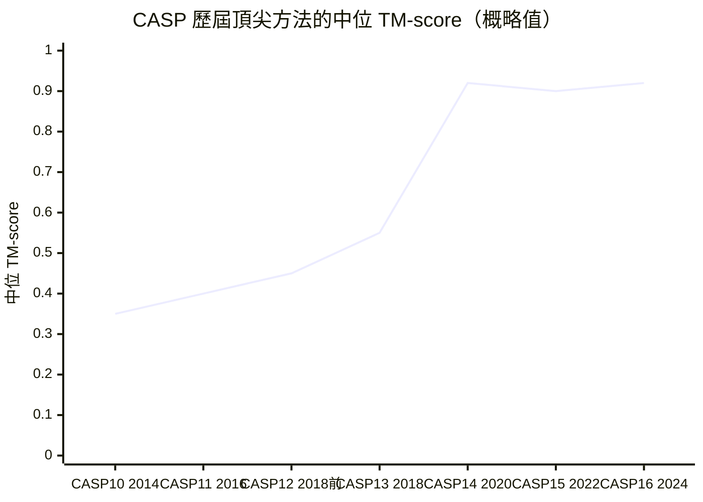

# 5.3 CASP14 奪冠、模型開源與科學衝擊（2020）

## 一、盲測的殘酷性

要理解 2020 年發生的事情有多不尋常，先要理解 CASP 的制度設計。CASP 每兩年舉行一次，評審在比賽開始前從 PDB 中挑選一批從未公開解析的靶標蛋白質，交由參賽團隊在完全隔離的條件下預測。參賽者不能查閱靶標的任何結構資訊，只能依賴序列、資料庫與方法本身。這種盲測設計，是因為結構預測領域長期存在一種過擬合競賽的文化：方法開發者會在公開資料集上反覆調參，而評分若不嚴格，數字就會失去意義。

CASP14 是有史以來規模最大的一屆，靶標數量超過一百個，其中相當一部分是摺疊類靶標，也就是那些結構從未被解出、序列與任何已知模板都沒有可用的血緣關係的蛋白質。這類靶標是結構預測最誠實的考場：它無法靠搬運模板得分，只能靠真正的物理與資訊推論。

2020 年 5 月，比賽開始。2020 年 11 月 30 日，結果在線上發布。

## 二、數字本身：0.92 是什麼意思

AlphaFold 2 在 CASP14 的官方評測中，於幾乎所有分類別都取得第一。它的核心數字是：整體中位 TM-score 約 $0.92$ ，摺疊類靶標的中位 GDT_TS 約 $92$ 。而在最困難的一組靶標上，中位 TM-score 仍維持在 $0.85$ 左右。

TM-score 是 1998 年由 Zhang 與 Skolnick 提出的度量，它解決了 RMSD 的一個致命缺陷：RMSD 對少數殘基的極大誤差過度敏感，兩個可能整體拓撲完全不同的結構，只要少數殘基偏得離譜，RMSD 就會變得很難看；而 TM-score 是尺度無關的，它衡量的是整體結構的相似性。

$$
\mathrm{TM} = \max_{\text{疊合}} \frac{1}{L_{\text{ref}}} \sum_{i=1}^{L_{\text{ref}}} \frac{1}{1 + \left( d_i / d_0 \right)^2}
$$

其中 $d_i$ 是第 $i$ 個對應殘基在最佳疊合下的距離， $d_0$ 是隨序列長度調整的尺度因子，常用形式為 $d_0 = 1.24 (L_{\text{ref}} - 15)^{1/3} - 1.8$ ， $L_{\text{ref}}$ 為參考結構的殘基數。關鍵在於那個倒數形式：當 $d_i$ 遠小於 $d_0$ 時，該項貢獻趨近於 1；而距離遠大於 $d_0$ 時，貢獻趨近於 0，但下降是平緩的，不會像平方那樣劇烈懲罰。於是 TM-score 的性質是整體形狀對了給高分，少數區域嚴重偏差不致滿盤皆輸，這正好符合結構生物學家判斷一個模型是否抓對了形狀的直覺。

實務上，TM-score 大於 0.5 即被認為兩個結構具有相同的整體折疊，大於 0.8 則通常視為同一類別的同一結構。 $0.92$ 這個數字意味著：預測結構與實驗結構在幾乎每一段都高度吻合，差異已經細微到要用更嚴格的度量才能區分。

| 評估面向 | AlphaFold 2 在 CASP14 的表現 | 傳統方法的典型水準 |
| --- | --- | --- |
| 整體中位 TM-score | 約 0.92 | 約 0.4 至 0.6 |
| 摺疊類靶標中位 GDT_TS | 約 92 | 約 45 至 55 |
| 最困難靶標中位 TM-score | 約 0.85 | 明顯低於 0.5 |
| 與實驗結構的 RMSD | 多數靶標落在 $1 \text{\AA}$ 上下 | 常見 $3 \text{\AA}$ 以上 |

最後一列是全章最重要的。 $1 \text{\AA}$ 級別的偏差，已經接近單次 X 光繞射實驗本身的解析度誤差，也就是說，對相當一部分靶標而言，AlphaFold 2 輸出的不是一個近似，而是一個與實驗結果難以區分的三維模型。

## 三、為什麼這是五十年來的第一次

把這個成績放回歷史脈絡，就會明白它的重量。從 1969 年列文索爾悖論被明確表述，到 2020 年，五十一年間，蛋白質結構預測從未在盲測中達到實驗級精度。1980 年代的同源建模確實能給出可用結構，但它只在有近緣模板時有效，而且結構是模板的複製品；1990 年代的執行緒折疊擴展了序列無近緣但有結構模板的情況；2010 年代的片段組裝方法在靶標有可檢索片段的前提下能給出相當準確的結果，但碎片化的資訊來源意味著它無法外推到資訊稀薄的蛋白質。

真正的分水嶺在於：AlphaFold 2 是第一個不需要模板就能工作、而且精度不亞於以實驗結構為基礎的方法的系統。它的資訊來源只有序列與演化資料庫，但它提取這些資訊的深度，遠超此前任何一個方法。

更細緻地說，這五十年可以切成兩半。1969 到 2015 年，領域的主導典範是物理優先：先用物理化學的機制建構能量函數，再想辦法在電腦上求其最低點。列文索爾悖論之所以令人絕望，是因為這個典範的計算複雜度隨序列長度指數成長。2015 年之後，典範悄悄翻轉為資料優先：不再窮舉構形，而是學會一個從序列到結構的映射。這正是第 2 章末尾與第 5.1 節所述的從搜尋轉向學習的轉身。

於是 CASP14 的意義可以這樣表述：它是一場在盲測條件下、由純粹的資料驅動方法首次達到實驗精度的里程碑，而它的技術基礎是第 5.1 節的架構轉型與第 5.2 節的演化資訊深度挖掘，再加上第 6、7 章的 Evoformer 與結構模組。

曲線為歷屆頂尖方法的概略水準，用以呈現量級變化；2020 年之後的領先者已非 DeepMind 原班人馬。

## 四、不是唯一的天才，是可複製的方法

值得強調的一點是：AlphaFold 2 並非不可複製的奇蹟。就在 CASP14 同一場比賽上，美國華盛頓大學的 Baker 團隊發表了 RoseTTAFold，在多數靶標上取得了與 AlphaFold 2 相當的準確度，而且完全獨立開發、架構不同。兩套系統用的是同一批 PDB 訓練資料、同樣的深度序列對齊挖掘思路、同樣的注意力機制基礎設施。

這個巧合本身就是最科學的證據：AlphaFold 2 的成功不是靠某個人的靈感，而是因為它把當時成熟的多個技術部件——深度殘差網路、注意力機制、演化耦合統計、幾何等變架構——組裝成了一個可行的系統。當這些部件同時就位，任何有經驗的團隊都能做出來。這與 2012 年 AlexNet 的情況類似：不是只有 Hinton 的團隊能用 GPU 訓練深度網路，而是所有人都能。

## 五、開源：從冠軍到公共設施

2020 年 11 月 30 日，在發布 CASP14 結果的同時，DeepMind 將 AlphaFold 2 的原始碼以開源授權釋出，並提供了 CASP14 模型的權重檔。這一步的決定性意義，需要放在當時的產業背景下才能看清。

在 2020 年之前，蛋白質結構預測是一個高度封閉的領域。主要的方法論掌握在少數幾家機構手中：Rosetta 團隊的軟體需要學術授權，商業套件則按年度授權收費。更關鍵的是，PDB 中的結構資料並不完整，整個資料庫涵蓋了大約二十萬個結構，而已知的人類蛋白質就有近兩萬個，其中只有一部分被解出過。絕大多數生物學家要研究一個蛋白質，只能拿著序列去猜。

AlphaFold 2 的開源，把預測一個結構這件事的成本從數月的研究降到數十分鐘的運算。任何。下載模型、輸入序列，就能得到一份帶有可信度指標的結構模型。

2022 年 7 月，AlphaFold 蛋白質結構資料庫正式公開，第一批釋出涵蓋逾兩億個模型，覆蓋 UniProt 幾乎所有已知蛋白質；2024 年的擴充版本更把規模推高到超過六億個結構。這意味著，絕大多數從未被實驗解出結構的蛋白質，現在都有一份可下載的預測結構。第 12.3 節將專門討論 AFDB 的開放與影響。

## 六、2021-2022：科學共同體的實際反應

開源之後，真正的影響才開始顯現，且它不是透過一篇轟動的新聞，而是滲透在無數篇論文的補充資料裡。

第一個領域是功能註解。蛋白質功能註解長期是生物學的瓶頸：新基因被定序，它們做什麼？傳統答案是耗時數年的生化實驗。2021 年起，大量研究顯示，把 AlphaFold 預測結構與既有的結構分析工具串接，可以快速提出可實驗驗證的功能假說。典型的流程是：預測結構顯示某個未知蛋白質具有一個陌生的金屬結合口袋或酵素 fold，於是研究者設計結合試驗或突變實驗去驗證。2021 年多篇報導顯示，這條路徑在瘧疾原蟲蛋白質等大規模計畫中被用來加速標靶鑑定。

第二個領域是結構生物學教育的重組。當預測結構從一門需要數年訓練的手藝，變成一個任何研究生會用 Python 就能呼叫的工具，研究所課程的內容必須重新安排。過去的訓練主線是如何解結構，現在越來越多的訓練主線變成拿到結構之後要做什麼：如何判讀預測結構的可信度，如何在預測結構上做分子動力學模擬，如何設計突變來驗證假說。這是一個領域價值的重新分配：花時間學會得到結構的報酬下降，而花時間學會解釋結構的報酬上升。

第三個領域是藥物研發的前段。雖然 AlphaFold 2 只預測蛋白質的單體結構，無法直接處理配體與複合體，第 9 章會說明 AlphaFold 3 如何補上這一段，但即便如此，它已經在幾個地方改變了生技研究的第一步：標靶結構的取得成本大幅下降，讓更多小型研究團隊得以進行結構導向的藥物設計探索。2021 年《自然》期刊上關於瘧疾蛋白質的系列工作，以及同年 Uhlén 等人在《科學》期刊發表的人類蛋白組廣泛結構覆蓋成果，都是這條路徑的代表。

第四個領域是公共衛生與基礎研究。2020 年 COVID-19 疫情爆發時，AlphaFold 團隊在同年 7 月即公開了 SARS-CoV-2 主要蛋白質的預測結構，讓全球研究者能立即開始在結構上做抗體與小分子設計研究，而這件事若是放在 2015 年，需要一支團隊花兩年時間。

2021 年 10 月，諾貝爾化學獎頒給了 David Baker，以及 Demis Hassabis 與 John Jumper，表彰 Baker 的計算蛋白質設計，以及 Hassabis 與 Jumper 開發的 AlphaFold 預測模型。獎項的措辭裡明確提到解決了半個世紀以來的蛋白質結構預測問題。

## 七、對既有研究者的衝擊

每一個範式轉移都意味著一批既有的專業能力被重新定價。AlphaFold 2 對結構預測研究領域的衝擊，在最初的兩三年裡相當具體。

最受影響的是模板法的專業能力。這類研究者花了十幾年累積同源建模與執行緒折疊的技藝，在 2020 年之後，這些技藝在準確度上不再具有競爭力。諷刺的是，他們建立的評估方法、資料集，以及對什麼是可能的心裡預期，反而成了 AlphaFold 2 最好的開發環境。這是一個常見的科技史模式：舊範式的守護者，往往是新品最好的訓練資料。

另一個衝擊是發表焦慮。在 AlphaFold 2 出現之前，一篇利用結構預測提出功能假說的論文，其預測部分是方法學貢獻；之後，預測部分只值一句我們使用 AlphaFold 2。研究價值的重心，因而從怎麼預測整體轉移到預測之後驗證了什麼。

也有研究者選擇了正面擁抱。CASP15 之後，DeepMind 不再參賽，但各大團隊的成績迅速逼近，因為方法的可複製性意味著差距只會是暫時的。到 CASP16，領先者已經換成 AlphaFold 3 與其他後繼系統。領域的、健康的發展是這樣的：冠軍不復存在，但整體水準被抬到了所有人都能參與的高度。

## 八、範式的轉向：從「預測結構」到「預測行為」

在 AlphaFold 2 之前，蛋白質結構預測是一個目標明確的技術競賽，衡量標準只有一個：與實驗結構差多少。這個遊戲規則在 2020 年之後被徹底改寫。

最直接的改變是研究問題的組成。當一個蛋白質的形狀不再需要花三年去解，人們開始問那些過去根本無從提出的問題：這個突變會如何改變蛋白質與另一個蛋白質的結合方式？這兩個已知結構的複合體看起來像什麼？這個藥物結合口袋在致病突變之後還在不在？這些問題的共同特徵是，它們把結構從「終點」降格為「輸入」，並且每一個都需要同時跨越結構預測、相互作用預測與功能註解三道關卡。

第二個改變是關於「證據等級」的重新安排。在預測結構可以直接上網下載的年代，一篇論文若僅提供一張預測結構的圖，通常不足以支撐其結論；研究者被期望同時說明預測的可信度指標（如第 8 章將介紹的 pLDDT 與 PAE）、並設計實驗來區分「模型碰巧對了」與「模型只是看起來合理」。這使得結構生物學的訓練目標發生位移：從產出模型，轉為評估模型。

第三個改變最為根本，也最不容易被察覺：結構的取得成本下降，等於把研究自由從少數擁有實驗室的人手中，交到了多數只會寫程式的人手中。這種賦權（empowerment）在醫學研究上尤其明顯——許多感染性疾病Neglected tropical diseases 的蛋白質靶點從來沒有被解出過結構，而 AlphaFold 讓分布於全球的實驗室可以先從預測結構開始設計實驗，而不必先取得結構才能談論功能。

## 九、當結構變成免費：新的問題從何而來

AlphaFold 2 帶來的最深刻的困擾，不是它不夠準，而是它太準了。

當一個結構可以用數十分鐘免費取得，研究者面對的問題就從這個結構是什麼，轉移到我該問什麼。當任何序列都能在幾分鐘內變成一個三維模型，結構不再是瓶頸，於是瓶頸轉移到了別處：這個預測可信嗎？哪些區域是可靠的、哪些是無序區的虛構（第 8 章）？這個突變改變的是構形，還是改變了轉譯後修飾位點附近的電荷分布？一個宣稱的作用機制，是否真的被結構支持（第 13 章）？

更深一層的問題是方法的社會後果。當結構預測變成免費，結構生物學的資源分配就會重新洗牌：那些花了二十年蒐集結構的團隊，他們的資料資產被稀釋了；而那些從來沒有資源做實驗的團隊，第一次拿到了進入這場遊戲的門票。2020 年之後蛋白質科學的文獻裡出現了一個新的現象，越來越多預測結構驅動的功能假說被提出，也越來越多這類假說被證偽。

這並非全是壞事。一個結構成本極低的領域，意味著更多的假說被提出、更多的實驗被設計、更多的邊界被測試。但它確實要求科學教育與研究訓練做出調整：研究者需要新的素養，能讀懂預測結構、能判斷信心、能設計實驗去區分模型對了與模型只是看起來合理。

## 十、一個時代的結束與另一個的開始

2020 年 11 月 30 日那場發布，意味著蛋白質結構預測從一個科學問題，變成了一項基礎設施。

在此之前，結構是實驗科學的產物，是昂貴的、稀有的、必須被論證的東西。在此之後，結構成為了序列的可信推論，是廉價的、普遍的、但仍然需要被檢驗的東西。這個轉換並沒有終結結構生物學，恰恰相反，它把結構生物學從解出形狀的勞動，推到了解釋形狀的智識工作上。

而這，才剛剛開始。第 6 章與第 7 章將拆解讓這一切成為可能的兩個核心機制：讓演化資訊在網路內部流動的 Evoformer，以及讓網路直接操作三維幾何的結構模組與不變點注意力。
