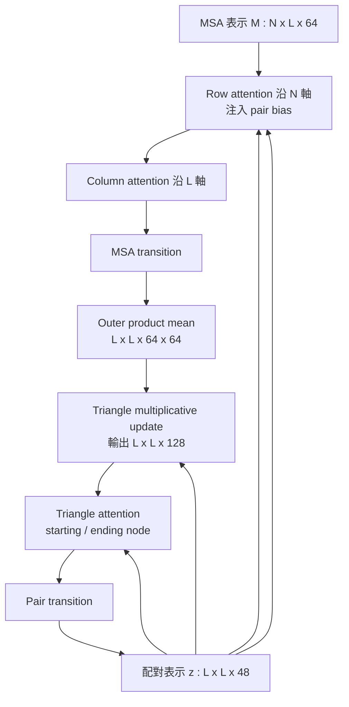

# 6.1 兩種表示法的交織：MSA 表示與配對表示（Pair Representation）

## 符號約定：兩種資訊形狀的落差

AlphaFold 2 的 Evoformer 並不是單一表示上的深度網路，而是兩種形狀完全不同的表示在同一個計算圖中反覆交織、互相校準的系統。要讀懂後面的公式，先把符號釐清。本文以 $`N`$ 表示多重序列對齊（multiple sequence alignment, MSA）的深度，也就是被蒐集到的同源序列條數；以 $`L`$ 表示目標蛋白質的殘基數，也就是序列長度；位置索引一律取 $`1 \leq i, j \leq L`$ 。這個約定之所以重要，是因為文獻中 $`N`$ 有時用來指序列長度，容易與「深度」混淆。

第一種表示是序列維的 MSA 表示 $`M \in \mathbb{R}^{N \times L \times 64}`$ ，它的維度結構是「條數 × 位置 × 通道」。資料集中的每一條同源序列，在每一個胺基酸位置上都被編碼成一個 64 維向量；這 64 維同時容納了該位置的胺基酸種類分佈（以 one-hot 與頻率統計呈現）、整條序列的型別標記，以及在 48 個 Evoformer 區塊中不斷被改寫的隱狀態。它是一個沿著「序列條數」這個軸攤開的表示，因此天然適合用來做「同一位置、不同序列之間」的運算。

第二種表示是殘基對維的配對表示（pair representation） $`z \in \mathbb{R}^{L \times L \times 48}`$ ，維度結構是「位置對 × 位置對 × 通道」，而且它不隨 $`N`$ 變化。在 Evoformer 內部，配對表示被視為所有 $`N`$ 條序列共享的單一張「殘基對關係表」。它是一個沿著「序列位置」這個軸攤開的表示，因此天然適合用來做「不同位置之間」的運算。

| 比較面向 | MSA 表示 $`M`$ | 配對表示 $`z`$ |
| --- | --- | --- |
| 維度結構 | $`N \times L \times 64`$ | $`L \times L \times 48`$ |
| 主軸語義 | 序列條數（演化樣本） | 殘基位置對（幾何關係） |
| 典型運算 | 跨序列注意力、跨位置注意力 | 三角形更新、三角形注意力 |
| 天然捕捉 | 保守性、共演化的原始統計 | 接觸、距離、方向、堆疊 |
| 對齊誤差敏感度 | 高 | 經注意力加權後降低 |

兩者的落差正是問題的根源。演化給我們的關鍵訊號是「共演化」：若位置 $`i`$ 與位置 $`j`$ 的胺基酸種類在多條同源序列中呈現統計相關，表示這兩個位置在演化上互相牽制，通常意味著它們在空間中靠近。這是一個二體統計量（two-body statistic），它的自然容器是配對表示，而非 MSA 表示。然而 MSA 表示才是共演化統計的原始出處；要把它搬進配對表示，就必須設計一套搬運機制，而這套機制的形狀，正是 Evoformer 的結構主幹。

## 序列維的 MSA 表示：保守性與共演化的原始礦脈

MSA 表示的初始化相當傳統：對每個位置，把整個對齊中該位置出現的 20 種胺基酸頻率作為輸入特徵，再拼上「此列是否為查詢序列本身」的標記。這一步看似平淡，卻已攜帶演化學最基本的成果——保守性。一個位置若在數百條同源序列中始終是 Gly 或 Pro，它的 64 維向量就會被強烈推向那個方向；這種偏置是統計的、可泛化的先驗，比任何人工設計的特徵都更有訊息量。

但 MSA 表示的真正價值不在單一位置，而在同一條序列中不同位置的關聯。模型要學會的是「若位置 $`i`$ 變了，位置 $`j`$ 必須跟著變」這件事。純粹的位置統計做不到這點，因為它們每個位置各自為政。要把「關聯」放進表示，就只有兩條路：一是讓網路自己去比較不同的 $`M_{i\cdot}`$ 向量，二是顯式地構造位置對的表示。前者正是注意力機制擅長的事，後者則是配對表示存在的理由。

還有一個容易被忽略的細節：MSA 表示的每一列（一條序列）在訓練時會被隨機丟棄（row dropout），而注意力在序列維上的聚合，正是網路學會「不依賴單一序列、而是依賴統計共識」的機制。深度不是越多越好，而是「有效深度」：親緣關係太遠的序列會帶來偏差而非資訊；注意力若能學會把權重集中到真正相關的同源序列上，就等於學會了「哪些遠親值得聽」。

## 殘基對維的配對表示：幾何的容器

配對表示 $`z`$ 的每個切片 $`z_{ij} \in \mathbb{R}^{48}`$ 描述「位置 $`i`$ 與位置 $`j`$ 之間的關係」。它的內容在訓練過程中被逐步改寫成越來越具有物理意義的量：最初只是「這兩個位置在演化上是否共變」，漸漸變成「這兩個殘基在空間中是否接觸」，最後逼近「這兩個殘基的骨架原子相距幾埃」。

問題是，這些語義沒有一條是被告知的。網路必須從資料中把「共演化」翻譯成「幾何」，而翻譯的過程就是學習的過程。這解釋了為何 AlphaFold 2 的成功不能只歸因於「Transformer 夠強」：真正的關鍵在於，它給了網路一個可以表達二體關係的架構，讓演化統計與空間幾何得以在一個中介層相遇。若沒有配對表示，序列到結構的映射就只能靠一層層全連接去隱式逼近 $`L^2`$ 個殘基對的距離，參數量與資料效率都不可行。

另一個關鍵事實是：配對表示在 AlphaFold 2 中不隨 $`N`$

## 為何不把 MSA 直接丟給一般 Transformer

既然注意力可以處理任意形狀的序列，為何不乾脆把 $`M`$ 視為一條長度 $`N \times L`$ 的序列，讓標準 Transformer 層層堆疊？這個想法很自然，也是 MSA Transformer 等工作的出發點。但 AlphaFold 2 的作者刻意偏離了這條路，原因涉及一個無法迴避的資料問題：同源序列之間的對齊並不完美。

Indel（插入與缺失）在真實演化中普遍存在。當兩條同源序列分別在第 37 位插入 3 個殘基、又在第 90 位缺失 1 個殘基，生物資訊學家用動態規劃把兩者對齊時，會面臨一個沒有標準答案的選擇：把插入的三個殘基算在第 37 位之前還是之後？尤其當插入片段與原有片段性質相似時，不同的對齊軟體會給出不同配準，差異可能達到數個位置。這不是工程瑕疵，而是序列比對問題本身的本質歧義。

這個歧義有嚴重後果。若把 MSA 當成一條平坦的長序列餵給一般 Transformer，「位置 37」在第 $`i`$ 條序列與第 $`j`$ 條序列中，可能對應到完全不同的三維殘基。跨序列注意力於是會在語意錯位的鍵值配對上做加權，學到的「關聯」被系統性地稀釋與汙染；更麻煩的是，這種錯配無法被診斷，因為模型沒有任何機制知道自己剛剛把兩個不相干的殘基對在了一起。

Evoformer 的解法不是消除歧義，而是讓歧義變成可被表達的不確定性。跨序列注意力（row attention）本來就以「這條序列與那條序列在這個位置是否指向同一個結構殘基」為自然的注意對象——因為同源序列的同一欄位幾乎必然對應同一個結構位置。注意力給出的權重分布，於是就變成了對「這條遠親在這個位置有多可靠」的估計。不需要外部的對齊品質標籤，不需要事後重新對齊，權重本身就成了軟性對齊機制。這是專用化的真正理由：不是 Transformer 不能用，而是只有明確知道「演化樣本之間存在位移不確定性」的架構，才能把它建模進去。

## Evoformer：交替更新的設計

Evoformer 的核心迴路是兩條更新路徑的交替：一條從配對表示更新 MSA 表示（同時把殘基對資訊注入序列維），另一條從 MSA 表示更新配對表示（同時把序列維統計注入殘基對維）。這個交替在 48 個 Evoformer 區塊中重複，形成所謂的 Evoformer stack。

### Row attention：帶偏置的跨序列聚合

Row attention 沿著 MSA 維度 $`N`$ 做注意力。固定某個位置 $`l`$ ，它把該位置上 $`N`$ 條序列的特徵當作查詢與鍵的來源，計算

$$
\text{Attention}(Q, K, V) = \text{softmax}\left(\frac{Q K^\top}{\sqrt{d_k}}\right) V
$$

其中 $`Q`$ 、 $`K`$ 、 $`V`$ 都由 $`M`$ 經獨立的線性投影得到，形狀為 $`N \times d_k`$ 。關鍵的設計是 pair bias：在 softmax 之前的分數上，加上由配對表示算出的偏置

$$
b_{ij} = \text{MLP}(z_{ij})
$$

其中 MLP 輸出每個注意力頭一個標量，於是

$$
s_{ij} = \frac{q_i \cdot k_j}{\sqrt{d_k}} + b_{ij}
$$

這個偏置把「這兩個位置在演化上已被判定為共變或接觸」直接寫進「這兩條序列應該互相聽取」的決策裡。沒有它，row attention 只是純粹的序列相似度比對；有了它，注意力就變成「以幾何假設為先驗的序列比對」。這是配對表示第一次反向流入序列維，也是整個交織機制的第一個節點。

### Column attention：同一條序列內的位置關聯

Column attention 換了軸：固定某一條序列 $`n`$ ，它沿序列位置維度 $`L`$ 做注意力，查詢來自位置 $`i`$ ，鍵與值來自位置 $`j`$ ，形狀為 $`L \times d_k`$ 。它沒有 pair bias，因為配對表示本身不區分是哪一條序列。

為什麼需要 column attention？因為 row attention 完全看不見「同一條序列上相鄰位置之間的關係」——它在每個位置上獨立地混合序列。而蛋白質的局部結構規則（二級結構的螺旋與摺板、轉角偏好）在序列上是連續的。Column attention 讓模型可以直接學到「位置 $`i`$ 附近的序列環境如何影響位置 $`i`$ 的表示」，這與 MSA 深度 $`N`$ 無關，因此即使只有一條查詢序列也完全適用——這是它對低深度 MSA 的重要意義。

### MSA transition：通道間的非線性

兩種注意力之後，MSA 表示需要一次通道維度的非線性整理，這就是 MSA transition。其典型結構為 $`\text{LayerNorm} \rightarrow \text{Linear}(64 \to 256) \rightarrow \text{ReLU} \rightarrow \text{Linear}(256 \to 64)`$ ，並以殘差形式加回 $`M`$ 。它的功能是把不同通道承載的訊息（保守性、序列型別、演化耦合）做非線性組合，讓它們不必被硬性分配到不同通道，也讓下一輪的注意力能在混合後的特徵上運算。

### Outer product mean：把共演化搬進殘基對維

資訊終於要從序列維流向殘基對維。這項工作由 outer product mean 完成：對每一對位置 $`(i, j)`$ ，把 MSA 表示在該兩欄的向量做外積，再沿序列條數平均

$$
A_{ij} = \frac{1}{N} \sum_{n=1}^{N} M_{n,i} \otimes M_{n,j} \in \mathbb{R}^{64 \times 64}
$$

整體而言 $`A \in \mathbb{R}^{L \times L \times 64 \times 64}`$ ，這是一個龐大的中間量，每個殘基對都有 4096 個數。它隨後被線性投影壓回 48 維，並以殘差形式加進配對表示

$$
z_{ij} \leftarrow z_{ij} + W \, \text{vec}(A_{ij})
$$

這一步的意義常被低估。共演化在統計上的形式，就是兩欄胺基酸分佈的聯合機率與邊際機率之差；而 $`M_{n,i} \otimes M_{n,j}`$ 的平均恰好承載了這種「兩欄之間的統計連結」。模型不需要我們告訴它「這個叫做共演化」——只要發現這種外積形式有助於預測幾何，它就會把對應的通道保留下來並強化。演化統計與空間幾何之間的翻譯，就這樣在反覆搬運中被不知不覺地完成。這也是「共演化如何在配對表示中被累積」的答案：它不是被寫入的，而是被反覆重算與摻和，逐漸在配對表示的通道中凝結成接觸的意義。

### Triangle multiplicative update：讓關係可以被三角化

配對表示更新的下一環是三角形乘法更新（triangle multiplicative update）。它把三個位置組成的「三角形」納入考量：對殘基對 $`(i, j)`$ ，考慮所有第三個位置 $`k`$ ，計算

$$
c^{\text{out}}_{ij} = \sum_{k} z_{ik} \otimes z_{jk}, \quad c^{\text{in}}_{ij} = \sum_{k} z_{ki} \otimes z_{kj}
$$

兩者分別對應「從 $`i`$ 出發」與「從 $`j`$ 出發」的三角形方向。兩種結果混合之後形成 $`\mathbb{R}^{L \times L \times 128}`$ 的張量，經投影後以殘差形式寫回 $`z`$ 。128 這個通道數說明網路需要相當大的容量，才能同時容納兩個方向的三角形資訊。

物理直覺是這樣的：三個殘基 $`i`$ 、 $`j`$ 、 $`k`$ 若兩兩接近，它們大致共面，或構成螺旋的局部片段；若 $`i`$ 與 $`k`$ 接近、 $`k`$ 與 $`j`$ 接近，則 $`i`$ 與 $`j`$ 大概也接近——這是三角不等式在化學距離上的近似對應。三角更新把這種路徑一致性注入配對表示，使單一邊緣統計不至於過度自信。

### Triangle attention：把注意力搬到三角形上

三角形注意力是注意力機制在配對表示上的版本，也是「對齊不確定性」思維的延伸。對殘基對 $`(i, j)`$ ，它沿著第三個位置 $`k`$ 這條軸做注意力，權重由 $`z_{ik}`$ 決定，值則取自 $`z_{jk}`$ ，把「透過 $`k`$ 這個橋樑」才連得上 $`i`$ 與 $`j`$ 的資訊匯入 $`z_{ij}`$ 。實作上分為以 $`i`$ 為 starting node 與以 $`j`$ 為 ending node 的兩種變體，兩者的注意力軸分別對應三角形的三個邊之一。

與 row attention 的偏置結合起來看，邏輯就完整了：三角形注意力的 softmax 分數會被接觸偏置調控，只有當 $`k`$ 真的在演化上與 $`i`$ 相關時，透過 $`k`$ 的資訊傳遞才被允許大量發生。這等於是一種圖上的一致性傳播：把已經建立的局部接觸關係，沿著三角形路徑外推。

### Pair transition：通道間的非線性

最後是 pair transition，一個作用在 48 個通道維上的前饋式 MLP，典型結構為 $`\text{LayerNorm} \rightarrow \text{Linear}(48 \to 256) \rightarrow \text{ReLU} \rightarrow \text{Linear}(256 \to 48)`$ ，並同樣以殘差形式加回 $`z`$ 。它讓「共演化」與「幾何」可以在同一組通道裡共存並互相組合，而不必被硬性分配到不同通道。

## 四十八次對話之後

48 個 Evoformer 區塊，就是 48 輪對話。每一輪裡，序列維與殘基對維各自更新一次，並且各自把資訊注入對方。直接後果是： $`z`$ 的內容不是模型「想出來」的，而是被反覆地、以演化統計為養分地塑形出來；同理， $`M`$ 的內容也在反覆吸收幾何假設，因此 row attention 的權重會逐漸偏向與接觸預測一致的模式。

回頭看，整個 Evoformer 可以被一句話概括：它把「演化樣本之間的可比性問題」與「殘基之間的幾何一致性問題」各自交給專門的運算子處理，再讓兩者互相校準。這不是把 Transformer 硬套在生物序列上，而是先理解資料的物理與演化結構，再設計匹配的架構——這正是前面各章一路鋪陳的主張，在架構層級的兌現。
