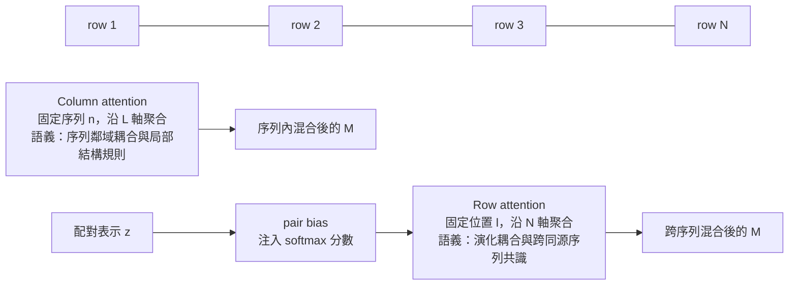

# 6.2 注意力機制（Attention Mechanisms）在生物序列中的應用

## 從一句話到一個公式

Attention 機制的直覺說法只有一句話：當我在某個位置寫下第 $i$ 個詞時，我應該把多少注意力放在第 $j$ 個詞上。把它寫成可微分的運算，就成為縮放點積注意力（scaled dot-product attention）

$$
\text{Attention}(Q, K, V) = \text{softmax}\left(\frac{Q K^\top}{\sqrt{d_k}}\right) V
$$

三個矩陣的語義是標準的： $Q$ 是查詢（query），代表「我在尋找什麼」； $K$ 是鍵（key），代表「我能被什麼找到」； $V$ 是值（value），代表「找到之後實際傳遞的內容」。分數矩陣 $\frac{Q K^\top}{\sqrt{d_k}} \in \mathbb{R}^{n \times m}$ 對應「 $n$ 個查詢對 $m$ 個鍵」的相容程度；除以 $\sqrt{d_k}$ 是必要的數值穩定修正——當 $d_k$ 較大時，內積的尺度會成長到讓 softmax 進入飽和區，梯度近乎消失，除以 $\sqrt{d_k}$ 讓分數尺度維持在 1 附近。

softmax 的關鍵性質是歸一化：每一列的分數被轉成總和為 1 的權重分布。這意味著注意力是一種凸組合，輸出是 value 的加權平均。它解釋了注意力在深度網路中的穩定性——不會像硬選擇那樣造成梯度中斷；但它也帶來了「權重被分佈化」的代價，這一點在討論可解釋性時會變得重要。

## 注意力改變了計算的可行範圍

在 2017 年之前，序列到序列的模型以循環網路（RNN）或卷積網路為主流。兩者都有結構性限制：RNN 的路徑長度隨序列長度線性增長，遠距離資訊要經過很多步才能傳遞，且無法充分並行；卷積的感受野要靠堆疊層數擴大，同樣難以直接建模任意距離的依賴。

Transformer（Vaswani 等人，2017）提出的解法是：直接為所有位置對計算關聯權重，把路徑長度壓縮到常數階，同時整個運算可以一次算完並充分並行。就參數效率而言，這是一種用計算換參數的交換：序列長度為 $L$ 時，注意力矩陣佔用 $O(L^2)$ 的記憶體，而循環網路的狀態只需 $O(L)$ 。對語言任務而言，句子的長度上限讓這個代價可以承受。

生物序列把這個取捨推向極端。蛋白質序列的長度中位數約在三百上下，但 MSA 的深度可以達到數萬條；一個完整 MSA 的注意力矩陣會讓記憶體爆炸。同時，「哪些位置相關」在生物序列中的含義遠比自然語言複雜——它可能是序列鄰近造成的，也可能是演化共變造成的，甚至可能只是資料中的假相關。這正是 AlphaFold 2 沒有把 Transformer 直接照搬，而是重新設計「注意力作用於哪一條軸」的原因。

## 生物序列上的注意力：作用於哪一條軸

MSA 是一個 $N \times L$ 的矩陣，注意力可以作用在兩條不同的軸上，兩者對應完全不同的生物學耦合方向。



### Row attention：演化耦合方向

Row attention 固定一個序列位置 $l$ ，把該位置上 $N$ 條序列的表示當作 $Q$ 、 $K$ 、 $V$ 的來源。形狀上，它相當於在 $L$ 個位置上各執行一次長度為 $N$ 的注意力。生物學語義是「在這個胺基酸位置上，這 $N$ 條同源序列各自的說法，哪些值得被聽取」。

這正是共演化的最佳表述：共演化不是「位置 $i$ 與位置 $j$ 在某條序列裡同時出現」，而是「不同序列中，位置 $i$ 的變化與位置 $j$ 的變化彼此相關」。Row attention 讓每個位置去收集其他序列在該位置的資訊，再透過後續的 outer product mean 把這些收集到的資訊按位置對組合起來，最終共演化就以 $A_{ij} = \frac{1}{N} \sum_{n=1}^{N} M_{n,i} \otimes M_{n,j}$ 的形式被顯式構造出來。換句話說，AlphaFold 2 是「先用注意力把序列整理成共演化友善的形式，再用外積把共演化算出來」。

### Column attention：序列鄰域耦合方向

Column attention 固定一條序列 $n$ ，沿序列長度做注意力。形狀相當於對 $N$ 條序列各執行一次長度為 $L$ 的注意力。它的生物學語義是「同一條多肽鏈上，鄰近與遠端的序列位置之間有什麼關係」，涵蓋了二級結構的局部偏好、轉角與轉折的序列決定因素，以及長程的序列遙相關。

兩個方向的互補性在資訊量上並不對稱：column attention 的效果幾乎不依賴 MSA 深度，即使只有查詢序列本身也完全可用；row attention 的價值則隨有效深度增加而提升。這解釋了為何 AlphaFold 2 在深度極低的序列上仍能運作——退化成 column attention 加上一點共演化；也解釋了為何越是孤立的蛋白質族，深度學習方法的優勢越小。

## 工程現實：深度、遮罩與記憶體

理論上的美麗要接受計算現實的檢驗。Row attention 對每個位置都要計算一個 $N \times N$ 的分數矩陣；當 MSA 深度達到數萬條時，光是單一位置的注意力就無法容納。因此實際流程中，MSA 會先由序列搜尋工具取得，再以聚類演算法壓縮深度，並在推論與訓練時設定不同的深度上限。

訓練時深度較小而樣本數較多，推論時深度較大，兩者之間的落差由 MSA 的隨機丟棄（row dropout）與注意力加權來彌補。注意力若完全依賴深度，訓練用小深度、推論用大深度就會產生分布偏移；而 dropout 強迫網路學到「即使某些序列被抽掉，剩下的也足以推斷」，等於把「對 MSA 深度的魯棒性」直接寫進了訓練目標。

另一個工程現實是遮罩（masking）。在自監督設定下，模型會遮掉 MSA 中某些位置與某些列的資訊，要求它從其餘部分重建；遮罩與注意力是互補的——遮罩創造了缺失，注意力決定了從何處補上。這也解釋了為何結構預測模型可以先用「遮蔽後還原序列」的代理任務預訓練，再以真實結構監督微調。

值得留意的是，MSA 沒有「自然的順序」：第 $n$ 條序列與第 $n+1$ 條序列之間並無先後關係，序列的排列順序純粹是資料庫檢索的產物。因此 row attention 完全不需要位置編碼——同一欄位的序列本來就對應同一個結構位置，這正是它能作為軟性對齊的結構前提。相對地，column attention 作用在同一條序列的內部，那裡存在真正的順序資訊，位置結構則由序列本身的相鄰關係提供。兩者的差異顯示，位置資訊在生物序列裡並非外加的裝飾，而是必須依據「那一個軸上是否存在順序」來決定要不要顯式建模。

## 注意力作為學習式的序列加權

把 row attention 再往上抽一層，會看到一個統計學上很有意思的對應。演化耦合分析的經典方法（直接耦合分析 DCA、互資訊法）在估計兩欄胺基酸的耦合強度時，都面對同一個技術難題：MSA 中的序列並非同分布地獨立取樣，親緣關係近的序列會把某個祖先的狀態重複計數，造成系統性的系統發偏差。統計上的標準解法是加權：對每條序列給一個權重 $w_n$ ，並以「有效序列數」

$$
N_{eff} = \exp\left(-\sum_{n=1}^{N} w_n \log w_n\right)
$$

來度量 MSA 的實際資訊量。手工設計的加權規則（例如以位置變異度為基礎的 Henikoff 加權）在共演化分析中被廣泛使用，近來也出現了以小型神經網路去學習加權規則的做法。

Row attention 做的事情，恰好就是這種加權的高階版本。模型學出的注意力權重並非只決定「聽誰的」，還決定了每一條序列在共演化統計中的份量：outer product mean 裡的加權平均，若上游注意力把某條序列的貢獻壓低，等價於在共演化估計中降權該序列。換句話說，注意力在這裡不是裝飾性技巧，而是一種可微分、可端到端學習的系統發去偏差機制。這解釋了為何 AlphaFold 2 能在親緣關係極為複雜的序列族上仍然有效：它不依賴人手挑選的同源序列子集，而是自己學出哪一批遠親該被忽略。

## 從 Transformer 到 MSA Transformer：剪裁與專用化

2021 年的 MSA Transformer（Rao 等人）是注意力應用到演化資料最具代表性的獨立工作。它確認了軸向化注意力的威力：僅用 row attention 與 column attention 在 MSA 上交替，配合遮罩與位置偏置，就能作為逆摺疊（inverse folding）與接觸預測的預訓練模型，取得當時極佳的成果。

但它與 AlphaFold 2 的差異不是實作細節，而是架構判斷。讓我們把三者並列：

| 面向 | Transformer（2017） | MSA Transformer（2021） | AlphaFold 2 Evoformer（2020） |
| --- | --- | --- | --- |
| 作用對象 | 單一 token 序列 | $N \times L$ 的 MSA | $N \times L$ 的 MSA 加上 $L \times L$ 配對表示 |
| 注意力軸 | 單軸 | 軸向（row 與 column 交替） | 軸向加上三角形注意力 |
| 位置資訊 | 絕對或相對位置編碼 | 相對位置偏置 | 由 pair bias 與三角形更新承擔 |
| 跨維溝通 | 無 | 無 | outer product mean 與三角形更新 |
| 主要用途 | 語言 | 逆摺疊、接觸預測 | 三維結構預測 |

三點差異值得強調。第一，MSA Transformer 沒有配對表示，因此沒有位置對的容器；它能預測接觸，靠的是注意力權重本身與後續的統計解碼，而非架構上的二體統計。第二，AlphaFold 2 的 row attention 注入了 pair bias，這讓注意力從純粹的相似度比對升級為帶先驗假設的比對。第三，AlphaFold 2 在每一輪交替更新中都做雙向溝通，讓幾何假設能反向修正序列維的表示——這是 MSA Transformer 沒有、也不需要的機制，因為它的輸出介面是序列而非座標。

## Evoformer block 的執行順序

把前一節的運算子攤開，Evoformer 區塊的順序可以用以下偽代碼表述。

```python
def evoformer_block(M, z, blocks=48):
    for _ in range(blocks):
        M = msa_row_attention(M, z, pair_bias=True)
        M = msa_column_attention(M)
        M = msa_transition(M)

        A = outer_product_mean(M)
        z = z + linear(A)

        z = z + triangle_multiplicative_update(z, directions=["outgoing", "incoming"])
        z = z + triangle_attention(z, variant="starting_node")
        z = z + triangle_attention(z, variant="ending_node")
        z = pair_transition(z)
    return M, z
```

這個順序不是任意的。它先讓序列維吸收配對資訊（row attention），再讓序列維在自身軸上整理（column attention），然後才把整理好的序列維統計倒灌進配對維（outer product mean）；配對維再以三角形運算互相校準幾何一致性，最後由 MLP 完成通道混合。若把 outer product mean 提前到注意力之前，模型就會在未整理的 MSA 特徵上做統計，得到的共演化估計會更雜訊。

## 注意力作為可解釋性線索

注意力的一個附加價值是它給出了一個可以視覺化的權重矩陣。對生物序列而言，注意力圖往往以接觸圖的形式呈現：row attention 的權重在某些頭上會集中於演化相關但序列上不相鄰的序列對；column attention 的權重則呈現出明顯的對角帶狀結構，寬度對應二級結構的類型——螺旋區的帶較寬而穩定，摺板區的帶窄而跳動。AlphaFold 2 的原始論文正是以這類注意力圖的視覺化，作為「模型確實學到了生物學意義」的定性證據。

不過，注意力圖的可讀性有技術前提。單層注意力往往只是局部而雜訊的權重分布；要看出宏觀模式，通常需要把多層的注意力矩陣連乘並取平均，這就是所謂的 attention rollout。或者更常見的做法，是把注意力圖重新排列成序列對對序列對的形式：對 row attention 而言，第 $(i, j)$ 個元素是序列 $i$ 與序列 $j$ 之間的平均注意力，這張矩陣有時會呈現出與目標序列的相似性結構，或與演化樹相關的分群結構——模型內部隱約保存了一棵序列親緣關係的估計。

不過，注意力圖的解釋力需要被量化，才能進入科學論證。合理的做法是把它當作假說生成器：先從注意力圖提出「第 $i$ 位與第 $j$ 位殘基互相接觸」的預測，再用獨立的接觸預測統計量去比對，檢查注意力給出的信號是否真的超出隨機基線。只有當這種比對成立，注意力圖才值得被當作生物學線索引用，也才值得被寫進論文的結果段落。

對研究者而言，這提供了一種罕見的機會：可以沿著網路內部的權重，追溯某個預測結果的依據。哪一對殘基被模型認為是共變的、哪一段序列被模型當作結構模板、哪個注意力頭專門負責偵測訊號肽或跨膜區段，這些都可以被提出來檢驗與批判。

## 注意力不是解釋

但這個用法有一個必須講清楚的陷阱。Jain 與 Wallace（2019）在〈Attention is not Explanation〉中做了一個簡單而殘酷的實驗：他們找出分類結果高度依賴某個標記 token 的樣本，發現模型學到的注意力權重可以大幅調換而不改變預測輸出。換言之，權重的「重要性」與輸出的「敏感度」可以不一致——注意力圖看起來很像理由，卻未必真是決策的理由。

後續的辯論沒有讓這件事變得單純。Wiegreffe 與 Pinter（2019）指出，若以充分性與完整性這兩個明確指標來衡量，注意力有時確實構成解釋；主張「注意力不是解釋」的結果，多半是因為測試所用的 faithfulness 指標設計不當。實務上的結論是：注意力地圖可以作為值得追查的線索，但不能單獨當作因果解釋的證據；真要驗證，得做遮蔽、置換或反事實實驗，也就是實際改變輸入，看輸出是否如圖所預測的那樣改變。

在 AlphaFold 的脈絡下，這個告誡格外重要。蛋白質結構預測的正確性本來就可用 RMSD 與 $F_{nat}$ 等獨立指標客觀評量，沒有理由把注意力的可解釋性誤認為額外的科學證據。注意力圖的價值在於提出假設、在於協助開發者除錯，而不在於它解釋了生物學。

## 小結

注意力在生物序列上的成功，靠的不是把 Transformer 移植過來，而是先回答三個資料特有的問題：注意力應該作用在哪一條軸上（演化軸與序列軸的分工）、注意力分數該不該被偏置引導（pair bias 與對齊不確定性）、以及注意力產出的資訊該如何匯入另一種形狀的表示（outer product mean 與三角形更新）。這三個問題，正是 Evoformer 與一般 Transformer 之間的分水嶺。
