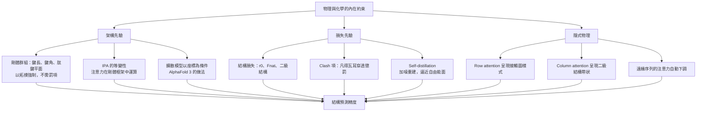

# 6.3 學習物理與化學的內在約束

## 物理從哪裡進入一個神經網路

蛋白質摺疊是一個物理過程：多肽鏈在溶劑中受熱力學驅動，尋找自由能最低的構象。物理力場可以形式化地描述這件事——鍵結、鍵角、二面角、凡得瓦耳排斥、溶劑效應——但代價是計算量隨殘基數快速膨脹，而且真實蛋白質的力場參數化本身就充滿爭議。AlphaFold 走的是另一條路：它不嘗試在推理時模擬物理，而是讓物理的產物作為監督訊號，讓物理的約束以各種形式滲入網路的架構與目標函式。

要把這件事講清楚，最好的分類方式是問：物理是以什麼形式進入系統的？答案是三種管道，分別對應寫進架構、寫進損失，以及被資料教會。

| 管道 | 形式 | 具體例子 | 強制程度 |
| --- | --- | --- | --- |
| 架構先驗 | 硬編碼在網路拓撲與對稱性中 | 結構模組的剛體群組、IPA 的等變性、擴散模型以座標為條件 | 絕對強制 |
| 損失先驗 | 以懲罰項的形式寫在目標函式 | clash 項、 $F_{nat} 、self-distillation 的加噪重建 | 統計強制 |
| 隱式物理 | 從資料中自行湧現，無人工指定 | 接觸圖樣式的注意力、二級結構樣式的條帶 | 無強制，靠資料 |

第三種最令人著迷，也最容易被誤讀。把它與前兩種分清楚，才能正確回答「AlphaFold 到底是不是物理模擬器」這個問題。

## 幾何先驗：哪些寫進架構

先澄清一個常見的誤解：AlphaFold 2 的配對表示在初始化時並不是用接觸圖填滿的，而是零初始化。幾何資訊是由 MSA 表示經由 outer product mean 逐步流入的。把「以接觸圖初始化配對表示」誤寫成 AlphaFold 2 的做法，會錯過這個架構真正的精巧之處——它並不預先假設幾何，而是讓幾何從演化統計中長出來。

真正的幾何先驗有兩個來源。第一個是演化所蘊含的接觸預測：當 MSA 深度足夠時，演化耦合分析的經典方法（例如直接耦合分析 DCA 或互資訊法）就能給出接觸預測圖，指出哪些位置對在演化上彼此牽制。這張圖就是幾何先驗，它以統計形式存在於 MSA 之內，並不必然需要被手動轉成配對表示的初始化值。Evoformer 的做法更有效率：讓網路自己在 outer product mean 與三角形更新中，把這張圖逐步翻譯成配對表示裡的內容，而不是先驗地塞進去。

第二個來源是結構模組中硬編碼的幾何，這是第 7 章的主題，但在此必須點出其意義：AlphaFold 2 的結構模組不直接輸出座標，而是把每個殘基的骨架表示為一個剛體群組——一個平移向量加一個旋轉矩陣，並以不變點注意力（IPA）在剛體群組的框架中進行所有運算。骨鍵長度、鍵角、肽鍵平面這些化學硬約束，透過「注意力對剛體變換免疫」這個拓撲性質被自動滿足，無須任何罰項。這是「把物理寫進架構」最漂亮的例子：物理不是被檢查的，而是被保證的。

第三種途徑存在於後續的模型中。AlphaFold 3 把預測問題改寫成座標上的擴散過程，每一步都在既有座標上做更新，起始座標與中間狀態本身就是幾何先驗。從「零初始化的配對表示」走向「以座標為條件的生成」，反映的是模型家族對「先驗該寫在哪裡」這個問題的答案逐步移動：先驗愈來愈靠近物理，而不是愈來愈靠近統計。

## 損失中的物理項

### 結構損失：把 RMSD 與接觸分開獎勵

結構模組的訓練目標通常由數個物理量項組合而成：

$$
\mathcal{L}_{\text{struct}} = w_1 \, r_0 + w_2 \, F_{nat} + w_3 \, d_{sc} + w_4 \, d_{lo}
$$

其中 $r_0$ 是疊加後骨架的 RMSD，對整體平移與尺度不變； $F_{nat}$ 是原生接觸比例：

$$
F_{nat} = \frac{\# \{(i, j) : |i - j| > 6, \; d^{pred}_{ij} < 8 \text{\AA}, \; d^{true}_{ij} < 8 \text{\AA}\}}{L(L-1)/2}
$$

$d_{sc}$ 對應二級結構一致率， $d_{lo}$ 對應鬆散區域（loop）的結構差異。 $F_{nat}$ 特別值得注意：它不直接要求座標精確，而是要求該靠近的位置確實靠近。這是一個比 RMSD 更貼近生物學的目標——演化與功能真正依賴的是接觸拓撲，而不是把每個原子放到小數點後第四位。

### Clash loss：把物理寫成懲罰

clash 項處理的是物理中不可違反的部分：原子的凡得瓦耳半徑不容許被穿透。它對所有非鍵結的重原子對計算

$$
\mathcal{L}_{clash} = \sum_{(a,b) \in \mathcal{P}_{nonbonded}} \max\left(0, \; r_a^{\text{vdW}} + r_b^{\text{vdW}} - d_{ab}\right)^2
$$

其中 $\mathcal{P}_{nonbonded}$ 排除同一殘基內的鍵結原子對，以及序列上相鄰殘基間的肽鍵相關原子對——那些接近是化學必然，不是衝突。在 AlphaFold 2 中，結構模組的損失正是結構損失與碰撞損失的加權和，兩者權重同量級。

clash 項的深層意義是：它讓物理上不可能的結構在訓練中付出真實代價。沒有這項，純粹的接觸預測訓練偶爾會產生原子互相穿插的結構——它在接觸拓撲上完全正確，卻在物理上不可信。碰撞損失是「用資料逼近物理」的過程中，少數真正以物理定律形式寫入的段落。

clash 項的權重也不是愈大愈好。若它取得過高的權重，模型會偏向輸出保守、緊密、把所有原子推開的構形，即使接觸拓撲並不特別正確；反之若過低，模型則可能生成在接觸圖上漂亮、卻在幾何上無法成鍵的結構。損失函數中每一個物理項的權重，實際上都在拓撲正確與幾何合理這兩種誤差之間做取捨。這也說明為什麼結構損失不是單一項，而是 $r_0$ 、 $F_{nat}$ 、二級結構與 clash 的一組加權組合。

### Self-distillation：把漏斗的下降變成訓練程序

AlphaFold 2 的訓練有一個極不尋常的設計：網路預測出結構後，這個結構並不直接與實驗結構比較，而是先被加上高斯噪訊，再送回結構模組，要求它重建出未加噪的結構。這就是 self-distillation（自我蒸餾）。

令 $x$ 為當前結構模組輸入的目標座標， $x_{noisy} = x + \varepsilon$ ，其中 $\varepsilon \sim \mathcal{N}(0, \sigma^2 I)$ ，最小化

$$
\mathcal{L}_{distill} = \sum_{\sigma} w_{\sigma} \, \text{RMSD}\left(f_{\theta}(x_{noisy}), \, x\right)
$$

而 $x$ 在第一輪訓練時來自實驗結構，在後續輪次中則來自上一輪網路自己的預測；噪訊幅度 $\sigma$ 隨蒸餾輪次遞增，模仿的是從低品質結構走向高品質結構的逐步精修。

為什麼要這樣繞一圈？因為若直接把預測結構與實驗結構比較，網路會被迫在「一次到位」與「對噪聲過度敏感」之間二選一。加入噪訊重建這一層後，梯度訊號變得平滑得多，訓練更穩定，而最終得到的模型在推理時只需跑一遍。純粹的實驗結構監督退居為最早期的初始化，之後每一輪都在逼近上一輪的近似解——這是一種自我一致的蒸餾迴圈，也是 AlphaFold 2 能夠把 GDT_TS 推高的技術細節之一。

## 統計物理：摺疊漏斗與接觸順序

摺疊漏斗模型（Dill 與 Karplus，1995）描述的是能量景觀的拓撲結構：在高能態，構象數量極多且自由能近乎平坦；隨著能量下降，構象空間急劇收縮，最終落入唯一的 native state。這個模型解釋了為何摺疊能在毫秒到秒的尺度內完成——漏斗提供了一條下坡的捷徑。

AlphaFold 2 並不顯式建立漏斗。它不做能量最小化，也不做蒙地卡羅採樣。但漏斗的形狀以一種隱喻的方式滲入了設計：模型必須從千千萬萬種可能的座標配置中，直接輸出最底部的那一個。這就是漏斗對網路架構的實際壓力來源——輸出空間是連續而巨大的，正確答案卻極其稀少。Self-distillation 的加噪重建機制，正是把漏斗的逐級下降變成了訓練程序：先學會從小幅擾動回到正確位置，再學會從大幅擾動回來。

接觸順序（contact order）則提供了摺疊動力學的代理量：

$$
CO = \frac{\sum_{i<j} \delta_{ij} \, |i - j|}{N_{res}^2}
$$

其中 $\delta_{ij}$ 在 $(i, j)$ 為原生接觸時等於 1 ，否則為 0 。Bromley 與 Searle（2015）證明蛋白質的摺疊速率與接觸順序呈指數反比：長程接觸（序列上遠離但空間上靠近的殘基對）越早形成，摺疊越快，因為它們大幅縮減了後續搜尋的空間。這個發現為結構預測的評估提供了不同於 RMSD 的視角，也暗示了模型輸出的價值排序意義：若一個模型能先預測長程接觸、再補上局部細節，它就重現了摺疊順序。

摺疊的第一階段常被描述為疏水塌縮：疏水殘基聚集、排斥水分子、縮小去摺疊的構象空間。AlphaFold 2 沒有任何一項顯式的疏水項，但它隱含地包含了這項效應——因為 MSA 表示中本來就含有胺基酸的疏水性資訊，模型在訓練中必然學會哪些位置要埋進核心。接觸預測圖中核心疏水殘基聚集的模式，正是這項物理在資料層面的投影。

## 網路學到的隱式物理

最直接的證據來自訓練後的注意力地圖分析。在 AlphaFold 2 中，MSA row attention 的若干注意力頭，其權重圖在視覺化後會呈現出清晰的接觸預測樣式：對角線之外，遠端位置對之間出現明確亮斑，且亮斑位置與已知結構的接觸圖高度吻合。Column attention 的權重圖則在對角線附近形成寬度不同的帶狀，對應螺旋、摺板等二級結構的種類；而三級結構的資訊主要體現在配對表示自身的通道模式上，而非序列維度。這意味著功能分工是自發形成的：模型自己決定了跨序列比較與序列內比較各自負責什麼物理內容。

另一個令人側目的觀察來自 MSA 深度的影響：當 MSA 深度增加時，模型對親緣關係過遠的序列的注意力會自動降低——因為那些序列會引入誤導性的共演化訊號。這是統計學意義上的相關性加權，是模型自己學會的、而非被指定的序列過濾機制。

這些現象的共同點在於它們是湧現的。沒有人寫下「注意力圖應該像接觸圖」，也沒有人教模型「長程序列應該比近親更不可信」。這些模式是「用接觸預測這個目標訓練深網路」的自然後果。這是深度學習最讓人不安也最讓人著迷之處——模型並非被告知物理，而是被給了足夠多真實世界的資料，然後逼近了那個世界的規則。

這種湧現現象在方法論上有一個重要啟示：當我們要設計新的生物學預測模型時，「把物理寫進架構」與「把物理寫進損失」都是成本高昂、而且需要大量領域知識的工程選擇；而「把物理留給資料」有時反而更有效也更通用。AlphaFold 2 的成功在某個意義上是統計學的勝利而非物理學的勝利——它證明了只要資料足夠豐富、任務定義足夠正確，物理學的結論可以從資料中重新浮現。

## 物理約束的注入路徑總覽

## 為什麼 AlphaFold 不是物理模擬器

把上述內容攏在一起，可以明確回答一個常見的誤解。AlphaFold 2 不是物理模擬器，原因至少有五點。

第一，它在推理時不計算任何物理量。沒有力場、沒有能量、沒有溫度、沒有熵。所有物理都已經被蒸餾進權重裡，成為一個靜態的函數逼近。第二，它不描述動力學。它輸出的是單一的靜態結構，不能告訴你蛋白質如何摺疊、經過哪些中間態、哪些過渡態是瓶頸；摺疊速率、時間尺度與動力學網路在 AlphaFold 的框架裡無處安放。第三，它不保證熱力學正確性。同一序列的不同摺疊狀態是否自由能幾乎相同，模型並不知道；它的輸出反映的是統計上最可能的構象，而不是自由能最低的構象。這兩者在多數情況下重合，但在過渡態與人工設計的序列上可能嚴重分歧。

第四，它沒有內在的守恆量。物理模擬遵守能量守恆與細節平衡；深度網路不遵守任何這類原理，它只是把輸入映射到輸出。第五，它受限於訓練分布。對分布之外的序列——人工設計的蛋白質、極端環境的蛋白質、非天然骨架——它的行為沒有任何物理保證。

正因如此，「用資料逼近物理」是更精確的描述。AlphaFold 2 做的事，是用數百萬個物理的實例，也就是 PDB 中已知結構的蛋白質，訓練出一個函數，使它在該分布內的表現接近物理規律。它達成了物理模擬器的目標，卻沒有採模擬器的方法：推理成本從數小時降到數秒量級，而準確度遠超任何力場方法。

## 小結

物理進入深度網路的方式有三種：被寫進架構、被寫進目標函式，以及被資料教會。前兩種是我們可以主動設計的，第三種是模型的湧現。最後一種最耐人尋味，也提醒我們一件重要的事——當資料足夠真實、任務定義足夠貼近物理時，一個足夠 expressive 的模型會自行逼近物理的樣貌，即使它的內部從未出現過力、能、溫度這些詞。AlphaFold 2 的真正含義，或許就在這裡：它不是因為理解物理而成功，而是因為把物理的足跡原封不動地留在了資料裡。
