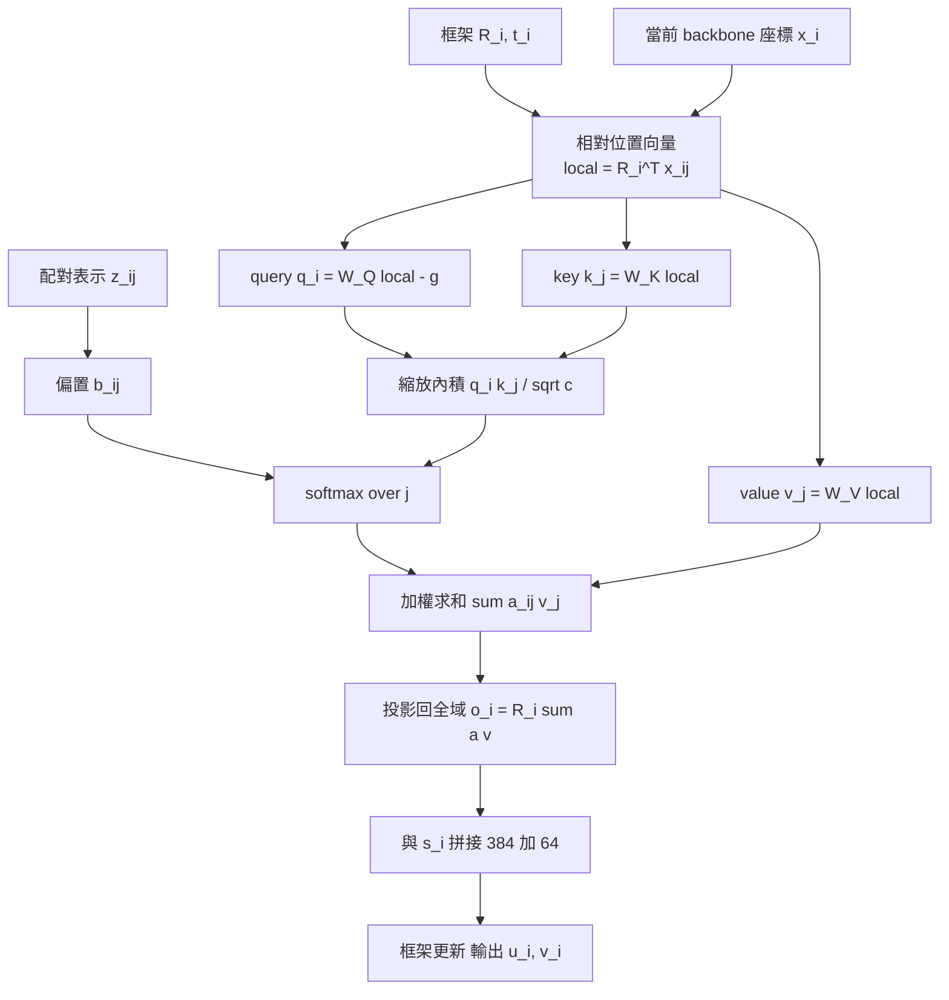

# 7.2 不變點注意力（IPA）如何滿足空間幾何對稱性

## 注意力機制的幾何盲點

第 6 章描述的 Evoformer 注意力（MSA 行注意力、列注意力、三角注意力）已經是一個相當精緻的架構，但它們有一個共同特徵：它們是置換等變的，卻是幾何無知的。所謂置換等變，是指把 MSA 的行打亂、輸出也跟著相應打亂；所謂幾何無知，是指它們完全不知道兩個殘基在三維空間中離多遠，也不知道它們之間的相對朝向是什麼。整個 Evoformer 是在一個抽象的向量空間裡進行資訊流動的。

這帶來一個尖銳的矛盾。結構模組的目標明明是產生三維座標，但它的上游從未真正「看見」過三維。那麼，Evoformer 提供的配對表示 $z_{ij}$ ，憑什麼能告訴結構模組「殘基 $i$ 與殘基 $j$ 應該靠近」？

在 AlphaFold 2 的原始設計裡，答案來自一個笨拙但可行的機制：Evoformer 透過三角乘法更新，在 MSA 表徵的維度上做外積，藉由共同相鄰殘基的資訊傳遞，間接逼近共演化訊號；而結構模組則透過二維距離的傅立葉展開，從配對表示中猜出一組距離，再把這些距離拿去做幾何推理。這條路能走通，但猜測的成分很重——模型必須先在 128 通道的向量空間裡隱含地表示「 $i$ 與 $j$ 之間的距離大約是 8 Å」 ，才能讓下游用得上。

不變點注意力提出的解法更為徹底：與其讓配對表示去隱含表示距離，不如把注意力機制直接搬到三維幾何裡去執行。注意力分數不再由抽象的向量內積決定，而是由「在殘基 $i$ 的局部座標系中， $i$ 與 $j$ 的相對向量分別經過 query 與 key 投影後的內積」決定。這樣一來，幾何不再是被猜測的對象，而是被內建進注意力核心的東西。

## 局部框架、query、key、value

IPA 的運算完全建立在第 7.1 節引入的框架集合之上。對每一個殘基 $i$ 與它鄰域中的每一個殘基 $j$ ，先算出兩者的相對位置向量，接著把它旋回 $i$ 自己的座標系：

$$
r_{ij}^{\text{local}} = R_i^\top ( x_j - x_i )
$$

這一步是整個機制的關鍵，因為它把一個依賴全域姿態的量，轉換成一個依賴相對幾何的量。這個局部向量是剛體運動不變的：無論整個蛋白質怎麼平移或旋轉， $r_{ij}^{\text{local}}$ 都不變。

然後，query、key、value 三者都由這個局部向量投影而來：

$$
q_i = W^Q \, r_{ij}^{\text{local}} - g, \qquad k_j = W^K \, r_{ij}^{\text{local}}, \qquad v_j = W^V \, r_{ij}^{\text{local}}
$$

其中 $W^Q$ 、 $W^K$ 、 $W^V$ 是可學習的投影矩陣， $g$ 是一個可學習的全域偏置向量，用來抑制注意力過度依賴相對位置中的某些分量。

在多頭、多鄰域的實作形式下，query 對鄰域內多個成對關係做加權聚合，得到：

$$
q_i = R_i^\top \sum_k w_k^Q \, ( R_i r_{ik} - t_i ) - g
$$

這裡 $k$ 遍歷注意力頭覆蓋的鄰域成對集合， $w_k^Q$ 是可學習的聚合權重。這個寫法的關鍵在於：整個聚合發生在局部座標系之內，最後才透過 $R_i^\top$ 轉回全域系。這就是為什麼 IPA 在多頭設定下仍能維持嚴格的等變性——所有的向量運算都在與輸入姿態無關的座標系裡完成。

注意力分數則是標準的縮放點積，再加上偏置項：

$$
\alpha_{ij} = \mathrm{softmax}_j \left( \frac{ q_i^\top k_j }{ \sqrt{c} } + b_{ij} \right)
$$

$b_{ij}$ 是一個從配對表示 $z_{ij}$ 經過線性層算出來的偏置量。它的意義是：幾何給出「 $i$ 和 $j$ 在空間中的相對朝向如何」，而演化資訊給出「 $i$ 和 $j$ 在序列中是否強烈共演化」。IPA 把兩者加在同一個分數上，於是注意力可以在空間上合理的鄰居與演化上相關的殘基之間取得平衡。這是 AlphaFold 2 中少數幾處把物理資訊與生物資訊放在同一個數學量上相加的地方。

最後，注意力輸出同樣在局部座標系中形成，再轉回全域：

$$
o_i = R_i \sum_j \alpha_{ij} \, v_j
$$

這一步的對稱性與 query 的建構完全一致：進場時用 $R_i^\top$ 進入局部系，出場時用 $R_i$ 回到全域系。

## 等變性的證明

現在可以做一個乾淨的推論。若把整個輸入結構用某個 $(G_R, G_t) \in SE(3)$ 變換，則各殘基的框架依下列規則變換：

$$
R_i \rightarrow G_R R_i, \qquad t_i \rightarrow G_R t_i + G_t
$$

先看局部向量。變換後的相對位置為 $x_j' - x_i' = G_R ( x_j - x_i )$ ，框架原點變為 $t_i' = G_R t_i + G_t$ ；而框架表示中殘基 $i$ 的自身座標在局部系裡恆為原點，故局部相對向量的正確定義是 $R_i^\top ( x_j - x_i )$ 。代入變換後的量：

$$
(R_i')^\top ( x_j' - x_i' ) = (G_R R_i)^\top \big( G_R x_j - G_R x_i \big) = R_i^\top ( x_j - x_i )
$$

完全不變。這代表局部向量、進而 $q_i$ 、 $k_j$ 、 $v_j$ 、進而注意力權重 $\alpha_{ij}$ 在剛體運動下全部保持不變。最後，輸出：

$$
o_i' = R_i' \sum_j \alpha_{ij} v_j = G_R \left( R_i \sum_j \alpha_{ij} v_j \right) = G_R o_i
$$

輸出被同一個剛體運動正確地變換。IPA 是 $SE(3)$ 等變的，這是一個可以逐行驗證的定理，不是經驗觀察。整個推論的要點只有一句：所有影響注意力的量都在局部座標系裡產生，因此它們對全域姿態免疫。

| 性質 | 普通注意力 | 不變點注意力 |
| --- | --- | --- |
| 輸入對象 | 抽象特徵向量 | 三維相對位置向量 |
| 是否知道幾何 | 否 | 是，以局部座標系表達 |
| 平移不變性 | 無 | 有，局部向量恆定 |
| 旋轉等變性 | 無 | 有， $SE(3)$ 等變 |
| 注意力偏置來源 | 位置編碼，額外外加 | 配對表示，提供演化耦合 |
| 能否讓結構模組直接看見三維 | 否 | 是 |

## 三種偏置的分工

IPA 的偏置項值得單獨拉出來跟 Evoformer 裡的其他注意力偏置比較，因為 AlphaFold 2 對偏置這個機制的使用構成了一套完整的設計。

在 Evoformer 裡，MSA 行注意力與列注意力都有一個偏置項，它來自配對表示 $z_{ij}$

這三者的分工可以這樣理解：三角注意力用 MSA 演化資訊去更新配對表示，IPA 用配對表示去決定三維幾何上的注意力。資訊是單向流動的，從演化到配對再到幾何，而不是繞圈。而第 7.3 節的循環精煉，恰恰是把這個單向流動變成帶有回饋的閉環。

## 實作細節：為什麼注意力分數是純量

有一個容易被忽略但影響很大的設計選擇，值得說明：在 AlphaFold 2 的實作中，IPA 的注意力分數是逐頭的純量，而不是逐頭的向量。

具體而言，每個頭各自從 128 通道的配對表示投影出 query、key 與 value；query 與 key 做內積後，得到的是一個數字，而 value 則是一個 16 維的向量。也就是說，注意力權重是「某一對殘基該被看多少」的一個純量信號，而被傳遞的內容則是另一個向量。這與典型的 Transformer 在形式上不同，因為那裡每個頭會產出一組注意力權重向量。

這個選擇有三個好處。第一，注意力圖譜立刻可解釋：每個頭給出一張純量的 $L \times L$ 矩陣，可直接當作接觸預測的代理量。第二是參數效率：注意力權重不佔用 value 的通道預算，價值的全部容量都用在傳遞幾何資訊上。第三是與偏置的相容性：純量分數使得來自配對表示的偏置 $b_{ij}$ 能夠以最自然的方式加上去，兩種資訊在同一個純量尺度上競爭注意力預算，這正是演化耦合與空間鄰近融合的精確機制。

另外一個實作上的選擇是相對位置向量的中心化：實作中使用的不是絕對尺度，而是相對於框架原點與鄰域中心化的表示。這是為了處理長鏈蛋白質中絕對距離尺度過大的問題——一條 500 殘基的鏈，兩端的相對位移可以有數百埃，其內積會被那些尺度極大的分量主導，注意力分數的有效動態範圍被浪費掉。局部座標系加上中心化，讓注意力關注的永遠是相對姿態這個真正帶有構形資訊的量。

## 注意力圖譜裡浮現的接觸圖

IPA 還有一個頗為迷人的副作用：它產生的注意力權重 $\alpha_{ij}$ ，本身是一張 $L \times L$ 的矩陣，而這張矩陣在蛋白質結構生物學上有直接的意義。

由於注意力分數的第一項正是 $i$ 與 $j$ 局部相對向量的幾何內積， $\alpha_{ij}$ 大意味著兩件事同時成立： $i$ 與 $j$ 的共演化訊號強，而且它們在三維中的相對朝向是有資訊量的。反過來說，一個在演化上真正緊密共變化的殘基對，往往正是三維中直接接觸的殘基對——這是結構生物學裡的老直覺。IPA 的注意力圖譜因此被廣泛用作接觸預測的代理量，用來檢視模型學到的關係是否合理，也用於分析蛋白質的結合界面。

這裡有一個值得玩味的方法論意涵：一個架構層面的對稱性設計不只提升了平均精度，還讓網路的中間產物變得可解釋。等變性保證了「模型在這個樣本上的注意力圖」是這個蛋白質的性質，而不是某個隨意座標系的產物——這是可解釋性的前提。

圖中最值得停留的是右側那條從配對表示通往注意力分數的邊。相較於其他所有主流注意力架構中「偏置只是錦上添花」的定位，在 IPA 裡偏置項是幾何分數與演化資訊的唯一匯流點。若把 $b_{ij}$ 拿掉，IPA 退化成一個純粹的三維幾何注意力；若把幾何部分拿掉，它又退化成第 6 章的 Evoformer 注意力。兩者的融合，是 AlphaFold 2 能夠超越兩者的關鍵。

## 幾何先驗的硬編碼：IPA 的方法論意義

IPA 的哲學意義值得單獨一段。深度學習的慣性是「讓資料決定一切，架構保持通用」；IPA 卻反其道而行，架構本身斷言了一個明確的物理命題：蛋白質的注意力應該是三維幾何的函數。這是一個先驗的硬編碼，但它與卷積網路硬編碼平移等變有本質差別——卷積的等變性來自問題的自然對稱性，而 IPA 的等變性來自「輸出本身就是三維物體」這個物理事實。換言之，IPA 不是一個方便的技巧，而是一個把物理對稱性編進網路結構的正確做法。

它同時解決了第 7.1 節留下的那個問題：Evoformer 幾何無知所造成的資訊斷裂。配對表示 $z_{ij}$

值得再強調一次的是 $SO(3)$ 的一個群論性質：它的行列式恆為 $+1$ ，因此它不是鏡像對稱的群。這意味著任何以 $SE(3)$ 框架表示的構形，其鏡像在表示層面根本不可達——不是「機率很低」，而是「無法被表達」。這是相對於直接回歸座標的一個額外紅利：手性資訊被架構保證，而不是被資料教會。

## 架構細節與侷限

在 AlphaFold 2 的正式架構中，IPA 只出現在結構模組裡，Evoformer 本身並不使用 IPA。這是一個重要的分工：Evoformer 負責從演化資訊中提煉誰跟誰有關，結構模組負責把這種關係兌現成三維形狀。結構模組由 8 個區塊組成，每個區塊內含一個 IPA 與一個逐點 MLP。IPA 的具體超參數是：每個注意力頭的輸入通道數為 128 ，每個頭的輸出為 16 維，共 4 個頭，因此原始輸出為 $4 \times 16 = 64$ 通道。這個 64 通道的張量會與序列表示 $s_i$ 沿通道維拼接，再經過一次線性層投回 384 通道，作為下一層的輸入。

這裡有一個細節值得留意：IPA 本身並不直接輸出座標，它輸出的是一個混合了幾何與演化資訊的特徵，座標是由框架更新模組從這個特徵中解讀出 $u_i$ 與 $v_i$ 而得到的。相鄰成對關係只在一個有限的二維鄰域內被考慮，配對表示的鄰域半徑為 32 個殘基。這既是記憶體的現實考量，也是一個有趣的取捨：IPA 是局部注意力，它不會讓整個蛋白質的注意力分數在一次計算中被完全攤平，代價是遠距離的結構約束必須透過多層堆疊與配對表示的三角形更新來間接傳遞。

把整個結構模組的區塊結構攤開來看，資料流是這樣的：每一個區塊先以 IPA 在局部座標系中完成一次幾何感知的資訊聚合，輸出 64 通道；這 64 通道與序列表示的 384 通道拼接後投回 384 通道，再由框架更新模組解讀成一次 $SE(3)$ 增量；這個增量被施加到當前框架上，產生下一層要用的框架與座標。於是八個區塊串成一條鏈，而這條鏈的每一環都同時做了三件事：把演化資訊注入幾何、把幾何回饋進序列特徵、並把座標往前推一步。結構模組之所以能把預測精度推到接近實驗解析度的水準，關鍵就在於這三件事被放進了同一個可微的迴圈裡，而不是分成三個各自獨立的階段。

誠實地看，IPA 還有幾項侷限。剛體運動等變性保證的是等變性，不是正確性；等變性保證模型輸出的結構與輸入姿態同步變換，但保證不了模型猜對了形狀，把等變性誤認為準確性是閱讀相關文獻時最常見的混淆。此外，IPA 的核心操作本質上是一個剛體不變的機制，它擅長表達「這兩個片段相對如何擺放」，卻不擅長表達「這兩個片段的形狀本身發生了什麼變化」；AlphaFold 2 用骨架剛體加上扭轉角可變的分工來補償，但整體而言對非剛體形變的表達力有限。

這幾項侷限在後續工作中被逐步修正。AlphaFold-Multimer 在多體複合體預測中加入了跨鏈注意力與 IPC 機制，試圖讓不同鏈之間也享有等變的注意力；AlphaFold 3 則乾脆把 IPA 從架構中移除，改用擴散模型直接生成原子座標。IPA 的歷史地位因此不在於它是終點，而在於它第一次把物理對稱性硬編碼進深度學習架構，並且以可證明的定理形式說清楚。

## 小結

IPA 的機制可以濃縮成五個動作：把相對位置向量旋回局部座標系；用 query、key、value 投影這個局部向量；加上來自配對表示的偏置項；做 softmax 加權求和；再乘回 $R_i$ 投影回全域。整個過程在局部座標系內完成，因此在數學上嚴格保證了 $SE(3)$ 等變性——這不是近似，是定理。

三維幾何不再是配對表示裡一個隱含的、需要被猜測的特徵，而是直接決定誰該看誰的物理量。這是 AlphaFold 2 結構精度能夠跨越到近乎實驗解析水平的最後一塊拼圖，也是全書第一次出現「把物理定律寫成一行程式碼」的完整範例。而當結構模組終於產出了一組初步可用的三維座標之後，一個自然的問題浮現：一次算出來就夠嗎？這是下一節的主題。
