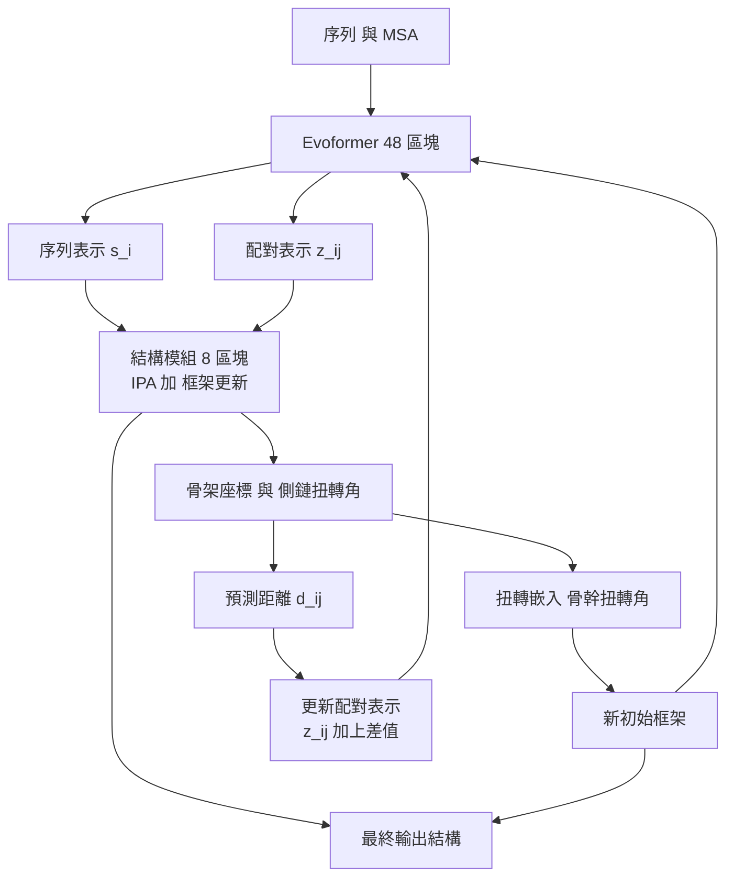

# 7.3 循環精煉（Recycling）機制：像藝術家般不斷打磨結構

## 一次成型的野心，以及它的代價

AlphaFold 2 的結構模組有 8 個區塊，每個區塊做一次框架更新。單看這個設計，它的行為模式是「一次性」的：從一個退化的初始構形出發，往前推進 8 層，吐出一個結構就結束。這個模式對照的是幾乎所有深度學習的慣例——一次前向傳播，一次輸出。

但蛋白質摺疊的物理圖景並不如此。第 2 章描述的摺疊漏斗，是一條連續下降的地形：構形的自由能沿著一條彎曲、狹窄、多局部極小值的山谷滑向天然態。自然的摺疊過程，不管它是熱力學上的、實驗上的，還是演化的，都不是「算一次就對」，而是不斷試、不斷修、不斷退一步再修正的過程。單次的 8 層前向傳播，彷彿要求網路用一次呼吸完成這整段旅程。

AlphaFold 2 的解法是把整個 Evoformer 加上結構模組的堆疊，包進一個外層迴圈裡。這個迴圈就是循環精煉。它的想法直截了當：把結構模組算完的結果丟回上游，重新跑一遍上游，如此重複數次。在推論階段，這個迴圈執行 3 次，外加最前面的一次，共 4 輪完整計算。

## 迴圈裡到底迴盪了什麼

「丟回上游」聽起來抽象，具體而言是兩件事。

第一件是把座標回寫成新的初始框架。結構模組輸出的骨幹框架，也就是 $N$ 、 $C_\alpha$ 、 $C$ 的座標，會被轉換成骨幹扭轉角 $\omega$ 、 $\phi$ 、 $\psi$ 與側鏈扭轉角；這個轉換過程稱為扭轉嵌入——把笛卡爾座標重新表達成內部座標。扭轉角再經反向的座標重建，得到一組新的骨幹座標，用來更新下一輪的初始框架。這一步很重要，因為它把兩種描述之間的可逆性，當成了一個資訊通道：網路上一次算出的三維結構，被重新編碼成下一輪輸入所偏好的那種語言，而內部座標更適合描述局部構形，因為它把鍵長與鍵角束縛自動帶了進去。

第二件是更新配對表示。迴圈中最關鍵的一步，是把結構模組這一輪預測出的距離回饋進配對表示 $z_{ij}$ 。具體做法是計算預測距離 $d_{ij}^{\text{pred}}$ 與原始輸入距離之間的差，並以這個差作為修正量更新配對通道：

$$
z_{ij} \leftarrow z_{ij} + \left( d_{ij}^{\text{pred}} - d_{ij} \right) \cdot \mathbf{1}\left[ |i - j| \leq 32 \right]
$$

這個寫法只保留了公式的骨架，實際實作中還包含一個可學習的縮放，方向與符號的約定屬於工程細節。這一步的直覺非常強烈：上一輪網路說「 $i$ 和 $j$ 應該靠近」，如果它們實際上在演化上也是共演化關係的殘基，那麼配對表示不該停在原來的抽象描述上，而該被拉向「這個距離是真的」。於是下一輪的 Evoformer 在處理 $z_{ij}$ 時，就多了一條明確的三維線索。

把這兩件事合起來看，循環精煉的完整資料流如下：

注意這張圖的拓撲：一個大迴圈包住 Evoformer 與結構模組，迴圈的回饋邊有兩條，一條走幾何，也就是座標到扭轉角再到新框架，另一條走資訊，也就是預測距離到配對表示。前者改變下一輪的起點，後者改變下一輪的判斷依據。

## 為什麼要這樣做：讓結構資訊回饋到序列推論

回到循環精煉的核心動機。Evoformer 存在的意義是從演化資訊中提煉哪些殘基彼此相關，但演化資訊有一個頑固的侷限：它只能告訴你誰跟誰有關，卻不能告訴你該長什麼形狀。單靠 MSA 的統計，一個有 300 個殘基的蛋白質，其理論上的構形空間依然大得驚人。

循環精煉引入了一個此前不存在的資訊源：網路自己產生的結構。一旦有了結構，三維幾何就提供了一種演化資訊永遠提供不了的東西，也就是直接的物理鄰接性。若模型這一輪把殘基 $i$ 放在 $j$ 旁邊 4 Å ，那麼下一輪它就能用這個資訊去重新解讀 MSA：這個共演化訊號是「直接接觸」還是「空間相鄰但不同層」？

這就是為什麼循環精煉不是單純的多算幾次。第一次的結構模組輸出是一次猜測；把它回饋進去之後，後續的迭代變成檢查與修正——網路拿自己上一輪的三維模型當作假設，去問演化資訊這個假設是否合理。這與第 6 章的共演化直覺相互呼應：一個殘基與另一個殘基的共同變異歷史，本質上就是它們在三維中接觸的歷史線索，而結構反饋讓這個線索第一次變得可操作。

## 迭代精煉：一個跨領域的母題

循環精煉不是孤立的設計。迭代精煉是深度學習中一個反覆出現的母題，在 AlphaFold 出現之前就已經存在於多個領域。

| 領域 | 迭代的對象 | 精煉的機制 |
| --- | --- | --- |
| U-Net（2015） | 像素 | 上層粗略預測下採樣，再上採樣後與跳連接細節融合 |
| GNN 訊息傳遞 | 節點特徵 | 多層鄰域聚合，層數對應資訊傳播距離 |
| AlphaZero（2017） | 策略與價值 | MCTS 自我對弈產生更好的搜尋目標，迭代改進網路 |
| AlphaFold 2 循環精煉 | 三維座標 | 座標與配對表示回饋，重跑整個堆疊 |

這四者的共同結構是：一個粗糙的初始估計，經過若干次「用估計去改變輸入、從而改變估計」的循環，逐步收斂。差異在於被迭代的對象與回饋通道。U-Net 迭代的是像素層級的多尺度細節；GNN 迭代的是圖上的鄰域聚合，嚴格說是透過深度而非循環；AlphaZero 迭代的是搜尋所產生的改進目標；AlphaFold 2 迭代的是三維幾何本身，而且回饋通道直接包含「把幾何翻譯成演化資訊」這一步。

若把 AlphaZero 與循環精煉並列，一個對照尤為有力：AlphaZero 的迴圈是離線的，它可以花數小時做數百萬次 MCTS 模擬；AlphaFold 2 的迴圈是在線的，在推論當下就必須跑完，因為蛋白質結構預測需要即時回應，而 CASP 競賽的規則更要求模型在限定時間內對數百個目標蛋白質完成預測。這使得 AF2 的循環次數被壓到 3 次，是在推論預算與精度之間做出的務實妥協。

## 與分子動力學的尖銳對比

因為 AlphaFold 是物理學的革命，讀者很自然會問：它跟分子動力學有什麼不同？兩者都在做迭代，但迭代的對象與依據截然不同，這是理解 AlphaFold 範式革命的最好角度。

分子動力學是力學積分：給定一個構形 $x$ 與速度 $v$ ，計算力場 $F(x)$ ，然後用辛積分器推進時間步：

$$
v_{n+1/2} = v_{n-1/2} + \frac{\Delta t}{m} F(x_n), \qquad x_{n+1} = x_n + \Delta t \, v_{n+1/2}
$$

這個過程有明確的物理語義：溫度、時間步長、動能守恆、以及遍歷假設。它模擬的是蛋白質在溶液中的實際動力學行為，代價是需要皮秒到奈秒尺度上數十萬到數億步的積分，而且結果強烈依賴初始構形——這正是摺疊問題的歷史困境。

AlphaFold 2 的循環精煉則完全不是積分。它沒有速度、沒有時間步長、沒有溫度、沒有辛結構。每一輪更新的是一個抽象的參數化，也就是框架，更新的方向由一個學到的網路給出，而非由物理力場給出。整個過程不是「蛋白質如何摺疊」，而是「一個被訓練來猜摺疊結果的網路，如何反覆改善自己的猜測」。這是一個本質的置換：從模擬物理變成學會物理的答案分布。

用一句話收斂這個對比：分子動力學是對物理律的數值積分，AlphaFold 是對物理答案的學習到的精煉。前者受制於時間尺度的鴻溝，後者受制於資料與網路容量——而後者顯然更容易被現代硬體碾過去。

## 三次這個數字從哪裡來

推論時的回收次數是 3 加上最前面的一次，總共 4 輪完整計算。這個數字不是憑空來的。

AlphaFold 團隊在訓練過程中觀察到，回收次數與結構精度之間呈現邊際效益遞減的關係：從 0 次到 1 次，RMSD 顯著下降；從 1 次到 2 次，改善仍在但幅度縮小；從 2 次到 3 次，改善已相當細微；而從 3 次往上推，收益幾乎完全被推論成本吃掉。這種形狀是迭代精煉的典型曲線，早期迭代解決「大致錯誤」問題，晚期迭代只做細節修飾。

因此 3 這個數字本質上是一個工程最優點：它是精度提升的斜率與計算成本的斜率相交的位置。團隊也據此提供不同的工作點設定，讓使用者可以按需求取捨；在需要極致精度的批量研究場景可以加大回收次數，在線服務或大規模資料處理則可以降低到 1 次。而前面提到的隨機回收次數訓練，正是讓這些工作點都能開箱即用的前提。

值得與第 10 章的擴散模型對照：AlphaFold 3 放棄了架構內部的回收迴圈，改用擴散模型的取樣步數來扮演相同的角色。同樣是迭代次數與精度的取捨，一個把迭代放在架構裡，也就是循環精煉，另一個放在生成過程裡，也就是去噪步數。這個對照說明了一件事：迭代精煉是 AlphaFold 系列跨範式繼承的骨幹，即使整個生成機制換掉了，這個母題依然保留。

## 訓練策略：隨機回收次數與梯度截斷

循環精煉在訓練時面臨兩個實務問題，AlphaFold 團隊的處理方式非常值得學習。

問題一是推論時要跑 3 次，訓練時是否也要跑 3 次。若每次訓練批次都跑滿 3 輪，訓練成本立刻變成 4 倍。AlphaFold 2 的做法是採用隨機回收次數的訓練：在每個訓練樣本上，隨機從 0 到 3 之間抽取回收次數。這樣一來，網路學到的不是「在 3 次回收後最準」，而是「在任何回收次數下都能給出自洽的結果」。第 0 次回收時的輸出就是可用的預測，第 3 次回收時的輸出更好。這種做法同時達到兩件事：訓練成本可控，以及推論時可自由選擇精度與速度的取捨點。團隊把這個設定稱為 no-recycle 訓練分支，並發現它訓練出來的模型在完整回收下的表現並不遜色，反而更穩健。

問題二是梯度要不要穿過循環。理論上，讓梯度流過整個 3 輪迴圈，等於在解一個更長的計算圖，會給出端到端更佳的訊號。實務上這會帶來記憶體爆炸與梯度發散的風險——多層巢狀的可微座標更新容易在訓練初期發散。AlphaFold 2 的做法是在迴圈的傳遞上截斷梯度：除了最後一輪之外，各輪回收所產生的輸入（配對表示、座標）在傳給下一輪前一律停止梯度，只有最後一輪保有完整梯度。這是一個明確的取捨：放棄了跨輪的端到端梯度，換取了穩定與記憶體。

| 策略 | 做法 | 效果與代價 |
| --- | --- | --- |
| 隨機回收次數 | 每批次隨機取 0 到 3 次 | 訓練成本可控，推論可彈性取捨 |
| 滿回收 | 每批次固定 3 次 | 單批次最準，成本四倍，不穩 |
| 梯度截斷 | 中間輪次停止梯度 | 記憶體與穩定性佳，失去端到端訊號 |
| 梯度穿透 | 全迴圈回傳 | 訊號最完整，易發散且耗記憶體 |

## 與自我蒸餾的親緣關係

循環精煉還有一個值得玩味的哲學面向：它把網路自己的輸出當成下一輪的輸入。這個模式在深度學習裡有另一個名字，也就是自我蒸餾。傳統蒸餾是大模型教小模型，把小模型的訓練目標設定為模仿大模型的輸出分佈；自我蒸餾則是用自己的舊版本或自己的當前預測當作目標，讓模型把自己的判斷內化為穩定的先驗。

AlphaFold 團隊在後續工作，特别是關於蒸餾 MSA 與結構的工作中，確實使用了這一思想：讓模型學會產生像是訓練出來的演化訊號，而不需要真的跑 MSA 搜尋。但把它放回循環精煉的脈絡裡，兩者的共性是鮮明的：兩者都相信模型對自身領域的判斷是有價值的資訊，值得被回收再利用。蒸餾把它回收成訓練目標，循環精煉把它回收成網路輸入。前者改變「我們要什麼」，後者改變「網路下一輪看見什麼」。

這也解釋了為什麼循環精煉會如此有效。傳統的一次性結構預測，網路的所有資訊都必須從 MSA 一路單向流到座標；循環精煉則建立了一個內部回饋迴路，讓網路擁有了某種形式的自我提問能力：先給出一個假設，再從多個角度（演化一致性、三維合理性）去檢驗它，修正後再檢查。這與人類專家的工作方式驚人地相似——先畫草圖，再檢視骨架是否合理，再修正，而不是一筆畫到底。

## 代價與邊界

誠實的評估需要指出循環精煉的侷限。

首先是推論成本。3 次回收意味著 Evoformer 與結構模組各跑 3 遍，總計算量約為單次的三到四倍。對於 CASP 這類需要批次處理數百個目標的場景，這是一筆實質的帳；對於需要在線服務的生技應用，也是一個真實的延遲成本。

其次是收斂性沒有保證。循環精煉是一個啟發式的迭代過程，沒有任何數學保證它會收斂到全域最佳；網路可能在某一輪把結構推向一個錯誤的吸引子，之後的迭代反而在不斷強化這個錯誤。訓練時的隨機回收次數，在某種程度上就是為了讓模型學會在每一輪都保持可被修正的狀態。

第三是它依然是貪婪的局部修正。循環精煉修正的是當前的構形，但它不會跳出當前的吸引子去找另一個摺疊態。真正的摺疊有時需要在兩個穩態之間跳躍，而這需要時間尺度上的自由能計算——第 13 章會回到這個問題。

還有一個容易被忽視的工程事實：回收迴圈的每一輪都要重跑整個 48 區塊的 Evoformer，而不只是一個結構模組。這是因為回饋的兩條路徑有一條是走向上游的——配對表示的更新必須讓演化推理重新消化一次，結構資訊才會真正改變「誰跟誰有關」的判斷。若只重跑結構模組，回收就退化成了單純的重複加強，失去它最關鍵的意義。

## 小結

循環精煉是 AlphaFold 2 在架構上最後一塊拼圖，它讓整個系統從一次性的猜測變成持續的自我修正。它的三個要點是：把結構模組的座標與預測距離回饋進上游，透過扭轉嵌入更新初始框架、透過距離差更新配對表示；在訓練中以隨機回收次數控制成本、以梯度截斷換取穩定；在概念上，它與分子動力學的力學積分截然不同，後者積分物理律，前者精煉學到的答案。

第 8 章將轉向一個更實際的問題：當我們拿到 AlphaFold 給出的結構，我們怎麼知道該相信它多少？那正是 pLDDT 與 PAE 這兩把尺子存在的理由。
