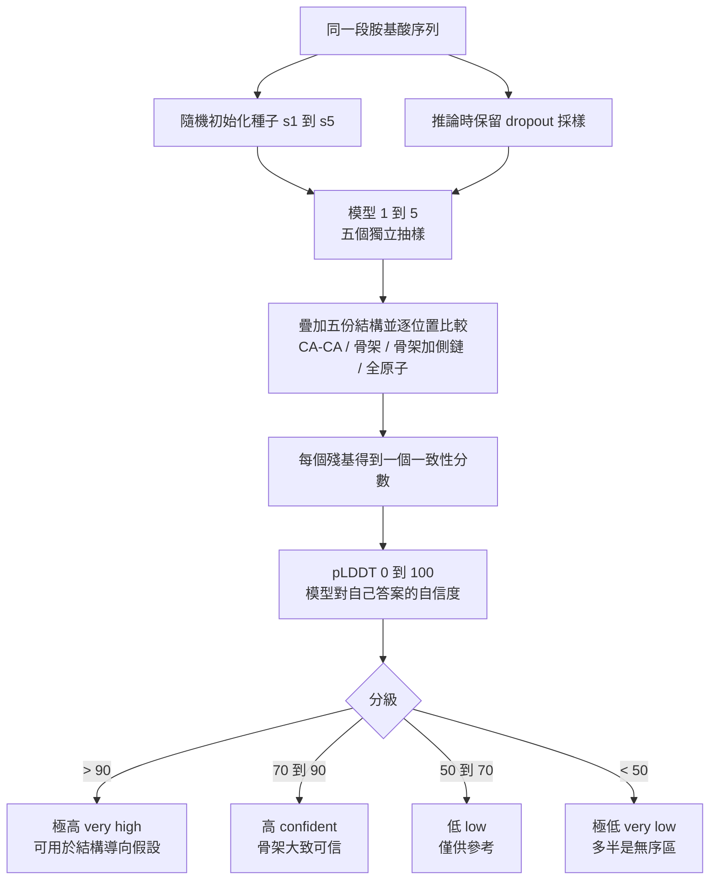

# 8.1 讀懂預測結果的「不確定性」

## 一、單一 RMSD 的暴政

在 AlphaFold 2 出現之前，蛋白質結構預測的評分幾乎只有一個語彙：RMSD（root-mean-square deviation，平方根均方差）。它的做法極其直觀——把預測結構與實驗結構的所有原子對齊，算出每個原子座標差值的平方平均再開根號，單位是埃（Å）。RMSD 之所以長久以來是唯一的度量，是因為它只有一個數字，容易計算，容易比較，也容易被經驗法則綁定：「小於 2 Å 可用」、「大於 5 Å 就不要看了」。

然而 RMSD 的單一數值本質，是一種資訊壓縮的暴政。它把數千個原子的逐點差異壓成一個純量，於是兩種截然不同的失敗被歸為同一個分數：一種是整體構形輕微偏移、內部摺疊大致正確；另一種是兩個結構域之間的相對朝向根本搞錯了，其中一個結構域甚至只是被硬塞進一團密度裡。以 RMSD 為唯一判準的年代，人們無法分辨「模型有點歪」與「模型徹底想錯」，這正是直覺式判讀在人工智慧時代之前緩慢得令人沮喪的原因之一。

更麻煩的是，RMSD 對「哪些原子值得計分」並不敏感。一個側鏈擺錯方向、把柔性環區揉成一團、或把一段天然無序區硬建成一根直棍，這些都會以相同的權重灌進平均值裡。於是研究者在拿到 RMSD 為 3.2 Å 這樣的數字時，實際上什麼也沒被告知。AlphaFold 2 的真正貢獻之一，就是把「這個模型到底有多可信」從一個必須靠事後人工檢視的問題，變成一個模型自己會回答的問題。

## 二、不確定性從哪裡來：隨機初始化與 dropout

要讓一個深度網路對自己的答案表示懷疑，前提是它在數學上「可以」有不同答案。AlphaFold 2 的結構模組並非只有一個確定性映射那樣的東西，它是一個受過大量隨機性洗禮的訓練產物，因此天生具備產生分歧的能力。

第一個來源是隨機初始化。AlphaFold 2 的權重在訓練開始前由偽亂數產生器撒下，任何一次訓練的落點都不同，而深度網路的損失面極其崎嶇，不同起點會落在不同的、且往往是局部性的解上。這意味著「用同一段序列重新訓練一次」得到的模型，骨架可能略有不同，而這種差異正是資訊，不是雜訊。第二個來源是 dropout：它在訓練時隨機遮蔽部分神經元，強迫網路不能過度依賴任何單一路徑；在推論階段若保留遮蔽並重複採樣同一個模型，就相當於向網路索取「同一問題的多個可能答案」。

DeepMind 正是把這兩件事結合起來，構成本書第 5 章提到的五模型 ensemble。官方釋出的 model_1 到 model_5 由不同的隨機種子與不同的 dropout 設定所產生，它們是五次彼此獨立的抽樣，而第 7 章所述的循環精煉機制，則保證了每一次抽樣本身也是經過反覆打磨的收斂結果。於是同一段序列會得到五個略有差異的結構，它們的重疊程度就是「這段序列的形狀有多確定」的直接量測：若五個模型彼此重疊得幾乎一模一樣，說明該區域的摺疊是被強烈驅動的；若五個模型在同一段走出完全不同的形狀，那本身就是答案。

這裡的因果鏈值得再說清楚一次：資料不足導致欠約束，欠約束使得優化過程的終點不唯一，不同起點因而收斂到不同的解，ensemble 分歧大，最後反映為 pLDDT 低。反過來，凡是能被多樣化的演化資訊緊密框定的區域，例如保守的疏水核心螺旋，或有大量序列提供共演化訊號的接觸介面，五個模型會重疊得非常好，pLDDT 也就逼近 100。這解釋了一個常見的觀察：不確定性在蛋白質內部不是均勻分布的，它有結構，緊密的球狀核心區往往高分，柔性環區、鉸鏈區與尾端延伸則低分。

還有一個容易被忽略的工程細節：這五個模型並不是對同一套網路權重重複執行 dropout，而是五套獨立訓練的權重加上推論時不同的 dropout 設定。這個設計讓分歧來源涵蓋了初始位置與推論時的隨機遮蔽兩個層次，因而比單純重複採樣更接近「不同假設下的模型分歧」。AlphaFold 團隊在描述這套機制時也承認，把它稱為機率分布的估計是一種簡化，它其實是一個更粗糙但實用得多的變異樣本。

## 三、pLDDT 的定義：把局部距離誤差變成分數

這個「模型對自己答案的自信度」就是 pLDDT（predicted Local Distance Difference Test，預測局部距離差異檢定）。它的血統要追溯到 2013 年 Mariani 等人在 *Bioinformatics* 提出的 lDDT 指標，那是為了彌補 RMSD 的諸多缺陷而設計的：不依賴整體疊合、不受單一離群原子支配，並且可以逐殘基計算。

lDDT 的核心想法非常直觀：蛋白質的三維形狀本質上是「一堆距離」的集合。如果兩個殘基在真實結構中相距 10 Å，那麼一個正確的模型也應該讓它們相距約 10 Å；而如果真實距離是 3 Å，模型卻說它們相距 15 Å，那麼在 10 Å 這個容差門檻下就已經算錯。lDDT 於是逐對殘基計算模型距離與真實距離的差，並在四個容差門檻下判定對錯，容差門檻取 $`d \in \{0.5, 1, 2, 10\}`$ Å 。門檻越寬越容易得分，四個門檻的分數取平均後乘以 100，即為該殘基區段的 lDDT。

AlphaFold 2 把這個「真實結構對參考模型」的指標反轉過來：當沒有真實結構時，用模型自己的五個 ensemble 成員之間的距離差異取代真實距離。於是「模型之間對這個距離的說法有多一致」就變成了「模型對這個結構有多自信」。教科書常用的連續化寫法如下，其中 $`\Delta_{i,d}`$ 是在門檻 $`d`$ 下第 $`i`$ 個位置的距離偏差：

$$
pLDDT_i = \max\left(0,\ \min\left(100,\ \frac{1}{|D|}\sum_{d \in D}\max\left(0,\ 1 - \frac{\Delta_{i,d}}{d}\right)\times 100 \right)\right),\qquad D = \{0.5,\ 1,\ 2,\ 10\}
$$

嚴格而言，官方實作的 lDDT 使用的是階躍式判定，在門檻內記 1 分、超出記 0 分，而非上面這個線性映射；兩者在行為上高度接近，線性版本只為便於教學而保留。重要的是那四個門檻本身的分工：0.5 Å 與 1 Å 考驗的是局部骨架是否精確到位，2 Å 略為放寬，10 Å 則近似於二級結構層級的整體排列是否正確。四者平均的效果是，小範圍的結構偏差會被嚴厲懲罰，而整體摺疊拓撲正確的模型仍能拿到高分。

至於以 CA-CA、骨架、骨架加側鏈四種粒度計算這件事，指的是 lDDT 家族可以選擇不同的原子子集來定義「距離」。只用 $`\alpha`$ 碳是最穩健的選擇，因為 CA 的位置幾乎完全由主鏈決定；加入骨架氮與羰基碳可以檢驗更細部的幾何；加入側鏈原子則會暴露旋轉子是否預測正確；而骨架加側鏈的全原子版本最嚴格。必須特別提醒的是，AlphaFold 資料庫所發佈的 pLDDT 是以 CA 原子為基礎計算的，這代表一個 pLDDT 為 95 的區段，其側鏈仍可能擺放錯誤，這是下一節會回頭處理的一個實務陷阱。

## 四、四個級距與色彩語言

AlphaFold 2 把 0 到 100 的 pLDDT 切成四級，並在 AlphaFold 資料庫與 PyMOL、Jmol 等檢視器中以固定色彩呈現，讓使用者在拖曳結構的瞬間就能「看見」信心地圖：

| pLDDT 分數 | 級距 | 英文標示 | 色彩 | 實務意義 |
|---|---|---|---|---|
| > 90 | 極高 | very high | 深藍 | 骨架與整體摺疊高度可信，可作為結構假設的基礎 |
| 70 – 90 | 高 | confident | 淺藍 | 骨架大致可信，局部細節仍需檢查 |
| 50 – 70 | 低 | low | 黃 | 僅供參考，個別區段可能摺疊錯誤 |
| < 50 | 極低 | very low | 橙 | 極可能是無序區（disorder），不宜當作構形 |

這張分級表在實務上極為好用，但必須記住它的真正含義：它是一個關於「模型共識程度」的描述，不是一個關於「結構正確率」的保證。表中的顏色是模型對自己的評分，而不是量測誤差的天花板預測。實務上處理一個蛋白質時，正確的態度是同時看三件事：這一段的分數高低、這一段在生物學上是否合理、以及同一序列的其他模型是否支持這個構形。

## 五、自評而非實驗誤差

pLDDT 是一個自我評估。它衡量的是模型內部的不一致性程度，而不是模型與自然界的偏離量。這兩者之間有相關性，但相關不等於同一。

造成差異的機制至少有四個。第一，ensemble 分歧只覆蓋模型的不確定性來源，它捕捉的是初始種子與 dropout 造成的變異，卻完全看不到「五個模型都一致地犯同一個錯」的情形；當演化資訊稀薄或序列中存在系統性的誤導對齊時，ensemble 會以極高的信心給出錯誤答案。第二，資料分布的偏差：模型在 PDB 上受訓，而 PDB 收錄的結構天然偏向小、易結晶、實驗解析品質好的蛋白質，因此對冷門摺疊型態的信心分數會系統性偏高。第三，pLDDT 的量測單位是 CA 層級，CA 之間的距離約束只覆蓋主鏈拓撲，對側鏈旋轉子的正確性幾乎沒有發言權。第四，它不是機率，80 分並不代表有八成的機率正確。

因此更精確的說法是：pLDDT 是「在給定序列與給定模型架構下，這個區域的局部拓撲在 ensemble 內部達到共識的可信度指標」。它是經過大量實驗結構校準過的經驗量，但在使用時仍應被當作排序與篩選的工具，而非絕對刻度。

## 六、與真實誤差的關聯性

儘管有上述限制，pLDDT 與實際結構誤差的關聯性在實證上是穩健而強大的。這正是它能夠成為 AlphaFold 資料庫中每一個模型都必備欄位的原因。

關聯性的來源不難理解：模型之所以對某個區段的 ensemble 分歧大，是因為該區段的摺疊缺乏足夠的演化資訊或物理約束，網路沒有足夠的理由把結構模組的旋轉子往任何特定方向拉。當資料不足時，訓練過程會把這種「無主」狀態反映成不同隨機初始化之間的差異，而差異大正是欠約束的訊號。

實務上的經驗規則相當一致：pLDDT 高於 90 的區段，其 CA 的實際 RMSD 通常落在 1 Å 左右；pLDDT 落在 70 到 90 的區段，實際 RMSD 約在 1.5 到 2.5 Å 之間；pLDDT 落在 50 到 70 的區段則常落在 3 到 5 Å，模型的骨架走向可能整個是錯的；而 pLDDT 低於 50 的區段往往根本不存在穩定的摺疊構形，也就無從對齊。值得留意的是，pLDDT 高不代表絕對座標精確到小數點後兩位，當對齊的參考框架不同、或同一區段在演化上呈現多態時，兩個高 pLDDT 的模型之間仍可能存在數埃的偏移，這正是下一節的 PAE 要處理的核心問題。

## 七、一張可以在十分鐘內完成的判讀清單

在實際的結構解讀工作流程裡，pLDDT 最有效的用法不是當作判決，而是當作巡檢順序的排程器。一份可操作的清單大致如下，而這份清單也正是本章與下一節合併後的完整流程。

先看整體色帶，深藍為主、橙黃零星的結構通常可以放心採用；反之，若整體偏黃，問題多半出在序列或比對資訊本身，而不是局部瑕疵。接著標出所有低分區段，逐段檢查其生物學性質：若低分區段是已知的柔性環區、鉸鏈或無序區，低分是預期的；若低分區段是預期高度保守的功能核心，例如酵素的催化三聯體，那麼低分就是一個明確的警示訊號，代表這裡的預測不可用。最後一步是標記所有高 pLDDT 但位於鏈端、或緊接在大段低分區之後的區段，這些位置的座標可靠性特別值得懷疑，因為它們往往是從一個不確定的支撐點向外延伸的部分。

這份清單的價值在於，它把「信心的來源」還原成了生物學的因果鏈，而不是把一個數字當成護身符。

## 八、校準問題與侷限

「校準」在這裡的意義是：pLDDT 的數值是否真的對應它所宣稱的信心。對整體 CASP14 測試集而言，AlphaFold 2 的高信心區段與實驗結構高度吻合，顯示這個尺度大致是校準良好的；但在幾個特定情境下它會失準。

序列太短或 MSA 太薄是主要的失準來源。當深度可用的比對序列只有十幾條、且彼此相對保守時，演化資訊不足以分辨序列中的不同區段，模型可能把一段環區畫成直的螺旋、把一段真正是螺旋的序列拉平，而 ensemble 依然一致地犯這個錯，因為它學到的是序列相似性到結構相似性的統計平均，而不是這一條序列的物理。缺少模板也是同樣的問題：AlphaFold 2 雖已大幅降低對同源建模模板的依賴，但對於古蛋白、設計序列以及序列分化的早期分支，比對資訊仍可能不足以支撐高置信度的結構。

多構象蛋白質則觸及了 pLDDT 的定義邊界。pLDDT 是對「唯一答案」的自信度，而多構象蛋白質的本質就是沒有唯一答案，此時高 pLDDT 可能意味著模型選中了其中一種構形而非它錯了，這個資訊不足以區分，必須靠實驗。

最後是尺度不對稱的提醒：pLDDT 是逐殘基的局部指標，它對兩個結構域之間的相對位置幾乎一無所知。一個蛋白質的所有區段都可能是 95 分，卻在域間相對朝向上有十埃以上的偏差。這種「局部極準、全域極錯」的組合，是 AlphaFold 2 最典型的使用陷阱，也是下一節的主題。

---

在 AlphaFold 的輸出裡，「看起來很像真的」與「真的正確」之間，需要一座橋樑。pLDDT 提供了橋樑的一半，它告訴我們每一段局部骨架的可信度；而橋樑的另一半，必須處理全域相對位置，那正是 PAE 的任務。
