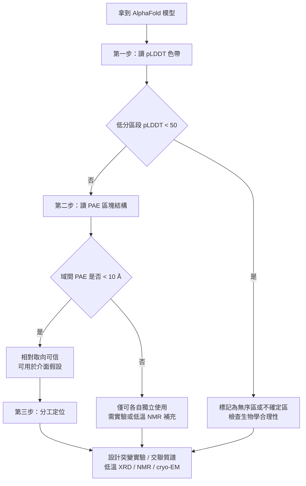

# 8.2 pLDDT 與預測區對齊誤差（PAE）的解讀技巧

## 一、pLDDT 看不見的那一半

前一節确立了 pLDDT 的意義：它衡量的是模型 ensemble 對「局部骨架形狀」的共識程度。但一個蛋白質的三維結構有兩種截然不同的資訊藏在裡面。第一種是局部的，這一段是 α 螺旋、那一段是 β 摺板、這兩段之間隔著一段柔性鉸鏈。第二種是全域相對的，左手邊的催化結構域與右手邊的配體結合域，它們彼此之間的朝向、傾角，以及面對面還是背對背。

pLDDT 對第一種資訊非常在行，對第二種則幾乎完全失語。原理很簡單：ensemble 的分歧來自局部的旋轉子有多不確定，而域與域之間的相對朝向，恰恰是那些彼此緊密堆疊的原子接觸所共同固定的。當兩個結構域各自都被摺疊得很好、卻彼此之間缺少足夠的共演化訊號時，五個模型會一致地把 A 域疊好、把 B 域也疊好，但把 A 域放在 B 域的左邊、右邊、或者上面，模型一樣會得到不錯的局部分數。

結果就是一個非常典型的失敗型態：整個結構的 pLDDT 幾乎全在 90 以上，肉眼看上去也「很像一個合理的蛋白質」，但兩個結構域之間的角度可能整個搞錯了十幾度甚至更多。這種錯誤不會被 pLDDT 抓到，也幾乎不會被肉眼抓到，因為沒有實驗結構可以對照。PAE（Predicted Aligned Error，預測對齊誤差）就是為了補上這個缺口而設計的。

## 二、PAE 的定義：方向性的相對誤差

PAE 是一個 $N \times N$ 的矩陣，索引是兩個殘基 $i$ 與 $j$ ，它的官方定義是：當模型被對齊在殘基 $j$ 的局部鄰域上時，殘基 $j$ 的位置期望誤差，以 Å 為單位。這句話需要拆開來讀，因為三個關鍵字都承載了意義。

「對齊在殘基 $j$ $j$ 附近的 $j$ 在 15 Å 以內的參考原子，而

「殘基 $j$ 的位置誤差」而不是「整體結構的誤差」，說明 PAE 是逐殘基而且有方向的。 $PAE_{ij}$ 與 $PAE_{ji}$ 一般不相等，因為它們代表的是兩種不同的條件假設。整體而言，PAE 的數值範圍被正規化到 0 到 30 Å 之間，這並非真實距離的上限，而是「超過 30 Å 的誤差在結構生物學上已無實用意義」這個判斷的實作結果。

把上述定義寫成一個概念性的算式，可以這樣表述：

$$
PAE_{ij} = \mathbb{E}\left[\min_{k}\ \max_{l}\ \left( x_{ik} - x_{jl} \right)^2\right]
$$

這個式子是官方定義的一個緊湊化表達：外層的期望 $\mathbb{E}$ 取自 ensemble 的五個模型，中層的 $\min_{k}$ 對應「在 $j$ 的鄰域上尋找最佳疊合」，內層的 $\max_{l}$ 對應「在最佳疊合下，鏈上各殘基的最大位移」，而平方差則是距離誤差的度量。重要的是這三個算子的方向：期望讓不確定性被平均化，最小化讓模型被給予最有利但合理的疊合，最大化則保證誤差是由鏈上最糟糕的那一段所決定，一個結構只要有一段錯得離譜，PAE 就會反映出來。

## 三、數據在哪裡、怎麼讀

在工具層面，AlphaFold 資料庫的每個條目都會提供幾個固定名稱的檔案，而它們與本章的兩個指標一一對應。`predicted_aligned_error.json` 存放的就是逐殘基的 $N \times N$ PAE 矩陣；`confidence_vj.json` 則存放逐殘基的 pLDDT 陣列。而當模型以 PDB 格式下載時，pLDDT 會被塞進 B-factor 欄位，這一點非常實用，因為絕大多數分子視覺化軟體都會直接用 B-factor 決定原子著色，於是 AlphaFold 模型「打開就是彩虹色」的樣子，其實就是 pLDDT 的視覺化。

PAE 熱圖則需要專用工具。常見的做法是把 `predicted_aligned_error.json` 載入 PyMOL 的 PAE 插件、ChimeraX 的 AlphaFold 面板，或是使用 AlphaFold 資料庫網頁端的內建檢視器。使用時有兩個小技巧：第一是把矩陣依功能域手工劃分，再分別檢視跨域的區塊，比整張熱圖更容易看出結構；第二是把 PAE 圖與 pLDDT 色帶並排放置，因為「pLDDT 高但 PAE 亮」的區段正是最需要被標紅的區塊。

## 四、PAE 矩陣的視覺語言

PAE 最常見的呈現形式是一張熱圖：橫軸與縱軸都是序列順序，單位為殘基編號，顏色由深藍（誤差小）漸變到淺藍、白色、橙紅（誤差大）。官方發佈的原始檔是逐殘基的 $N \times N$ 矩陣，但檢視器通常會把它分箱成較粗的區塊來繪製，常見的解析度是每格 8 個殘基，因此一個 64 個殘基的鏈會呈現為 $8 \times 8$ 的區塊圖。原始檔與區塊圖必須分開理解，後者是有損的摘要，前者才是完整資訊。

判讀時有四個必須記住的視覺規則。

* $PAE_{ii}$ 是在「把 $j=i$ 對齊在它自己的鄰域上」的條件下問 $i$ 的誤差，答案按定義接近零。所以對角線的深色只是定義的產物，不能解讀為「這一段特別準」。真正要看的是對角線之外的區域。

**第二，區塊結構就是結構域的輪廓。** 一段連續的深藍方塊，代表那個範圍內的殘基彼此相對位置可信，它通常對應一個獨立的結構域。而兩個方塊之間的橙紅色帶，代表兩域之間的相對朝向不可信。整張圖若呈現「多個方塊加上橙紅間隔」的樣貌，就意味著 AlphaFold 給出的是幾個可靠的結構域，但域與域的組裝方式基本是猜的。

**第三，「深藍方塊加上淺色背景」與「整片深藍」是兩種不同的科學命題。** 前者說「我知道這是三個獨立摺疊的結構域，但不知道它們怎麼擺」；後者說「整個分子是一個單一連續的摺疊單元」。後者的情形遠少於想像。

**第四，PAE 與 pLDDT 必須一起看。** 若某區段 pLDDT 極低，PAE 對角線上的那一帶也必然是亮的，因為模型連自己的局部形狀都沒有共識。真正會讓人吃驚的，是那些 pLDDT 高達 90 但 PAE 對角線外一片橙紅的區段，它們是「局部極準、相對極錯」的典型代表。

## 五、四種典型情境與它們的正確結論

為了讓抽象的熱圖變成可操作的判斷，可以把最常見的組合整理成下表。表中的 PAE 判讀指的是在對角線之外的區域觀察到的顏色。

| 情境 | pLDDT 特徵 | PAE 特徵 | 正確結論 |
|---|---|---|---|
| 單一結構域的球狀蛋白 | 全域 85 到 95 | 幾乎整片深藍 | 模型幾乎可直接用於結構假設與介面設計 |
| 鬆散的多域蛋白，域間由柔性連接 | 域內 90 以上，連接區 40 到 70 | 域內深藍，域間大片橙紅 | 只能把各域當成獨立單位使用，域間組裝方式不可信 |
| 鏈間複合體（heterodimer） | 單鏈部分照舊 | 鏈內深藍，鏈間橙紅 | 介面朝向可能是隨機猜測的，不可直接拿去做介面突變設計 |
| 含有一段已知無序區（IDR）的蛋白 | IDR 段低於 50 | IDR 對應列一片亮色 | 這是預期的正確行為，詳見下一節 |

多域蛋白質是最需要小心的一類。許多訊號傳遞蛋白，例如激酶與轉錄因子，由多個結構域以短連接肽串接而成，它們在細胞內本來就會相對運動。在這樣的系統中，AlphaFold 輸出的多域模型往往呈現「三個漂亮方塊加上幾條亮帶」的樣貌。研究者若直接把這個模型當作「藥物結合時的構形」來做虛擬篩選或介面設計，等於是把一個不存在於任何特定時刻的構形當成了唯一答案。

膜蛋白是第二個高風險情境。跨膜 α 螺旋因為受到脂雙層的幾何限制，彼此之間的相對位置往往比可溶性蛋白質更受約束，理論上 PAE 應該更好；但同時，AlphaFold 的訓練資料中膜蛋白的比例偏低，而膜蛋白的實驗結構有系統性的偏好。實務上的建議是：跨膜螺旋本身的 pLDDT 通常可信，而整體跨膜排列則必須逐一檢查 PAE，並用生物學常識（例如螺旋傾角、S 形彎曲、正電荷偏好）交叉驗證。

鏈間介面是第三個情境，也是 AlphaFold-Multimer 存在的理由。單鏈 AlphaFold 2 只會告訴你「這條鏈自己長什麼樣」，它完全不會考慮你的對接對象；把兩條 AlphaFold 模型直接用剛體 docking 拼在一起是一個經典的錯誤做法，原因有二。其一，AlphaFold 預測的是結合態的構形，對許多蛋白質而言如此，而不是游離態，直接 docking 等於把兩個已經鎖定的構形硬湊，必然產生嚴重衝突。其二，即便介面朝向猜對了，柔性區域在複合體形成時會重排，單體模型的柔性區並不可信。AlphaFold-Multimer 與後來的 AlphaFold 3 提供了真正的複合體預測，而評估它們的介面品質，靠的正是鏈間的 PAE 與 ipTM（interface predicted TM-score），而不是單鏈的 pLDDT。

ipTM 是針對「把模型疊合到介面區域」這個特定框架所計算的預測 TM-score，取值 0 到 1。實務上社群常用的粗略判準是：ipTM 高於 0.8 通常意味著介面模型值得進一步嘗試，低於 0.6 則多半不可用，介於兩者之間屬於灰色地帶。這個門檻來自經驗觀察，不是統計定理，因此使用時必須搭配鏈間 PAE 圖一起判讀。ipTM 高說明介面內部的形狀有信心，但若鏈間 PAE 依然是亮色，就表示模型只是把兩條鏈各自擺好，並沒有真正確定它們如何嵌合，這兩件事必須同時成立，複合體的介面假設才成立。

## 六、PAE 不是什麼：四個必須避免的誤用

**誤用一：把 pLDDT 當成「實驗品質」的保證。** pLDDT 是模型的自評而非實測誤差，而且它以 CA 原子為基礎計算，對側鏈幾乎沒有發言權。一個 pLDDT 為 95 的殘基，其側鏈旋轉子仍然可能是錯的；用這樣的模型做精密的配體作用力分析，尤其是氫鍵與鹽橋的幾何細節，會系統性地產生假訊號。

**誤用二：忽略 PAE 就進行 docking 或分子動力學。** 對一個域間 PAE 高達 20 Å 的多域模型啟動分子動力學模擬，等於把隨機取向當成初始條件；模擬的前幾奈秒會看到分子自行調整到另一個構形，而這個構形與 AlphaFold 的輸出一點關係都沒有。這類研究近年來屢見不鮮，是 AI 結構預測被誤用的典型案例。

**誤用三：把 PAE 矩陣當成座標誤差的協方差矩陣。** PAE 的每一格是獨立的「條件期望誤差」，不是統計學上的 covariance；把它直接塞進需要協方差矩陣的演算法，例如某些自由能計算或高斯誤差模型，會得到無意義的結果。

* $PAE_{ii} \approx 0$ 是定義的必然結果。類似的地，不要把整張 PAE 圖的平均值當成模型品質指標，那會把「模型對自己很自信但自信錯了」的情形也評為高分。

## 七、建議的工作流程

綜合前面各節，一個可以交付給研究生或研究工程師的標準流程大致是這樣的。

**第一步，看 pLDDT。** 這是一個排除題，用來決定哪些區段可以進入後續分析。低於 50 的區段一律標記；低於 70 的區段需要逐段辯護其生物學合理性。

**第二步，看 PAE。** 這是一個結構假設的審查：若研究的問題涉及多個區段之間的關係，例如介面、催化或變構調控，而對應的 PAE 為橙紅，那麼這個問題在當前證據下無法用結構回答，必須承認這一點，而不是硬做。

**第三步，做實驗驗證。** 這一步不可省略，而且是唯一能真正校準模型的步驟。最低成本的驗證包括：設計突變以檢驗模型預測的關鍵殘基接觸，例如把預測介面上的兩個殘基做雙突變，若結合親和力大幅下降，則模型的方向性預測獲得支持；用交聯質譜或 HDX-MS 檢驗模型預測的接觸；以及用低溫 XRD、NMR 或 cryo-EM 取得實驗結構作為最終裁決。

這三步的順序不能顛倒。先看 pLDDT 再看 PAE 再做實驗，是因為前兩步成本近乎為零，打開一個 JSON 檔而已，而第三步成本高昂；把低成本資訊用盡，再決定要不要花昂貴的實驗資源，這本身就是一種經濟學。

## 八、與 CASP 評估指標的關係

把 pLDDT 與 PAE 放回評估科學的脈絡中，會發現它們正好是 CASP 三個傳統指標的預測版與補充版。

**GDT_TS（Global Distance Test - Total Score）** 源自 1999 年 GDT 的競賽。它把結構對齊後，落在 1 Å、2 Å、4 Å、8 Å 容差內的殘基比例取平均，得到 0 到 100 的分數。它的優點是對離群原子不敏感，缺點是對蛋白質大小不具尺度不變性，小蛋白質天然容易拿高分。**TM-score** 由 Zhang 與 Skolnick 在 2004 年提出，透過指數加權讓比對尺度歸一化，因此可以用同一個門檻（例如 0.5）比較長短不同的蛋白質；AlphaFold 用它的預測版本 pTM 來對多個候選模型排序。**lDDT** 則是 Mariani 等人 2013 年提出的無需疊合的局部指標，正是上一節所述 pLDDT 的真實對應物；CASP13 起將它列為官方評估指標。

AlphaFold 2 在 CASP14 測試集上的平均 lDDT 約為 92，平均 GDT_TS 也超過 90，這在 CASP 歷史上是沒有先例的數字。但這裡有個值得玩味的不對稱：CASP 的官方評估指標裡沒有 PAE 的對應物，因為 CASP 總是拿預測結構去比對唯一的實驗結構，而 PAE 回答的是「兩個區域彼此之間的相對位置有多確定」這個先驗問題。隨著 AlphaFold 從競賽模型轉為通用工具，PAE 這類「預測信心與實測誤差之關聯」的度量，才逐漸成為新的研究對象。

在這張地圖上，pLDDT 對應 lDDT、pTM 對應 TM-score，而 PAE 是一個沒有歷史對應、卻在 AlphaFold 時代不可或缺的新成員。它們共同構成了一個完整的信心三件套：pLDDT 管局部、PAE 管相對、pTM 管整體排名。三者互補，任何單獨使用都會遺漏一整類錯誤。

---

當我們把這套判讀框架用到那些「模型明顯不確定」的地方，會發現一件事：有些蛋白質的部分區段，本來就不存在唯一的摺疊構形。這不是模型失敗，而是問題本身被問錯了方式。
