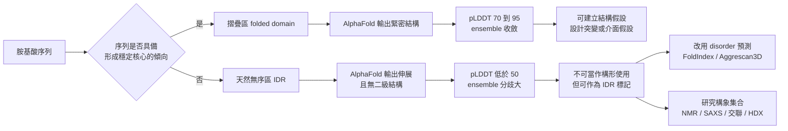

# 8.3 天然無序區域（IDRs）的科學意義

## 一、被結構資料庫遺忘的那一半

在 AlphaFold 資料庫釋出之前，人類已知結構的蛋白質總數約二十萬個，而人類基因體編碼的蛋白質估計超過兩萬種，再加上剪接變體與未知同源物，實際的蛋白質種類數量遠高於此。這個數量差距本身就透露了一件事：PDB 收錄的蛋白質是有偏樣本。它偏向那些能夠結晶、能夠在核磁共振下給出銳利訊號、能在生技產業裡被大量研究過的分子。

被這個偏差排除在外的，正是蛋白質王國中相當龐大的一類成員：那些在生理條件下本來就不具備穩定三級結構的區域。這類區域今天通稱為 IDR（intrinsically disordered region，天然無序區域），當整條蛋白質皆如此時則稱為 IDP（intrinsically disordered protein，天然無序蛋白質）。名字裡的 intrinsically 是關鍵字：它不是因為變性、因為錯誤摺疊、因為實驗條件不佳才變得無序，而是序列本身在化學上就不具備形成唯一穩定構形的傾向。

這裡還有一個結構生物學界的老規則值得記住：在 PDB 的實驗結構中，無序區段通常不是被「建模」出來的，而是被直接省略，以 REMARK 465 的形式記錄為 missing residues，再由建模軟體隨意補上一段平滑的電子密度或多肽鏈。這意味著 PDB 裡的無序區從來沒有被真正解析過，它們不是被解出來之後被刪掉的，而是從未被看見。整個結構資料庫因此系統性地低估了蛋白質的柔性總量，也讓以結構為基礎的機器學習從一開始就只學到了有序的那一半世界。

這個概念的成形是一段長達二十年的科學史。1990 年代中期，Peter Dobson 與 Christopher Dobson 團隊，以及 Donald Raleigh 團隊在核磁共振實驗中注意到一批小而有序的蛋白質其實並沒有固定的摺疊構形，這與當時「蛋白質必然摺疊」的信念正面衝突。1996 至 1997 年間，H. Jane Wright 與 Peter Dyson 在 *Nature* 與 *Current Opinion in Structural Biology* 上的系列文章明確提出 intrinsically unstructured proteins 這個類別，並給出了一個至今仍具建設性的機制概念：folding by induction（誘導摺疊）。某些蛋白質並非自發摺疊，而是在與伴護蛋白或配體接觸的瞬間才被誘導成形。

## 二、從「意外的例外」到「功能性的類別」

觀念的轉折點出現在 2005 年。Dunker、Karen、Parker 與 Wright 在 *Nature* 上發表了〈Intrinsically unstructured proteins and their functions〉，把無序狀態從「少數蛋白質的缺陷」重新定位為「一整類生理功能的執行方式」。這篇論文的論點是尖銳的：一個被演化保留下來的區段，如果沒有功能，它早就被刪掉了；所以那些沒有穩定構形的區段，必有其不可替代的功能，而那功能恰恰建立在「沒有形狀」這個性質之上。

這篇論文同時也推動了無序預測（disorder prediction）方法的第一代工具，其基本直覺是：既然無序區與有序區的物理性質不同，那麼它們在胺基酸組成上必有統計差異，偏向帶電殘基、脯胺酸、甘胺酸這類不利於規則二級結構的殘基，而缺少疏水核心所偏好的 bulky 疏水殘基。這一整套「序列組成偏差」的思路，至今仍是無序預測的基礎。

概念在接下來十年間不斷深化。2009 年 Wright 與 Dyson 在 *Nature Reviews Molecular Cell Biology* 上的回顧〈Understanding intrinsic disorder〉把無序現象定位為蛋白質物理學中的一個「第二種狀態」，並給出了完整的分類與機制框架；2010 年之後，液-液相分離（phase separation）與生物分子凝聚體（biomolecular condensate）的概念興起，讓無序區的功能意義獲得新的、更物理的解釋。

## 三、AlphaFold 為什麼對 IDR 給低分

現在回到 AlphaFold。當我們把一個含有明顯 IDR 的蛋白質送進去，輸出結構的那一段會呈現一條細長、伸展、幾乎沒有二級結構的線，而它的 pLDDT 會低到 40 以下，最深處甚至落到 20 出頭。對照上一節的解讀，這似乎意味著「模型在這裡完全失敗了」。但這個判斷是錯的，而錯的原因正好揭示了深度學習結構預測的本質限制。

因果鏈是這樣的：AlphaFold 的網路被訓練來預測在自然條件下最可能觀測到的單一構形，其目標函數本質上是對蛋白質構象分布的某種峰值估計；對一個真正有序的區段，這個峰值是明確的，ensemble 會收斂到同一處；而對一個真正的 IDR，構象分布是寬廣的多峰分布，序列沒有施加足夠的約束，許多構形在能量上大致等價，沒有哪一個明顯優於其他。這種寬分布被餵給一個學會「找峰值」的網路時，會產生三個後果。

其一，網路會退而求其次地挑一個「安全的」構形，通常是高度擴張、緊湊性低的形狀，因為這種形狀在立體障礙上最不冒險，與任何其他區段都不容易撞上，於是 IDR 在模型裡常被畫成一條不斷伸長的鏈。其二，因為沒有峰值可收斂，不同的隨機種子與 dropout 抽樣會得到不同的伸展方向與不同的構形，ensemble 分歧極大，pLDDT 因此塌陷到 50 以下。其三，也是最關鍵的：模型並沒有失敗，它只是被問了一個它無法用單一答案回答的問題。

換句話說，低 pLDDT 在 IDR 情形下是正確答案的表現形式。當然，這需要一個重要的保留：低 pLDDT 有多種可能成因，見第五節。

## 四、無序區做了什麼事

一旦承認「沒有形狀」本身就是功能，IDR 的生物學意義就變得清晰而具體。

**訊號傳遞與分子識別**是最直接的例子。許多訊號傳遞蛋白的關鍵區段，例如激酶的調節區、p21 這類抑制蛋白，或是轉錄因子的活化區，在未結合狀態下是無序的。當它遇到目標時，會有一段以誘導摺疊的方式成形，形成所謂的模糊複合體（fuzzy complex）：部分殘基形成緊密的核心，其他部分仍保持無序地掛在核心周圍。這種「有無序都可以」的結合模式，好處是結合特異性高，只有正確的夥伴才能提供足夠的接觸來誘導摺疊，錯誤的夥伴則什麼也誘發不了。對分子識別而言，形狀的暫時性放棄是一種篩選機制。

**磷酸化調控**是第二個關鍵機制。轉錄因子的活化區經常是長而無序的，並且富含絲胺酸與蘇胺酸這類可被磷酸化修飾的殘基。這裡出現了一個漂亮的量化關係：在某些轉錄因子家族中，磷酸化位點的數量與活化區的長度，以及該因子在細胞中的活化程度成正比。無序區提供了一大段可被磷酸化的緩衝區，使得細胞能以「磷酸化多少個位點」這種連續的方式連續地調節轉錄因子的活性，而不是只有開與關兩種狀態。2014 至 2018 年間，Mittag 與 Uversky 等人的工作顯示，這些磷酸化不只是開關，還會藉由改變區域的淨電荷而直接影響蛋白質與配體的親和力，甚至可能誘發摺疊。

**Prion 蛋白**展示了無序如何變成致病機制。酵母的 Sup35 與哺乳類的 PrP 都有長而無序的區域；在正常情況下它們以可溶、具功能的狀態存在，但在特定條件下可以模板化地轉換成富含 β 摺板的聚集態，並把這種構形強迫傳播給其他分子。2018 年 *Science* 上的研究進一步顯示，含有 CAG 與 CTG 重複序列的 RNA，例如在肌強直性肌萎縮症的 DMPK 基因中，會形成核內 foci，招募並抑制 prion-like 的蛋白質，從而在 RNA 層次上重現了 prion 的模板化行為。

**染色質與 SUMO 化相關因子**則展示了無序的第三種功能：介面之間的液-液相分離。染色質相關蛋白，以及 SUMO 化途徑中的許多因子都含有長 IDR，它們能夠在細胞核內自發聚集成為液態的凝聚體，像是有黏性的液滴，能把染色質的多個位點拉進同一個反應空間。無序區在這裡扮演的是「相容性標籤」，讓彼此辨識的分子自發地找到對方。

**疾病連結**則是最有說服力的證據。ALS（肌萎縮性側索硬化症）與某些額顳葉失智症患者攜帶 FUS 基因突變，而 FUS 的 N 端有富含 Gln、Gly、Ser、Tyr 的 prion-like IDR，C 端則有富含 Arg-Gly-Gly 的 RGG 區，兩者都直接參與了錯誤的液-液相分離與凝聚體形成。在癌症方面，p53 的 N 端轉錄活化區本身就是典型的 IDR，而它的錯誤摺疊與聚集會直接削弱其腫瘤抑制功能。於是「無序」不再是統計學上的例外，而是一個有明確臨床後果的研究對象。

## 五、怎麼預測無序：工具的世代交替

IDR 預測工具的發展軌跡，正好映照出 AlphaFold 帶來的轉折。

第一代是純序列統計方法。**FoldIndex**（Prilusky 等人，2009）以胺基酸組成推估每一段的摺疊傾向，簡單快速但不考慮環境。**Aggrescan**（2010）與升級後的 **Aggrescan3D**（2018）則更進一步：Aggrescan3D 是結構導向的，它把序列對應到一個已知的三維結構上，觀察哪些區段在這個結構中是露出且帶電的，因而傾向於無序。**DISORDER** 等工具則屬於同一世代。

第二代工具的關鍵變化，是 AlphaFold 的預測結構本身被當成無序的免費代理指標。Ruffolo 與 Ekeberg 等人（2021）系統性地比較了 AlphaFold 的 pLDDT 與既有的無序預測方法，發現 pLDDT 低於 50 的區段與無序區的預測結果高度一致，其區別度（AUC）達到 0.9 左右的水準。這個結果的意義在於：AlphaFold 資料庫已經為全球數百萬條序列免費產生了 pLDDT，而無序預測於是從「一個要另外跑的程式」變成「讀取既有的信心欄位」。

但第二代工具也有它的侷限。**ESMFold**（Lin 等人，2023）在語言模型路線上更進一步：它完全不需要多重序列對齊，靠著蛋白質語言模型（ESM-2）的內在知識直接預測結構，速度比 AlphaFold 2 快上一個數量級，並且在低 MSA 深度的物種上展現出可與 AlphaFold 2 競爭的表現。對 IDR 而言，ESMFold 仍然會輸出一個延伸構形而非宣告無序，只是它的信心訊號來自語言模型的內部表徵，性質與 pLDDT 略有不同。

值得注意的是，CASP 這類結構預測競賽從不考 IDR，因為競賽的每一題都有一個確定的實驗結構作為標準答案，而 IDR 沒有。這種制度性的缺席，正是 IDR 研究長期落後於有序結構研究的原因：它沒有自己的「世界杯」。因此，IDR 領域的進步主要仰賴方法學上的自覺與跨領域的資料共享，而 AlphaFold 資料庫把幾乎所有已知序列的 pLDDT 公開出來，等於在數學上替 IDR 領域補上了一層大規模的、免費的先驗篩選。

## 六、低 pLDDT 不等於模型壞掉

綜合以上，需要把上一節的告誡重新校準一次。pLDDT 低的成因至少有三種，而它們的科學意義完全不同。

**第一種是真實的無序**，這是 IDR，也是本章的主題。**第二種是資料不足**：MSA 太稀薄、序列太短、或演化資訊被汙染，這時模型其實以為自己在亂猜，但亂猜的方向仍被部分化學傾向拉著走。**第三種是模型能力的極限**：某些罕見的摺疊型態、過度複雜的纏繞（coiled-coil），或者需要金屬離子配位才能穩定的區段，超出了訓練分布。

| 成因 | 生物學特徵 | 交叉驗證方式 | 可否直接採用 |
|---|---|---|---|
| 真實無序（IDR） | 富含帶電殘基、Pro、Gly，缺乏疏水核心；常連接結構域 | SAXS 的回轉半徑偏大；HDX-MS 顯示無保護 | 不可當構形，但可當「無序候選」標記 |
| 資料不足 | MSA 深度極淺或序列分化過早；區段長度與 pLDDT 無關 | 找同源序列或實驗結構比對 | 不可用，需補資料 |
| 模型能力極限 | 罕見摺疊型態、纏繞、金屬位點 | 查 PDB 同類結構，嘗試不同模型或模板 | 不可用，需實驗 |

這三種情形在 pLDDT 數值上是無法區分的，這是 pLDDT 作為自評的根本限制，也是下一節要引出的更大問題。但即便如此，低 pLDDT 在多數情況下仍然帶有可操作的意義：它是一個誠實的拒絕作答訊號。相較於一個自信滿滿卻完全錯誤的高分區塊，一個坦承自己不確定的低分區塊對研究者而言顯然更有價值，它把有限的實驗資源引導到真正需要驗證的地方。

因此實務上的建議是：把 pLDDT 低於 50 的區段標記為「無序候選」，然後用其他獨立方法交叉確認。小角度 X 光散射（SAXS）提供整體的伸展程度與回轉半徑，氫氘交換（HDX-MS）描繪出哪些區段在結合前後變得更有序，交聯質譜則給出接觸的拓撲。而當研究問題本身就聚焦於構象集合時，NMR 與單顆粒低溫電子顯微鏡提供的是分布而非單一結構。

## 七、入口：從「看見形狀」到「看見動態」

AlphaFold 2 的到來，讓結構預測不再是瓶頸。但當所有人都拿到結構之後，一個新的問題浮上水面：這些結構是靜態的，而蛋白質在細胞內從來不是靜態的。構形轉換、變構調控、配體結合引起的重排、磷酸化驅動的相變，以及本章討論的無序區所承載的構象集合，這些都無法被一個坐標檔案表達。

這正是第 13 章的主題。而 AlphaFold 3 的擴散模型在這件事上留下了一個耐人尋味的線索：它在面對無序區時，並不假裝能給出一個可信的單一構形，而是以帶有隨機性的擴展座標來承載這段區域。在一個以「猜出唯一的摺疊結構」為前提的系統裡，這其實是對「有些區域沒有答案」這件事的一次承認。承認無序，是理解人工智慧結構預測真正侷限的入口；而從承認無序到描述動態，才是這個領域接下來十年的主戰場。

---

在把「不確定性」讀成一段局部骨架的可信度之後，我們才終於能看見：模型給出低分的地方，往往不是模型答錯了，而是這道題本來就沒有標準答案。
