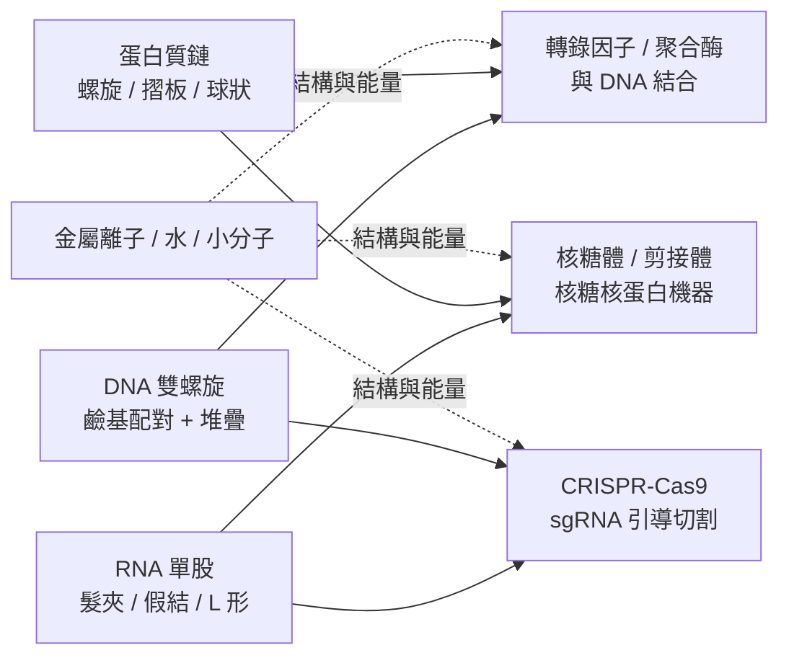

# 9.1 蛋白質與核酸（DNA / RNA）的交織網絡

AlphaFold 2 在 2020 年底的震撼，本質上是一個「邊界清晰的勝利」。它處理的是一條胺基酸序列，輸出的是這條序列所對應的三維結構；它的整個方法論建立在多重序列對齊（MSA）之上，也就是說，它仰賴的是蛋白質在演化過程中累積的保守性。這套設計精巧而有效，但它同時也把世界窄化成一條單鏈、只有蛋白質、只有標準胺基酸的走廊。細胞裡的真實情況卻不是這樣：一個酵素在催化反應時，周圍同時存在著受質、輔因子、金屬離子、水分子與 pH 梯度的伙伴；一個轉錄因子在辨識 DNA 序列時，必須同時「看見」雙螺旋的形狀與鹼基外露的化學指紋。這些分子不是各說各話的單體，而是纏結成一張彼此牽動的網絡。要把這張網絡交給電腦，就必須先承認 AF2 的世界觀是有邊界的。

## 一個成功的模型如何劃出自己的邊界

理解 AF2 的侷限，最快的方式是回頭看它的輸入與輸出介面。輸入是一段胺基酸序列、一份由序列資料庫檢索得到的 MSA，以及一組被標記為配對殘基的相對位置資訊；輸出是一組以虛擬原子（virtual atoms）與骨架框架（frames）構成的三維座標，隨後再由結構模組（structure module）細化成全原子模型。整條管線的每一個環節都假設了同一件事：輸入的每一個 token 都來自 20 種標準胺基酸之中的某一種，而每一個 token 在演化上的意義可以用 MSA 中的共同演化模式來度量。這個假設在「單鏈蛋白質」的問題上幾乎完美，一旦跨出這條邊界，系統便無從著手。

第一道邊界是化學多樣性。蛋白質摺疊只涉及二十種胺基酸的側鏈，而細胞中的蛋白質卻經常帶著翻譯後修飾（post-translational modifications, PTMs）：磷酸化、糖基化、乙醯化、泛素化、蛋白水解切割、二硫鍵。這些修飾不只改變局部電荷，還會在結構層面誘導構形變化，甚至創造出新的結合介面。AF2 的 token 集合裡沒有這些修飾的位置，它們既不是「胺基酸」，也不是序列中一個可以預先標定的位點。

第二道邊界是相互作用對象。AF2 可以預測一段序列自身的摺疊，也可以在 AF-Multimer 中把幾條鏈放在一起，但所謂「一起」僅限於蛋白質對蛋白質。DNA、RNA、小分子、金屬離子、水分子，在 AF2 的表示法中不是被遺忘的配角，而是根本不存在於詞彙表裡的詞彙。蛋白質與 DNA 的複合體，恰恰是基因表現調控、DNA 複製與修復的物理核心，也是藥物開發最密集的戰場之一。

第三道邊界更根本：即使模型給出了坐標，它給出的也只是「形狀」，而不是「行為」。單一構形無法承載酵素催化所需的運動區段（motif）、無法承載轉錄因子在結合 DNA 時的誘導構形變化，也無法承載核糖體沿 mRNA 行進時的動態。AF2 是一個靜態的形狀預測器，它所謂的「結構」是一張照片，而生命是一段電影。AF3 的整個設計動機，正是要把這張照片擴充成一座可以容納異質分子的電影製片廠。

## 核酸的另一半世界：從一張 X 光照片開始

核酸進入結構生物學的歷史，比蛋白質晚了二十多年，而且是被一組照片打開的。1952 年，倫敦國王學院的羅莎琳德·富蘭克林（Rosalind Franklin）在 X 光纖維繞射实验中拍下「照片 51」（Photo 51），那是一道清楚顯示雙螺旋輪廓的 X 形衍射條紋。1953 年 4 月，富蘭克林與雷戈布里德·戈斯林在《自然》期刊發表了包含照片 51 的論文；同月，沃森（James Watson）與克里克（Francis Crick）在《自然》發表了他們的雙螺旋模型，並在《冷泉港對稱性專題文集》（Cold Spring Harbor Symposia on Quantitative Biology）發表了更完整的推導。富蘭克林在 1958 年辭世，1962 年的諾貝爾生理學或醫學獎由沃森、克里克與威爾金斯共享，她本人未獲提名。這段歷史之所以重要，不只是因為一個模型被猜中，而是因為它示範了「結構決定功能」這條貫穿全書的因果鏈的第一個實例：鹼基配對規則一旦寫進雙螺旋的幾何，就立刻解釋了複製的半保留機制、遺傳訊息的互補性，以及鹼基堆疊（stacking）本身所貢獻的穩定性。

但雙螺旋只是起點。在接下來的半個世紀裡，生物學家發現 DNA 從來不只是「一條直線上的雙股螺旋」。DNA 會彎曲：轉錄因子在啟動子序列上纏繞時產生的「彎曲能量」（bending energy），是轉錄調控熱力學中的關鍵變數；DNA 會形成超螺旋（supercoiling），細菌的 DNA 幾乎永遠處於負超螺旋狀態，而這個拓撲狀態由 DNA 旋轉酶（gyrase）與拓撲異構酶（topoisomerase）持續維護；DNA 會形成環狀、結狀與纏結；DNA 會被組蛋白纏成核小體，再層層摺疊成染色質，最終以域（loop domain）的形式在染色質支架上被鉚定。這些現象共同構成「拓撲生物學」（topological biology）的研究傳統，而它們全都是形狀問題，也全都是能量問題。2013 年諾貝爾化學獎頒給 Karplus、Levitt 與 Warshel，表彰他們發展出把化學鍵能與蛋白質動力學連結起來的電腦方法，也正是在這樣的傳統裡，「結構預測」從一個工程題目升格為一個科學命題。

## RNA 的困難：一個更陡峭的能谷

與 DNA 相比，RNA 的結構預測困難得多，原因不在化學而在資訊。DNA 的雙螺旋幾乎是能量上的全域極小值，任何一段 DNA 都在自發地回到雙股狀態；RNA 卻是一條單股，它必須自己尋找配對方案，而不同的配對方案之間存在著極為接近的自由能。核酸的結構層次由二級結構出發：一段自我互補的序列可以摺成髮夾（hairpin），多個髮夾再由螺旋堆疊（helix stacking）與長程互動串成三級結構。1970 年前後，酵母 tRNA^Phe 的 X 光結構被解出，確立了分子的 L 形三級構形，也示範了「二級結構 + 堆疊 + 三維空間組裝」如何決定功能。

真正的難題是假結（pseudoknot）與其變體——包括那些只能在空間中形成、卻無法用平面配對圖描繪的「假想螺旋」這類非標準拓撲。當鹼基配對圖出現交叉連接（crossing links）時，能量地形便不再是單一的漏斗，而出現多個深度接近的極小值；此時一條鏈可以有十數種近乎等能的摺疊方案，而其中只有一種在細胞內是正確的。這種多穩態性意味著「最穩定結構」未必是「功能結構」，因為真正的生物學還牽涉到核糖體的轉位、剪接體的組裝順序與 ATP 的水解時序等動態因素。

蛋白質則幸運得多。對蛋白質而言，演化是一台龐大的實驗機器，它把「哪個構形是功能性的」這個問題，直接寫進了序列資料庫裡，而 MSA 中的共同演化殘基正是這些實驗結果的統計殘留。核酸，特別是編碼蛋白質的 mRNA，在演化上受選擇壓力的方式不同，序列中保守的位點遠少於蛋白質，因此核酸的 MSA 所提供的共同演化訊號要弱得多，許多位置的「不確定性」難以用統計相關來收斂。

## 從單體到巨型複合體：2009 年的核糖體與它的教訓

真正把核酸結構問題推上全球舞台的，是核糖體。2000 年，Yusupov 與 Cate 等人發表 50S 核糖體次單元的 X 光結構；2009 年，Ramakrishnan、Steitz、Yonath 三方團隊發表 70S 完整核糖體的高解析度電子密度圖，揭示了核糖體如何以肽基轉移酶中心催化肽鍵形成，以及解碼中心如何檢驗 mRNA 上的密碼子與 tRNA 的反密碼子配對。2009 年諾貝爾化學獎頒給這三人。此後，剪接體（spliceosome）——剪掉前驅 mRNA 內含子的巨型核糖核蛋白機器——也在 2015 年之後由冷凍電子顯微鏡接連解出，2017 年的《自然》論文給出了人類剪接體的高解析度結構。

這些結構帶來三個對演算法具有決定性影響的教訓。第一，生物功能幾乎從不發生在單鏈內部，而是發生在「多鏈、多型態、跨型態」的介面上；因此「結構」的真正單位不是鏈，而是複合體。第二，一個複合體可能由數十甚至數百條鏈組成，其中包含 RNA、核蛋白、以及數百個水分子與離子；用一條蛋白質序列的表示法去描述這種系統，在型態上就不成立。第三，結構預測的誤差在複合體介面上會被放大——如果兩條鏈各自的形狀都對了，但彼此的相對位置擺錯了，整個功能機制仍然是錯的。

在此背景下，核酸—蛋白質複合體成為演算法設計的試金石。DNA 聚合酶與模板 DNA 的複合體展示了「複製的機器如何在每個循環中把雙股解開再重組」；轉錄因子與增強子序列的複合體展示了 DNA 序列資訊如何被「讀取」並轉換為構形變化；2012 年 Jinek 等人在《科學》期刊發表的 CRISPR-Cas9 結構，則顯示 Cas9 核酸酶如何在引導 RNA 的帶領下辨識並切割一段外來 DNA 的特定序列，並在同一篇論文中示範了 R-loop 與樞紐（hinge）區域的構形變化機制。這些系統都是異質的：DNA 是長而帶電的多聚物，蛋白質是球狀而疏水的，RNA 則在兩者之間游走。

這張圖的要義是：不存在「蛋白質的結構預測」與「核酸的結構預測」兩件可以各自最佳化的事，只有一件事——在一個由多種化學實體構成的系統中，正確地擺放所有參與者。

## 為什麼必須是一個統一模型：表示法的三個難題

要讓模型處理這種異質複合體，有三個技術上的難題必須被解決，而且它們的困難程度是遞增的。

第一個難題是「什麼是一個 token」。蛋白質的標準胺基酸可以被當成單一 token，核酸的標準核苷酸也可以，但它們的側鏈化學資訊密度遠高於胺基酸：核苷酸有糖環、磷酸骨架、鹼基三個部分，鹼基還分為嘌呤與嘧啶。於是同一個 token 內部藏著多個可旋轉、可彎折的關節。相較之下，小分子配體則完全沒有標準化學式可循：每種藥物都是獨特的分子圖，碳、氮、氧、硫、鹵素的原子種類加上鍵級、形式電荷、立體化學與構形異質性，需要一套能夠攜帶「這是一個帶正電的四級胺、位於此處」的原子級描述。如果沿用 AF2 的殘基級 token，一個配體會被切成一連串沒有化學意義的假想片段；因此正確的做法是回到原子級，讓每個原子各自成為一個 token，並攜帶原子種類、形式電荷與鏈的歸屬資訊。

第二個難題是「鏈的身分」。在實驗結構中，複合體裡常常有兩條序列完全相同或高度相似的鏈——例如二聚體、兩個拷貝的受體、或者結合前後的兩個構形。AF2 的 MSA 模組用「copies」機制嘗試處理這種情形，但核酸複合體常常有更麻煩的情形：同一個晶體中，DNA 鏈可能是兩條不同的序列交錯排列，一條鏈的配體結合位點與另一條鏈幾乎一樣，此時「哪一條鏈是哪一條」在實驗上根本無法區分，這就是所謂的鏈身分置換（chain permutation）問題，而它直接決定了模型的輸出能不能與實驗結構對接比較。

第三個難題，也是最根本的，是「單鏈還是多鏈的幾何關係如何被同一個機制處理」。若採用「先各自摺疊再對接」的兩段式做法，會在兩個環節各引入一次近似：第一階段近似結構，第二階段近似相對位置，誤差沿著流程累積。更嚴重的是，兩段式無法表達「介面決定構形」的耦合現象——兩個鏈在沒有彼此的情況下可能根本沒有穩定的構形。

AF3 對這三個難題的答案，構成它的設計哲學：以原子級 token 統一表達所有化學實體（包括蛋白質、核酸、配體、離子與水分子），以鏈標記（chain ID）與拷貝編號明確區分鏈的身分，並且——最關鍵——以「同時對所有鏈的原子座標進行擴散去噪」的單一擴散過程取代兩段式的分開處理。當所有鏈在同一個擴散程序中共同演化時，鏈間相對位置不再是「預測後再對接」的結果，而是去噪過程本身的一部分。

## 從網絡到模型：AF3 的設計動機

回頭看，AF3 的出現並非憑空降臨。它是三條壓力線同時收緊的產物。第一條是功能科學的壓力：當研究人員拿到一個疾病相關突變的序列，他真正想知道的是「這個突變怎麼影響它與小分子、DNA 或 RNA 的結合」，而 AF2 只能回答其中關於蛋白質自身形狀的那一部分。第二條是實驗的壓力：冷凍電子顯微鏡讓「核糖體 + mRNA + 抗生素」這類複合體的結構解析數量在 2020 年後急遽上升，但每個結構仍需數月的解析與精修；能自動預測整個複合體的模型，等於為這些結構化學家提供了「搜尋用的第一個座標」。第三條是演算法本身的壓力：當模型要處理的系統越來越大，越需要一個能直接操作三維座標、而不是依賴手工設計中間表示的架構，而擴散模型恰好提供了這樣的介面。

於是「蛋白質—核酸—小分子—金屬—脂質」的交織網絡，終於有了一個能夠被完整表達的資料模型。在下一節，我們會看到這張網絡中最化學、最難預測、也最直接關係到藥的一角：小分子配體與藥物對接。

| 生物分子實體 | 化學多樣性來源 | 在統一模型中的合理 token 粒度 | 結構預測的主要困難 |
| --- | --- | --- | --- |
| 蛋白質（標準胺基酸） | 20 種側鏈 | 殘基級單一 token | 相對可控：演化 MSA 提供共同演化訊號 |
| 蛋白質（修飾、成熟態） | PTM、金屬、離子、二硫鍵 | 原子級 + 化學類型標記 | 無序列先驗，需由結構模板或上下文推斷 |
| DNA / RNA（標準核苷酸） | 鹼基 + 糖環 + 磷酸骨架 | 殘基級 token + 多內部關節 | 假結與多穩態；共同演化訊號弱 |
| 小分子配體 | 任意化學圖、立體化學 | 原子級 token + 鍵級/電荷/立體資訊 | 構形異質性、化學多樣性、未知先驗 |
| 金屬離子 / 水 | 配位化學 | 原子級 token | 配位數與幾何受金屬種類與環境約束 |
