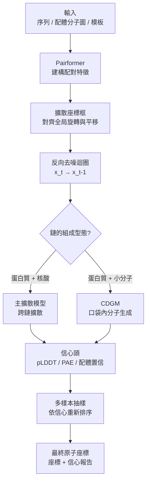

# 9.3 擴展模型（AF3 多體複合體）與配體擴散生成（2024）

2024 年 5 月 8 日，《Nature》雜誌刊出 Abramson 等人的長篇論文「Accurate structure prediction of biomolecular interactions with AlphaFold 3」，同一時間 Google DeepMind 釋出一段示範影片：一台噬菌體的衣殼在幾秒內被組裝起來，一張 DNA 雙螺旋纏繞著 RNA 聚合酶旋轉，抗生素卡在一個酵素口袋裡。影片之所以令人屏息，不只是因為速度，而是因為它呈現的東西在四十八小時之前還不存在於任何公共資料庫中。AF3 的核心突破並不是「更準」，而是「更廣」：它第一次用同一個生成模型處理蛋白質、DNA、RNA、小分子、離子與水的混合複合體，並且可以直接從擴散過程中生成原子的三維座標。

## 從 AF2 的結構模組到擴散模型

要理解這個轉換的份量，先要理解 AF2 的結構模組做了什麼。AF2 預測的是每個殘基的骨架框架（frame），也就是以 N、CA、C 三個原子定義的一組剛體座標系與一個二面角；真正的全原子模型是由一套模板（template）——由同源結構中挑選的原子座標——經過旋轉與平移的模板配合（template matching）拼湊而成。這是一個「先生成骨架，再填充細節」的兩段式設計。它在純蛋白質的場景裡工作得很好，因為蛋白質的原子組成相對固定；但一旦對象變成一個由小分子與蛋白質構成的複合體，「模板」從何而來就成了一個無法回答的問題。

擴散模型提供了另一條路：不預測結構參數，而是直接預測座標本身。一個標準的高斯擴散過程有兩個方向。前向（forward）過程從資料 $`x_0`$ 開始，逐步加入高斯噪聲，經過 $`T`$ 步之後得到接近純噪聲的 $`x_T`$ ：

其中 $`\alpha_t = 1 - \beta_t`$ ， $`\beta_t`$ 是第 $`t`$ 步的方差增量（通常依「餘弦排程」或線性排程隨 $`t`$ 遞增）， $`t = 1, \dots, T`$ 。這個公式的本質是：真實座標的訊號以 $`\sqrt{\alpha_t}`$ 的比例被保留，噪聲以 $`\sqrt{1-\alpha_t}`$ 的比例被注入。於是 $`t`$ 這個連續變數，成為一個可以連續插值的「破壞程度」座標軸： $`t=0`$ 是純真實， $`t=T`$ 是純隨機。

反向（reverse）過程則是一個學到的去噪器：給定第 $`t`$ 步的帶噪座標 $`x_t`$ 與所有條件資訊（序列、配對特徵、模板、配體分子圖），網路輸出反向轉移機率 $`p_\theta(x_{t-1} \mid x_t)`$ ，讓座標一步步被「拉回」生物學上合理的構形。訓練時，網路學會預測加在真實座標上的噪聲 $`\epsilon`$ （或等價的 score），這個目標函數最終讓從純隨機出發的反向抽樣能夠收斂到真實結構的分佈上。

對結構預測而言，這個轉換有三個好處。第一，去噪是一個迭代的精修過程，相當於把「一步猜出 3D 座標」變成「做數百步小步調整」，這與蛋白質摺疊本身在能量地形上尋找極小值的過程驚人地同構。第二，反向過程天然是隨機的，可以產生多個樣本（samples），再以信心指標挑選。第三，更重要的是，去噪讓模型得以在「連續的座標空間」裡直接操作原子，而不必受限於任何事先定義的結構參數化方式——這正是統一處理蛋白質、核酸與小分子的技術前提。

## 座標框架與擴散座標框：處理整體旋轉與平移

三維座標有一個惱人的對稱性問題：把整個複合體旋轉 90 度、把它的平移原點從一個地方換到另一個地方，物理上沒有任何改變，但數值上卻是天差地別。如果直接把原子座標餵給網路，模型就得浪費大量容量去學習「什麼是絕對座標」，並且在推論時需要對輸入做標準化、在輸出後做逆變換——這是單鏈蛋白質預測中常見的處理方式，但對多鏈複合體而言，標準化只能移除整體的剛體運動，無法移除鏈與鏈之間的相對方向。

AF3 的解法是引入「擴散座標框」（diffusion frame）。具體而言，模型在每一步去噪時，會先從當前的噪聲座標中估計出一個參考框架（reference frame），把要處理的原子相對於這個框架表示，並且在網路內部對座標做等變處理與對框架的重新對齊。這樣一來，模型不必把「整體怎麼擺」和「內部怎麼摺」混在同一個問題裡解決。座標框的更新伴隨去噪同步進行，形成一個閉環：先估框架、在框架內精修、再用精修後的結果更新框架。這套機制讓 AF3 能夠處理數十條鏈、數千個原子的複合體，而不會因為整體姿態的變動而使內部結構崩解。

另一個同屬於「條件化」範疇的技術是分類器引導（classifier guidance），它源自擴散模型在影像生成中的做法：利用一個分類器對生成樣本的梯度，把反向抽樣往符合目標條件的方向推動，例如引導產生的分子符合特定的形式電荷或官能基。在 AF3 的脈絡中，團隊採用的是一個更貼近結構生物學的變體：模型本身具備信心預測頭（confidence head），在推理時對同一輸入抽樣多個解，再依複合信心指標重新排序並挑選最可信者。這與分類器引導在數學形式上共享「用額外訊號修正抽樣分佈」的精髓，但實作機制更為簡潔，也更容易解釋。

## 37 種原子 token：一個統一的世界觀

AF3 最具象的設計選擇，是它把整個生物分子世界壓縮成一張非常短的詞彙表：37 種原子 token。在這套 tokenization 中，蛋白質的 20 種標準胺基酸各自是一個 token；DNA 與 RNA 的標準核苷酸各自是一個 token；小分子配體則被拆解成個別原子，每種原子型態（碳、氮、氧、硫、磷、鹵素，以及形式電荷、手性等修飾）配上一個類型嵌入（atom type embedding）；金屬離子與水分子也各有其 token。整個系統因此只使用一種粒度、同一種注意力機制、同一種擴散程序。

這個選擇的深遠之處在於，它把「蛋白質是特殊的一類分子」這個長久以來的隱含假設拆掉了。過去的模型架構往往以「殘基」為單位，因此無法自然地表示一個金屬離子或一個水分子；而在真實生物學裡，這些小分子是催化反應的必需品——核糖體的肽基轉移酶中心依賴 Mg²⁺ 與水，DNA 聚合酶依賴兩個 Mg²⁺ 與一個單磷酸。在 AF3 的表示法裡，它們只是原子 token 之一，卻能自動參與「它們該出現在哪裡、與誰配位」這個問題的求解。

單鏈／多鏈的區別也隨之被消解：蛋白質鏈、DNA 鏈、RNA 鏈、配體，在擴散程序中共享同一個座標空間，唯一攜帶的歸屬資訊是「這條鏈的識別碼」與「這條鏈上的第幾個殘基／原子」。這使得 AF3 得以把「蛋白質 A 結合蛋白質 B」與「蛋白質 A 結合 DNA」與「蛋白質 A 結合小分子」視為同一類問題的三個實例。

## 跨鏈擴散與鏈身分置換問題

然而，單一 tokenization 還不足以解決多鏈複合體最棘手的問題：鏈身分置換（chain permutation）。

問題的物理內容是這樣的：當一個複合體由兩條序列相同或高度相似的鏈組成時——例如二聚體、兩個受體拷貝、或一條鏈的兩個 domain——在許多實驗結構中，這兩條鏈的角色是無法分辨的。當兩條鏈都結合同一種小分子時，X 光或冷凍電子顯微鏡的電子密度會呈現一個近乎對稱的分佈，我們無從判斷哪一段密度對應哪一條序列；而在預測與實驗結構對接比較時，這種任意性會被系統性地誤判為「結構錯誤」。傳統的「先各自摺疊、再對接」流程在這裡會產生一個幾乎無法避免的 50% 機率性錯配。

AF3 的答案是跨鏈擴散（cross-chain diffusion）：不是先求出各鏈的構形再對接，而是讓所有鏈的原子在同一次去噪過程中共同演化。這意味著「哪條鏈在哪裡」這個變數被放進模型內部，讓網路去探索——模型可以給出鏈身分不同的等價解，而下游使用者透過信心指標與實驗約束來判斷哪一個是生物學上合理的。這是一個概念上的位移：鏈身分置換不再是使用者必須在輸出後手動修正的後處理問題，而是模型原生的一部分。

同時，AF3 也大幅改進了配對特徵（pair representation）的建構路徑。AF2 依靠 Evoformer 讓 MSA 表示與配對表示跨維度對話，並且需要 MSA；AF3 以 Pairformer 取代了這個模組，並且不再依賴 MSA 就能運作——它的配對特徵主要由序列資訊、模板與單鏈結構模組的輸出共同推導。這不只是效率考量（MSA 檢索是 AF2 服務最耗時的環節），更是覆蓋能力的考量：對於許多真實的複合體——尤其是實驗解析出的、冷凍電子顯微鏡結構中的配體結合複合體——根本不存在可靠的 MSA，因為它們是人工設計的、序列不穩定的，或者來自單一生物體的孤立的變異。

## 配體擴散生成模型（CDGM）

AF3 論文中最具原創性的部分，是它並不停留在「把已知配體放進口袋」。團隊訓練了一個稱為卷積擴散生成模型（convolutional diffusion generative model, CDGM）的模組，能夠在給定蛋白質（及其摺疊構形）與一個指定的口袋位置之後，直接從頭生成一個小分子的全部原子座標與鍵結。

CDGM 與主擴散模型的關係可以理解為一個分工：主模型負責蛋白質與核酸的構形以及配體的大致位置；CDGM 負責在該位置生成化學上合理的分子。它的訓練資料來自 PDBbind 這類含有已知配體結合構形的資料庫，其生成過程同樣是「從純噪聲出發、在蛋白質環境的條件下逐步去噪」，並且在每一步都會評估候選分子與蛋白質的相互作用以引導去噪。這使得 AF3 在功能上從一個「結構預測器」擴展為一個「分子設計器」。

這件事在產業上的意義立刻被看見。傳統的虛擬篩選受制於可查詢化合物資料庫的大小與多樣性——即使是最有影響力的商業資料庫，也不過數十萬到數百萬個化合物，而生物可探索的化學空間遠大於此。生成式方法意味著篩選不再受限於「已經被合成過的東西」，而可以向未被探索的化學區域延伸。當然，生成能力的邊界同樣立即被看見：能生成化學上合理、構形上貼合口袋的分子，不等於能生成有活性的分子。配體親和力預測在 AF3 發表時（以及此後的獨立評估中）仍被明確列為未解的問題。

## AF3 與 AF2 的系統性對照

| 面向 | AlphaFold 2（2020） | AlphaFold 3（2024） |
| --- | --- | --- |
| 建模對象 | 僅蛋白質（單鏈；Multimer 可處理多鏈蛋白質） | 蛋白質、DNA、RNA、小分子、離子、水的統一處理 |
| Token 粒度 | 殘基級（20 種標準胺基酸） | 原子級，共 37 種原子 token（配體逐原子表示） |
| 結構產生方式 | 結構模組：預測骨架框架 + 全原子模板配合 | 擴散模型：直接對原子座標去噪 |
| 全局對稱性處理 | 座標標準化／逆變換 | 擴散座標框（diffusion frame）逐步對齊 |
| 配對特徵建構 | Evoformer：MSA 表示 ↔ 配對表示 | Pairformer：序列 + 模板 + 單鏈模組，無須 MSA |
| 鏈身分置換 | 需外部處理，容易錯配 | 跨鏈擴散，模型原生處理 |
| 配體 | 不支援 | 支援已知配體對接；CDGM 可在口袋內生成新分子 |
| 信心指標 | pLDDT、PAE | pLDDT、PAE，加上配體專屬的置信與相互作用指標 |
| 輸出 | 一組座標 | 座標 + 多樣本抽樣後依信心排序 |
| 開源狀況 | 2021 年開源模型權重與訓練程式碼 | 2024 年 11 月僅提供線上服務，模型未開源 |

## 擴充模型、免費伺服器與權衡

AF3 發表時僅提供線上服務，模型權重並未公開。2024 年 11 月 6 日，Google DeepMind 推出免費的 AlphaFold Server（alphafoldserver.com），讓全球研究者以瀏覽器提交蛋白質與其複合體的序列，即可取得帶有置信指標的結構預測，初期的輸入僅限於蛋白質（單鏈與較小的複合體），並於後續版本逐步放寬至多鏈複合體、DNA 與 RNA 的提交。這是一個極具象徵性的姿態：AF2 時代的門檻是「知道序列、會跑 Python、有一張不錯的 GPU」；AF3 Server 把門檻降到「會用瀏覽器」。

然而，模型未開源也意味著獨立驗證受限。第三方評估指出，AF3 的配體能力在真正的時間盲測基準上未必穩定超越專門的對接模型（例如 DiffDock 與 Boltz 系列的後續版本），核酸部分（尤其長 DNA 與 RNA 三級結構）的可靠性也仍受質疑；AF3 對複合體中鏈身分置換的處理，雖然架構上更合理，但在配對實驗結構時仍會產生需要人工判讀的差異。這些限制不是致命缺陷，而是提醒我們：一個模型的適用邊界與它的能力邊界同樣重要。

伴隨而來的是擴充模型（Extended AlphaFold 3）的推出，它針對核酸輸入做了特別的改進，包含對 DNA 與 RNA 序列共演化資訊的處理，讓模型能夠利用核酸層面的演化耦合訊號補強單序列預測，並擴大了可處理核酸的長度與複合體規模。這一步的意義在於：AF3 首次讓核酸進入統一框架，但核酸預測的困難（假結、多穩態、MSA 訊號弱於蛋白質）並未因架構統一而自動消失，需要額外的資料處理與訓練策略。

## 2024 年 11 月的知識產權風波

AF3 發表六個月後，一場法律爭議爆發。2024 年 11 月，OpenAI 與 Lila Biosciences 兩家 AI 生態系的公司分別在美國聯邦法院對 Google DeepMind 提起訴訟，核心主張是 AF3 所使用的擴散模型架構用於生物分子結構預測，侵犯了他們在擴散模型與蛋白質結構預測領域的專利權。OpenAI 的訴訟援引其關於「用擴散模型預測蛋白質結構」的專利；Lila 的訴訟則主張其生物分子結構預測與藥物發現的機器學習專利遭侵害。Google 方面則主張 AF3 的方法在其既有研究之前即已有公開文獻脈絡，並援引學術自由與研究共享的原則反駁。這場訴訟在 2024 至 2025 年間持續進行，成為生成式 AI 與生物醫學交叉領域知識產權邊界的標誌性案例。

它之所以重要，不只是法律層面。在更長期的意義上，這場訴訟凸顯了一個結構性問題：像 AF3 這樣整合了多篇既有學術成果（擴散模型、蛋白質結構預測、配位生成、擴散座標框）的系統，其權利歸屬必然是聚合的；而當模型的價值高到足以支撐一場專利戰爭時，「哪一段是原創」就不再是學術問題。

## 2025 年的轉折：模型權重與程式碼公開

2025 年 11 月，Google DeepMind 公開了 AF3 的模型權重與推論程式碼，允許研究者在本機執行完整的 AF3 推論流程，並同步發布了擴充版模型與更新後的 AlphaFold Server（支援多鏈複合體與 DNA/RNA 提交）。此舉在實務上回應了自 2024 年 11 月以來最尖銳的批評——外部研究者無法對 AF3 做真正的時間盲測，也無法稽核其對鏈身分置換與配體置信的處理細節。權重與程式碼的公開，使得 AF3 從「一個服務」變回「一個可被稽核、可被改寫、可被用於消融實驗的方法」，這在科學方法學上的意義遠大於在競爭上的意義。

值得留意的是，這次公開並非毫無爭議：完整的 AF3 訓練流程與資料處理細節並未全部公開，商業使用仍涉及授權條款，而此前的專利訴訟在 2025 年底並未完全了結。換句話說，AF3 的「開源」是一種分層的開源：推論層開放、訓練層部分保留、商業層另訂條款。這種介於完全開放與完全封閉之間的狀態，或許正是 2020 年代中期這類高價值生物學模型最可能長期維持的形態。

## 影響與檢討

回頭看 AF3 的歷史意義，可以歸納為三條因果鏈。第一，它證明了「直接生成座標」優於「預測結構參數再填補細節」；這條結論從此成為所有後續生物分子生成模型（從蛋白質設計的 RFdiffusion 到配體生成的各種擴散模型）的共同起點。第二，它證明了「統一表示」的必要性：只有當蛋白質、核酸、配體、離子被壓縮進同一個 token 詞彙表與同一個擴散程序，生物學家才第一次能用單一工具處理整個細胞的分子機器。第三，它也把「結構預測」與「功能預測」之間那道鴻溝暴露得比任何時候都清楚：AF3 能給出結構，卻仍然給不出親和力、仍然給不出催化效率、仍然給不出細胞中的真實佔有比例。

第三條也是最重要的。AF3 的問世標誌著結構預測問題在很大程度上被解決，也標誌著下一個問題浮出水面——從「看見形狀」走向「預測動態與生命」。這正是 AlphaFold 3 留下的接力棒，而接下來幾章的主題，將從摺疊轉向功能、從靜態轉向動態、從預測轉向設計。
