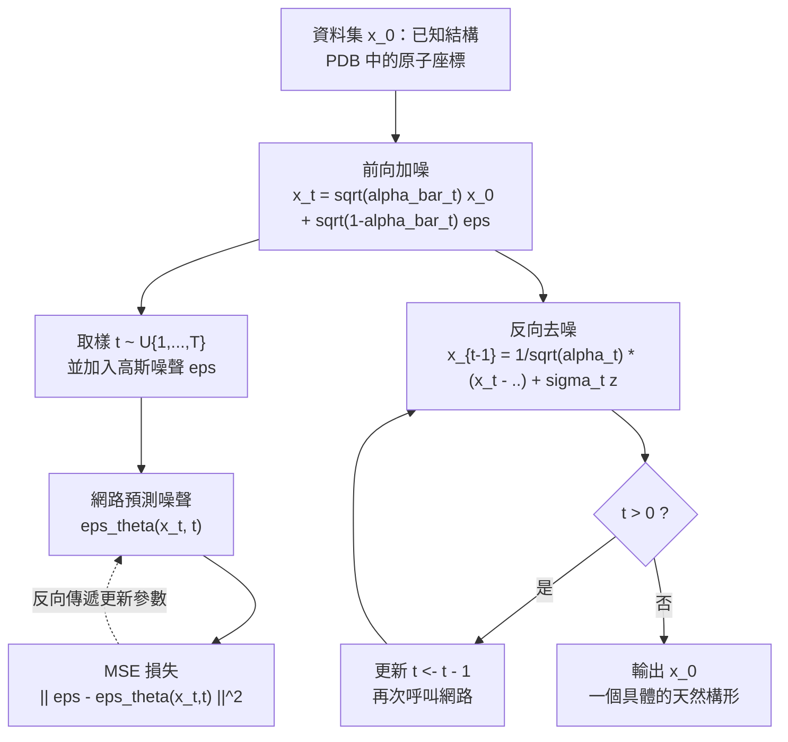

# 10.1 生成式 AI 如何重塑結構生物學

## 一、從「看見形狀」到「造出形狀」

在 AlphaFold 2 之前，深度學習在生物學上的角色基本上是「辨識者」而不是「創造者」。卷積網路辨認邊界框，Transformer 辨認語意標籤，分類器判斷這是貓還是狗。蛋白質摺疊的深度學習版本也遵循同一邏輯：模型接收一條胺基酸序列，輸出與每個殘基對應的結構特徵，最終給出一組座標。整個過程是判別式的、決定論的——輸入序列之後若再問一次，答案完全相同。

然而「生物結構」這個對象本身帶有性質，是「辨識」的心智模型總是抓不住的：同一條序列在細胞裡往往不只有一種構形。激動素有開啟與關閉態，酵素有 Michaelis 與 ES 兩種抑制態的結合構形，膜蛋白有朝向膜內與膜外的兩種排列，血紅素有 T 態與 R 態。以「一個序列對應一個結構」的模型來描述這樣的世界，等於把分佈的某個平均點當成了真相。

生成式 AI 的到來，提供了一種截然不同的問題設定：不是問「這個結構長什麼樣子」，而是問「這樣的結構可能長什麼樣子」。這種區別不只是技術上的，它改變了什麼叫做「解出結構」。第 9 章談到的 AlphaFold 3 是這個轉向最醒目的標誌，而它背後的擴散模型只是整個生成式生物學浪潮中的一顆棋子。本節要追溯這條血統，並說明為什麼生物結構特別適合用生成模型來處理。

## 二、三條血統：VAE、GAN 與擴散模型

### 2.1 VAE（2013）：把不確定性寫進數學

2013 年 12 月，Kingma 與 Welling 發表《Auto-Encoding Variational Bayes》，為生成模型立下一個可以微分的基準。VAE 的想法是從資料分布 $`p_{\text{data}}(x)`$ 中取樣時，直接建構 $`p(x)`$ 太難，但可以引入一個隱變數 $`z`$ 來把複雜的後驗變得可處理，並且用一個解碼器 $`p_\theta(x \mid z)`$ 把簡單的先驗重新展開成複雜的樣本。

關鍵在於「變分」二字。VAE 不去精確計算難解的 $`\log p_\theta(x)`$ ，而是優化一個下界：

$$
\mathcal{L}_{\text{ELBO}} = \mathbb{E}_{q(z \mid x)}\left[\log p_\theta(x \mid z)\right] - \mathrm{KL}\left(q(z \mid x) \;\|\; p(z)\right)
$$

這兩項各有意義：第一項要求解碼器能把 $`z`$ 還原成 $`x`$ ，第二項要求編碼器不要把 $`z`$ 藏在資料分佈之外的奇怪角落。ELBO 是負的（所以常被寫成 $`\mathcal{L}_{\text{ELBO}} = - \text{ELBO}`$ ），它是 $`\log p_\theta(x)`$ 的下界，優化下界就是在逼近真正的對數概似。這套框架後來在 VAE-GAN、β-VAE、以及蛋白質摺疊的深度生成模型（例如 2018 年前後的 trRosetta 一系工作、2019 年的「結構預測即生成」）中反覆出現。

VAE 的歷史意義在於它給出了一個可以拿來跟任意複雜分佈對話的數學骨架：既然複雜分佈無法直接求樣，那就把它表達成對簡單分佈的一次可逆轉換。這個骨架在八年後被擴散模型以更直接的形式繼承。

### 2.2 GAN（2014）：對抗取代了變分

2014 年 6 月，Goodfellow 等人在 NIPS 發表《Generative Adversarial Nets》，用一個更激進的想法取代了複雜的機率推論。GAN 同時訓練兩個網路：生成器 $`G`$ 把隨機向量 $`z`$ 映射成假樣本，判別器 $`D`$ 試圖分辨真偽，兩者互相博弈直到生成器學會製造以假亂真的樣本。

GAN 的訓練目標是極小极大博弈：

$$
\min_G \max_D \;\; \mathbb{E}_{x \sim p_{\text{data}}}\left[\log D(x)\right] + \mathbb{E}_{z \sim p(z)}\left[\log\left(1 - D(G(z))\right)\right]
$$

它的美麗之處是沒有明確的機率模型，也不需要 ELBO；其代價是訓練極其不穩定，模式崩潰、訓練動盪與超參數敏感長期是難題。2017 年 Wasserstein GAN 試圖用推土機距離取代 JS 散度以緩解梯度消失，但模式的本質問題並未解決。

對生物學而言，GAN 的直接影響較小，但它留下了一個重要觀念：**判別器其實比生成器更能辨識出什麼是「真實的生物結構」**。這個觀念在後續蛋白質生成工作中以另一種形式回歸——用能量函數或判別式評分來篩選生成的設計。

### 2.3 擴散模型（2020-2022）：可逆轉換的現代版

2020 年 6 月，Ho、Abbeel 與 Jain 發表《Denoising Diffusion Probabilistic Models》（DDPM），把 2015 年 Sohl-Dickstein 等人的擴散過程重新接手，給出了簡潔而強大的訓練與採樣框架。想法是：把資料逐步加上高斯噪聲，直到變成純噪音；再訓練一個網路學會把噪音「反向」還原成資料。

前向過程固定、不含任何可學參數：

$$
x_t = \sqrt{\bar{\alpha}_t}\, x_0 + \sqrt{1 - \bar{\alpha}_t}\, \, \epsilon, \qquad \epsilon \sim \mathcal{N}(0, I)
$$

其中 $`\beta_t`$ 是逐步加大的變異數日程， $`\alpha_t = 1 - \beta_t`$ ， $`\bar{\alpha}_t = \prod_{s=1}^{t} \alpha_s`$ 是累積乘積。 $`t`$ 從 $`T`$ （實務上常取 $`T = 1000`$ ）一路降到 $`0`$ ，資料就從 $`x_0`$ 逐步退化為 $`x_T \approx \mathcal{N}(0, I)`$ 。

反向過程才是可學的部分，每一步都預測加入了什麼噪聲 $`\epsilon_\theta(x_t, t)`$ ：

$$
x_{t-1} = \frac{1}{\sqrt{\alpha_t}}\left(x_t - \frac{1 - \alpha_t}{\sqrt{1 - \bar{\alpha}_t}} \, \epsilon_\theta(x_t, t)\right) + \sigma_t z
$$

訓練目標簡單到令人驚訝，就是一個噪聲預測的均方誤差：

$$
\mathcal{L} = \mathbb{E}_{x_0, \epsilon, t}\left[\left\| \epsilon - \epsilon_\theta(x_t, t) \right\|^2\right]
$$

三個關鍵改良在接下來兩年裡到位。2021 年 Song 等人的 DDIM（*Denoising Diffusion Implicit Models*）指出，只要重新設計反向的抽樣方式，完全可以把 1000 步的鏈式過程壓縮到 20 到 50 步，並讓中間的隱變數具有語意意義。2021 年底 Ho 與 Salimans 提出的 **classifier-free guidance**（無分類器引導）更為關鍵：它在同一個網路裡同時訓練「有條件」與「無條件」的預測，採樣時把兩者外插以強化條件訊號：

$$
\tilde{\epsilon} = \epsilon_\theta(x_t, t, \varnothing) + w \cdot \left(\epsilon_\theta(x_t, t, c) - \epsilon_\theta(x_t, t, \varnothing)\right)
$$

$`w`$ 大於 1 會把樣本往條件方向推得更遠，換來更高的條件遵循度，代價是過飽和與多樣性下降。這三個部件加總起來，就是 2022 年之後席捲影像與文字領域的擴散模型。而當 DeepMind 把這套框架搬到原子座標上時，它順帶解決了結構生物學一個長期卡住的問題。

## 三、共同原理：把複雜分佈的學習，化為簡單分佈之間的可逆轉換

VAE、GAN、擴散模型三者機制迥異，但共享同一個底層骨架，這也是它們被歸為同一「生成式」家族的原因：**把複雜樣本分佈的學習，轉化為兩個簡單分佈之間的可逆轉換**。

在 VAE 中，這個轉換由編碼器與解碼器實作，中間的瓶頸是分佈 $`q(z)`$ 。在擴散模型中，轉換由「前向加噪」與「反向去噪」實作，中間的瓶頸是標準高斯分佈。在 GAN 中，則是從簡單的 $`p(z)`$ 到資料分佈的映射，靠對抗訓練避免直接配分佈密度。

這個骨架之所以強大，是因為它把「學會 $`p_{\text{data}}`$ 這個複雜怪物」換成了「學會一個局部、一步一步的修正」。擴散模型尤其徹底：每一步只學會「如何從 $`x_t`$ 退一步回到 $`x_{t-1}`$ 」，而每一步的任務都是同一個形式的去噪回歸。數千步串起來，等於把一次不可能完成的分佈擬合，拆成數千個簡單到可以手寫損失函數的小任務。

這也是擴散模型能席捲影像生成的原因，而它之所以能進入生物學，是因為蛋白質結構的「複雜分佈」恰好可以套進這個骨架：PDB 中累積的數萬個已知結構，就是那個 $`p_{\text{data}}(x)`$ ；而每個結構都可視為一個三維座標的樣本。

## 四、分佈視角：結構不是一個「點」，而是集合中的一次抽樣

分佈視角帶來的第一個改變，是重新定義了「預測」這件事的意義。在迴歸式的框架裡，最佳預測是條件期望 $`\mathbb{E}[x \mid y]`$ ，也就是「所有合理答案的平均」。在生成式的框架裡，最佳預測是「從 $`p(x \mid y)`$ 抽一個樣本」。

對多構形系統而言，這兩者天差地別。想像一個有兩種平衡構形的酵素，其中一種自由能低了 1 kcal/mol。若問「最可能的構形是什麼」，答案是那個低自由能的構形；若問「平均構形是什麼」，答案是兩個構形的某種混合體——這是一個現實中從不存在的虛構結構。這就是統計學上著名的 **mode averaging（模態平均）** 現象，也是所有以均方誤差為目標的結構預測模型的根本弱點：MSE 損失在多峰分佈上，恰恰會把峰值抹平。

生成分佈還有第二個好處：它不只告訴你答案長什麼樣，還告訴你這個答案有多不確定。跑十次擴散採樣得到十個構形，它們的離散程度就是一個內生的信賴度指標。這與 AlphaFold 2 用 pLDDT 與 PAE 手工評估信心的做法不同——後者是模型對自己判斷的估計，前者則是分佈本身的寬度。

## 五、為什麼生物結構特別適合擴散

### 5.1 幾何是連續的，而平均是錯誤的

第一個理由是幾何性質。蛋白質結構不是離散的類別，而是一個連續的高維流形；原子座標是實數向量，可以施加高斯擾動而不破壞「像一個分子」的外觀。這讓加噪過程自然可行：把結構擾動 $`0.5`$ 埃聽起來荒謬，但把 0.5 埃的隨機位移加到每個原子上，得到的仍是一個幾乎合理的分子構形。

反過來說，若以迴歸 MSE 直接預測座標，不同構形間的差異會在損失中被平均掉。兩個差 10 埃的合理構形，它們的平均值是一個 10 埃都不像的東西。擴散模型完全繞開這個問題：它不去猜「中間值」，而是學會從噪聲出發，**沿著分佈的實際形狀走回其中一個真實模式**。

### 5.2 多模態是內建能力，不是附加功能

第二個理由是多模態。擴散模型的網路在每個時間步只需要做局部判斷：「從當前的模糊形狀看，往哪個方向走會更像某種蛋白質？」這個問題在同一時間步對所有可能的模態都是同一個答案。相較之下，要讓一個直接輸出座標的網路學會多模態，就必須讓它內建某種「選擇哪個模態」的機制（例如 AlphaFold 2 的 dropout 採樣所暗示的那樣），而這在決定論的網路裡並不自然。

擴散模型因此天然支援「同一序列、多個構形」。2024 年之後已有多個工作展示這一點：給定同一條序列，用不同的隨機種子採樣，可以得到彼此不同的、但都合理的構形；對酵素而言，這甚至能被拿來做側鏈異構態與活性位圈構形的枚舉。

### 5.3 去噪路徑與摺疊漏斗的同構

第三個理由最富詩意，但也最實用。回想第 2 章的摺疊漏斗模型：未摺疊的鏈是一個高熵、寬鬆的構形集合，摺疊過程則是能量不斷下降、構形集合不斷收斂的通道。擴散模型的去噪過程在幾何上與此驚人地相似——從純高斯噪音出發，逐步收斂到資料分佈的支集，也就是那些真實存在的結構。

更精確地說，擴散把「漏斗」從一個物理隱喻變成了一個**可操作的計算程序**。漏斗的入口是 $`x_T`$ （完全無序），出口是 $`x_0`$ （有序的天然構形），中間的每一步去噪都是在資料流形上做一次投影與微調。這也解釋了為什麼擴散模型被描述成「摺疊的計算版本」：它不只是尋找一個極小值，而是沿著一條被學到的路徑，把一個隨機起點逐步導向結構。（

整條流程可以用下圖概括，其中網路 $`\epsilon_\theta`$ 在每一步被重複呼叫，而時間索引 $`t`$ 從 $`T`$ 單調遞減到 0。

值得注意的是，訓練（左半部）與採樣（右半部）共用同一組參數，差別只在於訓練時用的是真實加噪的 $`x_t`$ ，採樣時用的是模型自己逐步還原出來的 $`x_t`$ 。這是擴散模型「自監督」特性的來源：不需要標註的目標結構，只需要未標註的結構集合。

## 六、AlphaFold 2 與 AlphaFold 3：精煉式模組與抽樣式生成

這就來到本書的核心對比。AlphaFold 2 的結構模組是**精煉式（iterative refinement）**的典範：從一個隨機初始化的剛體框架開始，反覆執行「注意力更新 → 更新框架 → 重建座標 → 回收（recycle）」的循環，直到收斂。全程是決定論的，輸入相同必得相同輸出，本質上是在做一個連續優化，只不過優化器是一個神經網路。

AlphaFold 3 則是**抽樣式（sampling）**的典範：把整個複合體的原子座標當作擴散變數，從純噪音開始，經過數百步反向去噪，最後得到一個具體構形。同一個輸入可以跑出不同的輸出，而這正是它能表達多構形的原因。

兩者的差異可以歸納如下。

| 面向 | AlphaFold 2 | AlphaFold 3 | 設計數據（RFdiffusion） |
| --- | --- | --- | --- |
| 生成機制 | 結構模組迭代精煉（deterministic） | 擴散去噪（stochastic sampling） | 對偶擴散（forward + reverse diffusion） |
| 輸入 | 序列 + MSA | 序列 + MSA + 模板 + 配體化學 | 目標形狀 + 條件標籤（motif） |
| 輸出 | 單一組座標 + 信心理分 | 單次可抽樣的座標；多次採樣給出構形集合 | 全新序列 + 對應座標 |
| 是否需要結構模組 | 需要（IPA + 框架更新） | 不需要 | 不需要 |
| 訓練目標 | 結構損失（frame loss + 位置損失） | 噪聲預測 MSE | 分類器/序列表 + 座標擴散 |
| 主要用途 | 預測結構 | 預測複合體結構 | 反向蛋白質設計 |
| 對序列的處理 | 只讀 | 只讀（不設計序列） | 同時生成序列與座標 |

值得強調的是，AlphaFold 3 並非只是把結構模組「換成」擴散模型這麼簡單。擴散在座標空間操作，必須處理整體平移與旋轉這些不可平均的自由度（第 10.2 節的主題）；而 AF3 省掉了結構模組，也省掉了回收機制，取而代之的是多鏈之間的擴散與交叉鏈擴散。兩者是互補而非替代：AF2 仍然在某些細節上更為銳利，而 AF3 換來了對配體、核酸與多模態構形的統一處理能力。

## 七、平行戰線：序列端與小分子端的生成化

生成式轉向並沒有停在 AlphaFold 3 一處，它在幾條平行線上同時發生。

序列端的代表是 ESM 系列。ESM-2（2023）把蛋白質序列當作語言，用掩碼語言模型的自監督目標學習演化規律，在序列層面預測結構與功能。ESM-3（2024）更進一步，聲稱能生成「功能性的蛋白質序列」：它用相同的框架同時處理序列、結構與功能三種模態，訓練資料涵蓋 PDB 的結構與 UniRef 的序列，並用數億年的演化尺度作為訓練任務。設計端的工作如 ProGen（2022）與 ProtGPT2，則把蛋白質序列的生成當作語言生成來做，並嘗試用強化學習與濾網器（如 GFP 螢光篩選）優化產物。

設計端的代表是 RFdiffusion（2023）與 Chroma（2023）。RFdiffusion 把結構生成反過來做：給定一個功能 motif（例如一個金屬結合位或一個抗原結合環），從純噪音出發生成能嵌合該 motif 的骨架，再由序列設計模型填入胺基酸。這是本章「生成式生物學元年」敘事中最能體現「從看見到造出」轉向的一例。

小分子端則有 DiffDock（2022-2023）、FrameDiff 等把擴散用於分子對接與配體構象生成的工作，AF3 把配體與蛋白質、核酸放進同一個擴散通道處理，是這條線路的集成點。

## 八、2024 年：生成式生物學的元年

把 2024 年稱為生成式生物學的元年並非誇飾，而是有幾個同時到位的事實。

第一，AlphaFold 3 於 2024 年 5 月在 *Nature* 發表，把擴散模型引入原子級結構預測，並把蛋白質、DNA、RNA、小分子、離子與修飾殘基統一進同一個模型。第二，ESM-3 同月發表於 *Science*，把結構與序列生成拉進同一個「模擬演化」的框架。第三，AF3 隨後開放了 API 與（年底）模型權重，讓生成式結構模型從少數實驗室的私有工具變成社群可用的基礎設施。第四，AI 蛋白質設計領域在同一年開始交付可驗證的成果——既有設計出來的酵素在實驗室做出反應，也有被發表為「設計出來的」蛋白質結構佔據了 Nature 期刊的版面。

這些事件的深層意義在於：當模型既能預測結構又能生成結構與序列，「摺疊問題」這個長達五十年的謎題，就從「求解」階段轉入了「生成」階段。接下來要問的問題不再是「這個序列會摺疊成什麼」，而是「我想要一個能摺疊成某種形狀並做某件事的序列，我要怎麼得到它」。

而要回答這個問題，就必須回到最底層的技術細節：擴散模型究竟如何在三維空間裡生成原子座標。那正是下一節的主題。
