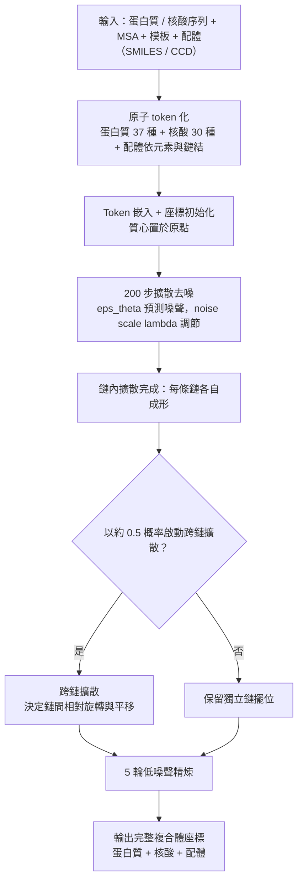

# 10.2 從「分類 / 迴歸」到「直接生成原子坐標」

## 一、難題的真正來源：座標不是一般的向量

第 10.1 節說明了擴散模型為何適合生物結構，但留下了一個技術上的硬問題：擴散模型擅長的是「在高斯噪音與複雜資料之間做可逆轉換」，而它預設資料分佈是某個 $\mathbb{R}^d$ 中的分佈。原子座標確實是 $\mathbb{R}^{3N}$ 的向量，但這個向量空間帶有幾何結構，而幾何結構正是結構生物學的核心。

問題至少有四層。第一，**整體平移與旋轉是冗餘自由度**：一個蛋白質的座標可以任意平移、任意旋轉，仍然是同一個分子。如果直接把座標放進擴散模型，網路就必須學會「這個構形到底朝著哪邊」這種毫無意義的資訊，這會浪費大量容量並污染分佈。第二，**旋轉不可平均**：把一個朝 $x$ 軸的構形與一個朝 $y$ 軸的構形做線性插值，得到的東西不是任何一個構形的變形，而是一個被壓扁的、沒有物理意義的形狀。這正是第 10.1 節所說的 mode averaging 在三維幾何裡的具體版本，而且比在數值向量裡嚴重得多。第三，**原子之間有剛性連結**：碳-碳鍵長約 1.53 埃，鍵角也有固定範圍，這些是硬約束而非軟偏好。第四，**不同種類的原子不可互換**：一個碳變成氮不只是數值改變，而是化學身分改變。 軸的構形

因此「直接生成原子座標」這句話，聽起來簡單，實際上包含一整套把幾何硬約束編進擴散框架的工程。AlphaFold 3 的做法值得仔細拆解。

## 二、兩種表示的分工：內部座標與座標框

在結構生物學裡，有兩種方式可以完整描述一個分子構形。

第一種是**內部座標表示**（internal coordinates）：給定鍵長、鍵角與二面角，加上「哪些原子相連」的拓樸資訊，就能完全重建三維座標。第二種是**座標框表示**（frames）：把原子群組成剛體片段（例如以殘基為單位，或以骨架 N-CA-C 為單位），為每個剛體指定一個位置 $\mathbf{t}$ 與一個旋轉 $\mathbf{R}$ ，再由剛體內部的固定相對座標展開成絕對座標。

這兩種表示各有好處。內部座標的好處是它天然滿足鍵長與鍵角等化學約束，而且**平移與旋轉被完全分離在描述之外**；代價是二面角本身帶有 $2\pi$ 的循環性，不容易用高斯噪音平順地擾動。座標框的好處是每一組參數都可以用歐氏幾何加上 $SO(3)$ 的指數映射平滑地插值；代價是同一個剛體內部不同原子的相對位置被綁死了。 的

AlphaFold 2 走的是座標框路線：結構模組（第 7 章）以框架作為中間表示，每一個注意力區塊輸出一組對框架的更新量，用指數映射 $\exp(\mathbf{w})$ 作用於旋轉矩陣以保證它仍是合法的旋轉，再用 $\mathbf{R}_{t+1} = \exp(\mathbf{w}) \mathbf{R}_t$ 施加增量更新。這種表示的妙處在於它讓網路的工作變成「微調」而非「重建」。

AlphaFold 3 的擴散則必須另闢蹊徑。它的做法可以概括為：**對絕對原子座標做擴散，但在每一個時間步施加對齊與去中心化，把整體平移與旋轉的自由度從擴散變數中「抽掉」**。具體而言，模型內部維持的並非單純的原子座標向量，而是一組相對於某個參考框架的座標；在推論時，所有鏈先各自獨立擴散，再經過一個把整個複合體對齊回共同座標系的步驟。

## 三、AF3 的具體做法

### 3.1 原子 token 化：把化學身分變成離散符號

擴散模型操作的是連續向量，但 AF3 需要同時處理蛋白質、核酸、小分子配體、離子與修飾殘基，元素種類與化學環境極其多樣。AF3 採取的策略是**把每個原子轉成一個 token，token 的嵌入向量作為擴散變數的一部分**。

具體的 token 化規則是：蛋白質使用與 AlphaFold 2 相同的 **37 種重原子 token**（涵蓋 20 種標準胺基酸的骨幹與側鏈原子，另有支撐非標準殘基的槽位），核酸使用 **30 種原子 token**（DNA 與 RNA 各四種核苷酸的糖、磷酸與鹼基原子），而小分子配體則依**化學元素與鍵結環境**另行定義，並支援以 SMILES 字串或化學成分典（CCD）輸入作為生成條件。

這裡有個容易混淆之處值得澄清：常見說法「AF3 有 37 種 token」其實指的是**蛋白質那 37 種重原子槽位**，而整體原子的 token 總數遠大於此，因為核酸另有 30 種、配體更是依分子而定。若把整個 token 集合加總，AF3 的原子詞彙表是在數十到數百的量級（依配體而定），而非 37。理解這點，才能正確理解為什麼 AF3 能處理任意小分子而 AF2 不能。

在擴散過程中，被擾動的是 token 的**連續嵌入**所對應的座標；token 的身分則是離散的、固定的條件輸入。這樣的分工非常漂亮：**擴散決定「在哪裡」，token 決定「是什麼」**。模型永遠不會把碳變成氮，也永遠不會憑空長出一個側鏈。

### 3.2 去中心化與旋轉對齊：處理不可平均的自由度

針對第一節提出的問題，AF3 在資料處理與推論流程中植入兩道機制。

**去中心化（centering）**：所有鏈的座標都以各自的質心為原點存放，因此整體平移這個自由度從資料中被移除，模型不必去猜「這條鏈應該放在哪裡」。這是可行的，因為在擴散框架中，平移的不確定性可以交給最後的組裝步驟處理。

**旋轉對齊（alignment）**：訓練時，所有結構先用 Kabsch 演算法對齊到一個共同的參考構形（或對齊到其自身的質心方向），使得資料分佈中不再存在「同一構形的多個旋轉副本」。這一步是 mode averaging 問題的直接解藥：把旋轉副本從資料中剔除，擴散模型面對的就是一個「每個構形只有一份」的乾淨分佈。

在推論時，AF3 則採用**鏈內各自對齊、鏈間由擴散決定相對擺放**的分工：每條鏈先在自己的座標系裡被展開，鏈與鏈之間如何相對旋轉與平移，則交給後續的跨鏈步驟去決定。這樣一來，鏈內的精確幾何（鍵長、鍵角、局部構形）由擴散模型負責，而鏈間的相對位置則由相互作用決定，兩者的不確定性來源被解耦。

### 3.3 交叉鏈擴散：把「各搞各的」變成「一起擺位」

純粹的鏈內擴散會產生一個平凡的解：每條鏈都摺疊得很好，但彼此隨便地擺在一起，甚至互相穿插。AF3 的解法是引入**交叉鏈擴散（cross-chain diffusion）**。

其流程是分兩階段的。第一階段先對每一條鏈各自做完整的鏈內擴散，得到一個「摺疊良好但相對位置未定」的構形集合。第二階段才是重點：在這個基礎上，讓鏈與鏈之間的座標也參與擴散，於是模型必須決定哪一種相對擺放能讓配體塞進口袋、讓 DNA 纏繞到蛋白質上、讓抗體貼合抗原。

AF3 的設計是**以約 0.5 的概率**在每個採樣批次中啟動跨鏈擴散，意味著模型在訓練中同時學會兩種模式：獨立的鏈內摺疊，以及受相互作用約束的組裝。這是一個很講究的取捨——若總是啟動跨鏈擴散，模型會過度依賴相互作用資訊，對於缺乏足夠同源資訊的鏈（例如設計出來的新序列）反而失準；若完全不啟動，則永遠學不到界面。

### 3.4 步數與精煉：200 步擴散加 5 輪修整

擴散模型的代價是採樣步數多。AF2 只需跑固定次數的結構模組回收循環，而 AF3 官方釋出的推論流程採 **200 步擴散**，之後再進行 **5 輪的精煉（refinement）**，在最後以較低的噪聲水平重新執行去噪，把座標往更合理的區域收斂。

這個設計的意圖很清楚。純粹的 200 步隨機去噪會留下細節噪聲與輕微的鍵長偏差，最後幾輪低噪聲精煉就是用來把這些統計殘差抹平。相較於 AF2 的結構模組「從零開始、由框架逐步逼近」的精煉，AF3 的精煉是在既有解附近的**局部收斂**，性質不同但目的相同。

# $\lambda$ ：用一個參數控制去噪的激進程度

AF3 引入了**擴散噪聲比例**這個概念，用一個尺度參數（記為 $\lambda$ ）調節每一步實際施加的噪聲相對於標準日程的比例。當 $\lambda$ 取得較小值時，前向過程施加的噪聲較弱，反向去噪就變得更「溫和」，每次只做小幅修正；當 $\lambda$ 接近或超過 1 時，則接近標準的高斯日程，行為更接近完整的擴散。

這個旋鈕的意義在於**用步數換準確度**。若系統預算允許，可以讓 $\lambda$ 偏小並多跑幾步，換取座標更貼近物理化學的合理範圍（更少原子重疊、更準的鍵長）。AF3 的 200 步加 5 輪精煉之所以能工作，部分就靠這個噪聲比例的細緻調校。它同時也是 AF3 能夠在推理時「多花時間換品質」的技術基礎。

### 3.6 整體流程

## 四、與 AF2 結構模組的正面對照

| 面向 | AlphaFold 2 結構模組 | AlphaFold 3 擴散模型 |
| --- | --- | --- |
| 中間表示 | 座標框 $(t, R)$ 與內部座標 | 絕對原子座標（去中心化、對齊後） |
| 更新方式 | SE(3) 上的剛體增量更新， $R_{t+1} = \exp(w) R_t$ | 反向去噪步， $x_{t-1}$ 由 $\epsilon_\theta$ 導出 |
| 幾何約束來源 | 框架內部的固定相對座標（硬約束） | 由訓練資料與化學先驗學得（軟約束） |
| 迭代對象 | 網路層級與回收循環（recycles） | 擴散時間步 |
| 結果決定性 | 決定論，同輸入同輸出 | 隨機，同輸入可得多個構形 |
| 多構形表達 | 需靠 dropout 採樣近似 | 天然支援，直接採樣即得構形集合 |
| 鏈間互動 | 跨鏈注意力在 Evoformer 中處理 | 交叉鏈擴散，以概率啟動 |
| 信心評估 | pLDDT / PAE | 分佈寬度 + 座標誤差（需外部評估） |
| 配體處理 | 幾何模擬 + 位姿網路（幾何圖模型與位姿網路） | 配體與蛋白質、核酸在同一擴散通道內生成 |

AF3 的關鍵取捨是把「硬幾何約束」換成了「軟的學得約束」。在 AF2 裡，鍵長與鍵角之所以大致正確，是因為框架內部座標本來就被固定；擴散模型沒有這個免費午餐，正確的鍵長要靠訓練資料教會網路。這個交換帶來兩個後果：AF3 能夠生成更連續、更自然的多鏈擺位，但個別局部幾何在某些案例反而不如 AF2 銳利。

## 五、訓練資料管線

AF3 的模型品質有一半取決於資料，而它的資料管線有三個特色。

**PDB 蒸餾**：除了使用經過過濾的 PDB 結構，AF3 大量利用以 AlphaFold 2 預測出的結構作為額外訓練目標。這種「蒸餾」的做法把 AF2 從一個競爭對手變成資料來源，讓模型見到大量沒有實驗結構的序列。代價是模型會部分繼承 AF2 的偏差，形成一種遞迴。

**噪聲增強（noise augmentation）**：訓練時除了標準的時間步採樣，還刻意在目標座標上加入額外的隨機擾動，範圍從極小到中等等級。這讓模型在面對擴散過程中間段的「半成品」座標時更為強健，等價於替模型做了一層輸入分佈的正則化。

**MSA 與特徵抽取的差異化**：AF3 對 MSA 特徵的處理與 AF2 不同，包括更廣的資料庫搜尋與不同的序列特徵編碼方式。當演化資訊稀疏時（例如設計序列、或新型態蛋白），模型必須更依賴擴散先驗本身，這也解釋了為什麼在這類案例中擴散方法的優勢反而更明顯。

## 六、失敗模式與後處理

AF3 的成功不意味著它可以免於檢查，事實上它的失敗模式相當具體。

**局部精度下降**：在某些案例中，AF3 的局部細節——側鏈擺位、二硫鍵位置、催化三聯體的幾何——不如 AF2 銳利。這是前面那個取捨的直接後果：放棄硬約束換取整體連貫性，總要在某處付出代價。

**配體的化學有效性不保證**：AF3 能生成構型「看起來像」塞進口袋的配體，但生成結果未必滿足價鍵、氫鍵幾何與立體化學的規則。一個芳香環可能被放成傾斜的，一個手性中心可能被反轉。這在藥物設計的情境下是致命的，因為錯的立體化學等於錯的藥。

**需要後處理**：2024 年出現的 **PoseBusters** 系列工作正是針對這類問題。它提供了一整套物理與化學合理性的檢查項目——分子間碰撞、配體鍵結是否重疊、內部鍵長鍵角是否合理、立體化學是否可接受——並證實當時主流的 AI 對接方法在生成分子構型時會系統性地違反這些基本規則。AF3 的輸出若要投入實際的虛擬篩選流程，同樣需要這一層把關。

這些失敗模式指向同一個本質：擴散模型是一個**分佈層級**的產生器，它保證的是「像資料集裡的東西」，不是「通過物理與化學檢驗的東西」。把前者的分布推到後者的集合上，是當前整個領域最需要補上的工程環節。

## 七、未來的三條路

AF3 式的擴散模型把結構預測從單體推向了複合體，接下來的應用延伸大致沿三條路。

**蛋白質-蛋白質介面預測**：在對接與複合體建模中，擴散能同時優化兩邊的結構，而不只是固定受體去找配體姿態。當介面本身是設計對象（例如設計一個能結合特定抗原的支架蛋白）時，這個能力格外有價值。

**分子動力學的初始構象**：把擴散採樣出來的多個構形作為 MD 模擬的起點，而不是只留一個。這樣 MD 探索的是多個模式，而不是從單一模式出發，得到的自由能面估計會更可靠。

**抗體設計**：抗體需要結合特定抗原的特定表位，這正是「條件生成」的典型場景。擴散模型可以同時生成抗體骨架並把抗原放進正確位置，這與 RFdiffusion 那類反向設計互補——RFdiffusion 從目標 motif 生成骨架再填序列，擴散則把整件事變成在條件下的座標生成。

最後還有一個更長遠的問題：擴散模型現在做的是「生成一個符合資料集分佈的構形」，而真正的目標是「生成一個具有特定功能的構形」。這兩者之間的差距，靠的是條件訊號的表達能力——從序列到結構的條件是一種，序列加 motif 到結構的條件是另一種，而序列加功能描述到結構的條件，至今仍是未解的問題。當那一天到來，第 10.1 節開頭那個區分——「看見形狀」與「造出形狀」——就會徹底翻轉。
