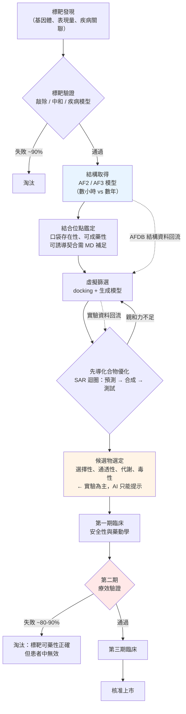

# 11.1 標靶藥物設計的加速器

## 一、漏斗的形狀：藥物研發的殘酷算術

藥物研發常被描述為一段「探索之旅」，但在工業現場它更像一條被反覆收窄的漏斗。最上端的入口是數以萬計的分子生物學發現：某條訊息路徑在某種組織中失調，某個基因在腫瘤中過度表現，某個酵素催化步驟是細菌存活的必要條件。這些發現構成「標靶候選池」，每一個候選都會被問同一個問題：值得投入十年與十億美元嗎？

漏斗的第一道閘門是「標靶驗證」。科學家會用基因敲除、抗體中和、細胞系比較等手段，試圖證明抑制或活化這個標靶真的會產生治療效果。這一步失敗率極高，主要原因不是機制錯，而是「生物學上重要」與「藥理上可操作」之間存在巨大落差：有些標靶在疾病中確實有角色，但它同時參與了太多其他生理功能，干擾它的副作用可能比疾病本身更嚴重。

通過驗證的標靶進入先導化合物發現階段，在這裡科學家合成或篩選數萬至數百萬個分子，逐一測試活性、選擇性與初步毒性，代價是數百萬美元與二到三年。結果通常只有數百個分子值得進入候選藥階段，其中再通過人體安全性與劑量探索的，只剩十幾到幾十個進入第一期臨床（phase I）。第一期的目的是確認「在人體內是安全的且有藥動學特性」，通過率大約在一成上下。第二期（phase II）才是真正對疾病患者測試療效，此時淘汰最為慘烈——許多生物學上合理的標靶在此被證偽，例如腫瘤細胞在藥物壓力下找到了繞過抑制的替代路徑。第三期（phase III）需要在數百至數千名患者身上驗證療效與安全性，最終獲准上市的比率仍只有一半左右。

把整條漏斗加總，一個新藥典型需要十年以上的時間與十億美元量級的資金，而這已經是二〇二〇年代製藥業在過去半個世紀大幅優化之後的數字。這種成本結構不是效率問題，而是風險結構問題：既然絕大多數候選注定失敗，理性的做法就是把更多資源投入「更早地殺死壞分子」。而「更早」這兩個字，正是結構預測在這個產業裡真正的位置。

## 二、結構作為先決條件

在 AlphaFold 之前，結構從來不是藥物研發的「步驟之一」，而是「能不能進入這一步」的前置門檻。藥物設計的核心動作，是把一個小分子放進標靶蛋白的某個凹槽裡，讓非共價作用力（氫鍵、疏水作用、離子作用、凡得瓦力）把兩者穩定地扣在一起。要評估這件事，你至少需要知道凹槽在哪裡、形狀如何、內側殘基的電荷分佈如何、以及它在水中的可接近性。如果蛋白質的三維結構未知，這些資訊一無所有。

這個前置門檻造成了一條極其陡峭的機會落差。有大量實驗結構的標靶——例如激酶、G 蛋白偶聯受體（GPCR）、核受體與蛋白酶——幾乎佔據了藥物研發的主要舞臺，因為這些家族成員多、序列保守、可結晶。反過來，缺少可信結構的標靶——尤其是獨特的、序列不保守的、沒有已知配體結合模式的蛋白——在傳統上難以進入小分子設計的視野。「沒有結構就沒有標靶」聽起來是悖論，其實是工程現實：不是生物學上不能，而是設計流程的第一步就被卡住了。

AlphaFold 2 在二〇二〇年公開模型、二〇二二年推出涵蓋逾兩億條序列的 AlphaFold 資料庫（AFDB）之後，這個門檻被大幅削平。凡是序列被測序、且落在 AFDB 覆蓋範圍內的蛋白質，幾乎都能在數分鐘內取得一個可信度不低的結構模型。這意味著「沒有結構就沒有標靶」的命題被改寫成「沒有結構的標靶數量驟降，而剩下的瓶頸轉移到別處」。

## 三、加速點一：結合位點的鑑定與可成藥性

結構到手之後，第一個立刻獲得收益的環節是「這裡到底有沒有可以下藥的地方」。這一步在傳統流程中成本高昂：通常需要先表達並純化蛋白質，再做結晶或 NMR 實驗以取得配體結合的電子密度地圖，有時還要跑突變掃描或核磁共振滴定，數月之際才能確認口袋的位置、大小、極性分佈、以及入口是否被柔性環狀區段堵住。

結構模型讓這個判斷在數小時內完成。更重要的是，預測模型不只給出「蛋白質的形狀」，還能以幾乎零成本生成**突變體**與**片段**的模型。研究者可以系統性地掃過數百個單點突變，用局部結構變化推估哪些殘基構成口袋的「壁」，哪些突變會讓口袋變得更深或更平。此時「可成藥性」（druggability）不再是靠直覺判斷的口頭詞彙，而是一個可以被量化、可以被機器學習模型吸收的特徵向量：口袋體積、口袋深度、口袋內的疏水性比例、可形成氫鍵的殘基數量、以及由 AF 模型的信心指數（pLDDT）所反映的局部構形穩定度。

這裡有一個重要的因果澄清：AFDB 給出的模型是「蛋白質在沒有配體時的構形」。真正的結合位點有時是誘導契合的結果——只有在配體結合後才形成的凹陷——這種情形下單靠 AF 模型會看漏。因此實務上可靠的作法是把 AF 模型當成起始的座標框架，讓蛋白質在分子動力學（MD）模擬中「有機會」閉合出隱藏口袋，再回頭檢查模型是否被扭曲。AF 的靜態模型加上實驗與模擬的動態約束，才是真正可用的結構。

## 四、加速點二：虛擬篩選的基準線被拉高

第二個收益點出現在虛擬篩選（virtual screening）。這是結構預測最常被高估、也最容易被誤解的一環，因此必須說清楚它的因果鏈條。

在 AF 之前，虛擬篩選受限於兩個瓶頸：第一，必須先有結構，所以能篩的標靶數量有限；第二，即便有結構，分子對接（docking）的預測精度有限。傳統對接在常見測試基準上的表現——能否正確重現已知結合模式並排除非結合者——大約在極低的水準上：以 ROC AUC 或 EF1% 這類指標衡量，許多靶點上的表現遠不足以在實務上省下合成的錢。

AF 模型改變的第一件事不是精度，而是**可用結構的數量**。當一個標靶有了可信模型，它的口袋就可以被拿去做大規模虛擬篩選，而無須等上好幾年的結晶。這才是命中率提升的主要來源。

AF 模型改變的第二件事是**基建的品質上限**。過去很多對接失敗，根因是模型本身有瑕疵：側鏈錯位、環狀區域歪斜、缺失的 loop 讓口袋形狀失真。AF2 在多數天然蛋白上的骨架精度相當高，這意味著 docking 的輸入品質從「常常很差」變成「通常夠用」。配合 AlphaFold 3（2024）對配體、核酸與修飾基的擴充，以及專為生物分子設計的對接工具興起，**docking 的基準線被系統性拉高**：同一個標靶，現代流程能篩出的命中率與候選多樣性，明顯優於同源建模時代。

但必須把話說到底：這是「基準線被拉高」，不是「預測等同於親和力」。虛擬篩選的輸出永遠是一個排序，而不是一個答案。真正的親和力必須由生化實驗回答。

## 五、加速點三：從零設計與配體生成

第三個加速點是設計（design），而非篩選（screening）。二〇二三年，David Baker 團隊發表 RFdiffusion，把擴散模型反向應用到蛋白質設計上：給定一個目標的形狀特徵（可以是口袋輪廓，可以是一條抗原表位），模型生成能達成該形狀的蛋白質主鏈。這意味著「先有結構假設、再去湊分子」被反轉成「先有形狀目標、再去找結合它的分子」。對藥物研發有兩個方向的意義：一是被稱為「de novo 骨架設計」的路線，讓科學家不必受限於天然蛋白的骨架庫；二是更重要的，**抗體與結合蛋白的設計**（下一節詳述）。

另一條平行線是**小分子生成**。把擴散模型用在配體上，讓模型在「化學有效性」的約束下生成候選分子，再以 AF3 或其他結構預測方法「回摺」檢查這些分子是否真的能結合指定的口袋。這個「生成—摺疊—篩選—再生成」的閉環聽起來像是把整個設計流程自動化了；實務上它確實產生了進入實驗管線的候選分子，但最誠實的描述是：它目前最可靠的產出，是**在已知口袋中產生親和力可接受的先導化合物與更多樣的 SAR 系列**，而更嚴苛的性質（成藥性、通透性）仍需大量人工與實驗把關。

## 六、加速點四：結合模式預測與 SAR 迴圈

第四個加速點位於藥物研發最昂貴、也最機械化的階段：先導化合物優化（lead optimization）。這個階段的工作本質，是圍繞一個已知活性的分子骨架建立 SAR（structure–activity relationship，結構－活性關係）圖譜——改變某一個取代基，活性如何變。每一輪 SAR 通常合成數十到數百個類似物並做一輪生化測試，耗時數月。

結構預測在這裡的加速機制相當直觀：研究者可以先在電腦上提出一個化學修飾的猜測，並**預測**它將如何改變結合模式——是讓氫鍵朝向催化殘基，還是造成立體阻礙？這個預測不保證正確，但它的價值在於「把數百個合成猜測壓縮成十幾個值得合成的選項」。在 SAR 迴圈中，**結構預測把串行的「合成—測試—理解」循環，變成可並行的「預測—篩選—驗證」循環**，並讓每次實驗的結果都能回饋到模型中。

更重要的是，這裡存在一個雙向的因果閉環：AlphaFold 資料庫本身帶有數億個天然蛋白的結構與序列對應關係，這些資料早已被產業界用於蛋白質配體複合體的虛擬篩選。換言之，AFDB 讓「蛋白質結構」這個維度變得便宜，而蛋白質配體複合體資料的累積，又回頭改善了 docking 與結合模式預測的機器學習模型。結構預測不是單向的捷徑，它正在形成一個自我強化的迴圈。

## 七、加速點五：抗體、nanobody 與蛋白質介面的設計

第五個加速點集中在生物藥（biologics），也就是抗體與其衍生形式。相較於小分子藥，抗體的優勢是選擇性高、毒性低；劣勢是組織穿透力弱、生產成本高、且口服不可行。因此抗體領域長期以「找到好分子」而非「便宜製造」為主要瓶頸，而結構預測在這裡解決的是前者。

傳統抗體設計流程是這樣的：先篩選出能辨識目標的 B 細胞或噬菌體展示庫，再做免疫原化學、晶體結構解析，最後才做工程化。這條流程的每一環都貴，而且每一環都依賴上一環的成敗。

RFdiffusion 在二〇二三年之後改變了其中一環。研究者給定抗原表面的一段區域作為目標形狀，模型直接生成能對接到該區域的**蛋白質骨架**——這是 nanobody（單域抗體）設計的重大推進，因為 nanobody 只需要一個結構域、體積小、穩定性高，本來就是設計生成模型最擅長的輸出型態。二〇二四年《自然》期刊發表的一批工作展示了以 diffusion 模型生成的 binder 對多種抗原（包括 SARS-CoV-2 棘蛋白與流感抗原）的實驗驗證，其中部分設計在實驗中確實展現出結合能力。

這裡必須立刻補上重要的限制：可結合不等於可用。生成的 binder 在實驗中能結合，但親和力往往落在 nM 數位而未必是 pM，要做到臨床可用的穩定性、溶解度、非特異性結合排除與免疫原性，仍需大量工程化與實驗優化。RFdiffusion 的貢獻，是把「從零造出骨架」這個原本需要數年的步驟壓縮成數週，並把完全隨機的搜尋變成目標導向的搜尋；它並沒有消除後續優化的工作量。

## 八、產業版圖的三個轉折點

學術突破要變成產業效應，需要資本、體制與資料的配合。二〇二〇年代中期，這條鏈上出現了三個轉折點。

第一個是 **Isomorphic Labs 的成立（二〇二一年）**，這家由 DeepMind 資深科學家創立的公司，主張以 AlphaFold 為核心進行「從標靶到候選藥物」的端到端設計。二〇二四年，Isomorphic 宣布與 Eli Lilly 及 Novartis 分別建立大型合作，兩筆交易的總規模依公開報導達數十億美元級別，這是史上首次出現由蛋白質結構預測公司直接與兩家大型藥廠在標靶發現與候選物設計上進行戰略合作。二〇二五年，據公開報導，Isomorphic 公布了其首個進入人體臨床的候選化合物，據稱是一針對 TNIK 標靶、與程序性死亡相關的小分子抑制劑，用於非小細胞肺癌。

第二個是 **Exscientia 與 Recursion 的合併（二〇二四年）**。這是把「設計」與「篩選」兩端縫合起來的嘗試：Exscientia 提供生成式化學與 AI 驅動的候選分子設計，Recursion 提供高通量的影像與自動化實驗平台。合併後的新公司以 Recursion 名義運作，並把來自 Exscientia 的 SyntheMol 等生成模型納入技術棧——這是一種「用模型產生假設、用機器人實驗驗證」的閉環嘗試。

第三個是 **Insilico Medicine 的 ISM001-055**（後更名 rentosertib）。這家公司採用「Pharma.AI」的流程：從靶點發現、分子生成，一直走到臨床。其 ISM001-055 是一個針對胸腺基質淋巴細胞生成素（TSLP）的口服小分子，據公開報導於二〇二四年進入第二期臨床試驗（phase IIa），用於特發性肺纖維化與相關呼吸道疾病。這個案例的重要性不在於藥效如何，而在於它把「AI 設計的分子」從「候選化合物」推到了「已給人體用藥」的位置。

然而必須同時說明清楚的現實：**截至本書撰寫時，尚沒有任何一款完全由 AlphaFold 設計並通過監管核准的藥物上市**。Isomorphic、Recursion、Insilico 的候選藥物都還在臨床階段的早期或中期；臨床失敗率並沒有因為用了 AI 而消失。AI 設計工具帶來的是「進入臨床的候選更多、速度更快」，而不是「成功率被革命性改變」。

## 九、誠實的邊界：結構瓶頸只是被移到下游

這一節是本章的重心。結構預測在藥物研發中的角色，最容易被誇大成「顛覆整個產業」，而最誠實的描述是：**它把一個在流程上游、無法用金錢直接繞過的瓶頸，轉移到了下游一個更容易用實驗解決的位置**。

具體而言，預測結構**不能**告訴你的事情包括：

| 面向 | 結構預測能提供 | 結構預測不能提供 |
|------|----------------|-------------------|
| 結合模式 | 高可信度模型下的結合構形推測 | 對誘導契合口袋、構形變換無能為力 |
| 親和力 | 幾何上的互補性、氫鍵幾何是否合理 | 結合自由能的真實數值、脫落速率 |
| 選擇性 | 口袋在演化上是否保守（跨物種比較） | 對同工酶、離子通道、受體的實際副作用 |
| 細胞通透性 | 幾乎無法提供 | 必須實測（細胞內濃度 vs 細胞外） |
| 代謝穩定性 | 幾乎無法提供 | 必須做肝臟 microsome、細胞與動物模型 |
| 溶解度與 PK | 幾乎無法提供 | 必須實測 |
| 毒性 | 可指出結構性警示片段（如 PAINS） | 必須做完整的毒理與安全性評估 |

這一表格背後的物理理由很簡單。蛋白質結合不是靜態的幾何配對，而是自由能平衡：ΔG = ΔH - TΔS，涉及去溶剂化、構形熵、應變能、水分子重新排列等數十個能量項；一項預測結構再準確，也只是給出了 ΔG 的一個幾何切片。而通透性、代謝、毒性更是**化學性質問題**，由分子在細胞環境中的行為決定，而不是由它在蛋白質口袋裡的形狀決定——一個結合完美的分子完全可能既穿不過細胞膜，又被肝臟的酵素在三分鐘內分解掉。

這就是為什麼真正的產業流程必須是「AI 生成 → 實驗驗證 → 資料回流 → 模型更新」的閉環。AI 的價值不在於取代實驗，而在於**讓每一次實驗更有資訊量**：更少的人力用於猜測「這個口袋在哪」，更多的人力用於回答「這個分子在人體裡會怎樣」。

## 十、漏斗與介入點

把上面這些串成一張圖，會發現結構預測並不是漏斗中的一個橫切面，而是**幾乎每一個環節的前置輸入**。以下示意標示介入點與仍然無法解決的瓶頸：

圖中藍色節點是結構預測真正壓縮時間的地方，橘色節點則是它無法省下的部分——因為那些是化學與生理問題，需要燒瓶與臨床。而紅色節點說明了另一個殘酷事實：第二期的失敗往往不是因為模型錯，而是因為生物學上的樂觀推論在人體中不成立，AI 對此幾乎無能為力。

## 十一、本節要點與思考

**要點回顧**

1. 藥物研發的真正瓶頸是風險結構而非效率：從發現走到上市典型需十年與十億美元量級，漏斗每一層都在大量殺死候選物。
2. 「沒有結構就沒有標靶」是工程現實而非生物學必然；AFDB 把這個門檻削平，使結構成為便宜而普遍的輸入。
3. 結構預測在五個環節加速：結合位點與可成藥性鑑定、虛擬篩選基準線提升、de novo 與配體生成、結合模式預測驅動的 SAR 迴圈、抗體與 nanobody 設計。
4. 產業轉折點包括 Isomorphic Labs 成立（2021）及其與 Eli Lilly、Novartis 的合作（2024）、Exscientia 與 Recursion 的合併（2024）、Insilico 的 ISM001-055 進入 phase IIa（據公開報導）。
5. 截至目前尚無「完全由 AlphaFold 設計並獲准上市的藥物」；AI 改變的是候選進入臨床的速度與數量，不是臨床成功率。
6. 親和力、選擇性、通透性、代謝穩定性與毒性仍由實驗決定——「瓶頸被移至下游」是本章最重要的誠實結論。

**思考問題**

1. 若虛擬篩選在有 AF 模型的情況下命中率提升，會不會反而導致「過度篩選」（over-docking）？大量低品質命中對後續 SAR 有什麼傷害？
2. 若一家藥廠把 AI 生成的分子大量推進臨床，而臨床成功率與傳統持平，這對藥廠的商業模型意味著什麼？請區分「速度提升」與「風險降低」的經濟效果。
3. 針對 AF 模型對誘導契合型口袋的不足，請設計一個把 AF 模型、分子動力學與 docking 串成閉環的流程，並指出每一環節可能的失敗模式。
4. 若一個標靶在演化上高度保守（跨物種），這對「選擇性」是有利還是不利？為何「口袋保守」與「可選擇性」的關係並非顯而易見？
5. 若十年後最難瓶頸已從「找到結構」轉移到「預測通性與代謝」，下一個值得投資的機器學習方向會是什麼？它的訓練資料從何而來，會遇到什麼資料瓶頸？