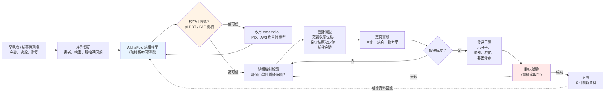

# 11.2 罕見疾病與抗藥性機制的破解

## 一、被結構遺漏的那一類疾病

若以結構可及性而非疾病人數來重新劃分疾病地圖，會看到一幅與公共衛生意圖極不協調的圖像。罕見疾病被定義為患者人數極少的疾病集合，國際上通常以「少於二十萬名患者」作為操作定義；這些疾病總數依統計口徑不同約有數千種，廣義的估計常引用七千種以上這個數量。每一種單獨來看都「不值得」投入傳統研發的十億美元級預算，但它們合起來構成了一個龐大的未被治療的集合——大多數罕見疾病至今沒有任何核准的治療藥物。

造成這種處境的，不只是商業考量，更是結構條件的必然結果。罕見疾病的致病基因，絕大多數是所謂的「孤兒基因」：它們在演化上相對年輕、或功能高度專屬、或序列保守度低，因此在實驗結構資料庫中找不到可靠的同源模板。以傳統的同源建模標準來看，序列相似度低於某個門檻的蛋白，模型就會退化為沒有資訊量的幾何裝飾；這意味著對這些標靶而言，研究者連一張「大致可以參考」的結構圖都沒有。

於是形成了一個閉環的困境：**沒有結構，就無法做結構基礎藥物設計；沒有藥物，就沒有對疾病生物學的深度理解；沒有生物學理解，結構的生物學意義又無從發揮**。這不是方法學上的細節，而是產業鏈條的斷點。

AlphaFold 2 與 AlphaFold 資料庫在二〇二〇至二〇二二年間做的事情，恰恰是切斷這個閉環：**它不依賴模板**。對一個完全沒有同源序列可對齊的孤兒蛋白，只要它本身是自然界存在的蛋白質（而非人工設計的序列），深度網路就能憑藉在數百萬個已知蛋白上學到的「蛋白質結構先驗」，直接產出一個合理的三維模型。對罕見疾病而言，這把「找模板」這個曾經決定一切的變數，改寫成「你有多少序列比對資料可用」這個溫和得多、也公平得多的條件。

## 二、從突變到結構：致病變異的機制解讀

罕見疾病研究中的一個核心問題是：某一個胺基酸的置換，為什麼會造成如此嚴重的病理？答案通常寫在蛋白質的三維層次裡，而這正是結構模型能立刻派上用場的地方。

### 2.1 2023 年前後的 GPCR 與離子通道案例

G 蛋白偶聯受體是人體最大的膜受體家族，數百種 GPCR 與視覺、嗅覺、味覺、荷爾蒙調控、以及多種神經精神疾病相關。離子通道家族則是癲癇、心律不整、偏頭痛與遺傳性骨骼肌病的關鍵節點。這兩類蛋白的共同難題是：它們是膜蛋白，且具有多個構形態（inactive、intermediate、active），實驗結構極難取得。

在 AlphaFold 之前，解析一個 GPCR 突變的結構影響，通常需要把突變受體重新表達並結晶——針對單一變異的結構研究往往耗時數年，且成功率不確定。AlphaFold 改變的，是「提出一個可檢驗的結構假設」的成本。研究者可以先預測野生型與突變型的結構，疊合後觀察局部氫鍵網絡、配體口袋的體積變化、以及氫鍵與鹽橋是否被切斷，再把這些假設交給實驗驗證。

據二〇二三至二〇二四年間的公開報導，這樣的工作已被用於解釋多個致病性 GPCR 突變（例如與垂體功能、視網膜病變相關的受體變異）以及多個離子通道突變（例如與遺傳性心律不整或癲癇相關的通道變異）如何在構形層面破壞通道的開關機制。這類研究的價值不在於它們產生了藥物，而在於它們把「這個變異為什麼致病」從一個只能靠猜測與大量取樣回答的問題，變成了一個可以先用計算提出機制假說、再以定向實驗檢驗的問題。

### 2.2 APOE p.Gly33Asp 與阿茲海默症風險：一個結構機制的示範

二〇二四年，《自然》期刊刊出的一項研究，為這個方法論提供了一個教科書級的示範。APOE 的 ε4 等位基因是阿茲海默症最強的遺傳風險因子，這一點早就是公共衛生層面的常識；但 ε4 究竟「做錯了什麼」，長期沒有結構層面的答案，直到該研究團隊報告了一個名為 p.Gly33Asp 的 APOE 變異（在族群研究中被稱為 APOE3-Jacksonville）——攜帶者在研究中展現出顯著更高的阿茲海默症風險。

關鍵在於結構。Gly33 這個位置位於 APOE 蛋白質的 N 端區域，而該區域正是 APOE 與其受體家族（包括 LDL 受體 LDLR 及 LRP1 家族）結合的關鍵區域。根據該研究的結構分析，Gly33 換成 Asp 後，側鏈的電荷性質發生反轉——從中性變成帶負電，而周遭的受體結合面上正是帶正電的殘基；原本關鍵的靜電互補因此被破壞，造成 APOE 與受體的結合親和力顯著下降。

這個案例的說服力來自它的因果完整性：它不只是「這個突變與疾病有關」，而是給出了一條可以說清楚的物理鏈條——**單一胺基酸置換 → 表面電荷分布改變 → 與受體的靜電互補崩解 → 脂質清除功能受損 → 神經元中脂質代謝異常 → 疾病風險上升**。而這條鏈條中的每一環都涉及結構，AlphaFold 提供的模型讓研究者得以在實驗室裡之外先看到它。

這也說明了為什麼「罕見病突變」特別適合結構模型：**突變是稀疏而局部的**。一個別人身上獨有的變異，往往意味著蛋白質上某個關鍵的化學性質被改變，而這種性質幾乎總是表現在三維表面上。

### 2.3 藥物代謝酵素的突變：劑量精算的分子基礎

另一類與臨床關係更直接的例子，是藥物代謝酵素的遺傳變異。CYP2C9 是維生素 K 拮抗劑（warfarin）最重要的代謝酵素之一，而它具有高度多型性——不同族群中帶有不同功能變異的個體比例相當可觀。CYP2C9 突變會改變酵素對藥物的清除速率，直接導致 INR 過高與出血風險，或清除過快而失效。這就是為什麼臨床上要求劑量必須依基因型個別化調整，也是為什麼在藥物標籤上會出現針對 CYP2C9 變異者的劑量建議。

在 AlphaFold 之前，解釋某一個 CYP2C9 變異為何造成功能下降，通常需要拿到突變酵素的晶體結構，並耗費大量時間。在 AF 模型時代，研究者可以先預測突變前後的結構，判斷變異是否發生在活性中心附近、是否破壞了與 heme 的定位、是否使活性位點體積縮小而無法容納受質；再以動力學實驗驗證。而要特別強調的是，這些預測的真正產出不是一個劑量數字，而是一個**機制分類**——這類變異是「活性位點阻斷」還是「摺疊不穩定」，兩者的臨床意義完全不同。

## 三、抗藥性：當結構被用來解釋「為什麼失效」

藥物抗藥性的機制研究，是結構生物學最早證明價值的領域之一（結核藥物抗性基因的結構工作可追溯至一九九〇年代），如今也成為 AlphaFold 展現價值的另一個舞臺。抗藥性問題的本質是：**病原體或腫瘤在治療壓力下改變了標靶的結合位點，使原有藥物不再結合**。這是一場分子層面的軍備競賽，而理解軍備競賽的前提，是看清雙方的武器。

### 3.1 抗體逃脫突變

單株抗體藥物面臨的一個特有問題是「抗體逃脫」（antibody escape）。病毒、腫瘤細胞、甚至製造抗體的生產細胞株，都可能藉由突變使抗原表位的殘基發生改變，導致抗體的接觸面積減少、氫鍵或疏水接觸被替換，進而讓結合親和力驟降數個數量級。

二〇二四年至二〇二五年間有數篇研究利用 AlphaFold 類工具解釋這類突變，涵蓋對抗 EGFR 抗體的表位逃脫、以及 CGRP（降鈣素基因相關胜肽）受體相關抗體的抗藥性突變分析。這些工作的共同邏輯是：先用 AF 模型取得野生型抗原／受體的結構，再預測突變後的局部構形變化，判定哪些接觸殘基的改變足以解釋親和力的損失，最後以結合實驗（例如 ELISA 或表面電漿共振）印證。

這裡有一個必須誠實說明的技術限制，否則整段論述會過度樂觀：**AlphaFold 2 對單點突變的局部結構變化預測能力有限**。理由在架構層面——AF2 的輸入是演化對齊資訊與序列，而單點突變幾乎不改變多重序列對齊結果，因此它在數學上「感覺不到」這個突變；模型輸出的往往是一個幾乎與野生型相同的結構，連局部側鏈的旋轉方向都不一定改變。這意味著以 AF2 為基礎的突變分析，實質上是在做「野生型結構上的幾何推理」，而不是真正的變異體結構預測。

實務上可靠的作法有幾條：改用能處理配體與複合體的 AlphaFold 3 來預測突變與配體的複合體；採用 ensemble 策略——對突變體生成多個不同的初始摺疊起點並比較構形分布；或者直接做分子動力學模擬以捕捉局部重排；近兩年也出現了專門針對複合體的開源模型（如 Boltz 系列）試圖改善這一環節。理解這個限制，是正確使用結構預測的關鍵：它更擅長回答「這個突變是否發生在功能關鍵區域」，而不太擅長回答「這個突變讓局部構形精確地轉了多少度」。

### 3.2 HIV 抗病毒藥的抗藥性

HIV 的抗病毒藥物抗性，是結構驅動的分子設計最成熟的戰場之一。蛋白酶抑制劑與反轉錄酶抑制劑的設計，本質上就是在抵禦病毒酵素的突變——病毒在治療壓力下以每代數十億分之一的速度產生變異，任何一個直接接觸藥物分子的殘基突變都可能造成失效。

而這裡出現了一個漂亮的因果迴圈：因為病毒突變是密集且同源的，HIV 序列資料庫異常豐富，AlphaFold 的多重序列對齊機制因此特別有效——AF 模型對 HIV 蛋白酶與反轉錄酶的結構預測相當可靠。研究者可以快速取得野生型與任一突變株的模型，比對藥物結合位點的三維重排，判斷某個抗藥性突變是透過「直接頂替結合位點」、透過「改變口袋容積」、還是透過「改變構形平衡」來生效。新的抗藥性突變在臨床監測中被發現後，往往在數週內就能給出結構性的解釋與可能的補救策略——這在過去需要耗費數年。

### 3.3 SARS-CoV-2 變異株與抗體逃脫

新冠疫情把「結構預測對抗藥性與免疫逃脫的價值」推到了公共視野。AlphaFold 團隊在二〇二〇年就公開了病毒蛋白質的結構模型（包含原始株、Alpha 與 Delta 變異株），供全球研究者使用；隨後研究社群累積了對omicron 變異株（包括 BA.1、BA.2、BA.5 與後續衍生株）的結構與中和逃脫機制的大量分析。

其中的因果鏈是清晰而可教學的：變異株在抗原決定位的替換 → 表面形貌改變 → 抗體的接觸面減少或氫鍵重排 → 中和效力下降 → 免疫逃脫。而結構模型的作用，是把「這個變異株逃脫了某些抗體」這個免疫學觀測，翻譯成三維幾何層面的具體理由。這也直接支撐了後來針對變異株的抗體工程——例如依據結構辨識出哪些殘基是最可靠的共同抗原決定位（conserved epitope），從而設計能跨變異株生效的抗體。

## 四、結構啟發式的設計：從解釋走向設計

到這裡，結構預測在罕見疾病與抗藥性領域的角色還只是「解釋」。真正的價值出現在它能反過來指導設計的時候，而這正是本章與前一章的接點。

第一條路徑是**疫苗設計**。傳統的疫苗設計是一個試錯過程：從病原體篩選抗原，找出能誘發強烈免疫反應的分子，測試，再測試。結構預測讓研究者能夠直接檢視候選抗原的表面，把抗體的接觸區域與抗原決定位疊合，預測「這個改造是否會削弱抗原決定位、是否會讓抗體逃脫變異株」。這把疫苗設計從「大量嘗試並挑選」推向「在已知幾何下做定向改造」。

第二條路徑是**抗體與 nanobody 的定向工程**。如同前一章提到的 RFdiffusion，設計模型可以在指定的抗原表面上生成結合蛋白骨架；而一旦有了野生型抗原的結構（可能是實驗解析，也可能是 AF 預測），設計者就能明確指定「我要這個抗體結合抗原決定位的這三個殘基」，並且在設計過程中把「避免產生逃脫突變」當作一個明確的目標函數。

第三條路徑是**罕見病的結構化標靶發現**。這裡有一個更微妙但更重要的應用：對罕見疾病而言，AF 模型不只幫助設計藥物，也幫助「理解疾病」。當研究者能在一個致病突變蛋白的模型上標註出所有與已知疾病相關的功能位點、與已知配體的結合位點、以及與相關家族成員的差異區域，他們就能反過來問：**這個突變破壞的究竟是哪個功能？哪個化學性質？哪個可能的藥物結合位點？** 這個問題的答案，往往就是標靶的確認。

於是出現了一個反直覺但合乎邏輯的結論：**對罕見疾病而言，AlphaFold 的第一個經濟價值可能不是「找到藥」，而是「找到靶」**。

## 五、方法論的誠實邊界

以下幾點必須寫清楚，否則本章的樂觀基調會造成誤導。

第一，**AF 模型不是定論，而是可檢驗的假說**。預測結構給出的是一個幾何模型，其可信度由 pLDDT 與 PAE 標示。對罕見病突變而言，最有價值的用法是「讓研究者知道該把實驗集中在哪裡」，而不是「用模型宣布這個突變的機制」。

第二，**突變效應預測是當前最薄弱的一環**。如前所述，AF2 在單點突變上的局部結構預測能力有限，而罕見疾病研究恰恰以單點甚至多點突變為主。這個缺口需要 ensemble、分子動力學、AF3 與專門的複合體模型來填補，也需要方法學上的新進展。這是 AlphaFold 之後最值得投入的研究方向之一。

第三，**功能不等於結構**。一個蛋白在 AF 模型中可能有很好的預測結構，卻在細胞內扮演完全不同的角色——因為它的功能可能依賴構形轉換、翻譯後修飾、寡聚化、或細胞環境中的配體。AF 模型再準，也不會自動解出這些事實。

第四，**臨床的終審依然存在**。截至本書撰寫時，尚未有以 AlphaFold 結構為核心設計的藥物通過第三期臨床並獲准上市。罕見疾病領域尤其如此——小族群、缺乏生物標記、疾病異質性高，使得即使分子層面的機制完全正確，臨床試驗也可能失敗。機制正確與療效存在之間，仍隔著隨機對照試驗這道牆。

把上述限制與工具配成一張速查表，可以看清「哪一種問題該用哪一種方法」：

| 問題類型 | AF2 模型能給的 | AF2 的不足 | 建議的補足手段 |
|----------|----------------|-----------|----------------|
| 突變落在哪個功能區域 | 可信的三維座標與殘基空間排列 | 對單點突變的局部變化幾乎無感 | 直接檢視模型，輔以序列保守性分析 |
| 突變是否破壞關鍵氫鍵／鹽橋 | 幾何上的可達性與環境 | 突變後側鏈朝向與局部重排不可靠 | ensemble 摺疊 + 分子動力學 |
| 突變體與配體的結合模式 | 無（AF2 不直接處理配體） | — | AlphaFold 3 或專門的複合體模型 |
| 致病性分類（位阻 vs 電荷） | 表面電荷與疏水性的大致比較 | 定量可靠性有限 | 結合生化動力學實驗驗證 |
| 藥物代謝酵素的突變效應 | 活性位點的幾何位置 | 缺乏真正的突變體構形 | 定點突變表達 + 酵素動力學 |

## 六、從解釋到干預：一個循環

把本章的邏輯整理成一個循環，可以看出它與第 11.1 節的差別與關聯：

這個循環有兩個關鍵樞紐。藍色的結構預測節點，改變了整個循環的「入口成本」——以前必須先有實驗結構才能進入機制研究，現在序列本身就是起點。橘色的檢核節點，則代表方法學的自我糾錯能力：當預測不可信時，流程會主動退回更昂貴但更穩健的替代方案，而不是把壞模型硬推下去。

## 七、本節要點與思考

**要點回顧**

1. 罕見疾病（約七千種以上）的困境在於其致病基因多為孤兒基因，缺乏實驗結構與同源模板，而「沒有結構就沒有標靶」在舊流程中是無法用錢繞過的斷點。
2. AlphaFold 的關鍵特性是「不依賴模板」，這使罕見病突變蛋白第一次獲得了可信的結構假設來源，把成本從「數年實驗結構」降到「數小時計算」。
3. 二〇二四年《自然》期刊報導的 APOE p.Gly33Asp 研究是結構機制解讀的示範：單一胺基酸電荷反轉破壞了 APOE 與受體的靜電互補，提供了從突變到疾病風險的完整因果鏈。
4. 抗藥性領域（抗體逃脫突變、HIV 抗病毒藥抗性、SARS-CoV-2 免疫逃脫）受益於結構預測，因為這些問題本質是「結合位點幾何被改變」；HIV 案例因序列資料豐富而特別成功。
5. 最重要的誠實限制：AlphaFold 2 對單點突變的局部結構變化預測能力有限，因為單點突變幾乎不改變多重序列對齊，模型「感覺不到」突變；需以 ensemble、分子動力學與 AF3 等手段補足。
6. 對罕見疾病而言，AlphaFold 的第一個經濟價值可能不是「找到藥」，而是「找到靶」——結構讓研究者知道該把實驗集中在哪個功能位點。

**思考問題**

1. 對一個沒有任何同源模板的孤兒蛋白，你會用哪些指標判斷 AlphaFold 模型是否可用？請說明 pLDDT、PAE 與「功能位點是否落在低信心的 loop 上」三者如何聯合判讀。
2. 假設某個罕見病突變的 AF 模型顯示局部氫鍵網絡被破壞。請列出至少三個替代機制（摺疊不穩定、動態平衡改變、細胞定位改變等），並說明每個機制需要什麼實驗來區分。
3. 病毒逃脫抗體與腫瘤逃脫抗體，在「可預測性」上有何本質差異？為什麼前者適合用結構做前瞻性設計，而後者較難？
4. 若要為一個罕見病患者做個人化用藥（例如調整抗癲癇藥劑量），請評估「用 AF 模型預測突變對酵素活性影響」在這條臨床路徑上能扮演什麼角色、能扮演不了什麼角色。
5. 有人主張「既然 AF 模型如此精準，藥物設計的最終瓶頸將是實驗通量而非計算」。請評估這個主張，並指出若此說成立，產業的競爭優勢會集中到哪種能力上。
