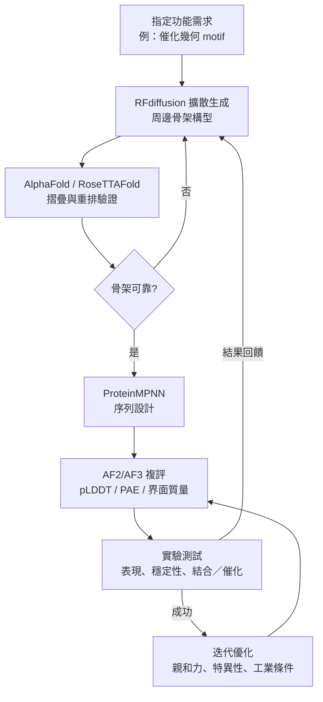

# 12.2 蛋白質設計與人工酵素：RFdiffusion 的逆向設計（2023）

## 設計蛋白質的兩種哲學

在 AlphaFold 之前，「設計一個蛋白質」這件事其實隱含著一個假設：設計的目標是重現一個已經存在的形狀，也就是把序列與結構之間的對應關係反推出來。這個假設支配了蛋白質工程的大半個歷史，而它之所以成立，是因為生物學中幾乎所有被研究的蛋白質，本來就是從自然界取出來的。

但設計科學家很清楚地知道，這個假設限制了上限。如果只能在既有的形狀集合裡挑選，那麼設計就永遠只能是模仿。真正的問題是：能不能**指定一個自然界從未出現過的形狀**，然後造出實現它的序列？這是「正向設計」與「逆向設計」的分水嶺，也是本章的主軸。

在正式進入工具之前，先把這段歷史梳理清楚，因為 RFdiffusion 的位置只有在這條線上才能被準確理解。

## 從負設計到正設計：一段被低估的方法論轉折

蛋白質設計的第一個重要方法論突破來自二〇一〇年前後的「負設計」（negative design）路線。其邏輯是：不直接指定想要什麼，而是指定「不要什麼」——排除掉所有會造成不需要的摺疊行為或錯誤寡聚的序列。具體做法是設計一個目標序列，再用分子動力學模擬去「搜尋」它的摺疊行為，同時持續篩掉那些在模擬中錯誤摺疊的變異株。這個想法很巧妙，但它的工程成本極高：每個設計循環都需要跑模擬，而模擬本身的耗時與不可靠性，讓它難以擴展到數千個候選。設計一個可以成功實驗驗證的螺旋束構件，往往需要數年的時間與大量的人力。

正設計（positive design）的轉折點，來自英國布里斯托大學的 Tom Woolfson 團隊。他們提出了一個關鍵的重新表述：**不要設計序列，而是設計「設計原則」**。所謂 α-螺旋束（alpha-helical bundle）設計原則，是用數學上可控的方式，把兩條、三條或四條螺旋，以特定的交錯方式（coiled-coil 或 helix–sheet–helix）排列在固定的三維框架上。同時，交錯處的 heptad repeat 模式被刻意設計成能穩定疏水核心。關鍵在於，這些原則不是一個具體的分子，而是一整族分子——它給的是一個可以參數化、可以系統化改變的建構詞彙表。

二〇一〇年，Woolfson 團隊發表了他們最具影響力的成果之一：一組名為 CC-Di 的螺旋束設計，它們具有高度不尋常的螺旋數目排列（其中兩個在天然蛋白質中極為罕見），並且能夠在水中自發組裝成穩定的單體三聚體。這是設計科學歷史上第一次令人信服地展示：我們不只是在模仿自然，而是在**援引一組幾何上可行但自然界偏好避免的拓撲結構**，而自然界之所以避免，是因為在傳統的序列—結構直覺下它看起來不該成功。

這個案例確立了蛋白質設計的一個關鍵方法論：**用幾何規則取代生物學偏見**。自然界受到演化歷史、蛋白質折疊漏斗地形、序列共演化网络的約束，因此許多在幾何與化學上完全可行的結構，從未在演化中被嘗試過——不是不能，而是不會。設計科學的任務，就是系統性地探索那個「演化未占據」的空間。

## 分子動力學時代的酵素設計：Kemp eliminase 與它的教訓

與此同時，酵素設計在另一條路線上獨立發展，其核心工具是過渡態理論（transition state theory）與量子化學。

過渡態理論提供了一個清晰的設計目標：如果一個酵素能夠穩定反應的過渡態相對基態的程度，達到未催化反應的 $10^{15}$ 至 $10^{17}$ 倍，那麼它就能把反應加速到接近擴散控制的極限。這意味著，酵素設計在原理上可以被表述為一個幾何問題：設計一個蛋白質的活性位點，使其**過渡態的幾何形狀與電荷分布，恰好互補於催化反應所需的排列**。

二〇一〇年，Rosetta 團隊的 Baker 與 colleagues 發表了一個里程碑式的成果：設計出催化 Kemp eliminase 反應的蛋白質。這個反應機制相當簡單——胺基酸的 β-碳上移除一個質子，同時形成共軛烯醇——但自然界沒有任何已知的酵素以這個方式催化它。設計團隊的做法是：先用量化學計算出過渡態的幾何形狀，再依據過渡態的幾何建立一個「活性位點骨架」，然後用蛋白質設計演算法（結合序列設計與力場模擬）找出能穩定這個骨架的胺基酸序列。

結果令人震驚：設計出的蛋白質確實能催化反應，速率提升可觀，且活性可透過突變進一步調整。幾乎同一時期，針對其他機制（傅–克喬克–柏–魏爾德曼轉換的逆轉）也出現了類似的成功案例。

但這些成果同時揭示了當時設計方法的侷限與一項至今仍具關鍵性的教訓：**在模擬中穩定過渡態的設計，不保證在實驗中催化反應**。當時的成功案例，仍然需要設計團隊手工挑選突變、把酵素表達、純化、做一連串的突變掃描，才能辨認出真正有活性的那一兩個變異株。設計階段的產出率極低：設計一百個候選，能實驗確認有活性的可能只有零星幾個，而其中真正達成高效催化的又是更小的子集。設計的瓶頸不在於想法，而在於**設計演算法與實驗之間那個低效率的介面**。

這正是 2020 年 RoseTTAFold 與 AlphaFold 的降臨所改變的第一件事：預測結構變得便宜且精準，於是「實驗驗證」不再是搜尋的第一步，而可以直接被用來**評分**已經產生的設計。RoseTTAFold 團隊隨即展示了所謂的「**蛋白質設計的迭代流程**」：先用摺疊預測篩選出可靠的設計，再用實驗檢查活性，實驗結果反過來再去改變設計演算法的目標函數——例如為了提高可製造性，把「蛋白質表面避免非天然胺基酸」之類的工業約束加入篩選條件。這是設計工作流第一次形成閉環。

## ProteinMPNN：把序列設計變成一個學習問題

二〇二二年，David Baker 團隊發表了 ProteinMPNN（Protein Message Passing Neural Network），把序列設計這一步徹底重新工程化。

此前的序列設計方法（例如 ProteinGym 時代常見的固定骨架序列設計，或依賴 Rosetta 的序列設計流程）成本高且難以精準控制。ProteinMPNN 的做法是：把蛋白質骨架視為圖，胺基酸種類視為節點特徵，序列設計視為一個圖上的分類問題，用 message passing neural network 學習「給定骨架與局部結構環境，每個位置應該放什麼胺基酸」。訓練資料是天然蛋白質資料集，標籤是天然序列，因此模型學到的是「在這個形狀下，自然界會選什麼」。

這個方法的關鍵改變有兩點。其一是**速度**：設計一個蛋白質的序列從數小時（甚至數天）降到數秒到數分鐘，使得「對同一個骨架嘗試數十到數百個序列」成為可行策略。其二是**可控性**：模型提供可控的採樣溫度，讓設計者可以在「最可能的序列」與「更具多樣性的序列」之間取捨。這使得設計者能夠同時產生「保守型」與「探索型」候選，系統性地掃過序列空間的局部與遠端區域。

更深層的意義是，ProteinMPNN 把序列設計從「物理模擬問題」轉成了「**統計學習問題**」。這是一個典範轉移：不是因為序列設計的物理原理變了，而是因為機器學習在這個特定問題上的樣本效率遠高於物理方法。隨後 ProteinMPNN 迅速成為整個蛋白質設計領域的標準配件，並且是 RFdiffusion 工作流程中不可或缺的一環。

## RFdiffusion：把「生成」重新定義為「去噪」

二〇二三年，Watson 等人在《自然》期刊發表了 RFdiffusion（RoseTTAFold Diffusion），這是本章的核心事件。

要理解它的突破，需要先理解 AlphaFold 3 使用的擴散模型機制（見第 10 章）。在那套框架裡，生成的意思是：從一個完全隨機的三維結構出發，反覆進行去噪步驟，逐步把座標推向一個符合物理與序列資訊的合理構形。RFdiffusion 做的事看似相同，卻有一個關鍵的改寫：**它把「給定序列生成結構」改成了「給定部分結構生成結構」**。

更具體地說，RFdiffusion 是一個**條件生成**的擴散模型：它的條件（conditioning）可以是一段指定的骨架（motif），也可以是一段指定的胺基酸序列。當條件是 motif 時，模型的工作是「繞著這個 motif 編織出一個完整的蛋白質骨架」。這聽起來簡單，但它的深層後果極大——它意味著設計者可以**先決定催化位點的三維形狀，再讓模型去生成承載這個形狀的整個蛋白質**。

這是本章最重要的因果轉折。回想第 12.1 節提到的 de novo 酵素設計困境：酵素設計需要一個滿足多重正交約束的序列，而力場方法難以同時最佳化。RFdiffusion 的作用，是把其中最難的那一項——「建立一個能穩定特定催化幾何的三維骨架」——從最佳化問題中抽取出來，交給一個學會了蛋白質幾何先驗的生成模型。剩下的序列設計交給 ProteinMPNN，摺疊可靠性的評估交給 AlphaFold 類模型。

換言之，**RFdiffusion 補上了 AlphaFold 不會生成的能力**。AlphaFold 2 是判別式模型：給定序列，它預測最可能的結構；它不會從零創造一個序列從來沒有過的形狀。RFdiffusion 則是生成式模型：它能產生新的骨架。要理解這個分工，可以想像 AlphaFold 是有一位頂尖的結構技師，拿到序列就能畫出結構，但不能憑空發明新玩具；RFdiffusion 則是設計師，能依規格畫出新玩具的圖紙；ProteinMPNN 是負責把圖紙轉成可加工零件清單的工程師；而實驗室是驗收工廠。

設計流程可以用下圖概括：

這張圖的重點不只在於流程的順序，而在於那個回饋迴路。設計不再是單向的「提出一批候選、碰運氣」，而是一個測量驅動的迭代系統。

## 成果一：Binder——把「設計一個蛋白質」變成可完成的工程

RFdiffusion 最具說服力的成果，是二〇二四年 Rossetti 等人發表在《科學》期刊的 Binder 系列工作。他們設計出了能結合 SARS-CoV-2 棘蛋白（spike protein）受體結合區域（RBD）的迷你結合蛋白（minibinder），並且設計了一類能結合 MERS-CoV 棘蛋白的分子。

這項工作的意義不僅在於「做出了一個有效的新蛋白質」，而在於它同時做了三件事：其一，設計出的 Binder 親和力達到與天然抗體相當的等級，且經過實驗結構解析驗證，與設計模型的差異極小；其二，整條流程在推理與實驗的總時間上以週計，而非以年計；其三——這一點最具顛覆性——他們設計了能**同時**結合 SARS-CoV-2 與 MERS-CoV 的分子，也就是把「廣泛中和」這個免疫學上極難達成的目標，直接編碼進了設計的幾何約束裡。

這就是 motif 條件生成的威力：當你可以用一段三維幾何來指定「我要這個分子去碰這個東西」，設計問題就從一個千維的連續最佳化，變成了一個「條件分布取樣 + 序列填補 + 實驗篩選」的工程問題。

同期的另一條重要路線是**金屬酵素的 motif scaffolding**：以某個金屬配位幾何（例如鋅、鐵、銅的配位排列）作為 motif，讓模型生成圍繞它的骨架，再設計側鏈來完成催化所需的電子與質子傳遞。這種「金屬位點為種子」的設計策略，讓科學家不必從零開始建立複雜的催化中心。

## 設計方法的年代與成果：一次工具鏈的累積

回顧這條歷史可以看到，某個領域的突破往往不是來自單一的天才時刻，而是來自一連串彼此咬合的零件各自到位。下表整理了 de novo 設計與酵素設計方法鏈上的關鍵節點，呈現出一種典型的工程累積型態。

| 年份 | 方法／事件 | 對設計能力的改變 | 殘餘瓶頸 |
| --- | --- | --- | --- |
| 2000s | 負設計（排除摺疊行為的序列搜索） | 建立「可設計摺疊行為」的目標 | 每個候選需跑模擬，極慢 |
| 2010 | 螺旋束設計原則、CC-Di（Woolfson 團隊） | 幾何規則取代序列盲搜，可參數化 | 尚無可靠預測工具可篩選 |
| 2010 | Kemp eliminase 設計（Baker 團隊） | 首次以過渡態幾何設計出自然界不存在的催化反應 | 設計→實驗的成功率極低 |
| 2020 | RoseTTAFold | 摺疊預測便宜且準，形成「設計—驗證」閉環 | 序列設計仍昂貴 |
| 2022 | ProteinMPNN | 序列設計由物理模擬改為統計學習，速度提升數個數量級 | 骨架本身仍需人給 |
| 2023 | RFdiffusion（Watson 等人） | 由 motif 條件生成全新骨架，補上 AF2 不會生成的部分 | 生成骨架需獨立摺疊檢驗 |
| 2024 | Binder 系列（Rossetti 等人） | 幾何約束可直接指定親和力與廣泛交叉反應性 | 工業穩定性仍在設計盲區 |

## 成功率：從不到百分之一到數十個百分點

設計領域最容易被行銷扭曲的數字，是「成功率」。所謂成功率，取決於分母是什麼：以設計的序列數計、以通過摺疊驗證的數計、還是以投入實驗的數計。在二〇一〇年前後的 de novo 設計中，「設計出可實驗驗證的蛋白質」的成功率往往在百分之一以下；那個時代的核心限制不是想法，而是篩選工具的缺席。

到了二〇一九年至二〇二四年間，這個數字發生了質變。報導的整體成功水準從「偶爾成功」提升到「相當比例的候選在實驗中摺疊並具有預期功能」。這種提升並非來自單一技術，而是三件事的疊加：

第一，**摺疊驗證的精準度**。AlphaFold 與 RoseTTAFold 讓設計者能在實驗前濾掉幾乎所有「不會摺疊成目標形狀」的候選。這一步把分母從「所有設計」壓縮成「所有能摺疊的設計」。

第二，**序列設計的效率與可控性**。ProteinMPNN 讓每個骨架可以配上一整族序列變體，且能依需求控制序列的保守程度。

第三，**實驗迴路的閉合**。實驗結果（尤其是失敗的結構）回流為模型的訓練資料，讓「什麼樣的骨架其實不可行」變成可學的訊息。這一點與第 6、7 章描述的 AlphaFold 演化過程驚人地相似——同樣是「預測—比較—修正」的循環。

值得注意的是，RFdiffusion 的設計本身也被 AlphaFold 用來評分。設計完成後，把候選骨架交給 AF2 摺疊，看它是否重現設計者的意圖、重現的能量與介面品質。這一步是至關重要的，因為**擴散模型有時會生成統計上合理但物理上脆弱的骨架**——它符合「蛋白質長什麼樣」的分布，卻不滿足「這個摺疊態真的存在且穩定」。用 AlphaFold 作為獨立的摺疊檢驗器（folding checker），正是把 AF2 從「預測結構」轉變為「**評分函數**」的典型例子。同樣的角色轉變也出現在蛋白質—蛋白質界面的預測、對抗性序列設計、以及以結構為條件的序列生成等工作中。

## 設計範式的成熟，與它的邊界

到二〇二五年，蛋白質設計的技術鏈已經相當完整：指定 motif → 擴散生成骨架 → 摺疊驗證 → 序列設計 → 實驗測試 → 迭代優化。這條鏈的每一環都有公開、可用、且被大量工作交叉驗證的工具。

但「成熟」不等於「解決」。有幾個邊界必須被誠實標示。第一，設計的目標功能通常受限於那些可以被幾何表達的性質：形狀互補、結合親和力、催化幾何的排列。無法用三維幾何編碼的東西——可溶性表達的細微差異、翻譯後修飾的效應、細胞內環境的酸鹼值、蛋白質之間的協同行為——仍舊在設計的射程之外。第二，催化活性的絕對水準依然是一個實驗問題。設計能給你「形狀對了」，給不了你「 $k_{cat}/K_M$ 夠高」，因為後者取決於過渡態穩定能、溶劑脫水、產物釋放速率、以及蛋白質在工業條件下的長程穩定性這些難以在推理階段量化的因素。第三，最終的驗證成本仍由實驗室承擔，而酵素的工業化門檻（熱穩定性、溶劑耐受、量產成本）幾乎完全在設計的盲區。

正是這個盲區，構成了下一節主題的必要性：如果設計工具已經可以在數週內產出候選，那麼「候選從哪裡來」就不再是瓶頸；而整個科學社群的瓶頸，正在轉移到另一個更基礎、更普遍、也更接近日常科研的問題——我們是否已經擁有足夠多、足夠可靠、足夠容易取得的結構資訊？

## 一個更廣的迴響：設計能力的民主化

在評估 RFdiffusion 這類工具時，還有一個結構層面的影響值得記錄：**蛋白質設計從少數頂尖實驗室的專長，變成了廣泛可及的技術**。過去，一個實驗室要進入 de novo 設計，需要領域知識、算力、以及把數個複雜軟體串接起來的工程能力；今天，一個受過基本訓練的研究者可以使用公開程式碼與公開權重，在數週內產生並測試數百個候選。

這意味著當設計不再是瓶頸，競爭會轉移到別處：轉移到那些「知道該設計什麼」的洞察、轉移到製造與純化的工程、轉移到臨床與產業的驗證。設計工具的民主化，往往意味著真正的價值會向上游移動——從「能不能做出來」移到「做什麼最值得做」。

這個觀察把問題帶回資料與基礎設施層面。而那，正是 AlphaFold 資料庫所做的事。
