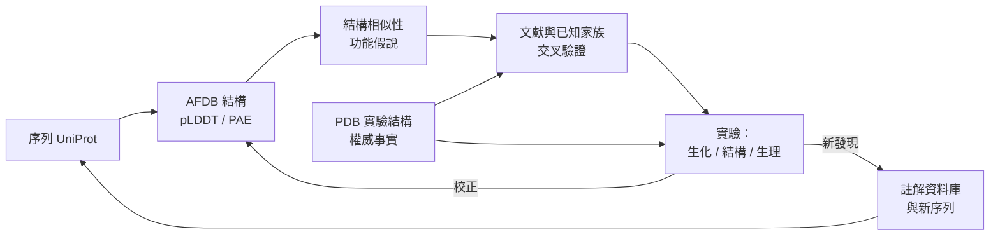

# 12.3 AlphaFold 資料庫（AlphaFold DB）對全球科學界的開放與影響（2022）

## 一次結構預測的變身：從模型到基礎設施

二〇二〇年八月，AlphaFold 2 的原始碼與模型權重在《自然》期刊發表的同時公開，接著在 CASP14 大賽上奪得全數要害類別的第一名。在那段時間裡，DeepMind 把模型開放給了全球研究社群使用。兩年的時間裡，這件事主要以「工具」的形式存在於科學家的桌面與伺服器上：下載權重、安裝套件、準備輸入序列、等待運算、讀取輸出。

但工具與基礎設施之間有一道質的門檻。工具要求每一位使用者都付出設定成本：足夠的算力、對輸入格式的了解、對模型侷限的判斷、以及處理輸出的耐心。而基礎設施改變的是**搜尋成本**——當某個資訊變得幾乎零成本地可得時，人們會徹底改變工作的方式，而不只是加快原有的方式。

AlphaFold 資料庫（AlphaFold Protein Structure Database，簡稱 AFDB）正是這個轉身的產物。二〇二二年二月的《自然方法》（Nature Methods）論文（Varadi 等人）宣布，DeepMind 與歐洲分子生物學實驗室（EMBL）的歐洲生物資訊學研究所（EMBL-EBI）合作，將 AlphaFold 預測結構以免費、公開、且幾乎沒有使用限制的形式釋出，提供涵蓋絕大多數已註解蛋白質序列的結構資料庫。

論文的時機與形貌都值得留意。這不是一篇提出新方法的論文——方法在一年多前就已發表——而是一篇**基礎設施的論文**：它的主要貢獻是解釋資料從哪裡來、如何生成、如何評估品質、採用什麼授權、涵蓋多少序列，以及如何讓社群使用。

## 技術與規模：兩億條序列與兩種信心

AFDB 的第一版涵蓋了 UniProt 參考蛋白質資料庫中大約兩億條序列，這在當時幾乎是整個已註解蛋白質宇宙的全貌。它的技術骨架可以拆成幾個部分來理解。

首先是**預測的輸入**。AFDB 的每個條目都是一條來自 UniProt 的序列，經過 AlphaFold 2 模型的完整推論，並且——這點相當重要——是**整條序列、包含所有區域的一次性預測**。這意味著資料庫中不只有摺疊結構，也包含被模型判定為無序、因而沒有可信三維結構的區段。這種「連無序區一起給出」的處理方式，對後續的動態與 disorder 研究極其重要。

其次是**品質指標的雙軌制**。AFDB 為每個條目提供兩組信心數值：全蛋白質層級的 pLDDT（predicted local distance difference test），以及以結構單元為單位的 PAE（predicted aligned error）。pLDDT 給出的是每一個胺基酸殘基「其位置預測得有多可信」的估計；PAE 則給出「任意兩個結構單元之間彼此對齊得有多可靠」的估計。兩者的區別在實務上極為重要：一個蛋白質可以有很高的平均 pLDDT（因為大部分區域折疊良好），同時在兩個結構域之間有很高的 PAE（因為它們之間的相對朝向不確定）。這對功能註解與介面研究是決定性的，因為後者往往正是人們最需要資訊的地方。

第三是**授權**。AFDB 採用 CC0 1.0 授權，這是國際 Creative Commons 組織最寬鬆的公有領域貢獻聲明：任何人可自由使用、修改、散布，包括商業用途，且無需歸屬。相較於當時相當一部分以「僅限非商業研究」發布的生物學資源，這是一個關鍵的選擇。這個選擇背後的判斷是：**結構預測資料的價值來自被使用的廣度**。若把守使用條件，就會把研究結果鎖在個別實驗室裡。

第四是**規模的持續擴充**。隨著方法本身的進步與運算資源的增長，AFDB 陸續擴充其涵蓋範圍，超過二億條序列，並持續納入新的 UniProt 釋出版本。由於它的原料（已註解的蛋白質序列）本身在持續增加，這是一個會隨著時間自己變大的資料庫。

## 影響一：搜尋成本歸零與「隨手一查」的新常態

AFDB 最直接的影響，是把「我要知道這個蛋白質長什麼樣」從一個研究計畫變成一個查詢動作。

在 AFDB 之前，一位研究生若想知道一個序列的功能線索，最基本的選項是：做同源建模（若能找到模板）、查 PDB 裡有沒有相關結構（多半沒有）、或者自己跑摺疊模擬。三者的共通前提都是：這是一個需要被「計畫」的事情，因此往往被延後或被略過。

AFDB 之後，這個查詢的成本趨近於零，於是出現了行為上的量變。一個序列的功能猜測，現在可以先看結構、再看結構與已知功能的相似片段的疊合、然後提出一個遠比過去具體的假設。許多年輕研究者描述過類似的體驗：**「我不再需要寫信問別人『你知道這個序列嗎』，我先自己去看看它長什麼樣。」**

這個變化的深層意義，不在於速度，而在於**研究問題的產生方式**。當資訊取得的邊際成本下降，人類會提出更多、更好、更細的問題：過去因為「查不到結構」而根本不會被提出的問題，現在成了日常。
## 影響二：非模式生物的結構扶正

AFDB 對科學版圖最可見的改變，也許是它對**非模式生物**的意義。

在 AFDB 之前，結構生物學的版圖嚴重偏向少數被密集研究的生物：人類、小鼠、果蠅、擬南芥、大腸桿菌、酵母菌，以及少數病原體。這不是巧合，而是經濟學的必然：結構研究需要大量的人力、經費與實驗技術能力，因此只能集中在少數實驗室願意長期投入的物種上。

結果是巨大的學科落差。全世界已知的有生物學意義的蛋白質序列數以億計，但有實驗結構的比例極低。而絕大多數序列所屬的生物——細菌、病毒、真菌、藻類、寄生蟲、植物、農業相關的作物與病原體——對人類醫學毫無直接經濟價值，因此在傳統的資源分配邏輯下永遠排在後面。但這些生物恰恰是農業疾病防治、生態研究、海洋生物學、寄生生物學與新興傳染病預警的關鍵對象。

AFDB 用一次批量推論，把這種不平等在結構層面大幅抹平。研究者現在可以為任何感興趣的生物的蛋白質取得一個可信度可量化的結構模型，包括從來沒有任何實驗室曾花過時間研究的物種。這不只是加速既有研究，而是**使研究本身成為可能**。

這裡有一個需要特別指出的技術性理由：AFDB 之所以能達成這種覆蓋，是因為蛋白質結構預測在「有大量同源序列可參考」的蛋白質上特別準確——這正是數十億年演化在序列中留下的資訊。而對非模式生物而言，這個優勢往往不成立：一個演化上孤立的蛋白質家族可能缺乏可供對齊的同源資訊，模型便只能依賴物理與局部模板。因此，AFDB 對非模式生物的「扶正」是顯著但不均勻的；用於初步的假設生成綽綽有餘，用於細緻的原子級結論仍須謹慎。

## 影響三：功能註解的加速，以及它帶來的新問題

功能註解（functional annotation）是蛋白質組學最根本的任務：給一條序列貼上「它是什麼」的標籤。傳統方法高度依賴序列相似性比對與家族定義，覆蓋率有限，且常常在細節上出錯。

AFDB 引入了一個正交的註解管道：**結構相似性**。兩個序列相似度不高，但折疊成相似形狀的蛋白質，往往共享功能模式。這種方法能捕捉到序列比對完全看不到的遠緣同源關係。更重要的是，結構提供的功能線索往往更接近機制層級：你可以看到底物結合口袋的形狀、看到金屬配位的幾何、看到兩個結構域之間的相對位置，從而提出關於作用機制的具體假設。

但這裡有一個必須誠實指出的悖論。研究者在註解一條蛋白質時，會傾向於**依賴最容易取得的證據**——而一個現成的結構模型，恰恰就是最容易取得的證據。當預測結構看起來非常可信（高 pLDDT）、看起來跟某個有功能的模板很像時，它就會被當成事實接受，即使它在細節上並不可靠。這種依賴的後果是，功能註解資料庫裡可能出現越來越多**由預測結構推導出的標籤**，而這些標籤在文獻中流傳、被用於訓練新的模型、再被用來註解新的蛋白質——形成一個自我強化的迴圈，把不確定性逐代放大。

這裡的核心教訓是：**降低取得成本，同時也降低了判斷的門檻**。工具的民主化，需要伴隨判斷力教育的民主化。

## 影響四：疫苗設計、標靶驗證與結構導向的公共衛生

在公共衛生領域，AFDB 的影響同樣深遠，但方向與前面幾個不同。

病毒蛋白質的結構資訊，是疫苗設計與抗體治療的基礎。以往要取得一個新病毒的蛋白質結構，需要在嚴格條件下進行結晶或低溫冷凍電子顯微鏡分析，耗時數月到數年，且常常失敗。AFDB 提供了病毒蛋白質結構的即時參考，讓研究團隊能在爆發初期就著手分析可能的抗原、篩選保守性 epitope、以及評估既有抗體的交叉反應性。同樣重要的是**標靶驗證**：藥物開發的第一道難關是找到一個「值得下手的目標」，AFDB 讓研究者能快速評估候選標靶的結構是否可用、活性位點是否存在、以及可能的結合模式。在罕見疾病領域尤其如此。而針對新興傳染病，AFDB 讓全球的研究者（其許多並非擁有先進結構實驗室）能夠參與分析。這是本章最具「公共財」色彩的一面：一個對所有人開放、且使用者無需付費的結構庫，其邊際社會效益遠大於若它只存在於少數機構的內部伺服器。

## 影響五：PDB 的轉向

AFDB 必然改變蛋白質資料庫（Protein Data Bank, PDB）在生態系中的角色。

PDB 是結構生物學的制度性心臟，自一九七一年成立以來，它是全球實驗結構的權威檔案庫。它的價值從來不只是「存放座標」，而是伴隨嚴謹的驗證流程（結構因子歸檔、幾何驗證、模型系數）與密集的詮釋性註解——實驗結構是經過審查的科學論述，而不只是資料。

AFDB 的出現不意味著 PDB 失去意義。實驗結構提供了預測方法永遠無法給出的東西：真實的構形變異、實際的水分子與配體、真實的後轉譯修飾、以及經過嚴格驗證的幾何品質。這些是科學共識的基石，不可替代。

但 PDB 的重心確實在轉向。合理的預期是：**PDB 將日益專注於那些預測無法取代的資訊**——實驗結構的高精度細節、動態與中間態、與特定化學狀態結合的結構、以及伴隨完整詮釋與驗證的「權威結構記錄」。同時，PDB 的角色會從「結構的主要供應者」轉向「**結構檔案庫**：保存那些經過實驗確立、因而具有權威地位的事實**」。這其實是一個健康的分工：當預測結構成為預設的初步答案，實驗結構的稀缺性反而會提高其價值——因為現在每做一次實驗結構，它都是對一個已經有預測答案的領域的**校正與增補**，而不是在虛無中提供第一個線索。

## 影響六：一條被重寫的科研流程

把上述各項影響放在一起，可以看出一條典型的生物學研究流程被重寫了。在 AFDB 之前，流程的關鍵分岔點是「取得結構」：拿到結構，計畫就能繼續；拿不到，整個計畫就得擱置。

在 AFDB 之後，流程的重點發生了位移。查詢結構從流程的**末端**移到了**起點**，成為提出假設之前的準備動作；而實驗結構的取得，則從「探索的起點」變成了「對既有假設的檢驗與增補」。這兩點的差別不只是效率，而是科學工作的性質：研究從「我們對這個分子一無所知，因此必須先看見它」變成「我們已經有一個可檢驗的結構假設，現在去檢驗它」。這個位移可以用下圖表示：

圖中值得注意的是兩條回饋路徑：一條由實驗回到預測結構，用以校正並補充資料庫中的空白（例如把不確定的區域以實驗結構補齊）；另一條由實驗發現回到序列層，產生新的待預測序列。PDB 在這張圖中的位置也被重新標示——它不再與 AFDB 平行競爭資料來源，而是作為「權威事實」同時支撐假說生成與實驗驗證兩個環節。

## 批判與反思：三個必須面對的問題

在為 AFDB 唱讚之前，本書有責任把三個批評認真地擺上桌面。

**第一，預測結構的品質參差，而指標的粒度有限。** pLDDT 是一個校準過的信心指標，但它是「位置誤差」的估計，而不是「生物學正確性」的保證。高 pLDDT 的區域意味著模型對該片段的局部三維結構有信心，它不保證側鏈構象正確（尤其在活性位點這種側鏈精度至關重要的地方），不保證寡聚狀態正確，不保證配體姿態正確，更不保證摺疊的**動力學**路徑正確。PAE 同樣是一個相對測量，它告訴你兩個單元的相對朝向不確定，卻不告訴你不確定範圍有多大、需要多少額外證據才能收斂。實驗結構裡那些惱人的細節——共軛的氫鍵、質子化態、水分子的位置——預測模型基本上無能為力。

**第二，pLDDT 不能取代實驗驗證。** 一個具體的教訓來自結構輔助的酵素研究：AFDB 中看似漂亮的活性口袋結構，若未經實驗確認，可能在關鍵的催化幾何上與真實構形有出入。因此「用 AFDB 結構設計突變」這種常見做法，必須把預測誤差納入設計餘裕，而不是把它當成地圖直接使用。

**第三，也是最深的一層批評：結構中心主義（structurocentrism）。** AFDB 把結構從稀缺資源變成豐富資源，這在科學上是一次巨大的進步，但它可能不自覺地強化一種本來就存在於生物學文化中的偏見：**以三維結構作為理解的中心與終點**。

問題在於，生命的許多核心現象本質上不是靜態的。酵素的催化循環是一連串構形狀態的序列；訊息傳遞仰賴構形交換與變構調節；膜運輸仰賴連續的構形循環。當二億個折疊態被放在資料庫裡供人查詢，人們的直覺反應會是「這個蛋白質是這個形狀」，而更準確的表述應該是「這個蛋白質的某個低能構形是這個形狀，其他構形與其轉變路徑我們尚不知曉」。這種靜態化的偏見，會讓研究者在拿到結構後過早停止追問。同樣重要的是**多尺度**的問題：一個蛋白質的行為取決於它在細胞中的位置、它與其他蛋白質的組裝、它的濃度與化學環境，而結構資料庫在原則上無法回答這些問題，卻極易讓人誤以為它們已被回答。第 13 章將專門處理這些問題。

## 追問：當結構不再是瓶頸，真正的瓶頸是什麼？

把 AFDB 當作一個實驗來看，它的結果是驚人的：幾乎所有已知蛋白質的結構假設，都可以在數十秒內取得。那麼，一個自然的追問是：**接下來的瓶頸在哪裡？**

第一個候選答案是**功能**。結構告訴我們形狀，但不告訴我們這個蛋白質在活細胞裡做什麼、與誰互動、在什麼條件下作用。AFDB 大幅增加了「已知形狀」與「未知功能」之間的不對稱，而功能註解的進度遠慢於結構的取得速度。結構註解，功能才是真正的稀缺品。

第二個是**動態與環境**。AFDB 提供的是靜態的摺疊態，而生物學真正關心的往往是構形變化、翻譯後修飾的調控、以及細胞環境的影響。這正是第 13 章的主題：從「看見形狀」走向「預測生命」。
第三個是**實驗與製造**。結構假設再精確，也需要實驗去檢驗、去製造、去在真實條件下測試。工具把假設的產生成本壓低之後，瓶頸就轉移到了把假設兌現的產能上：實驗室的排程、量產的良率、臨床試驗的樣本數。這是一個「好」的瓶頸——它意味著瓶頸從「我們想像不出」轉移到了「我們做得出來」。

第四個，也許是最深的一個：**目的與選擇**。當生成式設計可以在數週內產出上千個候選蛋白質，問題就不再是「能不能做出來」，而是「該做什麼」。選擇本身需要判斷、需要生物學理解、需要對病痛與需求的洞察，而這些恰恰不是可以用擴散模型直接輸出的東西。

於是，一個耐人尋味的收束出現了。AlphaFold 資料庫把蛋白質結構從一項需要數十年累積、耗資巨大的科學事業，變成了一個查詢動作；而蛋白質設計工具則把蛋白質從一個被發現的對象，變成了一個被製造的對象。兩者合起來，意味著**結構的角色改變了**：它不再是科學的終點，而是科學的語法。AlphaFold 之後真正困難的問題，不再是「這個分子長什麼樣」，而是「生命在時間中如何運作，以及我們要如何介入它」——這正是下一章的問題。
