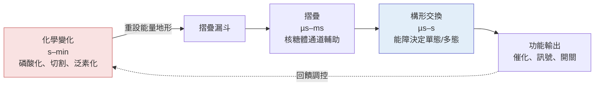

# 13.1 蛋白質的動態變化與構形轉換（Conformational Changes）

## 一、一張照片不等於一段人生

AlphaFold 2 與 AlphaFold 3 給我們的是一個模型，而且是一個特別好的模型：它把一條胺基酸序列轉譯成一組三維坐標，誤差在多數可摺疊區域已接近實驗解析度。然而，AlphaFold 資料庫中超過兩億個模型，幾乎全部是同一件事的靜態切片——一個構形，一張照片。而蛋白質在細胞裡從來不只活成一個構形。

這個落差不是統計誤差，而是問題型態的根本改變。生物學的功能往往不在摺疊本身，而在摺疊之後的「下一個形狀」：酵素要從開放態閉合才能抓住受質，受體要換一個構形才能啟動訊號傳遞，離子通道要靠一個閘門構形決定離子能不能通過。這些事件在時間上只有微秒到毫秒的尺度，卻決定了訊號的開與關、藥物的效應與毒性、人類的疾病與否。二十世紀前半葉，佩魯茲（Max Perutz）用血基質與血紅素的結構比較，開啟了「構形變化是功能核心」的觀念；而今日，AlphaFold 讓這種「換形」問題重新變成前沿。

問題因此可以精確地改寫：AlphaFold 解決的是「這個序列最可能摺成什麼樣子」，而接下來的問題是「這個蛋白質有哪些構形，它們之間怎麼轉換，轉換由什麼驅動，速率多快」。前者是一個幾何問題，後者是一個動力學問題。兩者都需要結構，但只有前者被目前的系統化流程真正解決。

## 二、三個時間尺度

蛋白質的行為可以沿著一條時間軸分成三個層次，它們彼此嵌套，卻各自對應不同的實驗技術與不同的 AI 方法。

第一個層次是摺疊本身，發生在微秒到毫秒之間。一條新合成的多肽鏈在細胞內並不是亂序後再搜尋到原生態，而是在合成過程中就開始摺疊，並由核糖體出口通道的物理限制強迫走向正確方向。這個尺度的核心物理是摺疊漏斗：能量地形是一個漏斗，序列沿著漏斗壁滾落，所需的「搜尋」量因此從組合爆炸被壓縮到近乎隨機行走。AlphaFold 預測的正是漏斗的底部，也就是終點。

第二個層次是構形交換，發生在微秒到秒之間。已摺好的蛋白質並非靜止，它在幾個最低能量的構形之間跳躍，這些跳躍的速率常數可用阿瑞尼斯方程式 $`k = A e^{-\Delta G^\ddagger / RT}`$ 描述。當某個構形轉換的能障夠高，蛋白質在生理時間尺度上就只表現為單一構形；當能障夠低，兩個構形共存，NMR 便會同時看到兩個訊號。這解釋了為什麼同一個酵素可以在「開放」與「閉合」之間來回切換，而結構預測卻只能給出其中之一。

第三個層次是化學變化，發生在秒到分鐘甚至更長。磷酸化、乙醯化、氧化、蛋白水解切割等反應改變序列的化學狀態，因而重設漏斗的形狀本身；此時的構形變化不再是「同一個漏斗內的跳躍」，而是「換了一個漏斗」。這個層次是 13.2 的主題，此處先點出它與動力學的耦合。

三個層次疊加的結果是：同一條序列在不同的化學狀態下、在不同的環境中、經過不同的摺疊路徑，可能以不同的構形集合存在。所謂「蛋白質的動態」，正是在這三個尺度同時拉動下才成立的動態。

## 三、佩魯茲的構形變化模型與血紅素的 T/R 態

構形變化作為科學問題被認真對待，可以回溯到 1950 年代末期至 1960 年代。當佩魯茲與肯德魯分別解出血紅素與肌紅蛋白的結構時，一個困惑浮現：兩者的活性部位在結構上極為相似，血紅素卻比肌紅蛋白多了一個四級結構，而氧的結合方式也明顯不同。佩魯茲提出的答案是一種「構形變化模型」——蛋白質並非僵硬的金屬塊，它會因配體結合而改變整體構形。

血紅蛋白的 T 態（張力態，deoxy state）與 R 態（鬆弛態，oxy state）是教科書上最著名的構形轉換。氧結合到血基質鐵原子時，鐵原子被拉入血基質平面約 0.06 奈米，這個微小的位移經由第 87 號殘基（纈氨酸）傳到 α 次單元的螺旋 F，進而推動 α、β 次單元相對旋轉，改變中央空腔大小，並讓兩個 β 次單元間原本阻塞中央通道的殘基（βHis143）移位。這不是「氧塞進一個口袋」，而是「氧的結合觸發了一個貫穿整個分子的機械聯桿」。

更關鍵的是這套機制的別構效應：兩個以上配體的結合會互相促進。第一個氧分子結合後使蛋白質偏向 R 態，第二、第三、第四個氧的結合因此更容易，導致氧解離曲線呈 S 形而非雙曲線。1930 年代波耳效應（Christian Bohr）從血液的二氧化碳與酸鹼度影響氧親和力，點出這是「化學環境改變構形平衡」的原型。1960 年代的 Perutz 構形變化模型，於是把這些生理現象、原子結構與自由能景觀三者接成一體，成為二十世紀結構生物學少數真正「解釋了什麼」的理論成就。

而這套故事，也是 AlphaFold 時代最直接的缺口。AF2 能給出血紅素單體的結構，甚至能預測其四級組裝，但它給的是一個構形；T 態與 R 態的能量差、配體結合如何偏置這個平衡、平衡常數如何隨 pH 與二氧化碳濃度移動，這些資訊不在序列裡，也不完全在演化對齊裡。它們需要動力學與自由能的方法。

## 四、2010 年代的cryo-EM：把「轉換」拍成電影

過去幾十年，「構形轉換」很難被直接看見，因為實驗手段各自受限：X 光需要單一構形的單晶，NMR 雖能給出動態資訊，但受分子大小限制，cryo-EM 則要等到 2013 年之後解析度突破才真正進入生物學的原子領域。冷凍電子顯微鏡帶來的第一批重大驚喜，正是「看到轉換本身」。

G 蛋白偶聯受體（GPCR）是最好的例子。它是涵蓋數千種受體的龐大家族，佔處方藥約三到四成的標靶分子，GPCR 及其下游的 G 蛋白是教科書級的「分子開關」。2010 年代中期，一系列 cryo-EM 結構陸續問世：β2-腎上腺素受體與Gs 複合體、腺苷酸環化酶的催化亞基、Gi 蛋白等，一幅完整的活化路徑逐漸拼合。2017 年諾貝爾化學獎頒給 erik Kobilka 與 Roderick Lefkowitz，即表彰他們對 GPCR 機制的研究。

這些結構揭示了一個關鍵事實：GPCR 的活化不是一個構形的「打開」，而是一整套連續的構形集合，包含多個中間態與路徑分歧。細胞使用同一個受體、卻透過不同的配體與不同的 G 蛋白，把受體推入不同的構形子集合，從而分辨出「去甲腎上腺素」與「腎上腺素」這類化學上只差一點點的訊號。這正是純粹的「一個序列對應一個結構」模型永遠無法表達的資訊：**功能存在於構形空間的體積與形狀裡，而不是存在於其中一點。**

同樣的邏輯在別處重複。ABC 轉位酶——例如 P 型 ATP 酶與多藥耐藥相關的 P-gp——被稱為「分子馬達」，但它的 ATP 結合、水解與磷酸化的循環在 2010 年代中期才由 cryo-EM 解析出多個中間態，顯示內部通道如何開合。

## 五、通道閘門：nAChR 的 2015 年

2015 年，神經傳導物質受體的結構成為里程碑。那一年分別有研究團隊發表了肌肉型與神經型菸鹼型乙醯膽鹼受體（nAChR）的 cryo-EM 結構，解析度達到 3.5 至 4 埃姆左右，跨越了當時被視為分水嶺的門檻。

nAChR 是一個五聚體通道，每個次單元含有四個跨膜螺旋（TM1–TM4）。它的閘門機制在教科書中被簡化成一句話：TM2 螺旋在接近胞外端的位置向內旋轉，使中央孔徑關閉。這句話之所以能被說得如此簡潔，正是因為 2015 年之前我們只能從低解析度結構與電生理實驗去猜；2015 年之後，我們直接看到了順式（cis）與反式（trans）構形中 TM2 螺旋不同的傾角與旋轉方向。當乙醯膽鹼結合到胞外配體結合位點，訊號沿著螺旋束傳遞到 TM2，閘門開啟的機制第一次成為可被視覺化的機械裝置。

但這也立刻浮現新的難題：通道並不是只有「關」與「開」兩個狀態。它有去活化態（desensitized）——即使有配體也開不了；它有多個亞態與中間態；它在磷酸化後的行為又不同。同時，在細胞膜的實際環境中，膜電位、跨膜電化學梯度、配體濃度都在持續改變通道的佔據比例。

## 六、蛋白激酶的活化環：DFG-in 與 DFG-out

在藥物設計的語境裡，構形轉換的重要性有一個特別清晰的縮影，就是蛋白激酶。

蛋白激酶佔人類激酶組約五分之一，是藥物開發最熱門的標靶類別。它們共享一個雙葉（bilobal）結構：由一個小的 N 端葉與一個較大的 C 端葉構成，兩葉之間是位於中央的活性裂溝，ATP 結合其中，而活化環（activation loop）橫跨其上。活化環上有兩個高度保守的殘基：DFG motif（Asp、Phe、Gly）與APE motif（Ala-Pro-Glu）。

激酶有兩個主要的構形：DFG-in 與 DFG-out。DFG-in 是活性態，此時磷酸化受質酪胺酸殘基的羥基恰好對準 ATP 的 γ 磷酸，催化幾何（catalytic geometry）嚴絲合縫。DFG-out 則是無活性態，此時 DFG 翻出裂溝，ATP 位點被阻擋，催化幾何被破壞。就是在這兩個明確的構形之間切換，決定了激酶是打開還是關閉。

藥物設計的整個策略語言都是建立在这條軸線上。類型 I 抑制劑占據 ATP 位點，作用於 DFG-in；較新型的類型 II 抑制劑結合一個 DFG-out 才出現的變構口袋（allosteric pocket），把激酶鎖在關閉態。這個差別不是術語遊戲：若一個腫瘤突變使激酶偏好在 DFG-out 構形存在，傳統的 ATP 競爭型抑制劑便會失效，因為患者細胞裡幾乎沒有 DFG-in 可以被競爭。於是「預測構形集合及其佔據比例」變成藥物設計的先決條件，而不只是一個描述性的圖。

這也說明 AlphaFold 在這裡的侷限與機會。AF2 對激酶骨架結構的預測精度很高，AF3 進一步能預測配體與蛋白質的結合；但它並不給出「在細胞內，DFG-in 與 DFG-out 誰多誰少」。那是一個自由能問題，需要動力學模擬、熱力學循環、或者從系综分布中取樣。

## 七、澱粉樣纖維：摺疊中間態的兩副面孔

蛋白質動態的另一個極端，是那些「不應該存在」的構形——摺疊中間態與錯誤摺疊態。

阿茲海默症、帕金森氏症等神經退化性疾病，與一種蛋白質病理聚集的過程高度相關：類澱粉蛋白（amyloid）纖維的形成。傳統的「漏斗」模型會說明，錯誤中間態是漏斗壁上的高能點，一旦越過摺疊障壁就會沉積為有序的纖維結構。

在 AlphaFold 時代，類澱粉的結構研究出現了一個耐人尋味的轉折：AlphaFold 2 能夠預測許多澱粉樣蛋白單體的「類澱粉摺疊」結構，而這些結構彼此相似，呈現所謂的「交錯 β 摺板」架構。更重要的是，人工智慧設計的澱粉樣結構模型——例如用擴散模型進行逆向摺疊設計得到的 amyloid 設計蛋白——在 2024 至 2025 年間有多篇工作據公開報導，成功地在實驗室中製造出具有特定形態的纖維，並且能用來檢驗諸如「纖維形態如何影響致病性」的問題。設計纖維的能力，意味著研究者第一次能夠把因果鏈反過來：先問「致病的是什麼形狀」，再去做出那個形狀。

但同一條消息的另一面是，纖維本身是動態的：它有生長端、扭轉、構形轉換，不同的摺疊中間態決定了它往哪個方向長。2024 至 2025 年間，一些工作報告了能夠對摺疊中間態進行穩定化設計的模型，並以此探討構形轉換路徑。這意味著設計工具的觸角已經從「穩定態結構」延伸到了「路徑與中間態」。
## 八、ensemble、NMR 與分子動力學：既有的回答

在深度學習介入之前，結構生物學家處理動態問題的工具箱並非空白，只是各自受限。

NMR 的最大優勢正是動態：核磁共振的化學位移與耦合常數對原子周遭的化學環境極度敏感，因此可以在溶液條件下，同時觀測多個構形及其交換速率，給出所謂的「構形系綜」（conformational ensemble）。其代價是分子大小上限——大分子訊號變得擁擠，重疊難以解析，於是大型蛋白質的 NMR 幾乎無法給出高品質的三維資訊。

X 光與 cryo-EM 的解法是「狀態解析」：既然一次只能看一個構形，那就讓樣品停在不同的構形上，分別收集資料。2010 年代 GPCR 與 nAChR 的成就，本質上就是把多個狀態分別凍結，再拼成一條路徑。缺點在於：這些構形之間的相對能量、佔據比例與轉換速率，仍然需要其他方法來補。

分子動力學（MD）是理論端的答案。它以數值積分牛頓運動方程式，模擬原子在明確力場下的運動，原理上能給出時間演化的軌跡、構形系綜與自由能差異。現實則是殘酷的：生物學家最關心的構形轉換往往發生在毫秒到秒之間，遠超直接模擬能夠覆蓋的時間尺度；即使是最快的機器，也多只能做到數百奈秒到數微秒。研究者於是發展出增強取樣（enhanced sampling）與傘形取樣（umbrella sampling）等技巧，用人為偏壓強迫系統穿越能障，再用自由能計算推回真正的平衡常數。這個方向也讓「把 MD 放進機器學習裡」的想法自然而然地浮現。

## 九、AI 的進場：從一個模型到一個分布

2025 至 2026 年間，人工智慧開始被系統性地用來處理動態問題，據公開報導可歸納為幾條路線。

第一條路線是讓模型學會「取樣」而非「預測」。AlphaFold 3 的擴散模型本質上是一個生成器：它從隨機噪點出發，在數十步去噪過程中把噪點收斂到符合條件的結構。既然擴散模型能生成符合資料分布的多個樣本，同樣的直覺就可用於構形系綜的生成。問題在於，AF3 的噪聲空間是座標空間，去噪過程並不是物理時間的推進，因此抽樣出來的多個構形並不自動構成動力學軌跡；它們是靜態樣本的集合，除非另外引入能量項或自由能估計。

第二條路線是把擴散模型與物理模擬結合。2025 年前後被提出並發表的工作，代表性地把分子動力學與擴散生成模型結合：讓擴散模型生成候選構形，再由 MD 動力學與重新加權方法（reweighting）篩選與排序，形成所謂「MD 引導擴散」的架構。這類方法的哲學是：神經網路提供搜索的效率，物理提供約束與驗證，兩者互補。這也是目前最可能成為主流的組合——純粹的物理太慢，純粹的生成模型沒有保真度保證。

第三條路線是直接訓練多構形預測模型。據公開報導，2025 年出現的 NeuralPLexer 等工作，目標是讓模型同時預測多個構形及其相對權重，而不是只給出「最可能」的那一個。這代表模型輸出的型態從點估計轉為分布估計——這正是統計學上正確的方向，也是 pLDDT 這類信心指標在概念上的延伸。

第四條路線是 Boltzmann 生成器（Boltzmann generators）與所謂的「學習自由能」。這類方法把統計物理的語言帶入深度學習：訓練一個以能量為參數的生成網絡，使其產生的樣本符合玻茲曼分布 $`p(x) \propto e^{-E(x)/k_B T}`$ ，於是可以直接對構形進行重要性取樣，並得到正確的平衡佔據比例。這在概念上是解決「AF2 給一個構形」這個問題最乾淨的答案，因為它把自由能差異直接編進模型。實務上的困難在於訓練的穩定性、能量模型的精度，以及長時間尺度上真正的玻茲曼取樣仍然昂貴。

## 十、誠實的界線：仍然開放的問題

必須清楚地承認，這一整章描述的方向還沒有一個方法能全面解決問題。

首先是自由能的絕對精度問題。模型可以告訴你兩個構形「不一樣」，卻很難可靠地告訴你它們在生理條件下各佔多少比例。而對藥物設計而言，佔據比例往往比構形本身更重要——一個佔比 5% 的結合態，可能正是藥物能抓住的靶點。

其次是速率常數與自由能障的預測。目前為止，多數方法能處理「有哪些構形」的分布問題，但「從 A 到 B 需要多久」仍主要仰賴物理模擬或耗費高昂的實驗。

第三個界線更根本：我們對「生理環境」的定義本身在擴張。離子強度、pH、溫度、配體濃度、分子擁擠、翻譯後修飾——每一個都是構形平衡的參數，而我們連「正確的參數集合」都沒有共識。

換句話說，動態問題並沒有被 AlphaFold 解決，而是被 AlphaFold 重新定義成一個更清楚、更可計算的問題。構形分布、自由能差異、轉換路徑——這些詞在 2026 年已經可以進入深度學習的損失函數，而在 1990 年代，它們還只是物理化學教科書裡的術語。這本身就是一種進步。

而這一章的動態故事，在下一節會遇到它最頑強的對手：不是時間，而是化學。蛋白質在細胞裡不是一條裸鏈，它帶著標籤、被其他分子包圍、在特定的氧化還原與離子條件中運作。這些不是邊界條件，而是系統本身。