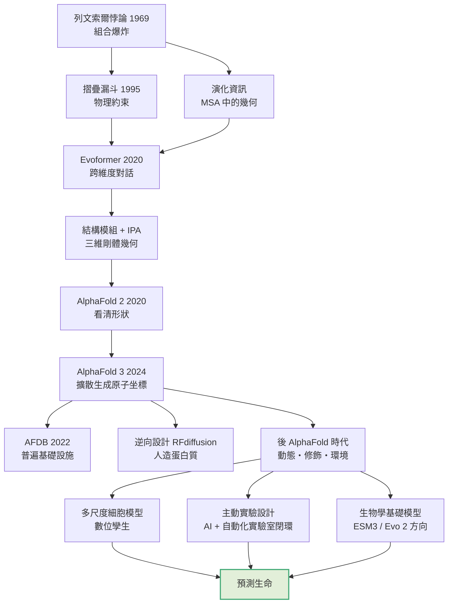

# 13.3 生物學的未來：從「看見形狀」到「預測生命」

## 一、回到導論：那個聖杯究竟長什麼樣

全書從一個悖論開始。1969 年，列文索爾在《Nature》發表的短文裡拋出一個簡單而殘忍的問題：地球上的蛋白質大約有十萬種不同的胺基酸序列，但要完成摺疊的構形數量，是 $3^{100}$ 這個天文數字——以宇宙的年齡計算，隨機嘗試連最簡單的蛋白質都來不及完成。生命卻完成了。

那篇短文的副標題是「蛋白質摺疊的問題」，而它的結論語氣樂觀：既然有這麼多種蛋白質，就必定有某種更聰明的摺疊原理。這份樂觀在往後二十多年裡不斷被修正又被重新找回。薛丁格的《生命是什麼？》（1944）提供了物理直覺上的答案形狀；摺疊漏斗模型（1995 年被形式化）把「搜尋」重新定義為沿著能量地形下行；演化資訊則揭示了序列本身早已編碼了答案，問題只是把這份隱藏資訊挖出來。

回頭看，AlphaFold 2 的成功，其實是這三條線索在 2020 年同時收斂的結果：

1. **列文索爾悖論揭示的是組合爆炸**，所以解法不能是更強的搜尋，而必須是能跳過搜尋的表示。
2. **摺疊漏斗給出了物理約束**：局部結構偏好、疏水核心、位元組摺疊偏好、緊湊性——這些不是從資料裡學來的雜訊，而是物理先驗。
3. **演化資訊是免費的資料**：多序列對齊（MSA）裡藏著幾何資訊，只不過被埋在序列之中，需要網路自己去「想」。

接著是一連串表示與架構的轉換。Evoformer（2020）讓 MSA 表示與配對表示在跨維度上對話，把演化資訊的挖掘從手工程式變成可學習的運算。結構模組與不變點注意力（IPA）讓網路直接在三維剛體幾何上操作，繞開「先預測距離再轉座標」的瓶頸；循環精煉（recycling）讓網路像藝術家一樣不斷回到草稿上重畫。信心指數 pLDDT 與預測區對齊誤差 PAE，則是把「模型知道自己可能錯在哪裡」變成可讀的輸出——這是科學使用 AI 的最低配備。

AlphaFold 3（2024）更換了範式：從「分類／迴歸到結構」轉為「用擴散模型直接生成原子坐標」，並把蛋白質、核酸、小分子配體與藥物放進同一個生成框架。於是結構預測從一個「特定問題的解題器」變成了一個「生物分子生成引擎」，而這正是第 11 章的藥物設計加速、與第 12 章的逆向摺疊設計得以成立的前提。

AlphaFold 資料庫（2022）則把這項能力從少數研究團隊的手中解放出來，變成任何連上網路的人都能查詢的基礎設施。

所以到現在為止，因果鏈是清楚的。但鏈條還沒有閉合。

## 二、五個剩餘難題

「AlphaFold 解決了結構預測」這個說法，在嚴格意義上只對了一半。我們能預測一個序列最可能的摺疊構形，但生物學真正處理的，是一個多維度的狀態空間。剩餘的難題可以列成一張清單：

| 剩餘難題 | 問題本質 | 現況 | 阻礙為何 |
| --- | --- | --- | --- |
| 構形動態與自由能 | 同一序列有多個構形，佔比與轉換速率未知 | 模型可給構形系綜，但缺乏可靠的相對能量與速率 | 缺乏帶有時間解析與佔比資訊的訓練資料；MD 時間尺度不足 |
| 多體複合體的真實組裝 | 實際細胞中的組裝是異質的、動態的、有中間體的 | 複合體預測已能建模，但多描述的是計算上可行的排列 | 組裝路徑依賴伴護蛋白、翻譯時序與濃度，不是序列本身 |
| 細胞微環境 | 鹽、pH、溫度、擁擠、氧化還原態都影響構形平衡 | 幾乎所有模型都在近似標準狀態 | 缺乏把環境參數連同結構一起標註的資料集 |
| 修飾與序列非唯一性 | 一條序列對應一族化學狀態，每種可能有不同結構 | 局部修飾建模已起步，全域模型尚未出現 | 修飾資料稀疏且不一致，且需結合激酶／酶體等系統資訊 |
| 剪接異型體與翻譯後差異 | 成熟蛋白質與前驅物、同源變體的構形可能不同 | 基因組層級的預測已開始 | 需要把轉錄本、共轉譯摺疊與切割事件納入建模 |

清單之外還有一項，但它更像是貫穿所有項目的一個隱藏軸：**蛋白質組學的資料量與結構資料量之間仍然存在鴻溝**，只是鴻溝的形狀變了。過去是「序列很多、結構太少」；現在是「序列與結構都很多，但『帶標註的動態與修飾資訊』仍然稀缺」。

這是一個關鍵的因果轉折：AlphaFold 沒有消除資訊瓶頸，它把瓶頸從「空間」搬到了「時間與化學」。

## 三、方法論的下一站：從單體結構到細胞數位孿生

自然的長遠方向是清楚的。既然單體結構只是起點，下一步就是把結構預測的邊界往外推。

第一個方向是**多尺度整合**。一個真正能用的細胞模型，需要把序列層（基因表現、剪接、PTM 譜）、結構層（構形集合與複合體）、動力學層（反應速率與網絡）串成同一個框架。這在概念上就是「細胞數位孿生」的蛋白質版本：不是預測一個蛋白質的形狀，而是預測一個細胞在某個時間點的分子狀態分布。這個目標極其宏大，但值得注意的是，AlphaFold 讓其中最難的子問題（結構）第一次變得可批量求解。

第二個方向是**主動實驗設計**。目前 AI 在生物學中的角色幾乎全是「預測」，下一個階段會是「決定下一步做什麼實驗」。邏輯很直接：如果模型能提出一個最有資訊量的實驗（例如「在 X 位置做 Y 突變並交配配體 Z，我們就能區分這兩個假設」），而自動化實驗室能把那個實驗在幾天內做完並回傳資料，那麼研究循環的週期會從數月縮短到數週。據公開報導，2025 至 2026 年間，這種閉環——模型提出假設、機器人執行、資料回饋、再訓練——已在若干蛋白質工程與藥物最佳化的工作中出現雛形。

具體到蛋白質動態，最能說明這條路線價值的組合是三層架構：AI 生成候選構形、分子動力學作為物理裁判、最後以實驗驗證。前面提過的「MD 引導擴散」正落在這個位置。它的意義不在於取代 MD，而在於用生成模型把 MD 送不到的地方（微秒以上的能障）用統計的方式補上，再用 MD 去把統計的產物重新物理化。

第三個方向是**生物學的基礎模型**。語言模型的成功已經示範了一件重要的事：當資料足夠同質且足夠多時，一個通用模型可以先學會「這個領域的語法」，再透過少量提示適應到具體任務。生物學裡最接近的對應物，是蛋白質序列與結構的通用預訓練模型——蛋白質語言模型（ESM 系列）、以及被廣泛稱為 ESM3 的「結構—序列—文字」統一模型，它嘗試讓序列、結構與功能描述在一個共同的表示空間裡彼此對話。

而在更前端的嘗試，據公開報導，Arc Institute 在 2025 年發表了 Evo 2，一個以 DNA 序列為基礎、規模更大的模型，宣稱能生成具有可編碼功能的 DNA 序列，並在非模式生物的基因組上展現出泛化能力。它的重要性不在於「設計出一個蛋白質」，而在於它把設計的起點往上推到了基因體層次——也就是說，它嘗試繞過整個蛋白質的世界，直接在「生命的最上游程式碼」上操作。無論其結果如何，這代表「生物學通用模型」已從隱喻變成具體的工程計畫。

## 四、科學方法的改變

AlphaFold 帶來的最深遠影響，可能不在生物學，而在科學工作的組織方式。

**結構生物學的民主化。** 在 2020 年之前，一個蛋白質結構是一份耗時數年的手工技藝成果，通常由少數具有長期累積經驗的實驗室完成——這些實驗室的核心資產不只是技術，而是「知道該做什麼實驗」的判斷力。AlphaFold 資料庫讓任何人可以在數秒內取得一個結構模型，這在效果上把結構從「研究成果」降格為「查詢服務」。於是結構不再是資訊的稀缺瓶頸，也不再是職業的護城河。

**實驗設計的分量上升。** 當結構免費了，經驗工程師的價值轉移到別處：提出正確的問題、設計能區分假設的實驗、判斷模型與現實不符時該相信誰。這是科學界常見的模式變化——當工具變便宜，判斷力變貴。

**跨領域的匯流。** 結構生物學與基因體學、蛋白質組學、系統生物學、以及機器學習研究之間的邊界開始溶解。理解「序列→結構→修飾→功能」整條鏈的人，在價值鏈上的位置比只懂其中一段的人高得多。

**可重現性的新要求。** 當模型輸出被廣泛引用，模型本身的版本、信心指標、pLDDT 與 PAE 的解讀方式，就成為科學紀錄的一部分。好的實踐要求引用模型時同時引用其局限——這不是吹毛求疵，而是把「這個數字背後有多少可信度」重新拉回科學的視野。這一點在本書第 8 章已經談過：AF 系列的出現，讓「不確定性表達」成為結構生物學的必修課。

## 五、教育的影響

結構生物學的教學正在被迫重新安排。過去的課程訓練學生「如何取得結構」——結晶、收集繞射資料、求解相位、建模。現在這段流程對大多數研究問題而言已不再是必要技能，取而代之的是「如何質疑一個結構模型」：它的 pLDDT 是多少？PAE 在哪些區域偏大？這是實驗結構還是預測模型？模型給的構形是靜態的嗎，它在不同的修飾或配體條件下會不會不同？

這是從「技術訓練」轉向「判斷力訓練」的轉移，而判斷力只能透過做決定來培養，不能靠背誦步驟。也因此，生物學教育的另一個重大調整，是必須教統計與機器學習的基礎——不是為了讓生物學家去寫網路，而是為了讓他們能看懂模型的輸出與其不確定性。

更深一層，AlphaFold 把「結構」從終點變成起點之後，生物學的課程應該更早、更深地處理動態與調控。因為對大多數生物學家而言，真正要回答的問題從來不是「這個蛋白質長什麼樣子」，而是「它在什麼條件下做什麼事，做得多快，被誰控制」。

## 六、科學家的價值：不變的部分

在技術全面提速的年代，最容易被誤判的是「什麼變得不重要了」。結構不再稀缺，於是有人會說結構生物學家不重要了；設計變得容易，於是有人會說分子設計師不重要了。這是對技術史的常見誤讀。

實際上被重新定價的，是價值的所在位置。真正的護城河轉移到了三處。

**第一是提出好問題的能力。** 能夠辨認出「這個現象背後有一個我們還沒看過的構形狀態」的問題意識，需要對生物學問題本身的深刻理解，以及對什麼已經被解出、什麼還沒被解出的清楚地圖。這份地圖，正是 AlphaFold 資料庫提供的公共品；能用好它的人，比不知道它存在的人更有價值。

**第二是實驗驗證。** 模型會產生錯誤，而模型本身無法知道錯在哪裡。辨識出模型在什麼區間外推、什麼區間被過度自信、哪個結論只是相關而非因果，需要實驗判斷與領域直覺。藥物開發領域已經很清楚地展示了這一點：結構預測極大加速了標靶的篩選，但真正決定成敗的，仍然是藥動學、毒理與臨床結果。

**第三是系統整合。** 把結構與基因體、蛋白質組、演化、疾病資料接起來的科學家，會成為最有價值的那一群人。13.2 所說的「注意力從形狀轉向修飾與調控」，指的就是這個方向。

## 七、結語：聖杯不是一個形狀

導論提到的聖杯——生命科學中那個用計算解決的目標——現在可以更精確地被描述了。它不是「預測結構」。AlphaFold 2 與 AlphaFold 3 已經把「預測結構」這件事做到近乎飽和，它不再是瓶頸，甚至不再是難題。

真正的聖杯是「預測生命」——但必須先承認，生命不是靜態形狀。

這個斷言不是修辭。蛋白質的意義取決於它處於哪些構形、取決於誰在什麼時候把它修飾成什麼樣子、取決於它身邊有哪些分子、取決於它是否被伴護蛋白攙扶著長大、以及它花多少時間停留在每個狀態裡。形狀是這些事情的投影，而不是它們本身。列文索爾的悖論之所以艱難，從來不只是「找到正確形狀」有多難，而是「生物系統如何在正確的時機、以正確的比例、處於正確的位置，呈現正確的形狀」有多難。

於是有一個漂亮的收束：AlphaFold 解決的問題，恰恰是把那個終究難以窮盡的問題切成了可以逐步處理的部分。序列到結構的這一段，現在可以交給機器；接下來的每一段——動態、修飾、環境、組裝、調控——都會在同樣的邏輯下被一一分解。列文索爾在一九六九年提出的挑戰，最終不是被一個更聰明的搜尋算法解決，而是被一系列「更好的表示」所解決；那麼剩下的挑戰，也將用同樣的方式被解決。

只是到了那個時候，會有新的悖論等在那裡。因為生命從來不是一個靜態的形狀，它是一個始終在改變、在被修飾、在被耦合、在被環境推著走的活動。預測生命，意味著預測這種活動，而不是預測它的某一次快照。

這也正是本書最想留下的那個直覺：形狀是生命的語法，而不是生命的意義。AlphaFold 讓我們能夠讀出生命所寫的每一個句子；而剩下要學的，是理解這些句子組成的語法——那是一門關於時間、化學與交互的語法，而人類的生物學，才剛剛開始學會念它。
