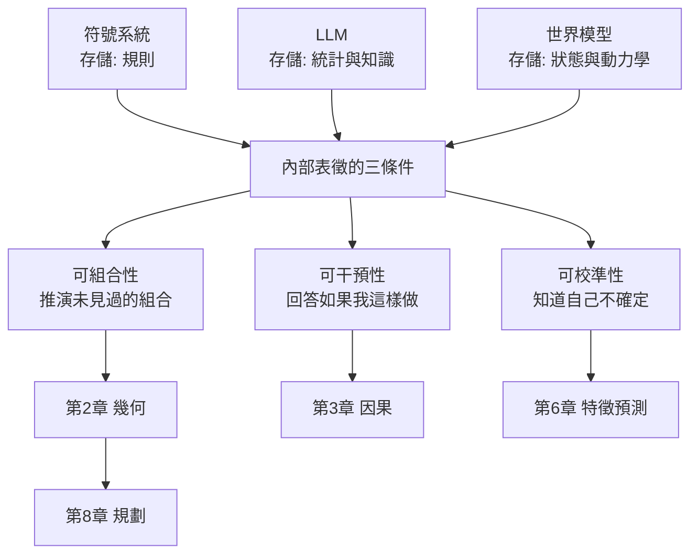
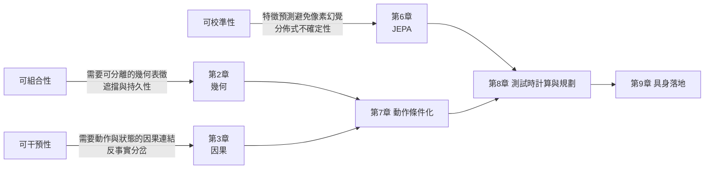

# 0.1 內部表徵的本質：超越「下一個 Token 預測」的智慧躍遷

## 智慧不是反應速度，而是內部世界的可查詢性

人類面對一個陌生房間時，所需的時間大約是零點幾秒：在這段時間裡，視覺皮質完成場景分割，頂葉建立物體在三度空間中的位置，海馬把當前狀態與過去經驗並置，前額葉推演出「桌上有兩個杯子，左邊那個較滿，若我伸手越過另一個去拿它，前臂會碰到桌上的筆筒」。這些運算並非發生在肌肉與關節上，而是發生在一個內部狀態中——一個可以被反覆查詢、可以被推演、也可以被干預的世界模型。

我們習慣用反應速度來衡量智慧：下棋的引擎每秒能搜尋幾百萬個節點，圍棋的「電腦下棋」之所以震撼，是因為它在下出超越人類直覺的一手。但速度只是上限，真正拉開差距的是那個被搜尋的狀態空間是否有意義。一個再快的引擎，如果狀態表示得含糊不清，它搜索得再深也只是在垃圾堆裡翻找。人類之所以能一眼看出一幅畫中「不對勁」，是因為腦中有一個能持續維持物理一致性的世界狀態；所謂的「一眼看出」，其實是內部表徵與外部世界的一次快速比對。

因此，本書把智慧的核心定義為：**在腦中維持一個可被查詢、推演與干預的世界狀態的能力**。這個定義有三個關鍵詞，缺一不可。可查詢意味著內部表徵不只是被動流入的感官流，而是可以被主動檢索的結構，像一本已經編好索引的詞典。推演意味著狀態不只記錄現在，而是攜帶了狀態如何演化的規則。干預則意味著模型內部存在一個「我」的位置——某個變數可以被設為「假若它不是這樣」，而其後果仍能在表徵中展開。

## 內部表徵與外部表徵：感官流並不等於世界

我們需要先把「內部表徵」與「外部表徵」分清楚。攝影機捕捉的畫面、感測器回傳的向量、鍵盤敲進來的字元，都是外部表徵：它們是時間序列上的觀測 $o_t$ ，彼此之間只有透過學習才建立起隱含的關聯。內部表徵則不同，它必須是一個以「現在是什麼樣子」為中心、能夠被查詢的狀態變數 $s_t$ 。兩者的差別可以用一個簡單的提問來檢驗：把外部觀測暫時關掉，模型內部還剩下什麼？如果剩下的只是一個空洞的向量，而無法重建出「桌上有兩個杯子」，那麼它擁有的只是觀測的摘要，而不是世界。

另一個檢驗方式更嚴格：內部表徵必須支撐**兩個方向**的運算——從狀態生成觀測（渲染），以及從狀態與動作推演下一個狀態（模擬）。只有前者，模型是描述性的；只有後者，模型缺乏對現實的對應；兩者兼具，才具備在世界裡行動的資格。本書後續章節之所以在渲染與模擬之間反覆來回，正是因為這兩種能力必須共用同一份狀態，否則渲染出來的東西會與模擬出來的東西對不上。

值得強調的是，內部表徵並不要求是「人類式」的具象心理表徵。深度網路中的高維向量同樣可以是有效的狀態，只要它滿足三個條件：可組合、可干預、可校準。心理學的類比幫助我們直覺把握問題，但不能替代對狀態變數的嚴格工程定義。

## 三種典範的內部儲存：規則、統計、狀態

在歷史上，人工智慧曾經嘗試過三種截然不同的內部儲存方式，其差異不是工程細節，而是對「智慧需要保存什麼」的根本分歧。

**第一種是符號系統**，它把世界抽象成規則的集合，典型代表是早期的專家系統與邏輯推理程式。它保存的是「如果 A 則 B」這類命題，推理的過程是對規則的機械套用。符號系統的優點是步驟可稽核，缺點是規則必須由人手寫：規則的數量隨著情境組合而爆炸，從「杯子倒了會打碎」到「倒下的杯子在地毯上不會打碎」這樣的細節，就足以讓封閉式的規則表趨於無解。規則適合處理已經被概念化的世界，不適合處理像素與連續變化。

**第二種是大型語言模型的內部儲存**，它把語料壓縮進數十億個參數之中。嚴格說，語言模型並非沒有內部表徵：注意力機制形成的上下文狀態，以及權重所承載的知識分布，都構成某種內部狀態。問題在於這個狀態的**表示形式**是離散的、抽象的、以詞義關聯為主軸的。當我們問「Autodesk 這個詞是什麼意思」，模型可以給出豐富的答案；但當我們問「如果我把杯子推過桌緣，兩秒後它在什麼位置」，模型能做的往往是把答案統計性地組合出來，而不是從一組帶有空間座標與速度向量的狀態推導出來。

**第三種是世界模型的內部儲存**，它保存的是「狀態 + 動力學」：一個描述世界此刻是什麼樣的向量或結構體，以及一個描述這組狀態如何隨時間與動作演化的函數。狀態是幾何的（物體在哪裡、形狀如何、朝向為何），動力學是物理的（重力、碰撞、摩擦、支撐）。這兩者的耦合，使得「我推一下杯子」這個動作能夠真的改變內部狀態的未來走向。

三者的差異可以寫成一個簡單的對照：符號系統保存的是**規則**，語言模型保存的是**統計**，世界模型保存的是**狀態與動力學**。規則告訴你怎麼做，統計告訴你常見什麼，而狀態告訴你**現在怎麼樣、接下來會怎麼樣**。

還有一個容易被忽略的差異在於**時間的處理方式**。符號系統通常假設世界靜止，規則在任一時刻都成立；語言模型把時間壓縮成序列的前後位置，前文是上下文、後文是預測目標，時間只以「先後」的形式出現；而世界模型必須把時間當成**連續的物理軸**，期間伴隨著位置的連續變化、速度的累積與外力的介入。第 1 章之所以要從狀態空間與 MDP 講起，正是因為狀態的 Markov 性——「未來只取決於現在」——是把物理時間引入機器學習框架的第一步。

## 語言預訓練的極限：預測文本不等於預測世界

語言預訓練的本質目標非常明確：給定前文 $x_{<t}$ ，預測下一個 token $x_t$ 的條件分佈：

$$
p_\theta(x_t \mid x_{<t}) = \operatorname{softmax}\left( \frac{W h_t}{\tau} \right)
$$

這個目標函數非常有效率，它讓模型從海量文本中學會了語法、事實、論證結構與世界知識。但它有一個結構性的侷限：損失函數只關心**符號序列的延續性**，不關心**所指之物的物理性**。

這就是「杯子會倒」這個例子的關鍵所在。人類能夠預測杯子倒下，是因為「杯子」這個詞在三維空間中指向一個有開口、有容積、有重心、有支撐面的物體，而「倒」意味著支撐面積收斂到臨界點、重力矩超過恢復力矩。人類並非先在腦中算出切線速度 $v = \omega r$ 才會說杯子會倒，而是因為神經系統內存在一個不依賴語言中介的物理狀態表示。相較之下，一個只被要求預測文本的模型，若要回答「杯子會倒嗎」，最可靠的方式是把「杯子會倒嗎」這個字串在語料中的常見後續撈出來——它的答案本質上是人類文字的統計回聲。

這種差異正是系統二與系統一隱喻的精確落點。人類在內心排練：想著杯子會倒的同時，腦中會浮現杯子傾斜、翻覆、碎裂的連續影像，並伴隨手可以伸出去接住的動作衝動。模型只在下一次 token 上做條件分布：它沒有那個內心電影，因為它的訓練目標從未要求它維持一個跨幀、跨動作的狀態變數。模型或許能寫出「杯子摔在地上，碎片四散」，但那串文字的產生並不是由某個帶有座標與速度的世界狀態向前推演而來。

## 為什麼「能生成」不等於「能預測未來」

「生成」與「預測」之間存在一道容易被忽略的鴻溝。擴散模型可以生成驚人逼真的影像，但逼真並不等於正確：它可以把杯子畫成懸空在桌面上方，把人的手指生成六根，把重力方向渲染成水平的。生成模型優化的是觀測分佈的似然，它並不保證生成的樣本滿足物理守恆，也不保證同一個場景在連續兩幀之間保持狀態連續。

區分這兩者的判準是：**生成器回答「這看起來像什麼」，世界模型回答「這實際上是什麼、下一步會怎麼樣」**。前者是一個靜態的紋理先驗，後者是一個帶時間箭頭的狀態轉移。這個鴻溝可以形式化地描述：若模型 $p(o)$ 只給定觀測分佈，而世界模型 $p(s_{t+1} \mid s_t, a_t)$ 需要給定狀態轉移分佈，那麼生成模型即使產出像素級逼真的畫面，也沒有回答「在同一初始條件下反覆生成，物理一致的解有多少」這個問題。

更深一層，語言生成還受制於人類約定的因果方向。文本的順序是人類排版時的約定，而非世界的因果順序；一句「他推開門走進去，屋裡是空的」在文字上是連貫的，但在物理與時間上，屋裡空不空這個狀態是推門之前就已經決定的。反過來，物理的因果方向是世界本身給定的：施力在前，運動在後。

還有一組實證上的旁證：現代視訊生成模型在短期片段上極為逼真，但只要把鏡頭拉長、或加入需要持續遵守約束的內容（例如「把杯子推過桌緣」），失真就會迅速累積。這說明模型學到的是**外觀的短程統計**，而非**狀態的長程守恆**。判別式模型同樣如此：靜態影像識別器可以在訓練分佈之外把倒下的杯子當成杯子，但它無法告訴我們杯子倒下後碎片的數量與位置，因為它的損失函數從未要求它回答這樣的問題。

因此「生成能力」與「世界理解」之間的關係，可以被表述為一個不等式：像素保真度提高，並不保證狀態一致性提高。前者是分佈擬合的問題，後者是結構學習的問題。把前者當成後者的充分條件，是當前業界最普遍也最危險的誤解。

## 內部表徵的三個必要條件

要讓內部表徵具備成為「世界模型」的資格，至少需要滿足三個條件。它們不是三種可選風格，而是同一枚硬幣的三個面。

**第一是可組合性（composability）**，也就是能夠在內部把從未見過的組合推演出來。具體而言，若狀態表示為 $s = (z_{\text{object}}, z_{\text{geometry}}, z_{\text{velocity}})$ 的結構化形式，則模型應當能夠回答「把 A 物體的速度改成 B 值會怎樣」這類組合性問題，而這要求各個潛在維度之間的意義是**可分離且可重組**的。純像素表示在這件事上先天吃力，因為像素之間是稠密耦合的，改動一個物體會牽動整張圖；這正是第 2 章要引入幾何與物體中心槽位表示的原因。

**第二是可干預性（intervenability）**，它要求模型能回答「如果我這樣做會怎樣」這個反事實問題。在統計框架下，觀測分佈只告訴我們 $p(o \mid s)$ 的樣子是什麼樣，卻不告訴我們 $p(s_{t+1} \mid do(a))$ 會是什麼。只有當動力學函數與動作變數之間存在明確的因果結構時，干預才成為可能的運算。這正是第 3 章要引入結構因果模型的原因。

**第三是可校準性（calibratability）**，它要求模型能夠知道自己的預測不確定，並且讓不確定性參與決策。一個永遠自信地給出答案的模型，在物理幻覺面前會非常脆弱；一個能輸出分佈並讓上層依風險調整行為的模型，才能在第 10 章那樣的極端情境中存活。而要在特徵空間而非像素空間做預測，還需要額外的機制避免特徵空間塌縮——這是第 6 章 JEPA 系列要處理的數學難題。

三個條件與後續章節的技術選擇之間存在嚴格的對應關係，而不是事後的合理化。下表先把條件、要求與章節的對應列出，詳圖則見其後：

表 0-1　內部表徵三條件與全書技術選擇

| 條件 | 內在意義 | 對狀態表示的要求 | 對應章節 |
| --- | --- | --- | --- |
| 可組合性 | 能推演未見過的組合 | 維度可分離、可重組 | 第 2 章 幾何與槽位表徵 |
| 可干預性 | 能回答「如果我這樣做」 | 動作與狀態間有因果連結 | 第 3 章 結構因果與反事實 |
| 可校準性 | 知道自己的預測不確定 | 以分佈而非單點表徵未來 | 第 6 章 JEPA 特徵預測 |

## 導言的定位：把整本書的技術路線收束成一條因果鏈

這三節導言的目的，是在正式進入技術之前先把判準立起來。0.1 節提出的三個條件，將在 0.2 節被轉換成一組可操作的維度對照，說明語言模型與世界模型究竟在哪裡分岔；0.3 節則引入李飛飛的渲染器、模擬器與規劃者三元視角，說明為什麼「世界模型」不是一個可以單獨訓練的模型，而是一組彼此循環的能力。

一旦判準與分類都清楚了，全書的結構就不再是技術名詞的堆疊，而是一條因果鏈：狀態必須存在（第 1 章），狀態必須有幾何（第 2 章），狀態必須遵守物理（第 3 章），未來必須能以三種架構之一生成（第 4 至 6 章），未來必須服從動作（第 7 章），未來必須能在腦中排練（第 8 章），最後必須能落到軀體上（第 9 章），並面對誤差累積與物理幻覺的終極檢驗（第 10 章）。每一章都回答上一章遺留的一個問題，而每一節都回扣 0.1 節所列的三個必要條件。
