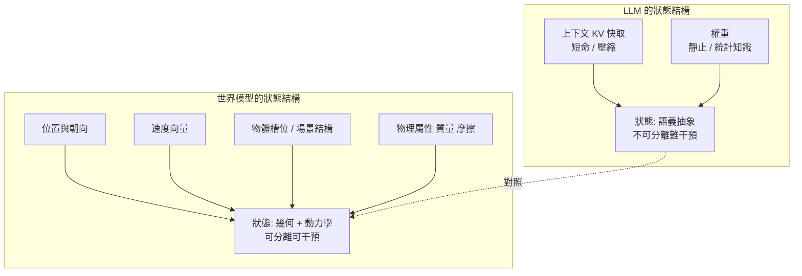

# 0.2 維度透視：大型語言模型（LLM）與世界模型（World Model）的本質差異

## 一組對照，而非一場口號

關於「世界模型會取代大型語言模型」的說法，街上充滿了立場，卻很少有嚴格的拆解。若要真正判斷兩者的差異，必須放棄時間線式的敘事——誰先出現、誰更強、誰會吃掉誰——而改用結構性的比較：把兩個系統沿著同一組維度剖開，看它們在每個維度上究竟做了什麼樣的工程假設。

本節採用五個維度：**輸入模態、狀態表示、目標函數、時間結構、可干預性**。下表先給出總覽，後續小節再逐維度展開技術細節。這五個維度不是隨意挑選的，它們依序回答了五個必然被問到的問題：世界從哪裡進來？進來之後被放在哪裡？訓練時到底在優化什麼？時間怎麼進行的？以及最關鍵的——它能不能回答「如果我這樣做會怎樣」。

表 0-1　LLM 與世界模型的五維對照

| 維度 | 大型語言模型（LLM） | 世界模型（World Model） |
| --- | --- | --- |
| 輸入模態 | 離散 token 序列，文字為主 | 連續觀測序列：影像、深度、力覺、本體感受 |
| 狀態表示 | 上下文 KV 快取 + 靜止權重，語義化 | 幾何與物理潛在變數：位置、速度、槽位、屬性 |
| 目標函數 | 下一 token 的交叉熵 | 未來狀態分佈與行動後果， $`q(s_{t+1} \mid s_t, a_t)`$ |
| 時間結構 | 以 token 為步長，抽象前序序列 | 以物理時間為步長，連續積分與多步展開 |
| 可干預性 | 難以回答反事實，因果方向為人類約定 | 可計算 $`do(a)`$ ，因果方向來自世界本身 |
| 典徵層次 | 語義理解與知識生成 | 感知重建 → 狀態預測 → 可干預的規劃模型 |

這五個維度共同構成一張對照表。值得先說明的是：LLM 並非一個統一的物體，它只是一類以序列為骨架的系統；而「世界模型」在文獻中的用法更寬，包括 Dreamer 的循環潜在狀態模型、擴散式視訊生成器、以及物理資訊神經網路等等。為了讓比較有意義，我們取 LLM 家族的典型形態——以 Transformer 為骨架、以自迴歸下一 token 分佈為訓練目標的系統——作為對照的一方。

## 維度一：輸入模態與資訊密度

LLM 的輸入是**離散的 token 序列**。這個序列經過分詞器切成整數編碼，長度受限於上下文窗口，而每個 token 在資訊密度上極不均勻：一個常見的漢語詞可能只佔一格，一個罕見的專有名詞卻被切成十幾片。這種離散化不是缺陷，而是任務本身的要求——語言本來就是符號序列。

世界模型的輸入則是**連續觀測序列**：影像幀、深度圖、力覺回饋、關節角度、本體感受流。每一幀都是高維連續張量，其中包含大量無法被文字描述的資訊，例如物體在影像中的確切輪廓、接觸點的位置、表面的高光走向。更關鍵的是，連續觀測在時間上是**稠密采樣**的：相鄰兩幀之間的變化量很小，因此物體的運動方向與速度可以直接從連續差分中估計出來，而不必依賴文字裡的「緩慢地」這類修飾。

這個差異帶來一個實際的工程後果。LLM 的狀態更新是「讀進更多 token」，每一個 token 只帶來離散的語義增量；而世界模型的狀態更新是「吸收一批新觀測並修正既有狀態估計」，這本質上是貝葉斯式的過濾與對齊過程，第 1 章的 Dreamer 正是這樣做的。

## 維度二：狀態表示

LLM 的狀態可以分成兩個部分：**上下文**（前一層隱向量所形成的注意力鍵值快取）與**權重**（訓練完成後固定的參數）。這個組合有個重要特性——上下文是被壓縮且短命的，權重則是相對靜止的知識容器。模型「記得」一件事，通常是指這件事的統計痕跡存在於權重之中，需要適當的提示把它「叫出來」。

世界模型的狀態是**幾何與物理潛在變數**：物體的位置與朝向、速度向量、物體的槽位表示、場景的動態結構。它的關鍵特徵是**結構化**——不同的物體佔據不同的槽位，不同的屬性佔據不同的維度，因而可以被單獨讀出、單獨修改、單獨推演。



兩者的差別可以用一個操作來檢驗：把場景中「紅色的杯子」換成「藍色的杯子」，哪種狀態表示能輕易完成？槽位表示只需要改動一個物體的屬性維度，其餘物體與幾何完全不受影響；而稠密的像素表示或語義化的語境表示，往往需要整段重新生成。

## 維度三：目標函數

LLM 的目標函數是**下一 token 的交叉熵**：

$$
\mathcal{L}_{\text{LLM}} = -\sum_{t=1}^{T} \log p_\theta\left( x_t \mid x_{<t} \right)
$$

這個目標非常純粹，也非常有效：它把「學會語言」與「壓縮世界知識」統一在同一個尺度上。但它沒有任何一項是關於物理的。損失值下降，只意味著模型對文本的下一個字越來越準，與杯子是否真的會掉落無關。

世界模型的目標函數則是**未來狀態的分佈與行動後果**。典型形式是預測下一個潛在狀態的分佈：

$$
\mathcal{L}_{\text{WM}} = -\mathbb{E}_{s_{t+1} \sim p(\cdot \mid s_t, a_t)} \log q_\phi\left( s_{t+1} \mid s_t, a_t \right)
$$

這個目標之所以不同，是因為它包含了動作變數 $`a_t`$ ，並且獎勵的是**多步之後**的狀態正確性。第 10 章會指出，單步預測的損失即使很低，長程誤差仍會以隨機遊走的方式累積；因此在更深處。世界模型需要的是能夠承受多步展開的目標——這正是「以未來狀態而非當下觀測為目標」的深層意義。

## 維度四：時間結構

語言模型以 **token 為步長**。一個 token 在時間上是抽象的：它可能對應半秒的沉默，也可能對應一整段的推理。語言模型由此獲得一種特殊的「時間壓縮」能力——它可以把跨越數分鐘的敘述壓縮進一個段落，同時也因此丟失了真實的物理時間尺度。

世界模型以**物理時間為步長**。每一個時間步對應真實世界中的一段時長 $`dt`$ ，觀測是對這個連續時間軸的稠密取樣。這種結構意味著狀態必須攜帶速度與加速度資訊，因為積分是必要的：

$$
s_{t+1} = s_t + v_t \, dt + \tfrac{1}{2} a_t \, dt^2
$$

而當時間跨度拉長到數秒、數十秒乃至數分鐘，純粹的自迴歸展開就會遭遇三重困難：訓練序列長度不足、誤差累積、以及長程依賴難以被局部注意力捕捉。第 1 章提出的循環狀態（recurrent state）設計，正是為了讓模型用一個**固定的潛在狀態**攜帶任意長歷史的摘要，這是解決長時依賴的第一個技術答案。

## 維度五：可干預性

這是五個維度中最關鍵的一個，也是差異最本質的一個。語言模型很難回答反事實問題——「如果當初那句話換成另一句，結果會怎樣」——因為文本序列的因果方向是人類約定的，而不是世界給定的。詩句的順序不會改變詩的意義，但球的初速度會完全決定它的軌跡。

物理的因果方向是世界本身給定的：施力在前、運動在後；接觸在前、反應在後。要在模型內部回答「如果我施加這個力會怎樣」，就必須在狀態與動作之間建立**結構性的因果連結**，而非把動作當成序列中另一個 token。第 3 章的結構因果模型把這件事形式化為介入運算 $`do(a)`$ ，第 7 章則把它變成生成模型的 FiLM 與交叉注意力控制通道。

```mermaid
graph LR
    A[語言模型] --> A1[序列因果<br/>約定方向]
    A --> A2[難以回答 do(改寫)]
    B[世界模型] --> B1[結構因果<br/>世界方向]
    B --> B2[可計算 do(施加力)]
    A1 -.對比.-> B1
    A2 -.對比.-> B2
```

## 為什麼「把影片塞進 LLM」不等於世界模型

一個自然的想法是：既然 LLM 已經能處理文字，為什麼不把影片也塞進去？事實上這已經在工業界發生，語言模型加影像輸入的系統確實能描述、推理、甚至規劃。但把觀測與語言在**輸入端**混合，與讓模型在**內部**擁有世界狀態，是兩件本質不同的事。

語言是抽象的符號序列，它承載的是**人類對世界的編碼**；物理規律則存在於像素與幾何之中，必須以連續量與拓撲關係來承載。影像被語言模型編碼後，得到的是「一張桌子，上面有一個紅色的杯子」這類語義標籤，而杯子在三維空間中的座標、它與桌面的接觸面積、它此刻的速度分量，這些資訊在語義編碼的過程中會被系統性地丟棄。

更關鍵的是，語言模型處理影像時，內部流轉的仍然是**自迴歸的序列建模**：把影像切成 patch，變成 token，用語言的因果遮罩去預測下一個 patch。這確實是一種時空自迴歸（第 4 章會仔細討論），但它並不保證物理一致性。模型學到的是「畫面在時間上通常怎樣變化」的統計，而不是「力如何改變物體狀態」。

因此，把影片塞進 LLM 是**架構選擇**（用序列模型處理時空資料），而建立世界模型是**表徵選擇**（讓內部狀態承載幾何與動力學）。前者可以成為後者的組成部分，但絕對不能取代它。

## 一個尖銳的對比

讓我們把兩種模型的能力放到同一張桌面上檢視。假設有兩個系統：系統甲能完美預測文本序列中的下一個詞，無論是詩歌、法律條文還是維基百科條目；系統乙能大致描述場景，但會犯物理錯誤。

現在問：如果系統甲畫出一張杯子放在桌面的圖像，杯子懸空在桌面上方二十公分處，沒有影子、沒有接觸、邊緣反光與重力方向矛盾。請問，系統甲理解了什麼？

答案很明確：它不理解世界。它所做的，是把「杯子」與「桌子」這兩個高頻概念放在一個語意上合理的相對位置，並且在視覺語言聯合訓練中學到了「杯子通常在桌面上」的先驗。它沒有落下過這個杯子，因為落下需要時間，而它處理的語料是靜態的。或者更殘酷地說：即使它處理影片，它學到的仍是影片裡的**樣子**，而不是杯子在**力**下會怎樣。

一個能完美預測下一個詞卻把杯子畫成懸空的模型，是語言模型的天花板，也是我們對「智慧」這個詞的最大誤解。把這個對比擺在前面，就能看出真正的分水線不在參數規模，而在**內部狀態承載的是什麼**。

## 世界模型的三個層次

在進入具體架構之前，我們把「世界模型」這個詞拆成三個層次，因為它們的技術難度與實用價值完全不同。

**第一層是感知重建（perception / reconstruction）**。模型的目標是從部分觀測恢復出完整的世界狀態，例如從單張影像估計深度與遮擋關係，或從多幀重建動態三維場景。這一層解決的是「現在是什麼樣子」。它的成功標準是重建誤差，風險是無法推演。

**第二層是狀態預測（state prediction / dynamics）**。模型學會了狀態如何隨時間與動作演化，能回答「接下來會怎樣」。這一層要求的是動力學結構，此時物理律的先驗、碰撞與守恆開始進入模型。

**第三層是可干預的規劃模型（intervenable planning model）**。模型不僅能預測，而且能因為「我打算這麼做」而改變預測，並在多條可能未來之間進行選擇與取捨。這一層才真正具備行動力，也是第 8 章與第 9 章的主題。

三層不是三個可以任意替換的模型，而是同一個世界模型的三種成熟度。第 2 章的幾何主要支撐第一層，第 3 章的因果支撐第三層，第 8 章的規劃把第三層的能力轉化為策略。

在實務上，三層的門檻差距極大。感知重建的資料取得成本最低，只需要大量靜態或短程影像，NeRF 與 3D 高斯潑濷正是這一層的成熟典範。狀態預測需要成對的觀測與動作序列，而在真實世界採集這類資料昂貴且昂貴的是「同一場景的多次重複」，這正是第 5 章的擴散模型與第 6 章的 JEPA 各自設計的理由：前者用生成先驗補齊稀缺情境，後者用特徵空間的自監督來避免逐像素擬合。第三層則要求模型能把動作真正注入動力學，並把多條未來放在一起比較取捨，因此它同時需要第 7 章的動作條件化與第 8 章的測試時計算。

值得提醒的是，三層之間並非嚴格串行。成熟的系統往往是三層並存：渲染器負責把潛在狀態轉成可供人類檢視與人類示範的影像，模擬器負責推演，規劃器負責在推演結果上做決策。0.3 節將把這個結構正式命名為李飛飛的三元視角。

```mermaid
graph TD
    A[感知重建<br/>現在是什麼樣子<br/>對應第2章 第3章前半] --> B[狀態預測<br/>接下來會怎樣<br/>對應第3章 第4-6章]
    B --> C[可干預的規劃模型<br/>因為我這樣做會怎樣<br/>對應第7章 第8章 第9章]
    C -->|執行後的觀測回流| A
    A -.成熟度遞進.-.-> C
```

## 小結：五個維度與三個層次

把本章收束成一句話：LLM 與世界模型的差異，不是「哪一個更聰明」，而是**它們內部承載的東西不同**。LLM 承載的是語義與知識的統計壓縮，世界模型承載的是幾何狀態與物理動力學；前者的時間是 token 序列的順序，後者的時間是世界的物理流逝；前者難以干預，因為序列的因果是人類約定的，後者可以干預，因為因果方向來自世界本身。

正是這五個維度的差異，決定了本書的架構選擇。第 2 章之所以要從像素走向幾何，是因為維度二；第 3 章之所以要引入結構因果，是因為維度五；第 4 至 6 章之所以分岔成自迴歸、擴散與 JEPA 三條路線，是因為維度三與維度四對「未來」提出了不同的要求；而第 8 章之所以把算力搬到測試時，是因為只有第三層模型才使得這筆算力花在刀刃上。
