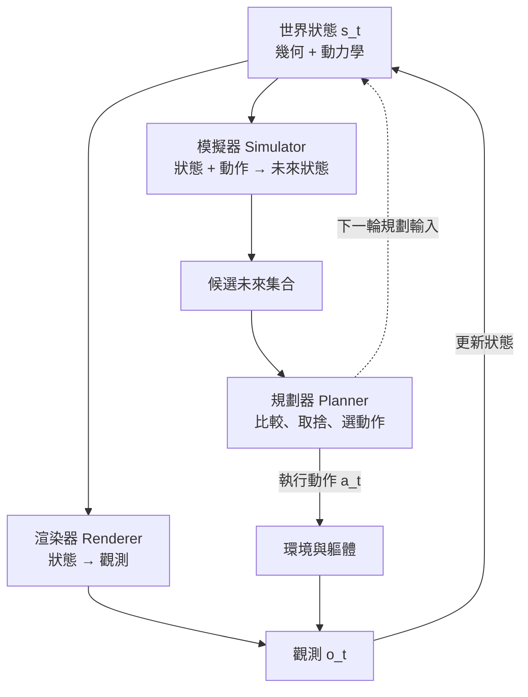

# 0.3 李飛飛的世界模型三元視角：渲染器（Renderer）、模擬器（Simulator）與規劃器（Planner）

## 從「空間智慧」到「世界模型」

2023 年底，在人工智慧領域最繁忙的一場辯論中，一個來自華人學術界的聲音給出了一個極為清晰的框架。李飛飛在談到具身智慧時反覆強調兩個詞：**空間智慧（spatial intelligence）** 與 **具身智慧（embodied intelligence）**。她認為，人類智慧的核心並非在語言裡，而在於理解空間、理解物件與環境的關係、理解動作如何改變這個世界；而當智慧系統被放進軀體、被要求在真實物理環境中行動時，它就必須真正擁有「世界模型」。

在 2024 年前後的演講與文章中，她把這個想法推得更具體。她主張，**生成式模型是學習世界模型的一條重要道路**——理由並不玄學：生成模型要求模型不僅要辨認世界看起來像什麼，還要在內部生成出「這個世界如果這樣發展會是什麼樣子」的完整序列。要生成一段可信的未來，模型就必須隱式地掌握其中隱含的幾何、物理與因果結構。

更關鍵的是她提出的三元結構：世界模型的能力可以分解為**渲染器、模擬器、規劃器**三種角色。這三個角色分別回答三個不同的問題：世界是什麼樣子的？如果我這樣做，未來會是什麼樣子？在眾多可能的未來中，我該選哪一條？

## 拆解第一角色：渲染器（Renderer）

**渲染器**的能力是：給定世界的內部狀態，生成與之對應的觀測。也就是「從狀態到像素」的那個方向。

這一支的代表性技術是輻射場方法與擴散式生成模型。NeRF 把場景表示為一個連續的輻射函數 $`F(\mathbf{x}, \mathbf{d}) \to (\mathbf{c}, \sigma)`$ ，給定相機射線就能查詢顏色與密度，進而合成出照片般的影像。3D 高斯潑濺把場景改寫為一組帶有位置、尺度、旋轉與顏色的高斯橢球，用混合的方式渲染，兼顧速度與品質。擴散模型則走另一條路：它不直接參數化場景，而是在噪聲與影像之間學習一條反向的去噪路徑，因此能生成高解析、變化豐富的觀測。

從世界模型的角度看，渲染器的意義在於**它把隱狀態變成可檢視的東西**。人類示範者要教機器人做一件事，需要看到一個動作會產生什麼樣的場景變化；工程師要除錯一個預測，也要能看到「模型 thinks 的世界」長什麼樣。此外，渲染器提供了一種極為強大的合成資料通道：如果模型能從動作生成未來影像，它就能無限地生產訓練資料，這正是第 9 章 Sim-to-Real 的技術基礎。

在本書的脈絡裡，渲染器主要對應**第 2 章**（建立穩定可查詢的幾何表徵）與**第 5 章**（擴散式生成架構）。第 2 章解決「狀態必須有幾何」的問題，第 5 章則展示生成式架構如何承載時空資訊。

渲染器還肩負一個容易被忽略但極重要的職責：**提供可介入的觀測介面**。人類的示範是透過視覺通道進入系統的，機器人若只能輸出抽象的潛在狀態，就無法接受人類的視覺指導；而當渲染器能把狀態還原成視角一致、幾何正確的影像時，人類就能「看見」模型的世界，於是語言、示範與自動化資料在同一個介面上合流。這一點在第 9 章談數位孿生作為低成本訓練場時會再次出現。

## 拆解第二角色：模擬器（Simulator）

**模擬器**的能力是：給定當前狀態與一個動作，預測接下來的狀態與觀測。也就是「從狀態到下一個狀態」的那個方向。

這是世界模型中與物理結合最緊密的部分，也是三個角色裡技術含量最高的一個。模擬器必須內建或隱含地學會動力學：重力如何把物體往下拉、碰撞時動量如何分配、摩擦如何影響物體的相對運動、以及當物體互相接觸時支撐關係如何變化。一個只會「生成像樣的畫面」而無法正確回應動作的模型，距離能規劃的模型還差得很遠。

模擬器可以分兩條路線來理解。第一條是**顯式建構物理引擎**：用解析或數值方法描述接觸、碰撞與約束，求解後得到下一幀的狀態。它的優點是物理上可信、可解釋、可保證守恆律；缺點是建模成本高，且難以覆蓋真實世界的複雜材質與形變。第二條是**學習式動力學**：用神經網路從資料中學出狀態轉移函數，或用擴散模型在軌跡空間中直接生成未來。第 4 章的自迴歸時空生成、第 5 章的動作條件化擴散、第 6 章的 JEPA 特徵預測、第 7 章的動作條件化與逆動力學，都是這條路線的不同切面。

在本書的脈絡裡，模擬器橫跨**第 1、4、5、7 章**：第 1 章建立狀態與動力學的數學框架，第 4 至 6 章給出生成未來的三種架構範式，第 7 章則補上「動作如何真正改變世界」這一環。

模擬器還有一個容易被低估的性質：它必須**量化自己的不確定性**。當模擬器對「杯子掉到地上會碎成幾塊」這類問題給出多種互異的答案時，規劃器才有資訊去選擇較保守的動作；若模擬器總是給出單一答案，規劃器就會把幻覺當成事實。擴散模型之所以在第 5 章佔據重要位置，正是因為它的隨機性天然承載了多模態的未來分佈，而自迴歸模型雖好，卻必須靠外掛的取樣策略（依第 4 章的討論，如分類器引導或隨機性注入）才能逼近同一件事。

## 拆解第三角色：規劃器（Planner）

**規劃器**的能力是：在眾多可能的未來中選擇一個動作。它必須能提出候選動作、對每個候選動作呼叫模擬器、比較結果的好壞，再回到起點提出下一個。

這是三個角色中唯一直接面對「選擇」問題的，因而它的本質是**搜尋**。蒙地卡羅樹搜尋在棋類上的成功，展示了測試時計算的威力；把同一套方法搬到物理世界，就成了模型預測控制（Model Predictive Control）：在每一個決策點重新規劃，只執行第一步或前幾步，然後用新的觀測重來。這種「規劃—執行—再規劃」的節奏，恰好模擬了人類用系統二在腦中排練的過程。

值得強調的是，規劃器並不需要自己理解物理，它只需要**能呼叫模擬器、能比較未來、能分配算力**。因此它的能力上限由模擬器的保真度決定，而它的實用性則取決於推演的效率。第 8 章的三節內容分別處理測試時計算的擴展、與 MCTS 及 MPC 的整合、以及在發散的平行未來中做價值導向的軌跡剪枝；第 9 章則把這套迴圈落到 VLA 模型與數位孿生上。

三個角色的職責、輸入輸出與對應章節，可以先整理成下表，後續各節再逐一說明其技術內涵。

表 0-2　渲染器、模擬器與規劃器對照

| 角色 | 核心問題 | 輸入 → 輸出 | 代表技術 | 對應章節 |
| --- | --- | --- | --- | --- |
| 渲染器 Renderer | 世界是什麼樣子的 | 狀態 → 觀測 | NeRF、3DGS、擴散生成 | 第 2、5 章 |
| 模擬器 Simulator | 如果我這樣做，未來會如何 | 狀態 + 動作 → 未來狀態 | 循環潛在動力學、時空自迴歸、JEPA | 第 1、4、5、6、7 章 |
| 規劃器 Planner | 在眾多未來中我該選哪一條 | 候選未來 → 動作 | MCTS、MPC、價值剪枝 | 第 8、9 章 |

## 三元視角的關鍵：循環，而非流水線

初看之下，渲染、模擬、規劃像是三個依序排列的工序：先渲染得到觀測，再模擬得到未來，最後規劃選出動作。但事實上，這三者的關係是**循環的**。

規劃器選定的動作會被施加到環境，於是產生新的觀測；新的觀測被渲染器與狀態編碼器吸收，更新了內部狀態；更新後的狀態再交給模擬器，產生新的、未受約束的平行未來；規劃器再在新的未來集合中重新比較。這是一個持續運轉的閉環，而不是一條單向的產線。

這個循環有兩個重要推論。第一，**渲染器不只服務於人類觀看**。在循環中它扮演的是「把潛在狀態解碼成可被感知模組消費的觀測」的角色，這使得感知與生成共用同一份狀態，避免兩套表示漂移。第二，**規劃的結果會回頭改變狀態**，因此系統具備自我修正的能力。第 8 章末的自反思架構正是把這條閉環閉合：模擬的結果被用來修正直覺策略，而不是只做一次性的決策。

## 「世界模型不是一個模型，而是一組能力」

三元視角最重要的理論推論，是它把「世界模型」從一個模型的名字，變成了一組能力的組合。這解釋了為什麼在文獻裡，我們會看到許多架構各異卻都被稱為世界模型的系統：Dreamer 是一個以潛在狀態為核心、把渲染與模擬整合在循環世界模型中的系統；世界模型式擴散模型把模擬交給生成器；一個 LLM 加一個獨立的物理模擬器加一個 MCTS 搜尋器，也是世界模型。名字不同，是因為三種能力被實作在不同的地方。

這也解釋了為什麼單一模型常常不足以完成任務。一個只有渲染能力的系統會給出逼真的未來影像，但無法保證它響應你的動作；一個只有模擬能力的系統能正確推演，卻無法把狀態視覺化，也難以從人類的語言指示中獲得目標；而沒有規劃器的模擬器，只是一台沒有方向的高保真錄影機。

三元視角還給出了一個可操作的診斷工具：當一個系統失敗時，可以直接問它缺哪一環。生成的影片很漂亮但動作無效，缺的是模擬器對動作的響應；推演很準但不知道該做什麼，缺的是規劃器；每一步都對但三步之後場景崩潰，缺的是規劃器所依賴的長程狀態精度。這套診斷方法在本書後續章節中會反覆出現。

## 與本系列其他書的呼應

三元視角並非孤立提出，它是「人工智慧系列」整體主線的自然延伸。它的價值在於把三個長期被混為一談的問題分開了：什麼是「重建世界」，什麼是「推演世界」，什麼是「決定要做什麼」。

與**《電腦下棋》**的呼應最為直接。棋類引擎的核心同樣是三元結構：渲染器是局面表示與合法走法生成，模擬器是假設推演（沿著對方最強回應展開後續局面），規劃器是搜尋與評估。世界模型把這套結構從離散棋盤搬到了連續物理空間，而連續空間帶來了兩個新麻煩：搜尋分支因子更大，且狀態沒有天然的「合法走法」可用來收斂。第 8 章的 MCTS 與 MPC 整合，正是這條跨域移植的主線。

與**《Agent 技術》**的呼應則在迴圈的形態上。Agent 架構強調「感知—決策—行動—再感知」的反覆循環，世界模型的循環是它的升級：Agent 的感知模組把觀測轉成內部狀態，世界模型則在這個狀態之上多了一層**推演**能力，於是迴圈從「被動反應」變成「主動排練」。可以這樣理解：Agent 技術處理的是迴圈的骨架，世界模型處理的是迴圈中那顆大腦。

兩條呼應合起來說明了一件好事：從下棋到 Agent，再到世界模型，是同一條技術路線的第三次推進——把更多算力放到思考裡，把內部世界的保真度做得更高。

而這條路線的共同難題也一直相同：內部世界保真度不足。棋盤上，內部表示與真實表示是精確對應的，所以推演不會出錯；Agent 迴圈中，內部狀態是語境化的摘要，長任務難免漂移；而世界模型要面對的，是連續物理空間中最細微的偏差都會在多步之後被放大。第 10 章所談的複合誤差與物理幻覺，正是這個老問題在物理世界裡最嚴重的形態。

## 全書路線圖

最後，讓我們把這本導言的三節放回全書的結構中，看清每一章在三元視角裡的位置。

第 1 章處理**狀態**的數學地基：從 MDP 到 POMDP，再到 Dreamer 的循環潛在狀態，這是在回答「世界模型內部到底存什麼」。第 2 章處理**幾何**：像素不足以承載遮擋與持久性，必須走向 3D 輻射場與以物體為中心的槽位表徵，這是渲染器能夠忠實還原世界的前提。第 3 章處理**物理與因果**：直覺物理學先驗、碰撞、以及結構因果模型與反事實推理，這是模擬器能夠正確回應動作的條件。

第 4 至 6 章是**模擬器的三條架構範式**：自迴歸時空生成追求「像真的」，擴散式世界模型追求「能表達不確定性」，JEPA 特徵預測追求「只要對決策有用就好」。第 7 章補上**動作的因果結構**：FiLM、交叉注意力、前後向動力學與多感官，讓觀測變成可干預的系統。第 8 章是**規劃器**：測試時計算、MCTS 與 MPC，以及在平行未來中做價值剪枝。第 9 章把三者落到**軀體**：VLA 模型、數位孿生與 Sim-to-Real。第 10 章則直面**極限**：複合誤差的累積、物理幻覺與守恆對齊，最後給出通用世界模型的藍圖。

回到導言的第一節：內部表徵必須可組合、可干預、可校準。第二節：LLM 與世界模型在五個維度上的分岔。第三節：這些能力被組織成渲染、模擬、規劃三個彼此循環的角色。三節合起來，就是這本書的問題意識——通用智慧的上限，不在於模型能說出多少正確的話，而在於它能否在腦中維持一個可被查詢、推演與干預的世界。

若把三節的命題再濃縮成一句，那就是：把世界變成一個可以內部運算的物件，然後把算力花在對這個物件的反覆試算上。這正是從預測文字走向模擬世界的全部距離，也是接下來十章要一寸一寸走完的路。
