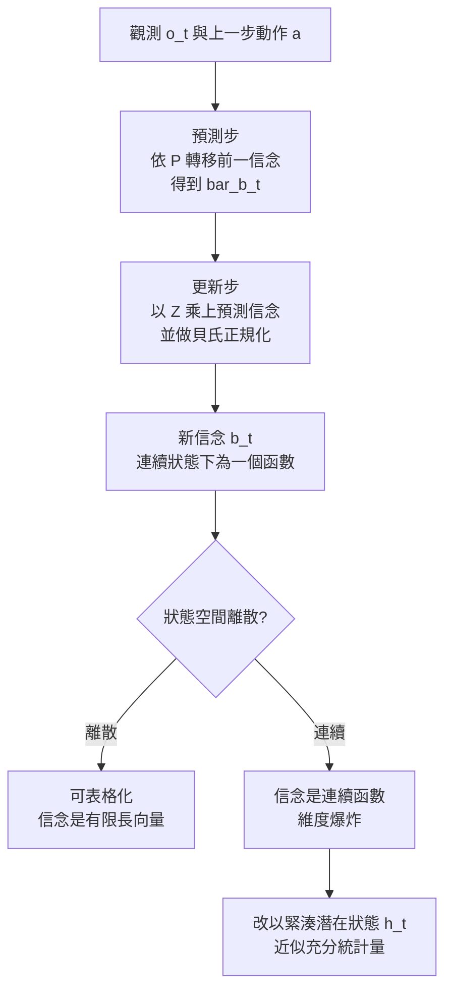

# 1.1 從馬可夫決策過程（MDP）到部分可觀察狀態（POMDP）的狀態轉移建模

## 前言：任何規劃的前提是「有一個可預測的世界」

在本書的第一頁，我們必須先把一個最基本的直覺寫清楚：所謂「智慧」，在工程上最可靠的定義，是**在已知環境規律的前提下，選擇能最大化長期回報的行動序列**。這句話拆開來有兩個要件。第一個要件是環境規律必須可被形式化；第二個要件是回報必須被定義。強化學習的整個歷史，就是把這兩件事從人類的直覺降格為可計算物件的歷史。而承載這兩件事的容器，就是 MDP。

MDP 是一個極度乾淨的數學物件：給定狀態，執行動作，未來的分布就完全決定了。這種「乾淨」在 1957 年是里程碑，在 2020 年代卻成了最大的障礙。因為真實世界幾乎從來不給你完整的狀態。你看到的是一幀 224×224 的影像，而不是牆壁的材質、彈簧的係數與地板的摩擦力。你聽到的是一段含混的錄音，而不是桌上物體的質量分布。本節的目的，是把這個「看不到全貌」的困難形式化，並解釋為什麼世界模型研究者最終選擇的答案不是「求出精確的信念狀態」，而是「學一個緊湊的潛在狀態」。

這裡有一個貫穿全書的區分值得先提出來：**可模擬的狀態**與**可觀測的狀態**不是同一件事。動物在奔跑時並不會看到地面每一粒沙子的座標，但它確實能「模擬」自己即將踩到的那塊地面。深度學習的詞向量模型把每個詞壓縮成一個固定的向量，那是可表示但不可模擬的狀態；世界模型要求的狀態必須能隨動作而演化，因此它天然帶有時間結構。本節的所有形式化，都是為了給這種「會動的狀態」一個合法的數學位置。

也要先點明本章與全書其他章節的分工。第 1 章處理的是**框架與奠基**：狀態是什麼、怎麼把它形式化、第一批架構長什麼樣。第 2 章起才進入**內容**：這個抽象的狀態裡該裝進哪些幾何資訊與物理資訊。把抽象與具體分開，是為了讓讀者在接受任何具體設計之前，先確立判斷標準——當我們在第 10 章討論「這個模型有沒有學到物理」時，判斷的依據正是本章給出的形式化。

## 三代架構的預覽

在進入細節之前，先把本章四節所涵蓋的三代架構並排放在一起，讓讀者有一個座標系。這三種架構處理的是同一個問題——用一個緊湊的表示取代不可得的真實狀態——但它們對「這個表示該保留什麼資訊」給出了不同的答案。

| 面向 | Ha 2018 | Dreamer v1–v3 | MuZero |
| --- | --- | --- | --- |
| 狀態表示 | VAE 潛在 $z_t$ | RSSM 拼接 $h_t^{\mathrm{det}} \Vert z_t$ | 隱含狀態 $h^0$ 與 $h^k$ |
| 狀態類型 | 連續、壓縮像素 | 確定性記憶加離散隨機 | 由表示函式自回歸推導 |
| 主要損失 | 重建加 KL、MDN 似然 | 重建加 KL 加回報預測 | 價值加策略加 unroll 一致性 |
| 觀測重建 | 需要 | 需要 | 不需要 |
| 策略學習 | CMA-ES 演化搜尋 | 在 imagination 中 actor-critic | 在搜索中改進策略網路 |
| 主要用途 | 示範可行性 | 樣本效率高的策略學習 | 為搜索提供可用的模型 |

這張表的縱列是「資訊保留量的遞減」：Ha 保留了重建像素所需的一切，Dreamer 保留了重建加上回報預測所需，MuZero 只保留價值與策略所需。第 1.2 至 1.4 節將分別說明這三個選擇背後的理由與代價。

## MDP 的形式化：五元組與它的承諾

一個 MDP 由五元組 $\langle \mathcal{S}, \mathcal{A}, P, R, \gamma \rangle$ 定義。狀態集 $\mathcal{S}$ 是環境在每個時刻的全部相關資訊；動作集 $\mathcal{A}$ 是決策者可執行的選擇；轉移核 $P(s' \mid s, a)$ 給出在狀態 $s$ 執行 $a$ 後到達 $s'$ 的機率；獎勵函數 $R(s, a, s')$ 描述轉移伴隨的即時報酬；折扣因子 $\gamma \in [0, 1)$ 則決定未來報酬的折損速度。

這五個元件合起來構成了 MDP 的核心承諾：**只要這五樣東西給定，未來就是可算的**。此時不需要真的知道世界的物理定律是什麼，因為 $P$ 本身就是定律的完整編碼。注意這裡的分工—— $P$ 不必具有物理意義，它只要是一個正確的機率表就夠了。這是一個重要但常被忽略的重點：MDP 對「物理」的要求僅限於轉移核正確，因此一個只會彈跳小球的物理引擎與一個完整的模擬器在 MDP 框架下是等價的。

MDP 之所以能支撐整個領域，是因為在它之上存在一個漂亮得不像話的解法。貝氏動態規劃把「求最優策略」化約為「求一個固定點」。若我們已知一個策略 $\pi$ ，其狀態價值函數滿足：

$$
V^\pi(s) = \mathbb{E}_{s' \sim P(\cdot \mid s, \pi(s))} \left[ R(s, \pi(s), s') + \gamma V^\pi(s') \right]
$$

這個式子的意義是：狀態 $s$ 的價值等於「立刻拿到的獎勵」加上「折扣後的未來價值」的期望。當我們不知道 $\pi$ 時，貝氏最優性原理給出更強的方程式：

$$
V^*(s) = \max_{a \in \mathcal{A}} \mathbb{E}_{s' \sim P(\cdot \mid s, a)} \left[ R(s, a, s') + \gamma V^*(s') \right]
$$

這兩個方程式的漂亮之處在於它們是**閉環**的：左邊與右邊都出現 $V$ 。它們把一個無窮維的策略空間問題降成了在狀態空間上的逐點計算。價值迭代、策略迭代、Q-Learning、TD( $\lambda$ )、PPO、AlphaZero——整個現代強化學習譜系，某種意義上都是這兩個方程式的工程化。第 8 章要介紹的 MCTS 與 MPC，也不過是把「解固定點」換成「在模型中展開分支並評估葉節點」。

## 真實世界不是 MDP：三個破口

MDP 的承諾在真實環境中同時從三個方向破口。

**第一個破口是遮蔽與部分可觀察**。自駕車的前方視窗看不到後方來車；人類的視野裡，房間裡的每個物體都存在，但只有正對你的那幾個進入視野。你不能從一幀影像中判斷出球的速率與方向，也不能從一張靜態照片判斷出玻璃杯裡的水位正在上升。這些不是工程瑕疵，而是物理現實的結構性特徵。第 2 章要處理的物體持久性與遮擋推理，正是把這一類破口重新接回來的工程努力。

**第二個破口是噪聲與不可重現性**。即使你定義了完整的狀態變數，真實環境的量測永遠帶噪。GPS 有多徑誤差，感測器有量化誤差，機器人會被地面摩擦力擾動。於是即使狀態是隱的，我們對它的信念也會隨時間擴散——同一個場景重跑兩次，你會得到不同的觀測。這種「同一隱狀態對應多個觀測」的現象，正是觀測模型 $Z$ 存在的理由。

**第三個破口是狀態空間的不可及性**。要正確描述一個房間的狀態，你或許需要知道每個粒子的位置、速度與相互作用力。這個集合是無限維的，而且不可觀測。任何企圖寫出「完整狀態」的企畫，實際上都是在做近似。這三個破口合起來導致一個殘酷的結論：**在真實環境中，人類與機器其實都無法直接看到世界的狀態**。我們能做的只是猜。而「怎麼把猜測組織成一個可以遞迴更新的物件」正是 POMDP 的任務。

還有一個更根本的困難常被忽略：MDP 假設狀態空間是給定的，但真實環境的狀態空間是我們**自己定義**的。我們可以把狀態定義成「機器人攝影機的像素」，也可以定義成「房間裡所有剛體的位置與速度」。前者維度有限但丟棄了物理，後者保留了物理但維數無限。這個「如何選擇狀態定義」的問題，比任何演算法都更根本——第 3 章的直覺物理學先驗、第 6 章的特徵空間選擇，本質上都是在回答它。

## POMDP 的形式化：七元組與信念狀態

部分可觀察決策過程把 MDP 擴充為七元組 $\langle \mathcal{S}, \mathcal{A}, \mathcal{O}, P, Z, R, \gamma \rangle$ 。相較於 MDP，新增了觀測集 $\mathcal{O}$ 與觀測模型 $Z(o \mid s')$ 。 $Z$ 是解釋機制：給定真正的狀態 $s'$ ，環境以某個機率產生觀測 $o$ 。在 POMDP 中，決策者永遠看不到 $s_t$ ，只看到 $o_t$ ，因此一個完整的解包含三部分：策略、觀測模型與預測模型。

核心技巧在於：我們雖然看不到狀態，但可以維護一個關於狀態的**機率分布**，稱為**信念狀態（belief state）**：

$$
b_t(s) = P(s_t = s \mid o_{1:t}, a_{1:t-1})
$$

注意它包含了截至 $t$ 為止的全部觀測與動作歷史。它的意義是：給定目前為止我看到與做過的一切，狀態是 $s$ 的機率。信念狀態是 Markov 的——這是整個理論的魔法之處。一旦把整段歷史壓縮成 $b_t$ ，剩下的決策問題就重新變成了一個 MDP，只是狀態變成了連續的分佈空間。策略此時定義在信念上： $\pi(a \mid b)$ 。

遞推分為兩步。第一步是**預測（prediction）**：在還沒看到 $o_t$ 之前，先依據上一個信念與上一個動作，把信念往前推：

$$
\bar{b}_{t}(s') = \sum_{s \in \mathcal{S}} P(s' \mid s, a_{t-1}) \, b_{t-1}(s)
$$

第二步是**更新或濾波（filtering / correction）**：看到新觀測 $o_t$ 之後，用貝氏定理把這個預測修正：

$$
b_t(s') = \frac{Z(o_t \mid s') \, \bar{b}_t(s')}{\sum_{s \in \mathcal{S}} Z(o_t \mid s) \, \bar{b}_t(s)}
$$

值得注意的是，這兩步恰好對應世界模型架構中的兩個模組：**預測步就是狀態轉移模型**，**更新步就是感知編碼器**。這不是事後的巧合，而是我們對 POMDP 遞推的重新解讀——把貝氏濾波的「預測」與「修正」替換成可學習的神經網路模組，濾波器就變成了可訓練的世界模型。

## 信念狀態空間的維度爆炸

如果 $\mathcal{S}$ 是離散且有限的，信念狀態就是一個長度為 $|\mathcal{S}|$ 的機率向量，遞推完全可計算。Kaelbling、Littman 與 Cassandra 在 1990 年代末正是靠這個框架，在機器人導航與 POMDP 求解上取得突破。然而，一旦狀態連續——而這正是真實世界的常態——信念就不再是一個向量，而是**定義在狀態空間上的一個連續函數**。

連續函數意味著無限多個自由度。若 $\mathcal{S} \subset \mathbb{R}^d$ ，理論上信念需要以 $d$ 維的連續分佈族來描述；就算我們用 $K$ 個高斯分量近似，每個分量有均值與協方差的自由度，整個近似的參數量也是 $O(K d^2)$ 量級。更糟的是，隨著時間推移，信念會不斷變得更高峰、更稀疏——這就是所謂的 belief degeneracy（信念退化）。觀測越多，信念越尖銳，分佈越難用固定容量的參數族表示。

在連續空間裡，濾波與預測兩步也就不再是簡單的求和與乘法。預測步變成對連續分佈的積分：

$$
\bar{b}_t(s') = \int_{\mathcal{S}} P(s' \mid s, a_{t-1}) \, b_{t-1}(s) \, ds
$$

更新步的分母則是對觀測似然的積分。兩者都沒有閉式解，只能靠粒子濾波、無跡粒子濾波或變分近似來逼近，而這些方法在長期軌跡上依然會退化或變得計算極貴。

因此「精確求解 POMDP」在真實規模上是一個注定失敗的策略。研究者轉而尋找另一條路：**既然無法窮盡信念空間，就直接學一個低維的表示，把歷史壓縮成足以支援決策的向量**。這就是「緊湊潛在狀態 $h_t$ 」的由來。

理想上我們希望 $h_t$ 是 $s_t$ 的**充分統計量**，也就是說給定 $h_t$ 與 $a_t$ ，對未來的信念與給定真實的 $s_t$ 與 $a_t$ 完全相同：

$$
P(o_{t+1}, r_{t+1} \mid h_t, a_t) = P(o_{t+1}, r_{t+1} \mid s_t, a_t)
$$

實務上我們幾乎不可能找到真正的充分統計量，但可以學一個夠用的近似，讓決策品質損失可控。這個讓 $h_t$ 近似充分統計量的目標，正是後面每一章的技術手段的真正目的。

## 三大組件的分工：感知、轉移、決策

一旦決定用 $h_t$ 取代不可得的 $s_t$ ，整個系統自然分裂成三個組件。

**感知編碼器（perception / encoder）** 負責把原始觀測 $o_t$ 編碼成一個向量 $e_t = \phi(o_t)$ 。它是單幀的、局部的，只需要回答「我看到了什麼形狀與外觀」，不需要回答「這東西正在往哪裡去」。它對應上文的濾波步：把觀測壓縮成一個可以與動作結合的特徵。

**狀態轉移模型（transition / dynamics model）** 負責把 $(h_t, a_t)$ 映射到下一個潛在狀態 $h_{t+1}$ ，並且在同一時間預測獎勵與觀測的分布。它是記憶的、整合的，需要回答「世界接下來會怎麼變」。它對應上文的預測步，也是整個模型中最昂貴、最需要長期訓練的部分。

**策略與解碼器（policy / decoder）** 負責從 $h_t$ 產生動作，並在需要時把 $h_t$ 解碼回可解釋的觀測形式（例如重建影像）。它是目標導向的，回答「我該做什麼」。當我們進入第 8 章的規劃時代，這個模組會被搜索演算法取代，但它的位置不變。

這個三分法不是憑空發明的。它來自一個非常實際的工程理由：**模組化使每個部分可以被單獨訓練**。VAE 可以用海量無標籤影像訓練，重建目標不需要任何動作資料；循環動力學模型可以用軌跡訓練，不需要獎勵；策略則需要在環境中互動，但只要潛在空間固定，前兩者都可以先凍結。相較之下端到端訓練在 2018 年既不穩定又缺乏診斷能力——當車輛撞牆時，你無法判斷是感知錯了、動力學錯了還是策略錯了。

模組化還帶來另一個好處：**每個模組可以擁有不同的訓練目標與不同的資料來源**。這正是 1.2 中三個組件分別使用 VAE 預訓練、MDN-RNN 預訓練與 CMA-ES 線上最佳化的原因。它們甚至不必在同一時間訓練，也不必在同一個框架內實作。

## 為什麼「分開感知、記憶與策略」是早期共識

現在回頭看，這個共識背後有三個互相呼應的理由。

**第一是資訊隔離的必要性**。重建像素需要高解析度、局部細節的資訊；預測動作需要抽象、任務相關的資訊。把兩者放在同一個向量裡，必然互相干擾。2018 年前後大量實驗都顯示，端到端從像素學到動作的管道梯度訊號極其脆弱，而分開訓練時每一段都可以獨立除錯。

**第二是資料效率的分工**。VAE 只需要靜態影像，不需要標籤也不需要互動軌跡；這意味著它可以在人類的網路照片上訓練。MDN-RNN 需要軌跡，但不需要獎勵；它可以在無標籤的影片上訓練。只有策略真正需要獎勵回饋與互動。把需求最弱的模組放在資料最容易取得的地方，是最務實的排列。

**第三是對未來擴充的預留**。如果狀態轉移模型能獨立於策略訓練，那麼同一個模型就可以搭配不同的策略；這是 Dreamer 系列後來能夠把「在真實環境中收集資料」與「在模型內部想像中訓練策略」拆開的前提。1.3 會看到，想像中的學習之所以能提升樣本效率，正是因為這個模組邊界的存在。

當然，這個共識也有代價。模組之間的介面是瓶頸：VAE 丟棄的資訊，MDN-RNN 就永遠拿不回來；而 VAE 為了重建而保留的資訊，又可能對預測毫無幫助甚至有害。1.2 會具體指出這三個侷限——感知端的容量浪費、記憶端的多模態薄弱、潛在空間缺乏物理結構——以及它們分別對應到本書後續章節的解法。

## 小結

MDP 給出了可解性，POMDP 給出了可表達性，而信念狀態的維度爆炸說明了两者都不能直接落地。世界模型的技術路線於是出現：放棄精確的信念狀態，改學一個緊湊的潛在狀態 $h_t$ ，並以感知、轉移、決策三個模組分工逼近它。在 1.2 我們將看到，這個三模組方案的第一個完整示範——用 VAE 看、用 MDN-RNN 記、用 CMA-ES 動——是如何在 2018 年的模擬器裡讓一輛車開出賽道，並且把「world model」這個詞帶進主流。
