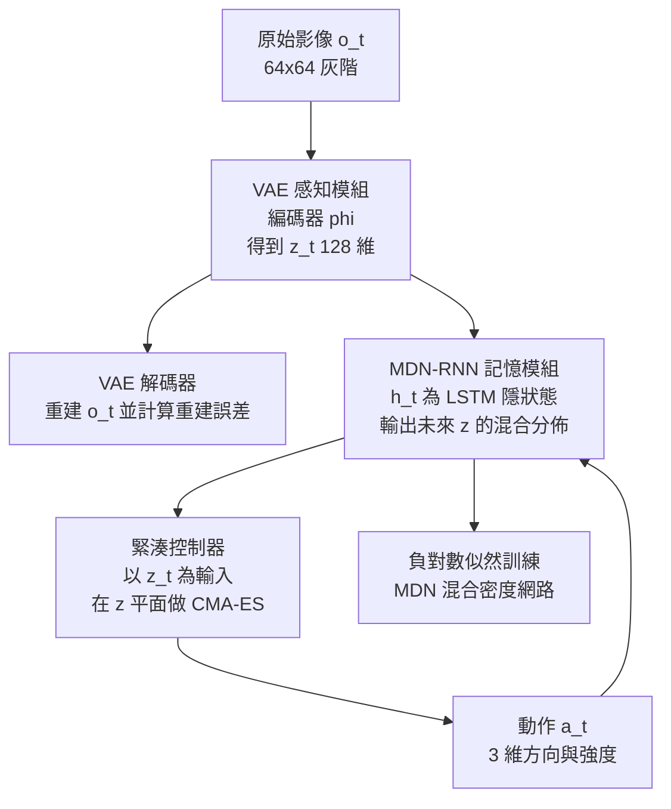

# 1.2 Ha & Schmidhuber 視覺世界模型：VAE 感知、MDN-RNN 記憶與緊湊控制器

## 前言：把「世界模型」這個詞帶進主流的一篇論文

2018 年 3 月，David Ha 和 Jürgen Schmidhuber 在 arXiv 上發表了題為 *World Models* 的論文。這篇只有六頁、幾乎沒有數學推導、卻在深度學習社群引發廣泛共鳴的文章，第一次把「感知—記憶—行動」這條完整管線以工程可用的形式組裝起來，並且示範它能在模擬器中讓一輛車真正開出賽道。它訓練的場景是從隨機生成的遊戲截圖中切出來的片段——這些影像不是真實的駕駛紀錄，而是幾乎不含任何駕駛訊息的雜訊，卻足以讓模型學會「轉彎時畫面會往哪邊偏」這種動力學直覺。

這篇論文的歷史地位極為特殊。在它之前，「world model」這個詞在機器人學界指的是一個明確的工程物件：一個能在給定控制輸入下產生狀態預測的系統，例如 MPC 控制器內部的狀態預測模型。在它之後，這個詞變成了 AI 領域的通用詞，泛指任何內部建構的環境模型。Schmidhuber 本身是 LSTM 的發明者之一，而整篇論文的核心引擎正是 LSTM 與 VAE 的組合——這不是巧合，而是一篇由「序列建模的大師」所寫的、架構上高度簡潔的示範。

這篇論文最值得學習的地方，不是它的具體模型有多強——以今天的標準看，它其實相當弱——而是它把一個此前散落於機器人學、心理學與控制理論中的模糊直覺，壓縮成了一條任何人都可以複現的管線。

也要說清楚它的歷史位置。它並不是世界上第一個世界模型系統：機器人學界在 1990 年代就有一整類「內部模型式控制」（internal model control），MPC 的狀態預測器也早已存在；Schmidhuber 本人在 1990 年代末就提出過帶控制器與環境模型的 RNN 架構。Ha 與 Schmidhuber 的獨特之處在於**把這些零件組裝成一個端到端可訓練、可用 GPU 訓練、並在視覺輸入上示範成功的完整系統**，而且示範的場景是開車——一個所有人一看就懂其重要性的任務。示範的可視化效果，是這項工作影響力的一部分。

## 三個組件的第一個完整實作

整個系統由三個模組組成，彼此以低維向量介面串接。

在進入細節之前，值得先把它放在本章的座標系裡。Ha 與 Schmidhuber 的方案是「三段拼接」：感知、記憶、策略各自訓練，靠低維向量通訊。往後的兩節則各自沿一個方向推進——Dreamer 把三段融為一體（1.3），MuZero 則連感知端的重建也一併砍掉，只留下決策所需（1.4）。

| 面向 | Ha 2018 | Dreamer v1–v3 | MuZero |
| --- | --- | --- | --- |
| 狀態表示 | VAE 潛在 $`z_t`$ | RSSM 拼接 $`h_t^{\mathrm{det}} \Vert z_t`$ | 隱含狀態 $`h^0`$ 與 $`h^k`$ |
| 狀態類型 | 連續、壓縮像素 | 確定性記憶加離散隨機 | 由表示函式自回歸推導 |
| 主要損失 | 重建加 KL、MDN 似然 | 重建加 KL 加回報預測 | 價值加策略加 unroll 一致性 |
| 觀測重建 | 需要 | 需要 | 不需要 |
| 策略學習 | CMA-ES 演化搜尋 | 在 imagination 中 actor-critic | 在搜索中改進策略網路 |
| 主要用途 | 示範可行性 | 樣本效率高的策略學習 | 為搜索提供可用的模型 |

### 感知模組：VAE 與它的重建加 KL 損失

感知模組是一個捲積式變分自編碼器。給定輸入影像 $`o_t`$ ，編碼器 $`q(z \mid o)`$ 輸出一個高斯分佈的參數 $`(\mu_t, \sigma_t)`$ ，再由此採樣得到潛在向量 $`z_t`$ 。解碼器 $`p(o \mid z)`$ 則把 $`z_t`$ 映回影像空間。

訓練目標由兩項組成：一項是重建項，衡量解碼影像與原影像的差距；另一項是 KL 正則項，衡量後驗與先驗分佈之間的距離：

$$
\mathcal{L}_{\text{VAE}} = \mathbb{E}_{q(z \mid o)} \left[ \log p(o \mid z) \right] - \beta \, D_{\text{KL}}(q(z \mid o) \parallel p(z))
$$

第一項保證潛在向量真的攜帶了關於場景的資訊，第二項把後驗拉向標準高斯，讓抽樣可微分且讓潛在空間連續。KL 項的作用不僅是變分推断的技術需求，更是一種**容量控管**：它迫使編碼器只保留對重建有用的資訊，避免把整張影像原封不動地編碼進去。

潛在維度只有 128 維。相對於一張 64×64 灰階影像的 4096 個像素，這是一個非常激進的壓縮比——而正是這個壓縮比，迫使模型只能保留「形狀與佈局」這類結構性資訊。

### 記憶模組：MDN-RNN 與多模態未來

記憶模組是整篇論文的技術核心。它是一個 LSTM，其隱狀態 $`h_t`$ 被設計成能同時作為「內部世界模型」與「生成未來幀的介面」。

這裡有一個關鍵的難題：如果 RNN 只用均方誤差去預測下一個 $`z_t`$ ，它在訓練時會把多個可能性的平均當成目標。這就是所謂的**多模態問題**——在岔路口，車子可以左轉或右轉，若預測目標取平均，模型會學到「直直往前走開進牆壁」這種完全不存在的未來。

MDN-RNN 的解法是使用**混合密度網路（Mixture Density Network）**：網路不直接輸出下一個 $`z`$ ，而是輸出若干個高斯分佈的參數 $`(w_i, \mu_i, \sigma_i)`$ ，然後用負對數似然訓練：

$$
\mathcal{L}_{\text{MDN}} = -\sum_{i=1}^{K} w_i \log \mathcal{N}(z_{t+1} \mid \mu_i, \sigma_i)
$$

這裡 $`w_i`$ 是第 $`i`$ 個分量的權重， $`\mathcal{N}`$ 是多元高斯密度。訓練時，用「哪一個分量最擅長解釋這一步的真實 $`z`$ 」來分配梯度（responsibility），使不同分量各自負責一種運動模式——例如一個負責直行、一個負責左轉、一個負責右轉。

同時，MDN-RNN 也接受**重建損失**作為輔助正則化，讓隱狀態不致於漂移到一個無法解碼回有意義場景的地方。這個組合——多模態似然加重建約束——是當時把「記憶」做成可用的生成模型的代表性做法。

### 控制器：在潛在平面上做 CMA-ES

第三個模組是控制器。它的輸入是 $`z_t`$ ，輸出是動作：方向與強度。它**不使用任何梯度下降**，而是用 CMA-ES（協方差矩陣自適應演化策略）這種無梯度最佳化，直接在 $`z`$ 平面上搜尋能讓車輛最快抵達終點的參數。

理由非常實際：控制器是在模擬器中線上訓練的，而模擬器的介面提供的是黑盒式的評分——你只能給一個動作，看車跑到哪裡，沒有可反傳的梯度。CMA-ES 這種演化策略只需要「評分」即可運作，因此能在任何模擬器上使用。控制器本身極小，只有幾百個參數。

這個設計有一個副作用值得注意：因為控制器是在固定的 VAE 潛在空間上搜尋出來的，它實際上隱含地「學會」了如何閱讀 VAE 的編碼。它的成功與否，完全取決於 VAE 的潛在空間是否保留了對駕駛有用的資訊。

值得強調的是，這裡的潛在空間扮演了一個**通行的中介角色**。VAE 不知道下游要做什麼，MDN-RNN 不知道獎勵是什麼，控制器不知道像素長什麼樣；三者只靠低維向量的形狀互相通訊。這種「以向量為契約」的設計，是深度學習時代特有的建築美學，也是後來 Dreamer 與 MuZero 都在某種程度上繼承的風格。

### 三個模組如何串成一條閉環

把三者的介面串起來，整條管線的資料流是這樣的：每一時刻，環境給出影像 $`o_t`$ ，VAE 編碼成 $`z_t`$ ；MDN-RNN 以 $`(z_t, a_{t-1}, h_{t-1})`$ 為輸入，輸出新的隱狀態 $`h_t`$ 以及下一個 $`z`$ 的混合分佈；控制器讀取 $`z_t`$ 產出動作 $`a_t`$ ；動作回饋給 MDN-RNN，並改變環境，產生下一幀。

這裡有一個常被忽略的技術決定：控制器的輸入是 $`z_t`$ 而**不是** $`h_t`$ 。理由是 $`z_t`$ 有明確的語義（這一幀的可見場景），而 $`h_t`$ 是高度抽象且與任務無關的記憶狀態。讓控制器只看「當下看到什麼」，是一種樸素的穩健化設計。

另一個技術決定是，MDN-RNN 在**訓練時**吃真實的 $`z_{t+1}`$ ，在**測試時**則改吃自己預測的混合分佈。這種 teacher forcing 與自迴歸推論的落差，是所有循環生成模型的共同難題，也是 Dreamer 用 RSSM 試圖處理的問題。

## 為什麼在 CARLA 裡能開車，而不用真實影像訓練

論文的實驗分兩個階段。第一階段在 CARLA 模擬器中進行：模型在模擬器裡收集帶動作標籤的影像，用上述三模組訓練，最後以控制器實際駕駛一輛車，成功跑完多條賽道。整個訓練過程不需要任何真實世界的駕駛影像。

第二階段才引入真實資料：團隊駕駛小型車在真實道路上記錄影像，訓練 VAE 編碼器（不含動作標籤），再用模擬器中訓練好的控制器在真實車輛上行駛。實驗結果顯示，儘管 VAE 是在真實影像上訓練，模型卻是在模擬器中學會開車，並且能遷移到真實車輛上——這是一次粗糙但真實的 sim-to-real 跨越。

這種做法之所以可行，理由有四點。第一，**合成資料可以無限供應**：CARLA 能即時生成無限多樣的駕駛情境，包含罕見但危險的情況，而真實採集既昂貴又危險。第二，**避免真實資料的分布侷限**：真實駕駛影片裡的相機位置、光照與背景高度相關，模型容易過擬合到特定場景。第三，**動作標籤難以在真實世界取得**：你無法在真實駕駛時精確知道「當時的方向盤轉角」，但模擬器可以精確回報。第四，**可重現性**：模型可以回到同一個模擬情境反覆實驗，診斷失敗原因。

但我們必須誠實地說，這個「不需要真實影像」的說法有相當大的保留。第一階段的 VAE 編碼器仍然是**用真實影像訓練**的，而且是用從 YouTube 遊戲影片中隨機裁切、幾乎不含駕駛資訊的片段。作者自己承認，這些資料在「學會看懂車道與路面」的意義上大約相當於三歲小孩的直覺。所以嚴格說，Ha 與 Schmidhuber 避免的是**真實駕駛軌跡的採集**，而非完全避開真實視覺資料。

## 歷史地位：從一個示範到一個範式

論文的歷史意義可以從三個層次來看。

**第一，它給出了「世界模型」的現代定義**。在它之前，world model 通常指 MPC 內部的狀態預測器；在它之後，它泛指任何內部建構的、可被用來進行預測與決策的環境模型。今天我們說「某個模型具有世界模型能力」，指的就是它內部存在這樣一個結構。

**第二，它示範了從像素到潛在再到行動的完整管線**。在 2018 年之前，深度學習界的主流是端到端地把影像映射到動作，梯度經過捲積層直接回傳到控制器。Ha 與 Schmidhuber 提出的替代方案是把問題切成兩段：先把影像壓縮成低維潛在，再在潛在空間裡學動力學與控制。這個「先壓縮、再抽象建模、才做決策」的順序，後來在 Dreamer、MuZero、JEPA 裡都以不同形式重現。

**第三，它確立了「合成環境先行」的典範**。用模擬器訓練、用少量真實資料接軌、將 sim-to-real 視為核心挑戰——這條路線後來在第 9 章的 VLA 與數位孪生中全面爆發。

### 一個容易被忽略的前提：訓練資料是「無用影像」

這篇論文裡有一個技術上不起眼但方法論上極具啟發性的設計。VAE 編碼器不是用駕駛資料訓練的，而是用 **Doom 遊戲的隨機截圖**——從一段玩家操作的遊戲影片中隨機裁切出來的片段。作者的論點是：這些影像裡幾乎沒有「駕駛」的語意資訊，但它們有道路、牆壁、天空與建築物，比例與明暗關係接近駕駛情境。VAE 因此學到的是「一個能把遊戲畫面壓縮成 128 維」的編碼器。

這個選擇的重要性在於它證明了一件事：**感知編碼器可以獨立於任務來訓練**。你不需要動作標籤，不需要獎勵，甚至不需要語意標註。只要編碼器能壓縮「像真實場景的影像」，它就能作為下游模型的輸入。這個解耦後來在 Dreamer 與大量世界模型工作中被系統化，成為降低資料需求的標準手段。

同時它也埋下了一個限制：VAE 只學會了「靜態場景的壓縮」，沒有學會「運動的壓縮」。因為遊戲截圖是隨機裁切的，相鄰幀之間沒有運動連續性。MDN-RNN 補上這一段，但用的是它自己的資料，而不是讓 VAE 的潛在本身帶有運動結構。第 2 章與第 7 章的工作，某种意义上就是在把「運動結構」下沉到編碼器裡。

## 侷限：三個缺口，三條後續道路

這篇論文的侷限同樣具有歷史意義，因為它們恰好構成本書後續章節的問題清單。

**侷限一：VAE 的重建目標浪費容量在無關細節上**。VAE 的損失要求編碼器保留足以重建每一個像素的資訊——天空的雲紋、路面上的雜訊、車身的反光。這些資訊對預測車輛的未來運動毫無價值，卻佔據了有限潛在維度中的大部分容量。結果是模型在「預測下一步會看到什麼」這件事上表現平平。第 2 章的物體中心槽位表徵要做的，是把感知模組從像素重建轉向結構化、與任務相關的編碼；第 6 章的 JEPA 更進一步，直接放棄像素重建。

**侷限二：MDN-RNN 的多模態建模薄弱**。混合密度網路的分量數固定，訓練時靠責任度指派機制做硬分配，容易出現分量坍縮或分量之間語義重疊。在複雜場景中，未來的可能性遠多於幾個高斯所能覆蓋。第 3 章的直覺物理學先驗與第 5 章的擴散式生成，正是用更富表達力的機制來取代固定分量的混合分佈。

**侷限三：潛在空間缺乏物理結構**。VAE 的潛在空間只保證能重建像素，並不保證潛在向量之間的距離對應物理相似性，也不保證在潛在空間中的線性外插有意義。因此模型無法回答「如果我施加不同的力，會怎樣」這類反事實問題。第 3 章的結構因果模型與第 7 章的動作條件化機制，正是要把可干預性注入狀態表示之中。

還有一個技術性的侷限值得記下：**MDN-RNN 的訓練與測試落差**。訓練時每一步都吃真實的 $`z_{t+1}`$ ，測試時必須連續吃自己的預測。當預測誤差累積，模型會逐漸漂移到一個它從未見過的潛在區域，然後在那裡產生越來越離譜的預測。這是所有循環生成模型的共同脆弱性，也是第 10 章複合誤差問題的第一個具體實例。Dreamer 的 RSSM 用確定性路徑加上隨機路徑的拼接來緩解這個問題，但並未從根本上消除它。

三個侷限、三條道路，構成本書從第 2 章到第 7 章的主線。它們不是對 Ha 與 Schmidhuber 的批評——任何一篇奠基論文都必然留下這樣的空間——而是說明：世界模型領域的後續三十年，基本上是在逐一修補這三個缺口。

## 小結

*World Models* 用六頁紙把「感知—記憶—行動」的管線變成了可複現的工程事實，並讓「world model」成為 AI 的核心詞彙。它留下的三個缺口——像素重建的容量浪費、多模態建模的薄弱、潛在空間缺乏物理結構——精確地對應了本書第 2、3、6 章的解法路線。而在 2019 年，Hafner 與另一群人會把這條管線帶到下一個階段：用一個可微的循環狀態空間模型取代 MDN-RNN，並讓策略直接在模型的想像中訓練。那就是 1.3 的主題。

值得記住的是這條演進的節奏：2018 年的 Ha 與 Schmidhuber 讓世界模型「跑得起來」，2019 至 2023 年的 Dreamer 系列讓它「學得好」，而 2019 至 2020 年的 MuZero 讓它「想得對」。三者分別對應本書的資料效率、模型品質與決策品質三條戰線。接下來的三節，就是這三條戰線各自的奠基工作。
