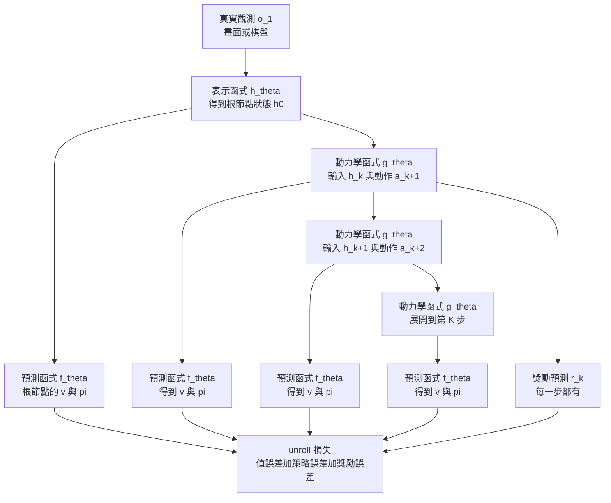

# 1.4 MuZero 架構啟示：不重建觀測，只為價值評估與策略搜尋學習隱式動力學

## 前言：另一種「不需要像素」的世界模型

2019 年 5 月，DeepMind 發表了 *Mastering Atari, Go, Chess and Shogi by Planning with a Learned Model*，隔年 12 月以 *Planning with a learned model* 為題的 Nature 論文正式發表。作者是 Julian Schrittwieser 等人，論文的第一作者正是先前在 *AlphaGo Zero* 與 *AlphaZero* 上嶄露頭角的團隊核心。方法的名字叫 **MuZero**——名字裡的 Mu 來自希臘字母表的第十二個字母，刻意選了一個不與任何既有方法相關的符號。

這篇論文在 DeepMind 內部引發的震撼是難以言喻的。AlphaZero 已經讓世界驚豔，但它需要一個**手寫的**規則引擎來告訴它「棋盤長什麼樣、什麼算合法走法、走到哪裡算贏」。MuZero 的宣稱是：**我連規則都不學，我直接學一個對決策有用的隱含模型**。它既不重建像素，也不重建棋盤結構，它只學一件事——「在某個隱含狀態下採取某個動作，多步之後的價值與機率會怎樣變化」。

這個宣稱在直覺上非常離譜，因此值得先把它的背景講清楚。MuZero 的環境是離散的格子遊戲（Atari、圍棋、國際象棋、西洋棋），每一步的合法動作是有限的（圍棋約 361 個位置），獎勵是稀疏的（圍棋要數百步才分勝負）。作者的核心論點是：**對於決策而言，唯一重要的模型輸出是「價值」與「機率」，而它們不必由像素重建來間接產生**。

這裡有一個我們必須先建立的直覺。在圍棋中，一個位置的好壞並不是由「哪幾顆子在什麼地方」這件事本身決定的，而是由**後續幾十步的演化趨勢**決定的。圍棋手看見的不是黑白棋盤的像素，而是一串意味深長的形勢判斷：「這塊地我拿到了」「這條大龍被圍了」「這手棋是俗手」。一個能把這些判斷壓縮進內部狀態的模型，就足以做出超人級的決策——它完全不需要重建棋盤。

MuZero 的實驗結果印證了這個論點的威力：在 Atari 上，它達到了與 Dreamer 同等水準並打破了多項紀錄；在圍棋上，它達到了超人水準並超越所有前作，同時只用了約半數的計算量。它的搜尋深度受限於算力，但受限的不是「模型的知識量」，而是「模型的複雜度」——因為模型不需要知道規則。

## 三個函式：表示、動力學、預測

MuZero 的模型由三個函式構成，全部以神經網路實作。

**表示函式（representation function）** $h_\theta$ 把原始觀測（遊戲畫面或棋盤表示）映射成一個隱含狀態：

$$
h^0 = h_\theta(o_1)
$$

**動力學函式（dynamics function）** $g_\theta$ 把隱含狀態與動作映射到下一個隱含狀態，並同時產出獎勵預測與策略先驗：

$$
(r^k, p^k, h^{k+1}) = g_\theta(h^k, a^{k+1})
$$

**預測函式（prediction function）** $f_\theta$ 把隱含狀態映射成價值與策略：

$$
(v^k, \pi^k) = f_\theta(h^k)
$$

三者的分工非常清晰：表示函式處理「從像素到內部」；動力學函式處理「動作如何改變內部」，並且**直接預測獎勵**；預測函式處理「從內部到好壞」。

### unroll 訓練目標：把搜尋過程變成梯度路徑

MuZero 的訓練方式，是把 MCTS 的搜尋過程**攤平成一個可微分的計算圖**。

具體來說，在每一個訓練樣本上，作者先用 MCTS 在真實環境中產生一個搜尋樹；然後沿著樹上的某條路徑（action sequence）進行 **unroll**：把根節點的隱含狀態送入動力學函式，逐步展開 K 步，同時在每一步計算一個損失：

$$
\mathcal{L} = \sum_{k=1}^{K} \left( \left\| \hat{z}^k - z^k \right\|^2 + \left\| \hat{\nu}^k - \nu^k \right\|^2 - \hat{r}^k \right)
$$

其中 $\hat{z}^k$ 是 unroll 產生的策略先驗、 $\hat{\nu}^k$ 是價值預測、 $\hat{r}^k$ 是獎勵預測，而 $z^k, \nu^k, r^k$ 則是 MCTS 在真實環境中的搜尋結果所對應的目標值。

這個 unroll 目標的關鍵在於：**它讓「模型在隱含空間中展開的結果」與「真實環境中搜尋的結果」對齊**。模型不需要知道棋盤長什麼樣、不需要知道合法走法是什麼，它只需要學會「如果我走這一步，搜尋結果會朝哪個方向變」。

有一個技術細節值得注意：在 unroll 的中間步驟，**真實觀測是被遮蔽的**。也就是說，從第一步之後，模型的狀態只能靠自己的動力學函式往前推。這迫使模型學到一個能夠自我維持、自我預測的隱含狀態，而不是依賴不斷注入的真實資訊。

### 梯度是怎麼回傳的

MuZero 的整個架構可以理解為：**MCTS 產生目標值，神經網路逼近這些目標值，而梯度沿著 unroll 路徑回傳到表示函式、動力學函式與預測函式**。

這裡有一個與 Dreamer 根本不同的取向。Dreamer 的模型是學「環境是怎麼回事」，然後讓策略在模型裡訓練；MuZero 的模型是學「**搜尋會怎麼走**」，然後用搜尋來產生更好的動作。Dreamer 的 imagination 是一個內部的模擬器，MuZero 的隱含模型是一個**對決策而言足夠精確的模擬器**。

這個差別在實踐上極為重要。如果一個遊戲的物理規則寫錯了，Dreamer 式的模型會學到錯誤的規則並在想像中做出錯誤決策；而 MuZero 的模型只要「在決策上是對的」，即使它對遊戲規則的理解與人類完全不同也無妨。換句話說，**MuZero 的正確性標準是外在的（能不能贏），不是內在的（能不能重建）**。

用一個更精確的說法：MuZero 的隱含狀態不必是人類可解釋的，它只需要滿足一個**任務充分性**（task-sufficiency）條件——給定這個狀態與一個動作，未來的價值分布可以被確定地預測。這比 1.1 提出的「對 $s_t$ 的充分統計量」更弱，因為它放棄了對觀測分布的預測能力，只保留了對回報的預測能力。

這個放棄帶來一個重要的工程後果：既然模型不預測觀測，那麼在 imagination 或 MCTS 展開的過程中，就無法用「重建像不像」來檢查展開的品質。唯一的檢查訊號是**價值與策略的穩定性**——如果展開到第十步時價值劇烈振盪，代表模型在該區域不可靠。這個觀察直接導向第 8.3 節的價值導向軌跡修剪：既然沒有重建誤差可用，就用價值的不確定性來判斷該不該繼續搜索。

## 為什麼「不重建像素」是一種進步

把 MuZero 與前兩種架構並列，MuZero 的選擇帶來三個明確的好處。

**好處一：容量集中在與決策相關的特徵上**。當模型不需要還原棋盤的每一個格子的顏色，它就可以把全部容量用來表示「這步棋好不好」「這局我佔優嗎」。在 Atari 中這一點尤其明顯：分數是稀疏的（有些遊戲需要很長時間才有回饋），而畫面中大部分像素（天空、牆面裝飾）與決策毫無關係。

**好處二：能泛化到不同的下游任務**。由於模型只輸出價值與策略先驗，而這兩者的介面是任務無關的，同一個模型可以在不同的評估目標下使用——例如同一個圍棋模型可以用來評估勝率，也可以用來評估「哪一步是個好棋」。這種任務無關性，是把模型遷移到新領域的基礎。

**好處三：訓練目標與使用目標一致**。模型被訓練來預測「搜尋的結果」，而搜尋的結果正是決策時所需要的。這種目標對齊消除了重建式模型中典型的「代理目標與真實目標錯位」問題。

同時我們也要承認它的代價：**可解釋性大幅下降**。一個能重建棋盤的模型，你可以直接看它「 thinks 」棋盤；一個隱含模型則只有向量，人無從判斷它內部到底建模了什麼。第 10 章在談物理幻覺時，這種不可檢查性會成為一個實際的風險。

## 與本章三種架構的對照

| 面向 | Ha 2018 | Dreamer v1–v3 | MuZero |
| --- | --- | --- | --- |
| 狀態表示 | VAE 潛在 $z_t$ | RSSM 拼接 $h_t^{\mathrm{det}} \Vert z_t$ | 隱含狀態 $h^0$ 與 $h^k$ |
| 狀態類型 | 連續、壓縮像素 | 確定性記憶加離散隨機 | 由表示函式自回歸推導 |
| 主要損失 | 重建加 KL、MDN 似然 | 重建加 KL 加回報預測 | 價值加策略加 unroll 一致性 |
| 觀測重建 | 需要 | 需要（v3 仍保留） | 不需要 |
| 策略學習 | CMA-ES 演化搜尋 | 在 imagination 中 actor-critic | 在搜索中改進策略網路 |
| 主要用途 | 示範可行性 | 樣本效率高的策略學習 | 為搜索提供可用的模型 |

這張表把本章四節的內容串在一起。三者的共同點是：**都把「內部狀態」從原始觀測中抽離出來**；三者的分歧點是：**內部狀態要保留什麼資訊**。Ha 保留重建所需的全部像素資訊，Dreamer 保留重建加上回報預測所需，MuZero 只保留價值與策略所需。資訊保留得越少，模型越專注，但也越難以從模型外部檢查其正確性。

值得注意的是，這三條路徑並非互斥。Dreamer v3 已經把「不依賴觀測重建」的版本做出來（第 6 章會詳述），而 MuZero 的 unroll 目標本質上也是一種「在模型內部展開並對齊」的目標。差別只在於對齊的目標是像素、是特徵、還是搜尋結果。

## 關鍵區分：可執行的模擬器 vs. 特徵預測器

在繼續之前，我們需要建立一個在全書中反覆出現的區分。

**世界模型作為「可執行的模擬器」**，指的是給定一個初始狀態與一串動作，模型能夠產生一條完整的、內部一致的未來軌跡，並且這條軌跡上的每一個狀態都能被價值函數評估、被策略函數讀取、被搜尋演算法分支。這正是 MuZero 的隱含模型，也正是 Dreamer 的 RSSM 的角色。它是一台**可以被反覆呼叫的模擬器**，而且它的介面是「狀態進、狀態出」。

**世界模型作為「特徵預測器」**，指的是模型只回答「下一個狀態的特徵大概長什麼樣」，但並不保證這條預測可以反覆迭代而不崩潰，也不保證預測出來的狀態對決策有用。這個角色更接近 JEPA，第 6 章會詳細處理。

這個區分之所以關鍵，是因為它決定了第 8 章能走多遠。**MCTS 與 MPC 只能呼叫「可執行的模擬器」**——搜索需要把一個狀態展開成多個子狀態，並對每個葉節點求值。如果模型只能做一步特徵預測，搜索就無法在模型內部展開分支。第 8.1 節要處理的「測試時計算擴展」，其前提正是模型具備可執行性。

## 為什麼 MuZero 的思考是全書的樞紐

MuZero 在本書的架構中佔據一個特殊位置，因為它的核心洞見同時延伸出兩條主線。

**第一條是動作條件化（第 7 章）**。MuZero 的動力學函式 $g_\theta(h^k, a^{k+1})$ 明確地把動作作為輸入，這意味著模型內部學到了「不同的動作導致不同的未來」——也就是 1.1 中所說的因果結構，而非單純的相關性。第 7 章要處理的 FiLM 注入、交叉注意力、動作條件化控制，都是把這個洞見推廣到連續動作與多感官輸入上。

**第二條是複合誤差（第 10 章）**。MuZero 的 unroll 目標要求模型在 K 步展開後仍與搜尋結果對齊。當 K 變大時，誤差的累積就成為核心問題。第 10.1 節要證明的「滾雪球般的複合誤差」，其數學根源正是這個自回歸展開結構；第 10.2 節要談的物理幻覺，則是當模型的隱含狀態沒有物理約束時，長程展開會逐步偏離真實物理。

還有一層更深的意義。MuZero 展示了「**可以把模型的訓練目標直接設定為下游思考過程的結果**」這個方法論。這是一種範式性的做法：與其讓模型逼近某個代理目標（像素、特徵、語意標籤），不如讓它逼近「思考過程會給出的答案」。這個原則在語言模型領域同樣成立——我們不預測「正確答案的字面」，而是預測「推理過程會導向的答案」。

這個方法論有一個前提值得標明：思考過程必須是**可重複執行的**。MCTS 可以對同一個節點展開數百次，AlphaZero 可以在同一個遊戲局面重跑數千次搜索，而每一次搜索都會產生可以拿來監督模型的目標值。這就是為什麼 MuZero 特別適合「把思考結果蒸餾進模型」這個範式：思考不只產生一個更好的動作，還順帶產生了大量高品質的訓練訊號。

這個機制在第 8 章會被推得更遠。當我們把「思考」從 MCTS 擴展到更一般的測試時計算（test-time compute），並讓模型不斷生成、批判、修正自己的推論時，被蒸餾進模型的就不只是「答案」，而是「推理軌跡的品質」。這是從第 1 章的狀態建模通向第 8 章系統二思維的一條暗線。

## 誠實的界線：MuZero 沒有空間，也沒有物理

最後必須指出 MuZero 的侷限，因為本章的標題裡的「空間」與「物理」兩個詞並不是裝飾。

MuZero 的實驗環境是**離散格子的遊戲**。Atari 的畫面雖然是像素，但遊戲物理本質上是離散的物件與規則。圍棋、國際象棋、西洋棋則完全是離散格子的抽象規則系統。在這些環境中：狀態沒有連續位置、沒有速度、沒有質量、沒有碰撞、沒有遮蔽問題。棋子不會互相穿透，車輛不會因為動量而打滑。

因此，**MuZero 完全沒有涉及空間幾何與物理學**。它沒有回答「物體的形狀是什麼」「這兩顆星球會不會相撞」「遮蔽背後的東西去了哪裡」。這些正是第 2 章與第 3 章的議題。

這不是批評，而是一次精確的定位。MuZero 證明了「不重建觀測、只學對決策有用的隱含動力學」這條路線在抽象規則環境中是可行的。至於這條路線能否延伸到連續的、有物理的世界——那是一個至今仍未完全解決的問題，也是本書從第 2 章開始要處理的問題。

我們可以這樣總結本章四節的分工：1.1 給出了理論骨架（MDP 與 POMDP 的信念狀態），1.2 給出了第一個可行管線，1.3 給出了把管線打磨到工業級的完整方法論，1.4 給出了「什麼可以不要」的激進答案。四者共同確立的座標是：**狀態是一個需要被主動選擇的、與任務相關的緊湊表示**。從第 2 章開始，我們要問的第一個問題是：這個表示除了「與任務相關」之外，還需不需要「與幾何相關」與「與物理相關」？

這個問題的答案，將會是全書的核心論點之一。MuZero 給出了「不需要」的極端版本，但它之所以能成立，是因為它的環境是抽象的規則系統。在一個有連續位置、速度與碰撞的世界裡，「只學對決策有用的隱含動力學」會立刻遇到一個困難：**動作連續時，隱含空間中的小位移不再對應物理上的小變化**，搜索也無法在連續動作空間中有效分支。第 8 章的連續動作處理、第 2 章的幾何表徵、第 3 章的物理先驗，都是為了讓「MuZero 式的隱含模型」能夠跨出格子遊戲的邊界而做的努力。

換句話說，MuZero 定義了世界模型的**目標形態**，但沒有解決世界模型的**適用範圍**。這兩件事，將由本書後續的九章分別推進。
