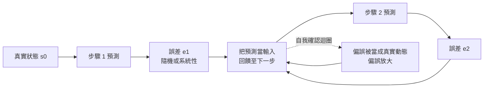
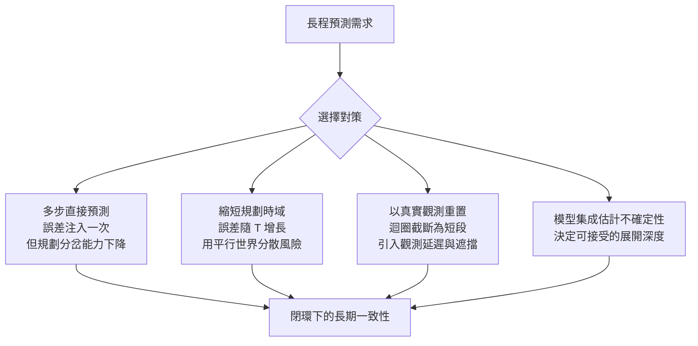

# 10.1 滾雪球般的複合誤差（Compounding Error）：自迴歸預測崩塌與長程飄移的數學極限

## 一、單步精度之外的隱藏問題

前九章的主線是「把世界表示成可以預測的狀態」，而所有章節都反覆引用同一個看似無害的指標：單步預測誤差。這個指標是必要的，卻遠遠不充分。一個逐步預測誤差只有百分之三的模型，在接續兩百步之後可能已經把一個靜止的杯子推到了桌子邊緣之外，再往後就會讓它穿過桌面掉到地板上——整段影片在視覺上仍然流暢，在像素指標上甚至可能比一個更爛但更保守的模型更好看。

問題的根源在於預測的遞迴結構。若模型在第 $`t`$ 步把狀態估成 $`\hat{s}_t`$ ，而真實狀態為 $`s_t`$ ，兩者之差就是該步的預測誤差。自迴歸生成把上一步的**預測**而非**真實觀測**餵回模型作為下一步的輸入，於是誤差不會停在原地，而會被當成新的事實繼續傳播。這個機制使得任何非零的逐步誤差都會沿時間軸累積，累積的方式則取決於誤差的統計結構。

這就是「複合誤差」問題的數學骨架。它不是實作瑕疵，而是任何以自迴歸方式做長程預測的系統都無法迴避的結構性代價。本節先把這個代價量化清楚，再討論它能被壓縮到什麼程度、以及哪些壓縮手段在原理上是有上限的。

## 二、兩種累積律：隨機漂移與系統性偏誤

把預測誤差記為 $`e_t = \hat{s}_t - s_t`$ 。最簡單的模型是假設誤差彼此獨立、零均值、且絕對值以 $`\epsilon`$ 為尺度。那麼 $`T`$ 步之後的累積誤差就是誤差的隨機和：

$$
\hat{s}_T - s_T = \sum_{t=1}^{T} e_t
$$

在這樣的假設下，累積誤差的期望量級隨 $`T`$ 的平方根增長：

$$
\left\| \hat{s}_T - s_T \right\| \sim O\!\left( \epsilon \sqrt{T} \right)
$$

這是相對誤差量級為 $`O(\epsilon \sqrt{T})`$ 的隨機情形。它來自正負誤差的互相抵銷：走的步數越多，偏離隨機游走的尺度就越大，但因為每次的新誤差並不單向疊加，成長速度是次線性的。若把狀態的尺度也考慮進去，可以寫成相對形式 $`\epsilon \sqrt{T}`$ ，其中 $`\epsilon`$ 是單步相對誤差。

真正危險的是第二種情形：**系統性偏誤**。若模型每次都把重力加速度估得稍微偏大、或者對物體邊界的深度有一個固定的偏差，那麼誤差不會互相抵銷，而是同向疊加：

$$
\left\| \hat{s}_T - s_T \right\| \sim O\!\left( \epsilon T \right)
$$

線性成長意味著預測軌跡會以一個固定的速度持續偏離真實軌跡。若參考速度為 $`v`$ 、偏誤方向與速度同向，漂移距離甚至隨時間平方增長，因為被估錯的不只是位置，还有速度的積分效應。

這個對比給出本章第一個重要判準：**系統性偏誤遠比隨機漂移危險**。隨機漂移只是讓預測變得模糊，系統性偏誤卻讓預測變成**自信的錯誤**。更糟的是，自迴歸框架會把偏誤放大成自我確認的迴圈：模型把上一步的錯誤當作已發生的真實動態，於是下一步的輸入本身已經包含偏誤，而模型是針對真實資料訓練的，它會把這個「不符合物理的輸入」解讀為一個合法的例外場景，於是產生出更不符合物理的下一幀。第 5 章描述的訓練分佈之外推現象，在這裡以動態系統的形式重現。

從工程的角度，這意味著提升模型品質的優先序應該很清楚：**先消除偏誤，再壓縮隨機性**。一個平均而言很準但有固定深度偏差的模型，在閉環裡會被自己的偏差吃掉；一個稍微粗糙但無偏的模型，反而能在很長的時域內維持軌跡大致對齊。實務上可以用一個簡單的診斷來區分兩者：用同一批場景分別以「真實重置」與「預測重置」兩種方式展開模型，若閉環誤差在預測重置下呈現近似線性的增長，就說明系統性偏誤是主導因素，修補資料標註與狀態估計的偏置比重訓模型更有效。

## 三、隨機漂移、系統性偏誤與混沌放大

把誤差的隨機性與物理系統本身的敏感性疊在一起，會得到本章第二個判準。真實世界的動力學在許多尺度上是對初值敏感的：一滴水落在哪裡會決定河流的走向、兩團氣體的微小密度差會決定哪一團會向上翻捲。這種現象通常被稱為混沌或敏感依賴，它的存在意味著即使完全正確的動力學模型，在初值有微小差異時也會產生日後的巨大分歧。

複合誤差與混沌在形式上**是同一類現象的兩個來源**。如果把系統狀態看成是包含微小擾動 $`\delta_t`$ 的軌跡，則在敏感度為 $`\lambda`$ 的區域中，擾動的放大是指數式的：

$$
\delta_t \approx \lambda^t \delta_0, \qquad \lambda > 1
$$

模型預測誤差扮演的角色，正是那個被持續注入的 $`\delta_0`$ 。也就是說，模型並不需要有錯，只要它不完全精確，它就是在混沌系統中不斷注入微小的初始差異，而系統本身會把這些差異放大。這解釋了為什麼「把模型做大、把資料變多、把訓練更久」只能把擾動的注入量壓低，卻無法改變放大率。

放大率的存在意味著存在一個有限的**可預測時域**，通常以李雅普诺夫指數的倒數來估計：若誤差以 $`e^{\lambda t}`$ 增長，而觀測精度給出一個誤差地板 $`\epsilon_{\min}`$ ，那麼預測還有意義的最長時間大致受限於

$$
T_{\text{pred}} \sim \frac{1}{\lambda} \log \frac{\epsilon_{\min}}{\epsilon}
$$

這個式子有一個極重要的含意：**改善預測的價值，主要體現在把「可預測時域」往後推，而不是把某個時刻的預測變得更準**。在一個已經臨近可預測上限的系統中，單步精度再提升一倍，可用的規劃深度可能只增加零點幾倍；但若能把 $`\lambda`$ 從 $`1.0`$ 降到 $`0.5`$ ，可預測時域的增長是成倍的。這解釋了為什麼「模型是否真的學到了物理」比「模型是否擬合得更好」更關鍵：學到正確的動力學結構，等於降低了放大率本身。

同時必須承認，這個時域不是一個靜態的常數，而是一個隨狀態而變的量。在接近碰撞、接近翻覆、接近相變的區域， $`\lambda`$ 會急遽上升；在平穩的巡航區域則幾乎不變。好的規劃器不應使用一個全域常數，而應依賴第 10.3 節要討論的**即時風險估計**，只在放大率低的區段放心展開，在放大率高的區段改用保守策略或請求更多真實觀測。

因此本章第三個判準是：**複合誤差在物理上是原理性的，不是工程性的**。真實世界本身對初值敏感，模型不可能消除物理的混沌；一個世界模型所能做的最高理想，是不再引入額外的誤差源。它是一台放大器，能保證的是「除真實世界的混沌之外不製造新的混沌」，而不是「未來可預測」。

這也重新定義了能力與運氣的邊界。在一個混沌系統裡，模型預測在 $`T`$ 步後失準，不必然代表模型有缺陷；同樣地，一次預測完美命中，也不必然代表模型學到了物理。區分這兩者需要基準線——例如對照同一段真實資料的物理引擎積分，或比較不同初始條件下的預測分佈是否一致。

## 四、可以怎麼做，以及各自的極限

既然誤差注入是不可避免的，工程上只剩下四個選項：減少注入、減少累積步數、允許重置、以及估計殘餘的不確定性。

第一個選項是**多步直接預測**。讓網路一次性地從 $`s_t`$ 直接預測 $`s_{t+k}`$ ，中間步驟不再作為輸入餵回。迴圈被打斷了，誤差累積從 $`k`$ 步壓縮成一次注入，代價是長距離的直接預測本身更難，誤差量級通常更大，而且模型放棄了對「中間發生了什麼」的細緻描述，從而喪失了可規劃性——規劃器需要的正是能夠在中間點分岔與重估的能力。

第二個選項是**縮短規劃時域**。既然 $`T`$ 決定了誤差量級，那麼把規劃的展開深度限制在誤差尚可容忍的範圍內，是最直接有效的手段。第 8 章談到的 MCTS 與 MPC 之所以要在同一規劃深度內比較大量平行世界，其原因之一正是平行展開本身就是一種風險分散：多條略微不同的軌跡可以用來覆蓋因不確定性產生的可能未來。

第三個選項是**以真實觀測重置狀態**。在閉環系統中，週期性地用真實感知覆蓋模型內部狀態，等於在誤差累積之前把它截斷。迴圈變成一串短迴圈，每一段的最大長度由重置週期決定。代價是重置本身有成本：觀測的處理延遲、遮擋造成的狀態不可見、以及重置與模型內部信念之間的不一致，都會引入新的誤差源。

第四個選項是**模型集成與不確定性估計**。若把 $`\epsilon`$ 本身當作需要估計的量，而不是假定它已知，就能讓系統知道「我現在的預測有多可信」。集成的做法是訓練多個初始條件或資料切分不同的模型，用它們分歧的程度作為不確定性的代理。分歧大意味著步數不能太長，分歧小意味著可以放心地展開更深的規劃。這把第 10.3 節要談的長尾風險處理提前拉到了這裡：安全與規劃的深度，都應該由不確定性動態決定，而不是由固定常數決定。

## 五、三條架構路線的誤差傳播比較

回到第 4 至 6 章的三條分岔。把同一把尺子——「在閉環中使用時的長期一致性」——量在三條路線上，差異是顯著的。

| 路線 | 誤差注入與傳播方式 | 多步預測能力 | 不確定性表達 | 閉環長期一致性 |
| --- | --- | --- | --- | --- |
| 自迴歸 | 每步把預測回饋為輸入，系統性偏誤逐步放大 | 強，細緻且可分岔 | 弱，預設給出高置信度的單一未來 | 最易崩塌，需反覆重置 |
| 擴散 | 以去噪鏈逐步還原整段序列，誤差不以「上一步預測」形式回饋 | 中等，能生成多峰未來 | 強，分佈本身就是不確定性 | 較穩定，但細節層級仍可能逐段漂移 |
| JEPA | 預測抽象特徵而非像素，輸出天然低維且不需像素級重建 | 較弱，特徵層的細緻結構被捨棄 | 中等，通常仍為確定性預測 | 結構層穩定，細節層一致性弱 |

這張表的關鍵洞察是：擴散路線的每一次生成都是從一個固定的初始條件出發、在整段序列上反覆細化，因此它天然具備某種「重新收斂」的機制，而不是把上一步的錯誤當成新的真實條件。JEPA 路線因為預測的是特徵而非像素，本來就不會產生像素級的幻覺細節，其代價是細粒度動態的一致性較難保證。自迴歸路線在表達力上最靈活，卻也是最脆弱的一條。

需要強調的是，這個比較並不意味著擴散模型就解決了複合誤差。任何在長時間軸上生成內容的模型，若以自身的輸出作為下一步的條件，都會面對同樣的問題；擴散只是把問題的形態從「逐步回饋」改變為「整段生成中的漂移」，因而更容易觀察與約束。真正的量測標準只有一個：在同樣的時間跨度上，哪一條路線的**閉環一致性**更好。

還有一個容易被忽略的量測問題：漂移的度量必須針對「與決策有關的狀態量」，而不是全部像素或全部特徵。杯子的位置誤差在杯子的高度已經遠離桌面之後完全無關緊要，但它的形狀誤差可能早就預告了接下來的穿模。把量測限制在任務相關的狀態量上，才能讓「長期一致性」這個指標真的對應到工程上的成敗，而不是一個漂亮但無用的數字。

## 六、收束：品質的判準是長期一致性，不是單步誤差

本章要留下的核心命題可以濃縮成一句話：**世界模型的品質不由單步預測誤差決定，而由閉環使用下的長期一致性決定**。單步誤差衡量的是模型對「眼前這一段」的模仿能力；長期一致性衡量的是模型能否被信任到足以在它的內部模擬中採取行動。這兩個指標常常不一致，甚至相反——一個傾向於保守、平均化的模型可能有較高的單步精度，卻在閉環中過早收斂，無法產生可供探索的多樣未來。

這個判準也意味著評測方式必須跟著改變。我們需要把世界模型放進一個閉環：給它一個狀態，讓它預測，讓它依預測行動，再讓環境給它新的觀測，然後比較它內部累積的狀態與環境的真實狀態之間的差距如何隨時間變化。差距的**斜率**，而不是某一個時刻的數值，才是世界模型的真正性能指標。

這就把問題推到了下一層。既然閉環漂移的一個主要來源是模型產生了不符合物理規則的狀態——球無故懸停、能量憑空出現、質量憑空消失——那麼與其被動地在漂移發生後才察覺，不如讓模型在生成與預測的當下就自覺地受守恆律約束。

這裡有一個容易被誤解的地方值得先講清楚：物理約束並不能消除複合誤差，它只能讓漂移的**形式**改變。一個被約束得不夠嚴的模型會漂移到物理上可行但現實中罕見的角落；一個約束得嚴的模型則會漂移到物理上完全合理、卻因為真實世界的邊界條件複雜而依然錯誤的地方。約束提升的是「誤差的下限品質」，不是「誤差的消失」。這正是第 10.2 節要正面處理的問題：守恆律的硬性對齊能保證什麼、不能保證什麼，以及在什麼樣的條件下它反而可能失效。

守恆律提供的是一個**可證偽的底線**：模型不必解對整個世界，但至少不能憑空創造能量。這樣的底線雖然遠不足以支撐「安全決策」，卻能把一個模糊的模仿問題，轉成可以逐條稽核的工程問題。第 10.2 節要處理的，正是把物理守恆從資料的隱含統計性質，轉化為可以明確寫下、明確檢查、明確驗證的硬性約束。
