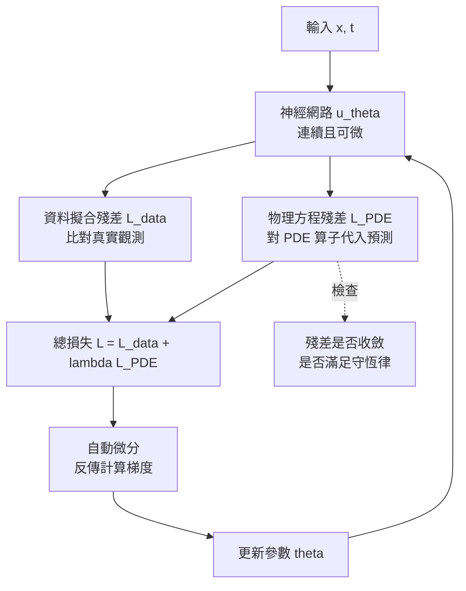

# 10.2 「物理幻覺」對齊：如何避免違反能量守恆與動量定理（Physics-Informed Loss）

## 一、物理幻覺的樣貌

生成式模型的失敗模式裡，有一種特別令人不安：它的輸出在視覺上完全說得過去。杯子沿著直線滑向桌面邊緣、然後平順地穿過桌面落到地上，畫面裡沒有任何撕裂或閃爍的跡象；一個被推出去的球在空氣阻力應該把它減速的地方卻越轉越快，甚至在沒有任何支撐的半空中懸停數秒；兩個物體在沒有外力的情況下相撞後，能量似乎憑空增加，彈開的速度大於接近的速度。

這種現象可以稱為**物理幻覺**。它與第 4 章談到的視覺幻覺有一個關鍵差異：視覺幻覺是局部的、可以用放大鏡找到的圖像瑕疵，而物理幻覺是**全域的、動態的、且在單幀上完全無辜**。單看任何一幀都沒有問題，問題只在把幀串起來做因果分析時才會浮現。這也是它長期未被自動評測捕捉到的原因。

物理幻覺的成因是多重的。模型是以像素重建的交叉熵或擴散噪聲匹配為目標的，這些目標函式完全不知道能量守恆的存在；訓練資料中真實的物理事件只是統計上罕見的事件，模型沒有足夠的信心把它學成規律；模型沒有內在的狀態觀念，因此無法區分「物體因為某個原因變慢」與「物體憑空變慢」。第 10.1 節已經說明，這些幻覺在閉環中會被系統性偏誤的機制放大。

## 二、為什麼守恆律是比像素指標更嚴格也更可驗證的約束

在評測生成模型時，主流的做法是算 FID、算 CLIP 分數、請人類評審比較「哪一張更像真實照片」。這套指標有兩個難以迴避的問題。第一，它需要人來判斷，而人類判斷既昂貴又不穩定；不同評審對「物理上是否合理」的標準差異極大。第二，也是更根本的，它測的是**外觀**，而不是**機制**。一張杯子穿過桌面的圖像，畫質可以完美無缺，FID 可以非常低。

守恆律恰好提供了一條不同的路徑。它的形式是明確的、可以寫成公式的，因此可以直接轉成**可解析檢查的判準**：把生成影片中的物體軌跡抽出來，估計動能與位能的變化，檢查在沒有外力作用的一段時間內，總機械能的變化是否落在容許誤差內。同樣地，可以對兩個物體的碰撞檢查動量守恆的殘差，可以對物體是否靜止在地面上檢查支撐條件是否成立。

這裡的關鍵差別是**可證偽性**。像素指標沒有明確的失敗定義——「這看起來不夠真實」無法被反駁；而「這段影片中物體的動能增加了三倍且沒有任何外力來源」是一個明確的事實陳述，理論上可以用程式自動判定，判定結果也可以被人工複核。這就是把物理約束引入世界模型的真正價值所在：它讓「這個模型是否可信」從一道品味題，變成一道稽核題。

守恆律還有一個常被低估的優點：它是**稀疏但強**的。像素層面的約束要求模型在千萬個維度上同時正確，而守恆律只要求少數幾個整合量正確。後者的學習難度遠低於前者，因此即使在生成能力受限的情況下，物理對齊仍可能帶來實質改善。第 5 章提到的「無分類器引導」正是這個思路的初步形態：不在像素空間硬加條件，而是在推導過程中用物理量把生成方向拉回來。

具體到本章標題所提的兩條守恆律，可以把它們寫成最簡單的形式。孤立系統中的能量守恆要求機械能在無外力功時保持常數：

$$
E_{\text{kin}} + E_{\text{pot}} = \text{const}, \qquad E_{\text{kin}} = \tfrac{1}{2} m v^2
$$

而兩物體碰撞過程中的動量守恆要求：

$$
m_1 v_1 + m_2 v_2 = m_1 v_1' + m_2 v_2'
$$

這兩個式子的檢查成本極低，只需要從生成影片中估計物體的質量、速度與高度。把這樣的檢查做成每次生成後自動執行的回歸測試，是把物理幻覺從「有人偶然發現」變成「系統持續監控」的最短路徑。

值得注意的是動量守恆與能量守恆並不等價：完全非彈性的碰撞守恆動量但不守恆機械能，超彈性的碰撞兩者都不守恆。因此當一個生成場景出現「能量增加」時，物理資訊損失能指出問題，但**哪一個物理量應該被犧牲**取決於碰撞的類型，這個判斷本身就超出了單純的殘差最小化。把碰撞類型作為條件輸入模型，是一個自然的延伸方向。

## 三、物理資訊網路的損失構造

最直接的物理對齊方法，是把控制方程寫進損失函數。假設我們對某個物理量 $`u(x, t)`$ 有一個偏微分方程描述其演化，例如擴散方程或波動方程：

$$
\frac{\partial u}{\partial t} = \mathcal{N}\!\left[ u \right]
$$

其中 $`\mathcal{N}`$ 是一個（可能非線性的）微分算子。把模型產生的軌跡 $`\hat{u}`$ 代入，定義**方程殘差**

$$
\mathcal{L}_{\text{PDE}} = \int_0^T \int_{\Omega} \left\| \frac{\partial \hat{u}}{\partial t} - \mathcal{N}\!\left[ \hat{u} \right] \right\|_2^2 \, dx \, dt
$$

於是總損失就是資料擬合項與物理殘差項的加權和：

$$
\mathcal{L} = \mathcal{L}_{\text{data}} + \lambda \, \mathcal{L}_{\text{PDE}}
$$

這個構造在數學上相當自然。關鍵在於**自動微分**提供了實踐它的橋樑：網路的參數 $`\theta`$ 與輸出 $`\hat{u}`$ 之間是連續可微的，而方程殘差本身也是 $`\theta`$ 的函數，因此 $`\partial \mathcal{L}_{\text{PDE}} / \partial \theta`$ 可以由自動微分鏈式法則計算出來。物理資訊網路（Physics-Informed Neural Network, PINN）正是把這個損失與資料損失聯合最佳化的代表方法，在求解偏微分方程的場景中展現了相當的效果。

在視訊生成的脈絡下，物理資訊網路與**神經常微分方程**（Neural ODE）有非常直接的對應關係。神經 ODE 把連續時間動力學寫成

$$
\frac{d z(t)}{dt} = f_\theta\!\left( z(t), t \right)
$$

其中 $`z`$ 是潛在狀態， $`f_\theta`$ 是由神經網路參數化的向量場。若我們對這個向量場施加物理結構——例如在無外力的自由段要求它正交於能量梯度，或者要求它保持某個李雅普诺夫函數不增——那麼物理資訊的損失函數就直接作用在向量場的參數上。把生成過程寫成 ODE 的好處是「連續時間的物理」被顯式地表達，而不是靠離散幀之間的隱式關係；代價則是求解成本與訓練的穩定性。

## 四、三種注入方式的比較

把物理知識放進模型，大致有三種做法，它們在保證強度、代價與適用範圍上各有不同。

| 注入方式 | 機制 | 保證強度 | 優點 | 代價與限制 |
| --- | --- | --- | --- | --- |
| 硬編碼物理引擎 | 以解析或數值積分器直接推進狀態 | 最強，物理成立是構造性的 | 可解釋、可稽核、誤差有界 | 只能覆蓋已知物理；建模成本高；難以處理複雜真實場景 |
| 軟約束損失 | 在訓練目標中加入物理殘差 | 中等，靠最佳化逼近 | 適用於連續場問題；自動微分直接可用 | 只能逼近，不保證；權重敏感；可能出現「殘差小但解不對」 |
| 後處理投影 | 生成後用物理規則修正輸出 | 取決於投影器 | 不需重訓模型；即插即用 | 只能修補表面特徵；修正可能破壞視覺連貫；無法處理隱性違反 |

三者並不互斥，實務上最常見的是組合：以軟約束訓練模型取得較好的先驗，再以後處理投影清理明顯的表面違規，最後在需要高保真的關鍵決策上用硬編碼引擎做最後的裁決。值得強調的是，軟約束之所以只是一種「趨近」，是因為殘差是被最佳化的對象而不是被強制滿足的條件；在訓練中，資料擬合項與物理項之間存在張力，模型可能在兩者之間取一個折衷點，而折衷點的位置由權重 $`\lambda`$ 決定。

## 五、嚴格性的邊界

物理資訊方法最容易被過度宣傳的地方，是人們常常把「方程殘差小」直接等同於「解在物理上可行」。這個等式是不成立的，至少有三個理由。

第一，**殘差小不等於邊界條件滿足**。偏微分方程的解由方程加上初值與邊界條件共同決定；模型可以在區域內部讓殘差趨近於零，卻在邊界上採用完全錯誤的數值。若初值條件本身就有誤差，方程解出來的東西可以完全不是對應物理過程的解。

第二，**多解問題**。許多物理方程在給定條件下並非唯一解，尤其在非線性區域；此時殘差小只保證「解集合中有一個成員」，不保證「是你要的那一個」。在視訊生成中，這對應到生成結果的多樣性與不可預測性——同一個場景守恆律成立，但物體的行為細節可能天差地別。

第三，**模型容量與訓練的相互作用**。當網路容量不足時，優化過程往往先滿足資料項再勉強壓低殘差，或者反之；最終得到的解可能是兩者的妥協，並且在訓練分佈之外迅速崩解。殘差小是在訓練樣本附近觀察到的現象，把它外推到分佈之外是沒有保證的。

## 六、守恆律之外還需要什麼

即使守恆律被嚴格滿足，物理上不可行的行為仍然可能出現。最典型的例子是**接觸不穿透**：兩個物體在運動過程中互相穿過，這個過程中動量守恆與能量守恆可能都成立（穿模前後速度連續），但它顯然不是物理上可能的。類似的還有一連串帶有「不等式」或「離散」性質的條件：摩擦力只能做負功而不能做正功、支撐力只能推而不能拉、兩個物體不能同時佔據同一空間、桌上的杯子不能無故懸空。

這些條件不能寫成平方殘差，因為它們是**不等式**或**整數約束**。可行域不是一個開集，因此不能用最小化殘差的連續最佳化方式自然地逼近。實務上的做法通常是把檢查寫成顯式的布爾條件並在訓練迴圈中作為違反懲罰，或者在後處理階段以投影方式強制滿足。這也解釋了為什麼第 5 章討論的物理引導在實作中往往需要「引導強度」這種人工調整的旋鈕：要讓模型自發地避開非法區域，必須給它一個明確的、與違例程度成正比的訊號。

## 七、自動化的物理違反檢測器

守恆律的另一個好處，是它們可以做成自動化的檢測器，作為模型品質的持續監測指標，而不是等到人工觀看影片才發現問題。一個可行的檢測器組合可以包含幾類。

**穿透偵測**在每一對可能接觸的物體間檢查軌跡的最小距離是否為零且持續穿透，並檢查是否出現互相嵌入的體積比例。**能量監測**對無外力作用的路段計算動能加位能的時間變化，檢查其相對變化是否落在容許誤差內。**支撐檢查**則確認處於靜止狀態的物體是否都有可辨識的支撐面，以及支撐力方向是否與重力反向。

這些檢測器可以作為獨立於生成模型之外的第三方工具存在，這一點在安全攸關的系統中特別重要：它們不需要理解場景語意，只需要量測軌跡，因此誤報率低、可解釋性高，而且能以串流方式連續運作。它們無法告訴你「車該往左還是往右」，但可以可靠地告訴你「剛才那個模型生成的杯子穿過了桌面」。這種分工正是第 10.3 節要發展的安全架構的雛形。

把檢測器組成一套指標體系，還能帶來一個額外的好處：它讓模型之間的比較有了共同的客觀語言。在傳統的視覺評測裡，兩款模型誰比較好往往取決於評審當天的狀態；而「每千幀的穿透次數」與「無外力路段的相對能量漂移」這樣的數字，是可以跨團隊、跨時間比較的。當物理約束成為發布流程的一部分，模型開發的節奏也會隨之改變：每次訓練產出的檢查報告可以立刻指出哪一類場景仍然失守，修正方向因此變得明確。

當然，檢測器自身的可靠性同樣需要校準。軌跡抽取代演算法本身的誤差會以系統性的方式傳遞到檢測結果裡——如果抽取器在遮擋場景下慣性地把兩個物體的軌跡接續起來，檢測器就會把「軌跡跳躍」誤判為「穿透」。因此檢測器應當在人工標註的真實片段上先行驗證其靈敏度與誤報率，才能作為有效的迴歸指標。

## 八、誠實評估

最後必須把話說清楚：物理資訊方法在**視訊生成**上的應用，目前仍屬於初步階段，收益有限。原因是多重的。守恆律在連續場問題上的形式相對簡潔，但在視訊生成中，狀態是**多物體、帶接觸、带摩擦、带遮擋**的複雜系統；把這樣的系統寫成可微的殘差，本身就是一個困難的研究問題。許多示範工作只在受控的單一場景（例如單球在平面上滾動）上驗證，這類驗證無法外推到真實的複雜場景。

此外，物理約束與生成品質之間存在真實的張力。過度嚴苛的物理約束會壓縮模型的表達空間，讓所有生成結果都朝同一個「安全而平庸」的區間塌縮，這在視覺上表現為缺乏多樣性——而多樣性正是擴散模型相對自迴歸的優勢所在。在可用素材有限的領域，這個代價尤其明顯。

因此最誠實的定位是：物理資訊對齊是**一條必要的方向，但目前不是解決方案**。它能把某些類別的物理幻覺顯著壓低，卻無法把生成模型變成一個可信的物理模擬器。第 10.1 節提出的判準在此仍然適用：加了物理約束之後，真正該問的問題不是「殘差降了多少」，而是「閉環使用下的長期一致性是否變好了」。

而一旦把世界模型放進真實的、會傷人的閉環裡，「還有多少長尾情境完全沒有被考慮」這個問題就會從學術好奇變成生死攸關。第 10.3 節要處理的，正是自動駕駛領域中這個問題的具體形態：端到端架構在長尾分布上的表現，以及世界模型作為一個「在腦中生成罕見情境並評估對策」的機制，能在多大程度上補上這塊缺口。
