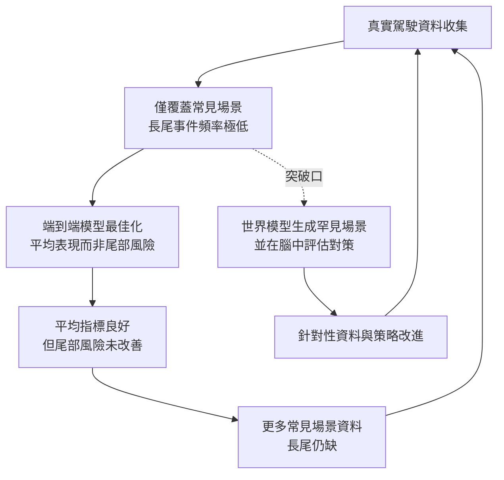
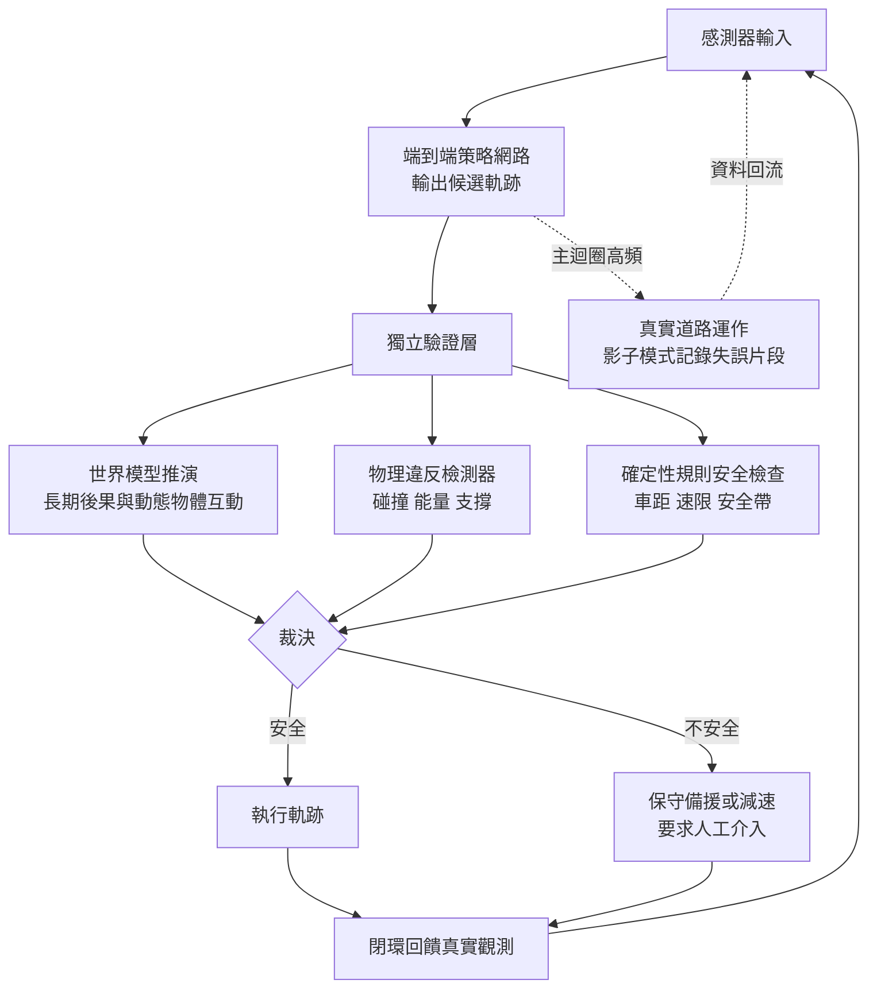

# 10.3 端到端自動駕駛的生死時速：極端邊界情況（Corner Cases）的安全想像與決策

## 一、架構的轉移：從模組化管線到端到端學習

過去二十年的自動駕駛系統基本上是模組化管線。感知模組負責辨識物件與估計深度，預測模組負責推估周圍動態物體的軌跡，規劃模組負責在幾何地圖與規則庫的限制下求解可行軌跡，控制的問題交給最後的控制器。這種架構的優點是每一個環節都可以被單獨檢查、被單獨歸因；當系統出錯時，事故報告可以指認是哪一個模組的哪一個判斷出了問題。它的缺點是同樣顯著：每個介面都是資訊的瓶頸，感知輸出的物體清單一旦漏掉一個障礙物，後面的規劃再精確也無濟於事。

端到端學習試圖把這條管線壓縮成一個從感測器輸入到控制指令的映射，直接用最終的行駛目標作為訓練訊號。這樣的架構有兩個難以反駁的優點。第一是**目標對齊**：模型學的是「要怎麼開」而不是「怎麼辨識」，所有中間表示都為了最終的駕駛品質服務。第二是**沒有介面損失**：模組化系統的每個介面都在丟棄資訊，也都在引入新的自由度，端到端把這些自由度一次移除。

代價同樣是結構性的。端到端模型的中間表示不再是語意可讀的物件清單與軌跡，而是一個無法直接檢查的內部向量；這使得「車為什麼在這裡煞車」變得難以回答，也使得事故分析失去了自然的著力點。更根本的是，模組化系統至少可以在每個模組上使用專門的方法與資料，端到端模型則把全部難度壓在資料分佈與目標函數的設計上。

## 二、邊界情況的統計學本質

在自動駕駛的語境裡，**corner case** 指的是那些罕見但真實存在、人類駕駛者能靠常識處理、而統計學習卻難以涵蓋的情境。一輛正在施工的車道旁邊散落著幾塊混凝土、一台工程車倒車時車尾伸出裝載物、一位穿著深色衣服的行人走在逆光下、一隻貓從車頭前方穿過——這些事件的共同特徵是：**它們在資料中的頻率很低，但在安全上的權重極高**。

這引出一個在統計學習與安全工程之間的尖銳對立。所有的平均指標——平均碰撞率、平均每英里接管次數、平均舒適度——都把罕見事件稀釋掉。假設某個系統在九成九的場景裡表現極佳，在剩下那百分之一的場景裡有百分之十會造成嚴重後果，那麼把這百分之一的機率加權進去之後，這個系統在風險意義上可能比一個平庸但穩定的系統更差。安全工程關心的是**分佈的尾部**，而機器學習的目標函式通常最佳化的是**分佈的中心**。

一個更令人不安的效應是資料收集的自我強化。車隊只會在系統表現良好或需要接管時取得有效資料，而真正需要學習的罕見情境往往在接管後就結束了——那些「幾乎出事」的片段如果被截斷，模型就永遠學不到「差一點點」與「差很多」的差別。於是資料越積越多，長尾卻沒有被填補。

## 三、世界模型為何是處理長尾的候選方案

世界模型在這個問題上的角色可以用一個對比來刻畫。統計學習處理長尾的傳統方法是**收集更多樣本**——而長尾之所以是長尾，正是因為樣本在真實世界中罕見，因此收集的成本極高甚至不可能。世界模型提出了不同的路徑：**如果罕見情境無法被收集，就把它生成出來**。

具體而言，世界模型能以三種方式支援長尾處理。第一是**場景擴增**：用擴散或自迴歸生成模型，依據真實資料學到的條件分佈，合成罕見但物理上合理的駕駛場景——雨夜加施工Cone、旋轉車廂的卡車、被部分遮擋的行人。這些合成樣本不必是攝影機拍到的樣子，只要它觸發了正確的決策反應，就有價值。第 9 章討論的合成資料策略，在自動駕駛的長尾問題上是直接可用的。

第二是**對抗式場景搜尋**：把場景參數化（例如他車的速度、橫向偏移、遮擋比例、路面附著力），然後用優化方法主動尋找那些讓當前策略最容易失敗的參數組合。這等於把「我們沒想到會發生什麼」轉換成「我們系統性地去找出什麼會讓我們出錯」，是一種以模型自身為對手的錯誤挖掘。

第三是**場景重構與風險評估**：在真實駕駛中遇到罕見情況時，世界模型可以把當下的場景重建為一個可模擬的內部狀態，然後在腦中展開數百條不同的未來，評估各個對策的後果。這是第 8 章的規劃能力在安全攸關領域的應用。

這三種用法在實現難度上是由低到高的。場景擴增只需要一個生成模型與一批條件控制介面，工程門檻最低，也最容易被外界檢視；對抗式搜尋需要把場景參數化並建立可微或可評分的目標，通常在模擬器內完成；場景重構與風險評估則要求模型能從真實感測器輸入即時建構出可模擬的內部狀態，並且這個狀態要足夠準確以致推演結論有意義。這一步實際上要求第 2 章的幾何表徵、第 3 章的物理先驗與第 7 章的動作條件化同時到位，因此它是三種用法中離「通用世界模型」最遠、卻也最具代表性的一種。

## 四、評測的困難：模擬器保真度與測試有效性

這三種做法都依賴一個前提：能夠在離線環境中反覆測試罕見情境。這就是模擬器與開迴圈測試的價值所在，也是它們最危險的地方。

模擬器必須同時滿足兩個互相牴觸的要求。第一是**保真度**：模擬出來的物理必須足夠接近真實，否則在模擬中通過的策略到了真實世界會失效。第二是**高效與可搜尋**：測試必須能夠跑得夠快、夠多，否則無法覆蓋長尾——如果每個場景要跑六小時，就不可能做大規模的對抗式搜尋。困難在於這兩者通常互相牴觸：最保真的模擬器往往是最慢的，而最快的近似模擬器正是誤差最大的那個。

更麻煩的是**測試有效性的自證問題**。一個在模擬器中找出上萬個失誤場景的系統，並不能保證它在真實世界中遇到的失誤已被覆蓋，因為模擬器本身就定義了「什麼是可能的場景」。模擬器中不可能出現的情境，優化過程永遠不會去探索；模擬器建模錯誤的地方，優化過程反而會去充分地利用。這意味著模擬器的系統性偏差會被對抗式搜尋**放大**而不是抵消。緩解之道有幾種：把多個不同來源的模擬器組成一個聯盟並取其最保守的行為、在真實資料上以虛擬實境方式補上模擬器缺失的現象、以及定期用真實道路的「影子模式」來檢驗模擬器的統計覆蓋度——但沒有任何一種方法能保證沒有遺漏。

另一個層次上的困難是**指標問題**：如何衡量系統對罕見情境的反應？一個模型在場景庫上的平均碰撞率下降，可能只是因為它變得更保守而不是更正確；而碰撞率若定義為「任何接觸」，就無法區分輕微擦碰與致命撞擊。合理的做法是把場景依「預測難度」分層，觀察模型在每一層上的表現曲線，而不是只看總平均，並且把那些只有在真實世界才出現的場景單獨標記出來。

還有一個容易被低估的維度是**時間覆蓋**。一次性的場景測試衡量的是模型在該場景上的反應，但安全真正考驗的是「連續幾百秒的行為序列」——模型可能每一步都合法，累積起來卻把車帶進一個危險狀態。這正是第 10.1 節閉環一致性的概念在駕駛領域的直接對應，因此評測必須以連續模擬或閉迴圈仿真來進行，而不能只跑一堆獨立的短片段。

## 五、安全架構：世界模型作為獨立的驗證層

把上述討論收攏成一個可落地的架構，關鍵的設計選擇是**層間職責的分配**。一個合理而且正在被廣泛討論的設計是：讓端到端模型負責高頻率的行為輸出，但把它的預測交給一個獨立的驗證層檢查，驗證層則由確定性規則與世界模型共同組成。

具體的流程大致是這樣：端到端模型每個規劃週期產出一組候選軌跡；驗證層取出這些軌跡，交給世界模型推演它們在當前場景下的長期後果，並且與第 10.2 節那類物理違反檢測器並行運作；一旦推演結果顯示某條軌跡會導致與動態物體的碰撞、穿越實體障礙、或在物理上不可行，確定性的安全層就介入裁決——例如觸發減速、要求人工接管，或直接改用一條保守的備援軌跡。

這個分層設計的思想與航空業的冗餘設計、以及形式化驗證中的「假設-保證」分解同源：**不在於讓每個組件都完美，而在於讓失效模式互不重疊，並且讓失效能被偵測**。端到端模型的失效模式是長尾情境下的錯誤決策；規則層的失效模式是人類沒有想到要寫的規則；世界模型的失效模式是它自己也會在罕見情境下預測錯。因此三者都需要被獨立評估，並且要有明確的裁決權責——誰有權否決誰的輸出，這個問題在工程上比演算法更決定成敗。

同時必須承認，世界模型作為驗證層有它自己的侷限：它推出的「碰撞」是**預測的碰撞**，不是真實的碰撞；驗證層若過度依賴世界模型，就等於用一個不可靠的東西去把關一個不可靠的東西。因此合理的做法是把世界模型設定為**否決權而非核准權**：它可以讓一條軌跡被擱置（成本低、副作用可控），但它的認可不足以放行一條軌跡。放行仍需要確定性規則與真實感知的一致。

## 六、監管與責任

自 2020 年以來，自動駕駛事故與監管的討論在多個司法管轄區都明顯升溫。據公開報導，涉及自動駕駛系統的事故報告程序中，製造商與營運商都面臨必須提交詳細事件記錄與系統狀態的要求；監管焦點也從單純的「允不允許上路」轉向「在什麼條件下允許、何種系統設計被要求、發生事故後責任如何劃分」。與此同時，部分地區已建立分級的自動駕駛測試與部署許可制度，把「在哪裡測試、測試什麼、用什麼標準判定能力」明確寫成規範。

值得注意的是，這個方向並不必然意味著「端到端被否定」。模組化與端到端在多數管轄區的法規中並未被依架構區分，強調的重點是責任歸屬與證明義務。這對世界模型反而是有利的，因為世界模型提供的正是**可稽核的證據鏈**：它在決策當下推演了什麼、依據什麼、推論的置信度如何。這類記錄在事故分析中遠比一個無法解讀的內部向量有價值。

當然，責任歸屬的問題不會因為架構選擇而自動解決。若世界模型被用於放行一個危險決策，它就承擔了部分功能性的責任，而它的可靠性仍遠低於人。這一點在法律與工程上都尚未定案，也提醒我們不要把「更先進的架構」誤認為「更安全的架構」。

## 七、誠實評估

最後同樣要把話說清楚：端到端學習與世界模型都**無法消除長尾風險**。世界模型能夠生成更多罕見場景，但它的生成本身就是有限的——它生不出資料裡完全沒有的物理現象，也生不出它自己架構所不理解的互動機制。對抗式搜尋能找到「在模型的世界裡」的失敗，但真實世界的失敗空間比模型的世界更大。

因此工程上唯一站得住腳的答案是多層冗餘：端到端模型提供行為的靈活與性能，世界模型提供前瞻性的風險掃描，確定性規則提供不會被統計偏差侵蝕的底線，保守模式與人工接管提供最後的保險。這四者不能互相取代，它們的價值恰恰來自失效模式的不重疊。

而把範圍再放大一格會看到更普遍的教訓：第 10.1 節的複合誤差、第 10.2 節的物理幻覺、第 10.3 節的長尾情境，是同一個問題的三種表現——**一個內部模型在真實世界中長期使用時，如何被真實世界不斷糾正**。自動駕駛是一個把這個問題推到生死極端的領域，但它並非唯一，也不應是終點。第 10.4 節要做的，是把視線從單一應用拉回全景，描繪通用世界模型的完整藍圖，並且老實地指出其中三個至今未解的根本性問題。
